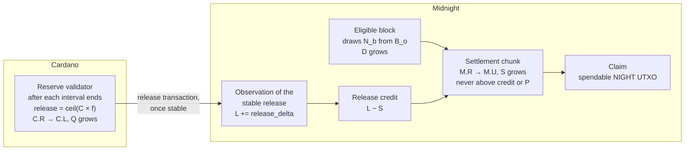

<!--
 Copyright Midnight Foundation

 Licensed under the Apache License, Version 2.0 (the "License");
 you may not use this file except in compliance with the License.
 You may obtain a copy of the License at

     https://www.apache.org/licenses/LICENSE-2.0

 Unless required by applicable law or agreed to in writing, software
 distributed under the License is distributed on an "AS IS" BASIS,
 WITHOUT WARRANTIES OR CONDITIONS OF ANY KIND, either express or implied.
 See the License for the specific language governing permissions and
 limitations under the License.
-->

## Abstract

This proposal defines how NIGHT reserved on Cardano is released, and observed by Midnight, to back
native Midnight block rewards, without Cardano learning anything about Midnight. The Cardano Reserve
contract releases NIGHT from the Cardano Reserve state (`C.R`) into the protocol-locked state
(`C.L`) on a fixed schedule: once each release interval of Midnight slots has ended by Cardano's
clock, it releases the published reward curve's maximum draw for that interval. Midnight observes
each stable release and creates an equal amount of release credit. Native settlement may make
rewards claimable only by consuming that credit.

Midnight produces at most one block per slot, and each reward-eligible block draws a fixed fraction
of the outstanding reward Reserve, so while both chains apply the same policy the scheduled release
covers what Midnight has earned by the end of each interval. Midnight never unlocks more than Cardano has released, so the
cross-chain supply invariants hold with no proof of Midnight state on Cardano. The cost is a timing
difference: NIGHT released for slots in which no eligible block drew it leaves the Cardano Reserve
before it is earned. It stays protocol-locked on Cardano, Midnight's own outstanding Reserve remains
the exact basis of the reward formula, and later draws consume almost all of it.

This proposal specifies the release schedule and its arithmetic, the Cardano release transition,
Midnight observation, rollback handling, coordinated parameter updates, operational funding, public
evidence, and migration. It does not allocate rewards among operators and their delegators or
stakers, or define recipient claims; those are specified by the linked native-rewards MIP. Rewards
of both operator kinds, ADA SPOs and NIGHT-native SPOs, settle against the same release credit.

## Motivation

NIGHT is native on both Cardano and Midnight. During the initial Reserve-control phase, the
Cardano Reserve holds the authoritative uncirculated supply while Midnight pays native rewards.
The published tokenomics requires Midnight to observe Cardano releasing Reserve tokens before the
corresponding Midnight NIGHT becomes protocol-unlocked, and states that the cross-chain invariants
"hold even when Cardano cannot observe Midnight".

Releasing exactly what Midnight has earned would require Cardano to know what Midnight has earned.
That means proving Midnight state to a Cardano contract through a light client, a proof pipeline
and a funded data pump, and it makes the Cardano Reserve trust Midnight's committee for every
release. Cardano needs none of that if the Reserve releases on a schedule that can never fall behind
what Midnight can earn. Midnight then enforces exactness on its own side: settlement consumes
release credit, so no NIGHT becomes unlocked on Midnight before Cardano has released it, and none
beyond what Midnight's blocks have earned.

The published curve gives such a schedule. Each eligible block draws a fixed fraction `R` of the
outstanding reward Reserve, and Midnight produces at most one block per slot, so the most Midnight
can draw in `K` slots is the fraction `1 - (1 - R)^K` of what was outstanding. A Cardano release of
at least that fraction of its own remaining reward Reserve, once each interval of `K` slots has
ended, therefore covers Midnight's earnings whenever both chains apply the same parameters. It is also bounded: Cardano never releases more
than the curve allows for the time elapsed.

A release based only on elapsed time runs ahead of rewards actually earned during missed slots and
slots held by ineligible producers. This proposal accepts that timing difference, makes it public,
and keeps it from affecting the reward calculation. Delayed release remains a visible liveness
failure rather than a monetary ambiguity.

## Specification

### Normative sources and units

The initial deployment MUST identify by stable URL, publication date, and SHA-256 digest:

1. the notified NIGHT MiCA white paper; and
2. the approved Midnight Tokenomics and Incentives Whitepaper edition.

If an implementation choice would contradict a representation about total supply, the Reserve,
reward source, token states, or the base reward, activation is prohibited until the accountable
Foundation, TGE, governance, and legal owners resolve the conflict in a published decision.

`STAR` is the smallest NIGHT unit, and one NIGHT is 1,000,000 STAR. Every value in this proposal is
an unsigned integer number of STAR. No consensus or contract calculation uses floating point.

### State model

During the Cardano-control phase:

- `C.R` is NIGHT held in the Cardano Reserve and not in circulation;
- `C.L` is NIGHT protocol-locked on Cardano;
- `M.R` is the mirrored Midnight Reserve balance;
- `M.U` is protocol-unlocked NIGHT on Midnight;
- `B_o` is the canonical outstanding reward Reserve on Midnight, used for the next native reward
  calculation;
- `D` is the cumulative finalized base draw earned by eligible Midnight blocks;
- `Q` is the cumulative NIGHT released by the Cardano Reserve contract;
- `L` is the cumulative release observed stable by Midnight;
- `S` is the cumulative release consumed by Midnight native settlement;
- `P = D - S` is earned value not yet settled; and
- `released_credit = L - S` is observed release not yet consumed by settlement.

At activation:

```
D = 0
Q = 0
L = 0
S = 0
B_o = initial_reward_reserve
C.R = initial_reward_reserve
```

After activation, the following MUST hold in the state of every finalized Midnight block for the
same policy version:

```
initial_reward_reserve = B_o + D
0 <= S <= D
S <= L <= Q
C.R = initial_reward_reserve - Q
released_credit = L - S
C.R <= M.R
M.U <= C.L
```

`Q` is Cardano state, and `L` trails it only by releases not yet stable. Midnight's Reserve moves
only through settlement, so `M.R = initial_reward_reserve - S`; since `S <= L <= Q`, this gives
`C.R <= M.R`, and settlement moves into `M.U` no more than Cardano has moved into `C.L`. That
preserves `M.U <= C.L` given that it holds at activation, which the activation state checks, and
that ordinary bridge movements preserve it on their own (Open Question 6). An
implementation MAY store equivalent cumulative or delta values, but all public reconciliation
interfaces and test vectors use the definitions above. Any finalized state that fails these
identities is inconsistent and MUST halt settlement.

While both chains apply the same policy to the same slots, the schedule in **Release schedule** also
guarantees *coverage*: once Midnight has observed
the release for an interval, `L` is at least the cumulative draw of every block in that interval and
earlier ones. Coverage is a liveness property. Its failure would delay claims; it cannot unlock unbacked
NIGHT, because settlement never exceeds `released_credit`. A coverage failure means the two chains
disagree about parameters, so it halts settlement (see **Rollback and inconsistency handling**).

`L - D`, when positive, is *undrawn release*: NIGHT released for slots in which no eligible block
drew the curve's maximum. It is protocol-locked on Cardano and backs Midnight release credit that
no entitlement has yet claimed.

At the best-chain head, `B_o` also reflects draws by blocks that are not yet finalized. Fork choice
may roll those draws back, so the identities above are required only of finalized state.

Value moves through these states as follows. Each arrow is specified in the sections below. No
arrow runs from Midnight to Cardano.



### Release schedule

Both chains measure time in Midnight slots. Slot `s` begins at
`midnight_slot_zero_posix_ms + s * slot_duration_ms`, and Midnight consensus produces at most one
block per slot. The slot duration is the same for every policy version under this MIP; a change of
slot duration requires a superseding MIP.

Releases cover consecutive *release intervals* of `K = release_interval_slots` slots. The first
interval starts at `anchor_slot`, the slot of the reward activation block, and each interval starts
where the previous one ended. A block belongs to the interval containing its slot.

Each policy version fixes a *release factor* `f = release_factor_n / release_factor_d`. It is the
smallest rational with the published denominator `release_factor_d` such that

```
f >= 1 - (1 - R)^K
```

where `R = distribution_rate_n / distribution_rate_d` is the per-block base distribution rate of
the native-rewards MIP. `f` is computed exactly off-chain and ratified with the policy version as a
normative vector, so the Cardano validator never evaluates a power.

The Reserve contract keeps `curve_remaining`, which starts at `initial_reward_reserve` and always
equals the reward NIGHT still in `C.R`. The release for an interval is:

```
release_delta  = min(curve_remaining, ceil(curve_remaining * release_factor_n / release_factor_d))
curve_remaining = curve_remaining - release_delta
```

**Coverage.** Suppose that at the start of an interval Midnight's outstanding Reserve satisfies
`B_o >= curve_remaining`. The interval contains at most `K` eligible blocks, each drawing
`floor(B * R) <= B * R` from the balance `B` before it, so at the end of the interval

```
B_o' >= B_o * (1 - R)^K >= curve_remaining * (1 - f) >= curve_remaining - release_delta
```

which is the next `curve_remaining`. Both start at `initial_reward_reserve`, so by induction
`B_o >= curve_remaining` at every interval boundary. Since `D = initial_reward_reserve - B_o` and
`Q = initial_reward_reserve - curve_remaining`, the cumulative draw of all blocks up to an
interval's end never exceeds the cumulative release once that interval is released. The induction
holds across policy versions because a new version takes effect only at an interval boundary on
both chains (**Monetary parameters and coordinated change**).

**Undrawn release is almost entirely a timing difference.** Where slots pass without an eligible block,
`curve_remaining` falls faster than `B_o`. The larger `B_o` makes later eligible draws larger, and
`D` approaches `Q` over time. None of it can be settled except against earned entitlements. A small
residual is never drawn: once `B_o * R` falls below one STAR, every draw floors to zero, so about
`1/R` STAR of `B_o` stays undrawn while `curve_remaining` reaches zero (about 62.6 NIGHT at the
illustrative rate). What happens to that residual is part of Open Question 3.

Near exhaustion, the ceiling releases at least one STAR per interval while Midnight's floored draw
reaches zero. When `curve_remaining` is zero, no release is valid.

### Cardano Reserve release transition

The Reserve contract stores at least:

```
ReserveRewardStateV1 {
    policy_version:                  u32,
    policy_hash:                     bytes32,
    initial_reward_reserve_star:     u128,
    release_factor_n:                u128,
    release_factor_d:                u128,
    release_interval_slots:          u64,
    curve_remaining_star:            u128,
    cumulative_released_star:        u128,
    next_interval_start_slot:        u64,
    anchor_slot:                     u64,
    midnight_slot_zero_posix_ms:     u64,
    slot_duration_ms:                u64,
    max_validity_window_ms:          u64,
    midnight_network_id:             bytes,
    release_destination:             credential,
    paused:                          bool,
    staged_policies:                 list<StagedPolicyV1>,
}
```

`StagedPolicyV1` holds a policy version, its policy hash, that version's release factor and release
interval, and its `activation_slot`. The policy hash also commits to the version's Midnight-only
contents, such as the distribution rate and the stability rule. The fields above without a
`staged_` prefix describe the active version, and a version number can be staged only once. At
most one version is staged at a time. A version can be staged only while no other version is
staged, and only if its `activation_slot` is the start of a future interval under the active
version, at least `min_staging_lead_slots` after the staging transaction's validity interval; `min_staging_lead_slots` is a ratified constant of at least one complete Midnight epoch
plus the Cardano stability window. `anchor_slot` never changes. `max_validity_window_ms` is a
ratified constant bounding the width of a release transaction's validity interval.

Anyone MAY submit a release. The validator accepts it only if:

1. releases are not paused;
2. `curve_remaining_star` is greater than zero;
3. the transaction's validity interval is no wider than `max_validity_window_ms`, and its lower
   bound is no earlier than the end of the interval starting at `next_interval_start_slot`, that is
   `midnight_slot_zero_posix_ms + (next_interval_start_slot + release_interval_slots) *
   slot_duration_ms`;
4. if a staged version's `activation_slot` equals `next_interval_start_slot`, that version becomes
   active and leaves `staged_policies` before the release is calculated, and rules 3, 5 and 7 use
   its release factor and interval;
5. `release_delta` is calculated as in **Release schedule** with checked arithmetic;
6. the transaction reduces `C.R` by exactly `release_delta` and increases `C.L` at the configured
   protocol destination by exactly the same amount;
7. the continuing state reduces `curve_remaining_star` and increases `cumulative_released_star` by
   `release_delta`, advances `next_interval_start_slot` by one release interval, and changes no
   other field except the activation in rule 4;
8. the network, initial Reserve, slot constants and destination match state; and
9. no NIGHT or value is paid to the submitter from the Reserve.

Each transaction releases one interval. After an outage, the missed intervals are released by
consecutive transactions, in order, and none can be released before it has ended. Rule 3 ties every
release to elapsed real time, so Cardano never releases more than the published curve's maximum for
the time that has passed. A release never distributes per-recipient rewards on Cardano.

### Release destination and classification

The destination is the configured protocol-locked Cardano credential used by the native NIGHT
cross-chain system, such as the ICS credential selected for deployment. The exact script hash,
asset policy, asset name, and datum encoding are activation parameters published with the contract
artifacts.

Release classification MUST positively identify the Reserve input, active validator version,
NIGHT asset, continuing state datum, and configured destination. Absence of metadata is never
sufficient to classify a transaction as a Reserve release. Wrong-script, wrong-asset, ambiguous, or
partially matching transactions provide no Midnight credit. Midnight observes every spend of the
Reserve under the same stability rule; a spend that is not a valid release, staging, pause, or
published upgrade transition is an unexpected Reserve spend (see **Rollback and inconsistency
handling**).

### Mainnet reference values

The following mainnet values were observed on 2026-10-26. They are provisional: each MUST be
re-checked against both chains at the activation block and ratified with the initial policy
version, and a value that has changed by then replaces the one shown here.

| Item | Observed value |
|---|---|
| NIGHT on Cardano | policy `0691b2fecca1ac4f53cb6dfb00b7013e561d1f34403b957cbb5af1fa`, asset name `NIGHT` (`4e49474854`) |
| Reserve validator | `addr1w950c5zxn5fhwlauvpy3ssk287q0qlwz6e2zc4gaj62vaxsy3s9p0`, script hash `68fc50469d13777fbc60491842ca3f80f07dc2d6542c551d9694ce9a` |
| Reserve two-stage upgrade policy | `d24b012f7b2a99a671b7e1196847f183982d70db02ed37068e4e49e9` |
| Reserve NIGHT | 6,000,000,000,873,988 STAR in UTXO `03b5d301678204ee48c7f93d3446fd4ad0427da6d1966e8d3df423c720657b0e#0`, unspent |
| Illiquid circulation supply (ICS) validator, the candidate release destination | `addr1wyczfpxfnf5hvp36mrn655ye4k2cwluvlez6phx8jx46k6s2ttdaq`, script hash `302484c99a6976063ad8e7aa5099ad95877f8cfe45a0dcc791abab6a` |
| ICS two-stage upgrade policy | `8f2c043f857c6acb716d27d67e9cb609c9c9814b7d7b938d6c410733` |

The Reserve UTXO is the one from which Midnight's genesis set its `reserve_pool` to the same
6,000,000,000,873,988 STAR, and the amount equals the Reserve allocation in the tokenomics white
paper (25% of supply, including a 873,988 STAR Scavenger Mine remainder). The provisional
`initial_reward_reserve` is therefore 6,000,000,000,873,988 STAR. Midnight's current
`reserve_pool` has not been read directly, because no public interface exposes it; it remains at
its genesis value unless a `DistributeReserve` or `UnlockToReserve` system transaction has run,
which MUST be confirmed at ratification.

### Midnight observation

Midnight accepts a release only after the Cardano transaction is stable under the active Cardano
stability rule; the native-rewards MIP calls such a release finalized. Each observation records:

```
ReserveReleaseObservationV1 {
    policy_version:               u32,
    cardano_transaction_id:       bytes32,
    reserve_input_reference:      cardano_utxo_id,
    interval_start_slot:          u64,
    release_delta_star:           u128,
    cumulative_released_star:     u128,
    curve_remaining_star:         u128,
    cardano_block_hash:           bytes32,
    cardano_block_number:         u64,
    observed_at_midnight_block:   u64,
}
```

The runtime validates the Cardano transition independently of the submitter and accepts it only
once. It recomputes `release_delta_star` from the previously observed `curve_remaining_star` and
the active policy, and requires the interval to start where the previously observed one ended. A
gap stops later observations until the missing transition is supplied. A duplicate is idempotently
rejected. A Cardano reorganization before stability creates no credit.

When a valid observation is committed, Midnight increases `L` and `released_credit` by
`release_delta_star`. It does not credit a recipient or change `M.U` merely by observing the
transaction. Native settlement under the linked MIP consumes release credit atomically with the
corresponding `M.R -> M.U` transition.

Midnight checks coverage after committing the observation for an interval, and again whenever a
block in an already released interval becomes finalized: the cumulative draw of all finalized
blocks up to that interval's end MUST NOT exceed `L`. Coverage counts slots, not time, so it can
fail only if the two chains applied different parameters to the same slots, or through a fault. A
coverage failure halts settlement (see **Rollback and inconsistency handling**).

Midnight also observes, under the same stability rule, every change to the Reserve state's
`staged_policies`, recording each newly staged policy version, its hash and its activation slot.
The coordinated update procedure in **Monetary parameters and coordinated change** relies on this
observation.

### Rollback and inconsistency handling

Cardano observations use a stability window selected so that ordinary rollback is handled before
credit exists. If a previously stable release is later absent because of an exceptional rollback or
consensus failure, the runtime MUST automatically halt new reward settlement. It MUST NOT subtract
already claimed NIGHT, fabricate a compensating release, or silently adopt a different Cardano
history.

Recovery requires a published incident reconciliation identifying the last common observed
release, Cardano Reserve state, Midnight consumed credit, and resulting invariant status. Any state
repair or exceptional governance transition requires its own auditable action, and it can change
who owns an entitlement, or reduce one, only through the actions listed in **Entitlement
ownership** of the native-rewards MIP's Security Considerations.

If any of the reconciliation identities fails, coverage fails, or Cardano reports an unexpected
Reserve spend, native settlement halts closed. Reward calculation MAY continue if `B_o` remains unambiguous,
causing `P` to grow, but no new value becomes claimable.

Midnight's Reserve is held to the same rule as Cardano's. After activation, `M.R` moves only
through a settlement chunk of the linked native-rewards MIP. Any other debit or credit of
Midnight's `reserve_pool`, including a `DistributeReserve` or `UnlockToReserve` system transaction
issued outside the reward-specific executor, is an unexpected Reserve movement: native settlement
halts closed until a published incident reconciliation accounts for it.

### Monetary parameters and coordinated change

The symbols `pi`, `B`, `T`, `R_a`, `gamma`, and `R` are defined, with their derivation, in
**Tokenomics parameters** of the native-rewards MIP. The initial policy version contains:

- the exact source-document digests;
- `initial_reward_reserve`;
- annual base distribution rate `R_a`;
- expected blocks per year `gamma`, derived from the active slot duration;
- per-block rate `R = R_a / gamma` in reduced rational form;
- the release interval `K` and the release factor `f`, with the vector that derives `f` from `R`
  and `K`;
- the slot constants, `anchor_slot`, and `min_staging_lead_slots`;
- the Cardano stability rule; and
- the activation slot, which becomes `anchor_slot`, and the Cardano validity interval.

The Foundation/economics owner and the applicable governance authorities MUST ratify the initial
values and normative vectors before either linked MIP moves to `Proposed`.

`R_a` and `R` change only together, and `f` must be re-derived whenever `R` or `K` changes. Slot
duration, `gamma`, initial Reserve, denomination, and destination cannot be changed by a policy
version at all; they change only through a superseding MIP (see **Release schedule** and
**Tokenomics parameters** of the native-rewards MIP). A coordinated update uses a prepared policy version containing
both the Cardano and Midnight configuration, identified by its policy hash, and an activation slot.
Activation is ordered, Cardano first, and both chains switch at the same slot:

1. Cardano governance adds the version to `staged_policies` with an `activation_slot` that starts
   a future interval at least `min_staging_lead_slots` ahead. Staging does not change release
   behaviour. A staged version cannot be withdrawn, and no other version can be staged until it
   activates.
2. Midnight observes the staging, stable under the Cardano stability rule, and schedules the
   version for the first block whose slot is at or after `activation_slot`. The scheduled version
   MUST be newer than every version Midnight has already scheduled or activated. Midnight computes
   rewards from that block under the new version. If Midnight first observes a staging after its
   activation slot has passed, it does not activate the version mid-interval; it halts settlement
   and the incident procedure applies.
3. Cardano applies the version to the release for the interval starting at `activation_slot`
   (rule 4).

```mermaid
sequenceDiagram
    participant G as Cardano governance
    participant R as Cardano Reserve contract
    participant M as Midnight
    G->>R: Stage version v with activation slot A, at least the minimum lead ahead
    R-->>M: Staging of v observed, stable under the Cardano rule
    M->>M: Schedule v for the first block at or after slot A
    Note over M: v newer than every scheduled or active version
    M->>M: Compute rewards from slot A under v
    R->>R: Release for the interval starting at A uses v (rule 4)
    Note over R,M: Both chains switch at slot A; Cardano never waits for Midnight
```

Midnight never activates a version that Cardano has not staged, and Cardano needs no signal from
Midnight to switch, so in normal operation both chains apply each version to the same slots. The lead time exceeds the
Cardano stability window, so a divergence requires an observation outage longer than the lead
time. In that case coverage may fail, and Midnight raises an alert and halts settlement until a
published reconciliation resolves it; supply remains safe because settlement never exceeds release
credit.

An update cannot change historical draws or releases. A Cardano logic upgrade MUST carry
`staged_policies` forward unchanged. Subsidy-rate changes that do not change total `N_b` are
governed by the native-rewards MIP and do not require a Cardano monetary update.

### Pause, upgrade, freeze, and transfer of control

The emergency pause may prevent new Reserve releases but cannot spend, redirect, confiscate, or
rewrite the Reserve and cannot invalidate already accepted releases. While paused, intervals keep
ending; after resumption they are released in order, so a pause delays claims but does not change
the schedule. Pausing is a safety action, not a recovery procedure; public monitoring MUST
distinguish it from normal operation.

Before any Cardano logic upgrade, implementations MUST publish the new script hashes, state
migration, policy compatibility, audit evidence, and rollback plan. The two-stage Cardano governance
procedure of MIP-0024's Reserve upgrade model remains applicable.

This MIP does not mandate an irreversible freeze. Freezing the Reserve logic is permitted only
after an external audit and an explicit governance decision that records:

- how later transfer of Reserve control to Midnight remains possible;
- which monetary and destination values become immutable;
- how defects discovered after freezing are handled;
- whether any permanent mitigation check is installed; and
- legal confirmation that the frozen behavior remains consistent with the notified disclosures.

Moving control from `C.R` to `M.R` reverses the direction of relevant cross-chain invariants and is
outside this proposal. It requires a separate Core MIP and migration, which must also account for
any undrawn release outstanding at that time.

### Transaction fees and release liveness

Submitting a Cardano release transaction costs ADA. Version 1 gives the reward-release flow its own
Cardano funding-pool UTXO, whose validator pays fees up to a governed `max_fee` only for valid
Reserve release transactions. Any party MAY act as a release keeper and submit the oldest
unreleased interval; the Reserve state's `next_interval_start_slot` makes one submission win and the
others stop retrying. Anyone may also submit a valid release with their own ADA. Reserve NIGHT is
never used to reimburse a submitter.

Operations MUST define and monitor:

- release lag, the number of ended intervals not yet released;
- minimum funding-pool ADA balance and refill owner;
- Cardano stability latency;
- released-credit and native-settlement backlog;
- coverage status and undrawn release; and
- alert and pause procedures.

Operations MUST also publish a claimability objective: the number of epochs within which a finalized
entitlement normally becomes claimable, ratified with the initial policy version. Under normal
operation it is at most one release interval, plus the Cardano stability window, plus the settlement
backlog. It is a service target, not a protocol rule. No transition may relax a release,
observation, or settlement check to meet it, and missing it triggers the alert and escalation
procedures above.

The keeper is not trusted for safety: it cannot change a release amount, interval or destination.
Failure delays claimability but does not change entitlement ownership or amount. An empty funding
pool stalls funded submissions and loses no NIGHT; monitoring and permissionless self-funded
submission provide recovery paths.

### Public query and evidence interface

The Midnight runtime API and the indexer, which also projects Cardano Reserve state and
transactions, expose batch-capable queries for:

- active and staged policy versions, their activation slots, and document digests;
- current `B_o`, `D`, `Q`, `L`, `S`, `P`, `released_credit`, and undrawn release;
- schedule state: `curve_remaining`, the next interval to release, and release lag;
- Cardano release transaction, Reserve input/output, destination, and stability status;
- Midnight observation and consumption by settlement chunk;
- coverage status per interval, pause state, and upgrades; and
- reconciliation status and the first inconsistent transition, if any.

An indexer is a historical projection, not proof. A verifier using its own Cardano and Midnight
nodes MUST be able to reconstruct every release, observation, and release-credit consumption from
finalized public data.

### Versioning

All records and encodings in this proposal carry version 1, denoted by the `V1` suffix of the
type name and encoded as a leading version tag, as in the native-rewards MIP. Unknown versions
are rejected. A change to the schedule's meaning, release calculation, destination classification,
observation, denomination, reconciliation, or update coordination requires a superseding MIP and
the applicable Cardano and Midnight upgrades.

## Rationale

A scheduled release is chosen because it needs no knowledge of Midnight on Cardano. No light
client, proof, or committee is trusted for Reserve movement, and the Reserve contract checks only
its own state and Cardano's clock. Supply safety rests on a rule Midnight enforces itself: settlement
never consumes more than observed release credit, and never more than has been earned.

Releasing the curve's maximum for each elapsed interval guarantees coverage, so under normal
operation release never holds back an earned reward for longer than one interval plus Cardano
stability. Computing the release
from Cardano's own `curve_remaining`, with a ratified factor and one ceiling per interval, keeps the
on-chain arithmetic to a multiplication and a division.

The two Reserves are not moved in one transaction because Cardano and Midnight are separate ledgers
with no shared commit. The protocol fixes the order instead. Cardano moves value first, from `C.R`
to `C.L`; Midnight acts only after observing that transaction stable, when settlement moves the
same value or less from `M.R` to `M.U`. The cross-chain invariants `C.R <= M.R` and `M.U <= C.L`
bound in one direction only, so they hold in every state between the two steps, and the gap costs
only latency. The reverse order would briefly leave unlocked NIGHT on Midnight that nothing locked
on Cardano backs.

The cost of the schedule is undrawn release. While permissioned producers, which earn nothing, or
missed slots account for a share of slots, roughly that share of each release is not drawn when it
is released. It is protocol-locked, cannot circulate, and is almost all consumed later, because
Midnight's larger outstanding Reserve makes later eligible draws larger. During that time the Cardano Reserve
shows less than Midnight's outstanding reward Reserve, and disclosures must say which one drives
the reward formula. Open Question 3 asks whether that is acceptable.

### Relationship to MIP-0024

MIP-0024 correctly identifies that Cardano cannot directly observe Midnight production, that
Reserve release transactions need funded automation, and that Cardano contract exposure must be
bounded. This proposal reuses its funded submission with `max_fee`, positive state-machine
validation, Cardano finality analysis, two-stage Reserve upgrade model, audit requirements, and
operational monitoring concerns.

Its release transition cannot be reused unchanged. MIP-0024 releases a time-based worst-case amount
from `C.R` into a Cardano-unlocked rewards pool (`C.U`) so batchers can pay Cardano virtual
accounts, and proves Midnight state to Cardano through MIP-0023. Native Midnight rewards instead
require backing to move from `C.R` to `C.L`, after which Midnight may move the earned counterpart
from `M.R` to `M.U`. This proposal keeps a time-based release, makes it an exact per-interval curve
calculation, and has no Cardano recipient pool, batcher, virtual account, distribution fee, epoch
fold, or MIP-0023 dependency.

Because MIP-0024 is already `Proposed`, this redesign should not be introduced as an unreviewed
substantive edit to it. MIP-0024 is recorded as Superseded only when both this proposal and the
native-rewards proposal are accepted (see **Backwards Compatibility Assessment**).

Calculation and release are separated because they follow different clocks. `B_o` follows
finalized reward economics on Midnight, while release credit follows elapsed time and stable
cross-chain supply movement. The reconciliation identities ensure this separation cannot become an
independent monetary counter.

Alternatives rejected are:

- **Exact cumulative checkpoints proven through MIP-0023:** releases exactly what has been earned,
  but Cardano must verify Midnight state, which adds a light client, a proof pipeline, a funded
  data pump, and trust in Midnight's committee for every Reserve movement. A compromised committee
  could release up to the curve's maximum anyway.
- **One release up front:** needs no schedule, but exposes the whole released amount if Midnight is
  compromised and empties the Cardano Reserve in one step, which the published disclosures would
  need to explain.
- **Release a governed fraction of the curve's maximum:** reduces undrawn release, but can fall
  behind earnings, so claims could wait indefinitely. It remains an option under Open Question 3.
- **Let Midnight settle without Cardano release:** violates the Cardano-control-phase supply gate.
- **Use missing metadata to identify a release:** permits unrelated or adversarial transactions to
  be misclassified.
- **Pay recipients on Cardano:** does not deliver native Midnight NIGHT and duplicates allocation,
  batching, and claim infrastructure.
- **Add a reward-specific signer federation:** makes Cardano trust signers about Midnight state,
  which this proposal avoids entirely.

## Path to Active

### Acceptance Criteria

This MIP and Native NIGHT Block Production Rewards: Accrual and Claims are activated together. The
native-rewards MIP depends on this one for Reserve release; this MIP depends on the native-rewards
MIP only for activation, because its releases back nothing until native rewards are calculated.
Criteria below that name the other MIP are joint-activation conditions.

This MIP may move from Accepted to Active only when:

1. The authoritative MiCA and tokenomics editions, digests, initial Reserve, monetary constants,
   derivation, release interval and release factor, and normative vectors are published and
   approved.
2. The linked native-rewards MIP is Accepted and its settlement consumes only observed release
   credit.
3. The deployed Cardano validator releases exactly `release_delta` per ended interval, in order,
   never before the interval ends, to the configured protocol-locked destination.
4. Midnight observes only stable, correctly classified releases, recomputes each release amount,
   and creates exactly the matching release credit once.
5. End-to-end tests continuously demonstrate all state and cross-chain invariants, and coverage,
   through reward calculation, release, observation, settlement, and claim.
6. Duplicate, skipped, reordered, premature, malformed, excessive, rolled-back, and wrong-asset
   releases create no credit.
7. The release keeper, dedicated funding pool, fee cap, pause path, monitoring, and incident
   reconciliation procedure are operational and exercised.
8. A monetary version activates on Midnight only after Cardano has staged it, and at the same slot
   on both chains, including when Cardano observation is delayed within the lead time.
9. The Reserve and observation changes pass independent security audit with no unresolved critical
   or high findings.
10. A public test network completes at least two committee rotations, a Cardano rollback exercise,
    a keeper outage followed by catch-up release, and a coordinated policy-version upgrade with
    published reconciliation results.
11. Foundation/TGE, economics, governance, security, and counsel record approval that the deployed
    state machine, including undrawn release, conforms to the notified and published disclosures.

### Implementation Plan

1. Ratify source documents, initial monetary values, release interval and factor, destination,
   stability rule, staging lead time, fee caps, and operational owners.
2. Implement and audit the Cardano Reserve validator transition, staged-policy activation, and
   exact positive release classification.
3. Implement stable Cardano observation, release recomputation, cumulative reconciliation, release
   credit, coverage checks, and halt-closed behavior in Midnight.
4. Implement staged cross-chain policy updates, public query surfaces, indexer projections, the
   release keeper, funding pool, and monitoring.
5. Run golden-vector, property, adversarial, migration, rollback, and end-to-end tests.
6. Deploy to a public test network, exercise operations and upgrade, publish reconciliation, and
   resolve audit findings.
7. Activate Cardano and Midnight changes through the coordinated governance procedure, then monitor
   every release and observation through the initial production period.

## Backwards Compatibility Assessment

This proposal changes the Cardano Reserve validator and adds a consensus-relevant observation path
and accounting state to Midnight. It requires coordinated Cardano governance actions and a Midnight
runtime/node upgrade. It requires no Midnight-to-Cardano bridge.

Together with Native NIGHT Block Production Rewards: Accrual and Claims
(`mip-xxxx-native-night-block-rewards.md`), this proposal supersedes MIP-0024: the companion
proposal replaces its Cardano payout location and delivery state machine, and this proposal replaces
its Reserve release flow. Neither proposal supersedes MIP-0024 alone. The two are accepted and
activated together, and MIP-0024 is recorded as Superseded only when both are accepted.

Existing circulating NIGHT, ordinary cross-chain transfers, DUST generation, and user-held NIGHT
UTXOs are unchanged. Existing Reserve state must be migrated into `ReserveRewardStateV1` without
changing its NIGHT amount or destination authority, and that amount MUST equal
`initial_reward_reserve`. Rewards before the activation block are not fabricated.

The activation state is constructed as follows:

1. At the audited activation block, read the Cardano Reserve balance, Midnight's `reserve_pool`
   (`M.R`), Midnight's `block_reward_pool`, and the total of `unclaimed_block_rewards`, and publish
   them with the audit.
2. Activation requires the Cardano Reserve balance, `M.R` and the ratified `initial_reward_reserve`
   to be equal. If they differ, activation is prohibited until a published reconciliation explains
   the difference and the initial policy version is ratified again with the corrected value.
3. Check that `M.U <= C.L` holds, and set `D`, `Q`, `L`, `S` and `P` to zero and `B_o` to `initial_reward_reserve`, with escrow empty.
   The existing `block_reward_pool` balance and unclaimed balances are unchanged; they are recorded
   as the activation baseline, and the native-rewards MIP's escrow identity counts
   `block_reward_pool` from that baseline.
4. The Reserve contract's migrated state starts with `curve_remaining_star` equal to
   `initial_reward_reserve`, `cumulative_released_star` zero, and `anchor_slot` and
   `next_interval_start_slot` both set to the ratified activation slot. Reward calculation starts
   with the first Midnight block whose slot is at or after it.

Existing bridge classification based on absent metadata is not reused for Reserve rewards. The new
positive classifier is additive until activation, after which only its versioned Reserve path may
create native reward release credit.

The linked native-rewards feature remains disabled if the Cardano migration, destination, or
Midnight observer is missing or mismatched. A partially deployed system therefore fails closed
rather than releasing or settling reward NIGHT.

## Security Considerations

**Supply conservation.** Checked arithmetic, cumulative counters, positive release classification,
Cardano stability, and release-credit consumption enforce the Reserve and cross-chain invariants.
No transition mints NIGHT.

**No trust in Midnight on Cardano.** The Reserve contract accepts no statement about Midnight. A
compromise of Midnight consensus or its committee cannot release Reserve NIGHT on Cardano.

**Midnight compromise.** A compromised Midnight can settle at most `released_credit`, which is
earned but unsettled value plus undrawn release. Both are bounded by the curve's maximum for the
time elapsed, minus what has already been settled. That exposure grows with undrawn release and
MUST be acknowledged in deployment risk acceptance.

**Compromised keeper.** A submitter can delay or censor its own submissions but cannot change a
release amount, interval, or destination. Other keepers and permissionless submission provide a
fallback.

**Clock.** Rule 3 requires the lower bound of the transaction's validity interval to be no earlier
than the interval's end, so no release can be made before its interval ends; the width bound keeps
the transaction's time meaningful. Coverage counts slots, not time, so clock differences between
the chains cannot make it fail. If Midnight's slots ran ahead of Cardano's clock, releases would
arrive later relative to Midnight's blocks and claims would wait longer.

**Replay and omission.** Consecutive intervals and cumulative values make duplicates, gaps,
reordering, and regressions invalid. The Reserve state carries the Midnight network identifier, and
each observation carries its policy version.

**Forks and finality.** Only stable Cardano releases create credit, and only finalized Midnight
draws count towards `D`. Exceptional rollback halts settlement and requires explicit
reconciliation.

**Bridge misclassification.** A release is recognized through positive matching of scripts, asset,
continuing state, destination, and state transition. Missing metadata is never evidence.

**Parameter drift.** Monetary values activate through a common policy hash at a common slot,
staged on Cardano first with a lead time longer than the stability window. Derived values cannot
be updated independently.

**Operational depletion.** Keeper ADA and release lag are monitored. Exhausting ADA delays release
but cannot redirect or change rewards. The per-block draw floors a fraction of `B_o`, so it falls
to zero once `B_o * R` is below one STAR; about `1/R` STAR of released NIGHT then stays undrawn.

**Upgrade and freeze.** State migrations are reconciled before activation. An irreversible freeze
requires a separate recorded decision after audit and cannot be inferred from acceptance of this
MIP.

## Implementation

The expected components are:

- **Midnight runtime/node:** release observation and recomputation, cumulative accounting, release
  credit, coverage checks, reconciliation, APIs, pause state, and coordinated version scheduling.
- **Cardano Reserve contracts:** scheduled release, exact release delta, continuing state, staged
  policy activation, positive destination classification, pause, migration, and the funding pool.
- **Release keeper:** interval tracking, funded submission, confirmation tracking, retries, and no
  custody of Reserve NIGHT.
- **Indexer and explorer:** release, observation, policy, coverage, and reconciliation history.
- **Operations:** dashboards, alerts, runbooks, ADA funding, incident response, and audit evidence
  retention.

No implementation code belongs in the MIP repository. Component repositories link their changes to
the assigned MIP number.

## Testing

Testing includes:

- golden vectors for the release factor derivation, release amounts over many intervals,
  denomination, rates, and cumulative arithmetic;
- property tests for every reconciliation and cross-chain invariant, and for coverage under every
  pattern of eligible, ineligible and missed slots;
- differential release reconstruction by an implementation outside the runtime;
- duplicate, skipped, reordered, premature, excessive, malformed, and wrong-network releases;
- insufficient Reserve, zero draw at the residual Reserve, exhaustion of `curve_remaining`,
  overflow, and boundary rounding;
- Cardano forks before stability and exceptional rollback after observation;
- wrong script, asset, datum, destination, metadata, or Reserve input;
- validity intervals that are too wide or start before the interval ends, which Cardano must reject;
- keeper censorship, outage, catch-up of many intervals, fee exhaustion, and competing
  permissionless submissions;
- partial deployment and mismatched policy hashes;
- policy updates with Cardano observation delayed within and beyond the lead time, a second version
  staged while another is staged (rejected), a version observed after its activation slot, and a
  Cardano logic upgrade between staging and activation;
- scheduling attempts for an older version after a newer one, or for an unstaged version, which
  Midnight must reject;
- pause, resume, Cardano contract migration, Midnight runtime upgrade, and interrupted processing;
- end-to-end reward calculation, Cardano release, stable observation, native settlement, and claim;
  and
- public-testnet reconciliation across two committee rotations and a coordinated version update.

## Open Questions

These questions need a decision from the Foundation, governance, or counsel rather than further
specification. Each names who decides and what it blocks.

### 1. Who may change the Reserve contract's parameters and logic

The NIGHT MiCA white paper (section H.5) states that the Reserve smart contract's parameters "may
not be amended except via the decentralized on-chain governance mechanics that are expected to be
developed". This MIP changes monetary parameters through coordinated policy versions staged by
Cardano governance, and upgrades the Reserve logic through the existing two-stage Cardano governance
procedure. During the federated phase that governance is the committee described in the tokenomics
white paper (Technical Authority, 6 of 9, and Council, 4 of 6). Under **Normative sources and
units**, activation is prohibited while such a conflict is unresolved.

Options: (a) counsel confirms that federated-committee changes are consistent with the MiCA
representation; or (b) policy-version changes and Reserve logic upgrades are disabled, except the
emergency pause, until decentralized on-chain governance exists, which also bears on the freeze
decision in **Pause, upgrade, freeze, and transfer of control**. Decides: Foundation and counsel.
Blocks: activation.

### 2. Which MiCA document is normative

**Normative sources and units** requires the notified MiCA white paper by stable URL, publication
date, and SHA-256 digest. The copy available to the authors is a browser rendering of the web page,
whose digest changes with every rendering. Decides: Foundation and counsel, who must supply the
notified document and its digest. Blocks: `Proposed`.

### 3. Undrawn release

While permissioned producers or missed slots account for a large share of slots, a similar share of
each release is undrawn when it is released, and the Cardano Reserve falls faster than Midnight's
outstanding reward Reserve. The difference is consumed over time, but it can be large early on.
Options: (a) accept it and disclose that the Cardano Reserve shows NIGHT released on schedule, not
NIGHT earned (proposed); (b) release a governed fraction of the curve's maximum, which reduces the
difference but lets claims wait whenever earnings outrun release; or (c) activate scheduled release
only once reward-eligible producers hold most slots. The same decision must say what happens to the
residual of about `1/R` STAR that is released but never drawn: it remains protocol-locked until the
separate MIP that transfers Reserve control to Midnight, unless decided otherwise. Decides:
Foundation, economics owner, and counsel. Blocks: `Proposed`.

### 4. Release interval and precision

The release interval `K` trades Cardano transaction cost against claim latency: a shorter interval
costs more ADA per year, a longer one delays claims. The denominator `release_factor_d` sets how
closely `f` follows `1 - (1 - R)^K` and how large the on-chain product becomes. The decision must
fix both, together with a measured script cost for the release transaction. Decides: authors, with
the Cardano contract maintainers. Blocks: `Proposed`.

### 5. What counts as unlocked NIGHT on Midnight

**State model** uses `M.U`, protocol-unlocked NIGHT on Midnight, in the invariant `M.U <= C.L`, but
does not say whether NIGHT that native settlement has moved out of `M.R` and that is not yet claimed
counts: the block-reward pool, escrow, unclaimed balances, and the Treasury share. Counting all of
it keeps the invariant meaningful, because settlement consumes credit backed by `C.L`. The
tokenomics white paper, however, describes Treasury NIGHT as initially locked, which suggests a
separate state. Decides: Foundation, with the economics owner. Blocks: `Proposed`.

### 6. Released NIGHT in the ICS and bridge accounting

A release moves Reserve NIGHT into the protocol-locked destination, for which the illiquid
circulation supply (ICS) validator is the candidate (see **Mainnet reference values**). If the
existing NIGHT bridge redeems Midnight-to-Cardano transfers from the ICS, released NIGHT is what
backs reward NIGHT that a holder later moves to Cardano. This MIP names the destination but not how
the ICS validator and the bridge account for released NIGHT: whether it is pooled with NIGHT locked
by ordinary bridge transfers, whether undrawn release can be used for such redemptions before it is
earned, and whether any ICS or bridge invariant must change to admit it. Decides: authors, with the
bridge and ICS contract maintainers. Blocks: `Proposed`.

## References (Optional)

- [NIGHT MiCA White Paper](https://a.storyblok.com/f/176646/x/2de4e159af/midnight-price-night-whitepaper.pdf)
- [Midnight Tokenomics and Incentives Whitepaper](https://45047878.fs1.hubspotusercontent-na1.net/hubfs/45047878/Midnight-Tokenomics-And-Incentives-Whitepaper.pdf)
- [MPS-0019: Block Production Rewards in NIGHT](https://github.com/midnightntwrk/midnight-improvement-proposals/blob/main/mps/mps-0019-block-production-rewards-night.md)
- [MIP-0001: Midnight Improvement Proposal Process](https://github.com/midnightntwrk/midnight-improvement-proposals/blob/main/mips/mip-0001-mip-process.md)
- [MIP-0024: Block Production Rewards Payout on Cardano](https://github.com/midnightntwrk/midnight-improvement-proposals/blob/main/mips/mip-0024-block-production-rewards.md)
- [Working draft: Native NIGHT Block Production Rewards: Accrual and
  Claims](./mip-xxxx-native-night-block-rewards.md)
- [Midnight reserve contracts, mainnet address report](https://github.com/midnightntwrk/midnight-reserve-contracts/blob/6310b16cad5bc5431a2dee9887545e1cf6ee4f79/release/mainnet/address-report.md)
- [Midnight node mainnet Reserve genesis configuration](https://github.com/midnightntwrk/midnight-node/blob/main/res/mainnet/reserve-config.json)

## Acknowledgements

This draft incorporates analysis from MPS-0019, the native-rewards working draft, the scope and
readiness assessment, the MPS critique, the current Midnight ledger and node architecture, and the
published MiCA and tokenomics papers. Named acknowledgements must be confirmed with contributors
before submission.

## Copyright Waiver

All contributions (code and text) submitted in this MIP must be licensed under the Apache License,
Version 2.0. Submission requires agreement to the Midnight Foundation Contributor License Agreement
[Link to CLA], which includes the assignment of copyright for contributions to the Foundation.
