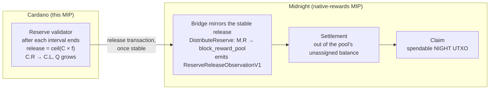

<!--
 Copyright Midnight Foundation

 Licensed under the Apache License, Version 2.0 (the "License");
 you may not use this file except in compliance with the License.
 You may obtain a copy of the License at

     https://www.apache.org/licenses/LICENSE-2.0

 Unless required by applicable law or agreed to in writing, software
 distributed under the License is distributed on an "AS IS" BASIS,
 WITHOUT WARRANTIES OR CONDITIONS OF ANY KIND, either express or implied.
 See the License for the specific language governing permissions and
 limitations under the License.
-->

## Abstract

This proposal defines how NIGHT reserved on Cardano is released to back native Midnight block
rewards, without Cardano learning anything about Midnight. The Cardano Reserve contract releases
NIGHT from the Cardano Reserve state (`C.R`) into the protocol-locked state (`C.L`) on a fixed
timer: once each release interval of POSIX time has ended, it releases a fixed fraction of what
remains, the published reward curve's maximum draw for that interval. The release factor and the
release interval are constants of the Reserve logic, and the logic is frozen within a stated window
after activation, so the release schedule is permanent.

Midnight mirrors each stable release through its existing bridge, which moves the same amount from
its Reserve into its block-reward pool, and records it as a `ReserveReleaseObservationV1`. That
record is the interface between this proposal and the native-rewards MIP, which settles rewards out
of the pool and never beyond what has been released. Released NIGHT that no eligible block has yet
drawn stays protocol-locked on both chains.

This proposal specifies the release schedule and its arithmetic, the Cardano release transition,
the release destination and its classification, the observation record, the freeze, the handover
of release timing to Midnight, operational funding, public evidence, and migration. Reward
calculation, settlement, the Midnight supply invariant and the halt rules are specified by the
native-rewards MIP, which consumes the observation record.

## Motivation

NIGHT is native on both Cardano and Midnight. During the initial Reserve-control phase, the
Cardano Reserve holds the authoritative uncirculated supply while Midnight pays native rewards.
The published tokenomics requires Midnight to observe Cardano releasing Reserve tokens before the
corresponding Midnight NIGHT becomes protocol-unlocked, and states that the cross-chain invariants
"hold even when Cardano cannot observe Midnight". It describes this stage as mirroring: "Cardano
releases block rewards. Observing this, Midnight would then move the corresponding number of tokens
from M.R to M.U."

Releasing exactly what Midnight has earned would require Cardano to know what Midnight has earned.
That means proving Midnight state to a Cardano contract through a light client, a proof pipeline
and a funded data pump, and it makes the Cardano Reserve trust Midnight's committee for every
release. Cardano needs none of that if the Reserve releases on a timer that can never fall behind
what Midnight can earn. Midnight then enforces exactness on its own side: it settles rewards only
out of released NIGHT, and only as far as its blocks have earned them.

The published curve gives such a timer. Each eligible block draws a fixed fraction `R` of the
outstanding reward Reserve, at most one block is produced per Midnight slot, and `R` is the annual
rate `R_a` divided by the blocks per year. So in an interval lasting a fraction `t` of a year,
Midnight can draw at most the fraction `R_a * t` of what was outstanding, whatever its block time. A
Cardano release of that fraction of its own remaining reward Reserve, once each interval has ended,
therefore covers Midnight's earnings. It is also bounded: Cardano never releases more than the curve
allows for the time elapsed.

The NIGHT MiCA white paper commits to such a fixed rate: the reward parameters are "included in the
code of the Reserve smart contract, which will operate autonomously once deployed", and "the base
distribution rate is a system constant" (section H.5). This proposal implements that literally: the
rate is a constant of the Reserve logic, and the logic is frozen.

A release based only on elapsed time runs ahead of rewards actually earned during missed slots and
slots held by ineligible producers. This proposal accepts that timing difference, makes it public,
and keeps it from affecting the reward calculation. Delayed release remains a visible liveness
failure rather than a monetary ambiguity.

## Specification

### Normative sources and units

The normative sources are:

1. the NIGHT MiCA white paper notified on 2026-07-28, SHA-256
   `519e002f38574fa455cf9e763bd88abee4b50598ae6c0769484a2fcf0312258d` (to be confirmed against the
   Foundation's filed copy before `Proposed`); and
2. the Midnight Tokenomics and Incentives Whitepaper, version 1.81 (May 2026), whose digest MUST be
   published with the initial reward parameters.

If an implementation choice would contradict a representation about total supply, the Reserve,
reward source, token states, or the base reward, activation is prohibited until the accountable
Foundation, TGE, governance, and legal owners resolve the conflict in a published decision.

`STAR` is the smallest NIGHT unit, and one NIGHT is 1,000,000 STAR. Every value in this proposal is
an unsigned integer number of STAR, or of POSIX milliseconds. No consensus or contract calculation
uses floating point.

### Cardano state and the interface to Midnight

This proposal uses the token states of the tokenomics whitepaper's section "Cross-chain token
invariants":

- `C.R` is NIGHT held in the Cardano Reserve and not in circulation;
- `C.L` is NIGHT protocol-locked on Cardano;
- `M.R` is Midnight's mirrored Reserve, its ledger `reserve_pool`; and
- `Q` is the cumulative NIGHT released by the Cardano Reserve contract.

The Reserve contract maintains `C.R = initial_reward_reserve - Q`. Each release moves NIGHT from
`C.R` to `C.L` and nothing else. No transition in this proposal moves value from Midnight to Cardano,
and the Reserve contract reads nothing about Midnight.

The proposal produces, for each stable release, one `ReserveReleaseObservationV1` record on
Midnight (**Midnight observation**). The native-rewards MIP consumes those records as the released
NIGHT available to settle, and specifies the Midnight-side state, the cross-chain supply invariant,
and every halt and reconciliation rule. Those are not repeated here.



### Release schedule

The Reserve validator measures POSIX elapsed time. A Cardano script sees time only as the POSIX
bounds of its transaction's validity interval, and the validator checks those bounds against
interval ends computed in POSIX milliseconds. It knows nothing of Midnight's block time.

Releases cover consecutive *release intervals* of `release_interval_ms` milliseconds. The first
interval starts at `anchor_posix_ms`, the ratified activation time, and each interval starts where
the previous one ended.

The Reserve logic fixes a *release factor* `f = release_factor_n / release_factor_d`. It is the
smallest rational with the published denominator `release_factor_d` such that

```
f >= R_a * release_interval_ms / ms_per_year
```

where `R_a` is the annual base distribution rate derived from `pi` in **Tokenomics parameters** of
the native-rewards MIP, and `ms_per_year` is 31,536,000,000, the 365-day year from which the
whitepaper's `gamma` is derived. `f` is computed exactly off-chain and published with its
derivation, so the Cardano validator never evaluates anything but a product and a quotient.

The Reserve contract keeps `curve_remaining`, which starts at `initial_reward_reserve` and always
equals the reward NIGHT still in `C.R`. The release for an interval is:

```
release_delta   = min(curve_remaining, ceil(curve_remaining * release_factor_n / release_factor_d))
curve_remaining = curve_remaining - release_delta
```

**Coverage.** On Midnight, each slot lasts `slot_duration_ms`, at most one block is produced per
slot, and the per-block rate is `R = R_a / gamma` with `gamma = ms_per_year / slot_duration_ms`.
Midnight changes its slot duration only at a release-interval boundary and only to a value that
divides `release_interval_ms` (native-rewards MIP, **Tokenomics parameters**), so an interval holds
at most `K = release_interval_ms / slot_duration_ms` slots, and `K * R = R_a * release_interval_ms /
ms_per_year <= f`. Suppose that at the start of an interval Midnight's outstanding Reserve satisfies
`B_o >= curve_remaining`. Each eligible block draws `floor(B * R) <= B * R` from the balance `B`
before it, so at the end of the interval

```
B_o' >= B_o * (1 - R)^K >= B_o * (1 - K * R) >= curve_remaining * (1 - f) >= curve_remaining - release_delta
```

which is the next `curve_remaining`. Both start at `initial_reward_reserve`, so by induction
`B_o >= curve_remaining` at every interval boundary: the cumulative draw of all blocks up to an
interval's end never exceeds the cumulative release once that interval is released. The bound uses
`K * R` rather than `1 - (1 - R)^K`, so it holds for every slot duration Midnight may adopt, and the
Cardano release never changes when Midnight's block time does.

**Undrawn release is almost entirely a timing difference.** Where slots pass without an eligible
block, `curve_remaining` falls faster than `B_o`. The larger `B_o` makes later eligible draws
larger, and the cumulative draw approaches `Q` over time. None of it can be settled except against
earned entitlements. A small residual is never drawn: once `B_o * R` falls below one STAR, every
draw floors to zero, so about `1/R` STAR of `B_o` stays undrawn while `curve_remaining` reaches zero
(about 62.6 NIGHT at the illustrative rate). That residual stays protocol-locked for good (Open
Question 3).

Near exhaustion, the ceiling releases at least one STAR per interval while Midnight's floored draw
reaches zero. When `curve_remaining` is zero, no release is valid.

### Cardano Reserve release transition

The release factor, the release interval and every other value that defines the schedule are
constants compiled into the Reserve logic:

```
ReserveRewardConstantsV1 {
    initial_reward_reserve_star:     u128,
    release_factor_n:                u128,
    release_factor_d:                u128,
    release_interval_ms:             u64,
    anchor_posix_ms:                 u64,
    max_validity_window_ms:          u64,
    midnight_network_id:             bytes,
    release_destination:             credential,
}
```

The Reserve contract's datum stores only the state that changes:

```
ReserveRewardStateV1 {
    curve_remaining_star:            u128,
    cumulative_released_star:        u128,
    next_interval_start_ms:          u64,
    paused:                          bool,
}
```

No transition of the Reserve logic changes a constant. The release rate changes only by replacing
the logic through the two-stage upgrade, and not at all once the logic is frozen (**Freeze**).
`max_validity_window_ms` bounds the width of a release transaction's validity interval.

Anyone MAY submit a release. The validator accepts it only if:

1. releases are not paused;
2. `curve_remaining_star` is greater than zero;
3. the transaction's validity interval is no wider than `max_validity_window_ms`, and its lower
   bound is no earlier than the end of the interval starting at `next_interval_start_ms`, that is
   `next_interval_start_ms + release_interval_ms`;
4. `release_delta` is calculated as in **Release schedule** with checked arithmetic;
5. the transaction reduces `C.R` by exactly `release_delta` and increases `C.L` at
   `release_destination` by exactly the same amount;
6. the continuing state reduces `curve_remaining_star` and increases `cumulative_released_star` by
   `release_delta`, advances `next_interval_start_ms` by `release_interval_ms`, and changes no other
   field;
7. the NIGHT asset and the Reserve input match the compiled constants; and
8. no NIGHT or value is paid to the submitter from the Reserve.

Each transaction releases one interval. After an outage, the missed intervals are released by
consecutive transactions, in order, and none can be released before it has ended. Rule 3 ties every
release to elapsed POSIX time, so Cardano never releases more than the published curve's maximum for
the time that has passed. A release never distributes per-recipient rewards on Cardano.

No transition releases more than one interval's `release_delta`, and no transition, paused or not,
moves the remaining Reserve in bulk. The NIGHT MiCA white paper states that Reserve NIGHT "will not
be transferable except as block production rewards following the rules described in section H.5"
(section G.11).

### Release destination and classification

The destination is the configured protocol-locked Cardano credential used by the native NIGHT
cross-chain system, such as the ICS credential selected for deployment. The exact script hash,
asset policy, asset name, and datum encoding are activation parameters published with the contract
artifacts.

Release classification MUST positively identify the Reserve input, the Reserve validator, the NIGHT
asset, the continuing state datum, and the configured destination. Absence of metadata is never
sufficient to classify a transaction as a Reserve release. Wrong-script, wrong-asset, ambiguous, or
partially matching transactions are not releases. A spend of the Reserve that is not a valid
release, pause, unpause, or published upgrade or freeze transition is an unexpected Reserve spend,
which the native-rewards MIP treats as a halt condition.

### Mainnet reference values

The following mainnet values were observed on 2026-10-26. They are provisional: each MUST be
re-checked against both chains at the activation block and ratified with the Reserve logic, and a
value that has changed by then replaces the one shown here.

| Item | Observed value |
|---|---|
| NIGHT on Cardano | policy `0691b2fecca1ac4f53cb6dfb00b7013e561d1f34403b957cbb5af1fa`, asset name `NIGHT` (`4e49474854`) |
| Reserve validator | `addr1w950c5zxn5fhwlauvpy3ssk287q0qlwz6e2zc4gaj62vaxsy3s9p0`, script hash `68fc50469d13777fbc60491842ca3f80f07dc2d6542c551d9694ce9a` |
| Reserve two-stage upgrade policy | `d24b012f7b2a99a671b7e1196847f183982d70db02ed37068e4e49e9` |
| Reserve NIGHT | 6,000,000,000,873,988 STAR in UTXO `03b5d301678204ee48c7f93d3446fd4ad0427da6d1966e8d3df423c720657b0e#0`, unspent |
| Illiquid circulation supply (ICS) validator, the candidate release destination | `addr1wyczfpxfnf5hvp36mrn655ye4k2cwluvlez6phx8jx46k6s2ttdaq`, script hash `302484c99a6976063ad8e7aa5099ad95877f8cfe45a0dcc791abab6a` |
| ICS two-stage upgrade policy | `8f2c043f857c6acb716d27d67e9cb609c9c9814b7d7b938d6c410733` |

The Reserve UTXO is the one from which Midnight's genesis set its `reserve_pool` to the same
6,000,000,000,873,988 STAR, and the amount equals the Reserve allocation in the tokenomics white
paper (25% of supply, including a 873,988 STAR Scavenger Mine remainder). The provisional
`initial_reward_reserve` is therefore 6,000,000,000,873,988 STAR. Midnight's current
`reserve_pool` has not been read directly, because no public interface exposes it; it remains at
its genesis value unless a `DistributeReserve` or `UnlockToReserve` system transaction has run,
which MUST be confirmed at ratification.

### Midnight observation

The existing bridge, `pallet-c2m-bridge`, already classifies a Cardano transaction that spends the
configured Reserve validator's inputs as a Reserve transfer and answers it with a
`DistributeReserve` system transaction for the amount, moving it from `reserve_pool` to
`block_reward_pool`. This proposal keeps that flow as the way Midnight mirrors each release, so
`M.R` moves by exactly what `C.R` moved and `C.R = M.R` once every release is stable.

The bridge acts only after the Cardano transaction is stable under the active Cardano stability
rule; the native-rewards MIP calls such a release finalized. For a release to be mirrored, the
bridge MUST classify it positively as in **Release destination and classification**, recompute its
`release_delta` from the previously observed `curve_remaining_star` and the compiled constants, and
require the interval to start where the previously observed one ended. A gap stops later mirroring
until the missing release is supplied. A duplicate is idempotently rejected. A Cardano
reorganization before stability moves nothing.

For every mirrored release the bridge records, in the same block as its `DistributeReserve`:

```
ReserveReleaseObservationV1 {
    cardano_transaction_id:       bytes32,
    reserve_input_reference:      cardano_utxo_id,
    interval_start_ms:            u64,
    release_delta_star:           u128,
    cumulative_released_star:     u128,
    curve_remaining_star:         u128,
    cardano_block_hash:           bytes32,
    cardano_block_number:         u64,
    observed_at_midnight_block:   u64,
}
```

This record is the whole interface to the native-rewards MIP. Its sequence gives the released NIGHT
available to settle; how settlement consumes it, and what Midnight does if a record is missing,
inconsistent or later rolled back, is specified there.

### Pause, upgrade, and freeze

The emergency pause may prevent new Reserve releases but cannot spend, redirect, confiscate, or
rewrite the Reserve and cannot invalidate already accepted releases. While paused, intervals keep
ending; after resumption they are released in order, so a pause delays claims but does not change
the schedule. Pausing is a safety action, not a recovery procedure; public monitoring MUST
distinguish it from normal operation. The pause authority and its scope are part of the logic that
is frozen.

Until the freeze, the two-stage Cardano governance procedure of MIP-0024's Reserve upgrade model
remains applicable, so defects found in production can be fixed by an ordinary upgrade. Before any
such upgrade, implementations MUST publish the new script hashes, state migration, audit evidence,
and rollback plan. An upgrade MUST NOT change the release schedule's constants unless `pi` itself has
changed through the native-rewards MIP's procedure.

### Freeze

The governance action that installs the reward Reserve logic MUST be followed, within 90 days of
`anchor_posix_ms`, by the governance action that freezes it: setting the two-stage upgrade's
`mitigation_auth` to the `always_fails` validator, so that no later upgrade of the Reserve logic is
possible. The freeze is a commitment of this MIP, not a later option.

Before the freeze, the following MUST be settled and published, because the freeze makes them
permanent:

- the release rate: `R_a`, derived from the `pi` the native-rewards MIP recommends, and the release
  factor and interval derived from it;
- the release destination; and
- an external audit of the logic with no unresolved critical or high findings, and legal
  confirmation that the frozen behavior is consistent with the notified disclosures.

If one of these cannot be settled within the window, releases MUST be paused until it is, and the
freeze follows before releases resume. After the freeze, a defect in the Reserve logic can be
mitigated only by the pause, and corrected only by a superseding MIP that migrates nothing out of the
frozen Reserve.

### Handover of release timing to Midnight

The release schedule is permanent. The frozen logic has no path that transfers Reserve control to
Midnight, releases faster than the schedule, or releases the remaining Reserve in bulk. *Handover*
means that Midnight stops waiting to observe each release and computes the same schedule itself.
The Cardano Reserve keeps releasing on its frozen timer, unchanged and forever, and no NIGHT moves
and no Cardano contract changes at handover.

Let `Q(t)` be the cumulative release the frozen schedule allows by POSIX time `t`. Both chains can
evaluate it, because the schedule is defined in POSIX time. After a handover, each chain is bounded
by the schedule rather than by the other chain:

1. Cardano never releases early: `initial_reward_reserve - C.R <= Q(t)`, which the frozen validator
   already enforces.
2. Midnight never settles beyond the schedule: `initial_reward_reserve - M.R <= Q(t - delta)`, where
   `delta` is a settlement margin covering one release interval, `max_validity_window_ms`, and an
   allowance for keepers. Midnight enforces this locally, without observation.
3. The bridge invariant and the per-chain sums are unchanged: `C.U <= M.L`, and on each chain
   `R + L + U = S`.

The supply guarantee follows from 3 and Midnight's sum alone: `M.U + C.U <= M.U + M.L = S - M.R <=
S`. It uses neither cross-chain Reserve inequality, so it does not depend on how the two Reserves
compare. The earlier pair `C.R <= M.R` and `M.U <= C.L` still holds whenever Cardano's actual release
is less than `delta` behind `Q(t)`; if Cardano falls further behind, transfers from Midnight to
Cardano wait until a keeper catches up. These bounds are continuous across the handover: before it,
Midnight settles no more than it has observed, and Cardano releases no more than `Q(t)`, so bound 2
already holds.

Undrawn release, including the final residual, stays locked for good: it is counted in `C.L` and is
never unlocked on Midnight. The handover itself is a change to Midnight only, specified by a later
MIP that replaces the producer of the native-rewards MIP's settlement gate with the computed
schedule. The tokenomics whitepaper says ownership of the Reserve "may" move from `C.R` to `M.R`;
this proposal declines that flip and states why in **Rationale**.

### Transaction fees and release liveness

Submitting a Cardano release transaction costs ADA. Version 1 gives the reward-release flow its own
Cardano funding-pool UTXO, whose validator pays fees up to a governed `max_fee` only for valid
Reserve release transactions. Any party MAY act as a release keeper and submit the oldest
unreleased interval; the Reserve state's `next_interval_start_ms` makes one submission win and the
others stop retrying. Anyone may also submit a valid release with their own ADA. Reserve NIGHT is
never used to reimburse a submitter.

Operations MUST define and monitor:

- release lag, the number of ended intervals not yet released;
- minimum funding-pool ADA balance and refill owner;
- Cardano stability latency;
- the native-rewards MIP's settlement backlog and coverage status; and
- alert and pause procedures.

Operations MUST also publish a claimability objective: the number of epochs within which a finalized
entitlement normally becomes claimable, ratified with the Reserve logic. Under normal operation it
is at most one release interval, plus the Cardano stability window, plus the settlement backlog. It
is a service target, not a protocol rule. No transition may relax a release, observation, or
settlement check to meet it, and missing it triggers the alert and escalation procedures above.

The keeper is not trusted for safety: it cannot change a release amount, interval or destination.
Failure delays claimability but does not change entitlement ownership or amount. An empty funding
pool stalls funded submissions and loses no NIGHT; monitoring and permissionless self-funded
submission provide recovery paths.

### Public query and evidence interface

The Midnight runtime API and the indexer, which also projects Cardano Reserve state and
transactions, expose batch-capable queries for:

- the compiled constants, the Reserve logic's script hash, and its freeze status;
- schedule state: `curve_remaining`, `Q`, the next interval to release, and release lag;
- each Cardano release transaction, Reserve input and output, destination, and stability status;
- each `ReserveReleaseObservationV1` and the `DistributeReserve` that mirrored it; and
- pause state and upgrades.

An indexer is a historical projection, not proof. A verifier using its own Cardano and Midnight
nodes MUST be able to reconstruct every release and observation from finalized public data.

### Versioning

All records and encodings in this proposal carry version 1, denoted by the `V1` suffix of the
type name and encoded as a leading version tag, as in the native-rewards MIP. Unknown versions
are rejected. A change to the schedule's meaning, release calculation, destination classification,
observation record, or denomination requires a superseding MIP; after the freeze, it can change
nothing in the frozen Reserve logic.

## Rationale

A scheduled release is chosen because it needs no knowledge of Midnight on Cardano. No light
client, proof, or committee is trusted for Reserve movement, and the Reserve contract checks only
its own state and Cardano's clock. Supply safety rests on a rule Midnight enforces itself: it settles
only out of released NIGHT, and never more than has been earned.

Releasing the curve's maximum for each elapsed interval guarantees coverage, so under normal
operation release never holds back an earned reward for longer than one interval plus Cardano
stability. Computing the release from Cardano's own `curve_remaining`, with a fixed factor and one
ceiling per interval, keeps the on-chain arithmetic to a multiplication and a division.

The release rate is a constant, not a governed parameter. The NIGHT MiCA white paper calls the base
distribution rate "a system constant" placed in the Reserve contract's code, and leaves
"monetary-policy parameters" outside the scope of today's governance authorities (sections H.5 and
G.3). Unless `pi` changes, the release on Cardano never needs to change: a change of Midnight's slot
duration rescales `R` so that `R * gamma = R_a` still holds, and the Cardano release, measured in
POSIX time and derived from `R_a`, does not move. A staged-policy mechanism would have let Cardano
governance raise the rate at any time, including after a freeze, because staging is a transition the
frozen validator would still accept.

The freeze is committed rather than permitted. While the logic is upgradable, the governance keys
are the attack surface for a quarter of the NIGHT supply. The window before the freeze lets the
release run in production while defects can still be fixed by an ordinary upgrade.

The two Reserves are not moved in one transaction because Cardano and Midnight are separate ledgers
with no shared commit. The protocol fixes the order instead. Cardano moves value first, from `C.R`
to `C.L`; Midnight mirrors it only after observing that transaction stable, moving the same amount
from `M.R` into its protocol-locked block-reward pool. The cross-chain invariants `C.R <= M.R` and
`M.U <= C.L` bound in one direction only, so they hold in every state between the two steps, and the
gap costs only latency. Mirroring keeps `M.R` equal to `C.R` once every release is stable, as the
whitepaper describes, and the pool's own balance records what has been released and not yet settled,
so no separate release-credit counter is needed.

The cost of the schedule is undrawn release. While permissioned producers, which earn nothing, or
missed slots account for a share of slots, roughly that share of each release is not drawn when it
is released. It sits in `block_reward_pool`, credited to no one, protocol-locked, and is almost all
consumed later, because Midnight's larger outstanding Reserve makes later eligible draws larger.
Open Question 3 asks whether that is acceptable.

### Handover: the whitepaper's flip, or timed release forever

The tokenomics whitepaper describes a handover in which "ownership of the Reserve tokens may move
from C.R to M.R, allowing Midnight to control the release of reward tokens", with the invariants
flipped to `M.R <= C.R`, `C.U <= M.L`, and `M.U <= C.L + (C.R - M.R)`. This proposal specifies
timed release forever instead:

| | The whitepaper's flip | Timed release forever (this MIP) |
|---|---|---|
| Who sets the release rate after handover | Midnight governance | The frozen Cardano timer, computed identically on Midnight |
| Cardano must observe Midnight | Yes, through a bridge that is not designed | No |
| Invariants | Flip at handover | Each chain bounded by the schedule; no flip |
| Undrawn residual | Must be unlocked at once to reach the flip | Stays locked |
| Cardano contracts at handover | Must change | Unchanged |

The flip needs Cardano to verify Midnight state, which is the bridge this proposal rejects for
releases. It cannot be reached from this design without a bulk release: switching from `C.R <= M.R`
to `M.R <= C.R` needs a moment where `M.R = C.R` with nothing undrawn, and undrawn release grows with
every unrewarded slot. It would also move the release rate out of the Reserve contract's code,
which the MiCA white paper says it is in. Timed release forever needs none of this, keeps the frozen
Cardano timer protecting NIGHT on Cardano, and leaves Midnight free to stop waiting for observation.
The whitepaper says the flip "may" happen, so declining it contradicts nothing published.

A bulk release, moving the remaining Reserve to `C.L` in one transaction, is ruled out under either
option. Before a flip, it forces Midnight either to put the whole remaining Reserve into circulation
at once or to leave `M.R` above `C.R` by that amount forever, after which the cross-chain invariants
detect nothing. After a flip, it breaks `M.R <= C.R` outright. In both cases `C.L` would hold the
whole remaining Reserve backing nothing on Midnight, and the MiCA white paper permits Reserve NIGHT
to move only as block production rewards.

### Relationship to MIP-0024

MIP-0024 correctly identifies that Cardano cannot directly observe Midnight production, that
Reserve release transactions need funded automation, and that Cardano contract exposure must be
bounded. This proposal reuses its funded submission with `max_fee`, positive state-machine
validation, Cardano finality analysis, two-stage Reserve upgrade model, audit requirements, and
operational monitoring concerns.

Its release transition cannot be reused unchanged. MIP-0024 releases a time-based worst-case amount
from `C.R` into a Cardano-unlocked rewards pool (`C.U`) so batchers can pay Cardano virtual
accounts, and proves Midnight state to Cardano through MIP-0023. Native Midnight rewards instead
require backing to move from `C.R` to `C.L`, which Midnight mirrors from `M.R`. This proposal keeps
a time-based release, makes it an exact per-interval curve calculation with constant parameters, and
has no Cardano recipient pool, batcher, virtual account, distribution fee, epoch fold, or MIP-0023
dependency.

Because MIP-0024 is already `Proposed`, this redesign should not be introduced as an unreviewed
substantive edit to it. MIP-0024 is recorded as Superseded only when both this proposal and the
native-rewards proposal are accepted (see **Backwards Compatibility Assessment**).

This proposal and the native-rewards MIP are split at one interface, the observation record. This
proposal holds exactly what becomes permanent at the freeze, plus the format of what Midnight
observes, so it can be audited and approved on its own terms by the Cardano contract maintainers.
Everything in the native-rewards MIP stays changeable by Midnight runtime upgrade, and a handover
replaces only the producer of its settlement gate.

Alternatives rejected are:

- **Exact cumulative checkpoints proven through MIP-0023:** releases exactly what has been earned,
  but Cardano must verify Midnight state, which adds a light client, a proof pipeline, a funded
  data pump, and trust in Midnight's committee for every Reserve movement. A compromised committee
  could release up to the curve's maximum anyway.
- **One release up front:** needs no schedule, but exposes the whole released amount if Midnight is
  compromised and empties the Cardano Reserve in one step, and contradicts the MiCA white paper.
- **Governed or staged release parameters:** let Cardano governance change the release rate,
  including after a freeze, contrary to the MiCA white paper's "system constant".
- **Settlement-driven Reserve movement on Midnight:** moving `M.R` only when settlement pays, with a
  separate release-credit counter, collides with the existing bridge, which already mirrors each
  release; it drains `reserve_pool` twice per release and makes the two Reserves drift apart.
- **Release a fraction of the curve's maximum:** reduces undrawn release, but can fall behind
  earnings, so claims could wait indefinitely. It remains an option under Open Question 3.
- **Let Midnight settle without Cardano release:** violates the Cardano-control-phase supply gate.
- **Use missing metadata to identify a release:** permits unrelated or adversarial transactions to
  be misclassified.
- **Pay recipients on Cardano:** does not deliver native Midnight NIGHT and duplicates allocation,
  batching, and claim infrastructure.
- **Add a reward-specific signer federation:** makes Cardano trust signers about Midnight state,
  which this proposal avoids entirely.

## Path to Active

### Acceptance Criteria

This MIP produces the observation record that Native NIGHT Block Production Rewards: Accrual and
Claims consumes. It depends on no other MIP. Its release starts at `anchor_posix_ms`, which is
ratified together with the native-rewards MIP's activation.

This MIP may move from Accepted to Active only when:

1. The authoritative MiCA and tokenomics editions and digests, the initial Reserve, `pi` and `R_a`,
   the release interval and release factor with their derivation, and normative vectors are
   published and approved.
2. The deployed Cardano validator releases exactly `release_delta` per ended interval, in order,
   never before the interval ends, to the configured protocol-locked destination, and has no
   transition that changes a constant or releases in bulk.
3. Midnight's bridge mirrors only stable, correctly classified releases, recomputes each release
   amount, moves exactly that amount from `reserve_pool` to `block_reward_pool` once, and records the
   matching `ReserveReleaseObservationV1`.
4. Duplicate, skipped, reordered, premature, malformed, excessive, rolled-back, and wrong-asset
   releases are not mirrored.
5. The release keeper, dedicated funding pool, fee cap, pause path, and monitoring are operational
   and exercised.
6. The Reserve logic and the bridge's release path pass independent security audit with no
   unresolved critical or high findings.
7. A public test network completes at least two committee rotations, a Cardano rollback exercise,
   and a keeper outage followed by catch-up release, with published results.
8. The freeze governance action is prepared, and its preconditions and the 90-day window are
   recorded in the activation decision.
9. Foundation/TGE, economics, governance, security, and counsel record approval that the deployed
   state machine, including undrawn release and the freeze, conforms to the notified and published
   disclosures.

### Implementation Plan

1. Ratify source documents, `pi` and the derived release interval and factor, destination,
   stability rule, fee caps, and operational owners.
2. Implement and audit the Cardano Reserve validator with compiled constants and exact positive
   release classification.
3. Extend the bridge's Reserve-transfer handler with release recomputation, ordering, and the
   observation record.
4. Implement public query surfaces, indexer projections, the release keeper, funding pool, and
   monitoring.
5. Run golden-vector, property, adversarial, migration, rollback, and end-to-end tests.
6. Deploy to a public test network, exercise operations and upgrade, publish results, and resolve
   audit findings.
7. Activate through the coordinated governance procedure, monitor every release through the
   initial production period, and freeze the Reserve logic within the window.

## Backwards Compatibility Assessment

This proposal changes the Cardano Reserve validator and extends the bridge's existing Reserve-transfer
handler on Midnight. It requires a Cardano governance action to install the logic, a second one to
freeze it, and a Midnight runtime/node upgrade. It requires no Midnight-to-Cardano bridge.

Together with Native NIGHT Block Production Rewards: Accrual and Claims
(`mip-xxxx-native-night-block-rewards.md`), this proposal supersedes MIP-0024: the companion
proposal replaces its Cardano payout location and delivery state machine, and this proposal replaces
its Reserve release flow. Neither proposal supersedes MIP-0024 alone, and MIP-0024 is recorded as
Superseded only when both are accepted.

Existing circulating NIGHT, ordinary cross-chain transfers, DUST generation, and user-held NIGHT
UTXOs are unchanged. Existing Reserve state must be migrated into `ReserveRewardStateV1` without
changing its NIGHT amount, and that amount MUST equal `initial_reward_reserve`. The migrated state
starts with `curve_remaining_star` equal to `initial_reward_reserve`, `cumulative_released_star`
zero, and `next_interval_start_ms` equal to `anchor_posix_ms`.

The bridge's handling of Reserve transfers keeps its positive classification by Reserve-validator
input. Classification based on absent metadata is not reused.

The native-rewards feature remains disabled if the Cardano migration, destination, or bridge path is
missing or mismatched. A partially deployed system therefore fails closed rather than releasing or
settling reward NIGHT.

## Security Considerations

**Supply conservation.** Checked arithmetic, cumulative counters, positive release classification,
and Cardano stability bound the Reserve's movement. No transition mints NIGHT.

**No trust in Midnight on Cardano.** The Reserve contract accepts no statement about Midnight. A
compromise of Midnight consensus or its committee cannot release Reserve NIGHT on Cardano.

**Governance keys.** No transition changes the release rate. Until the freeze, holders of enough
Technical Authority and Council keys could install different Reserve logic through the two-stage
upgrade; the freeze within 90 days removes that path permanently. After it, governance can only
pause releases.

**Compromised keeper.** A submitter can delay or censor its own submissions but cannot change a
release amount, interval, or destination. Other keepers and permissionless submission provide a
fallback.

**Clock.** Rule 3 requires the lower bound of the transaction's validity interval to be no earlier
than the interval's end, so no release can be made before its interval ends; the width bound keeps
the transaction's time meaningful. Coverage depends on Midnight producing at most one block per
slot and changing slot duration only as **Release schedule** requires; Midnight clock drift ahead of
Cardano's would delay claims, not unlock unbacked NIGHT.

**Replay and omission.** Consecutive intervals and cumulative values make duplicates, gaps,
reordering, and regressions invalid. The Reserve logic carries the Midnight network identifier.

**Forks and finality.** Only stable Cardano releases are mirrored. Exceptional rollback after
mirroring is handled by the native-rewards MIP's halt rules.

**Bridge misclassification.** A release is recognized through positive matching of scripts, asset,
continuing state, destination, and state transition. Missing metadata is never evidence.

**Bulk release.** No transition releases more than one interval, so the remaining Reserve cannot be
moved into `C.L` at once, where it would back nothing on Midnight and be guarded only by the
bridge's withdrawal policy.

**Operational depletion.** Keeper ADA and release lag are monitored. Exhausting ADA delays release
but cannot redirect or change rewards. The per-block draw floors a fraction of `B_o`, so it falls
to zero once `B_o * R` is below one STAR; about `1/R` STAR of released NIGHT then stays undrawn.

## Implementation

The expected components are:

- **Cardano Reserve contracts:** scheduled release with compiled constants, exact release delta,
  continuing state, positive destination classification, pause, migration, freeze, and the funding
  pool. The reserve-contracts spike (`midnightntwrk/midnight-reserve-contracts`, branch
  `block-rewards-validators`) already keeps the release factor and interval as compile-time
  constants.
- **Midnight runtime/node:** the bridge's Reserve-transfer handler, extended with release
  recomputation and the observation record; public APIs.
- **Release keeper:** interval tracking, funded submission, confirmation tracking, retries, and no
  custody of Reserve NIGHT.
- **Indexer and explorer:** release, observation, and freeze history.
- **Operations:** dashboards, alerts, runbooks, ADA funding, incident response, and audit evidence
  retention.

No implementation code belongs in the MIP repository. Component repositories link their changes to
the assigned MIP number.

## Testing

Testing includes:

- golden vectors for the release factor derivation, release amounts over many intervals,
  denomination, rates, and cumulative arithmetic;
- property tests for coverage under every pattern of eligible, ineligible and missed slots, and for
  every slot duration that divides the release interval;
- differential release reconstruction by an implementation outside the runtime;
- duplicate, skipped, reordered, premature, excessive, malformed, and wrong-network releases;
- exhaustion of `curve_remaining`, overflow, and boundary rounding;
- Cardano forks before stability;
- wrong script, asset, datum, destination, metadata, or Reserve input;
- validity intervals that are too wide or start before the interval ends, which Cardano must reject;
- attempts to release more than one interval, or the whole Reserve, which Cardano must reject;
- keeper censorship, outage, catch-up of many intervals, fee exhaustion, and competing
  permissionless submissions;
- pause, resume, Cardano contract migration, the freeze transaction, and an upgrade attempted after
  it, which must fail;
- the bridge mirroring each release exactly once, and never a release it cannot recompute; and
- end-to-end release, stable observation, native settlement, and claim.

## Open Questions

These questions need a decision from the Foundation, governance, or counsel rather than further
specification. Each names who decides and what it blocks.

### 1. Who may change the Reserve contract's parameters and logic

*Resolved by the current MiCA white paper.* The edition notified on 2026-07-28 says the Reserve
contract's parameters "may not be amended except via the applicable governance mechanics for the
Midnight network" (section H.5), keeps "the base distribution rate is a system constant", and lists
"monetary-policy parameters" among the elements outside the federated governance committee's current
scope, for a future decentralized on-chain governance system (section G.3). This MIP therefore
adopts option (b) of the earlier draft: the monetary parameters are constants, and no governance
action changes them; only the emergency pause remains. Logic upgrades before the freeze fix defects
only.

### 2. Which MiCA document is normative

*Resolved, pending confirmation.* **Normative sources and units** cites the edition notified on
2026-07-28 by date and SHA-256 digest. The Foundation must confirm the digest against its filed
copy and supply a stable URL. Decides: Foundation and counsel. Blocks: `Proposed`.

### 3. Undrawn release

While permissioned producers or missed slots account for a large share of slots, a similar share of
each release is undrawn when it is released, and sits in Midnight's `block_reward_pool` unassigned.
The difference is consumed over time, but it can be large early on. Options: (a) accept it and
disclose that it is protocol-locked until settled (proposed); (b) release a fraction of the curve's
maximum, which reduces the difference but lets claims wait whenever earnings outrun release; or (c)
activate scheduled release only once reward-eligible producers hold most slots. The residual of
about `1/R` STAR that is released but never drawn stays protocol-locked, and no event unlocks it.
Decides: Foundation, economics owner, and counsel. Blocks: `Proposed`.

### 4. Release interval and precision

`release_interval_ms` trades Cardano transaction cost against claim latency: a shorter interval
costs more ADA per year, a longer one delays claims. The denominator `release_factor_d` sets how
closely `f` follows `R_a * release_interval_ms / ms_per_year` and how large the on-chain product
becomes. The decision must fix both before the freeze, together with a measured script cost for the
release transaction. Decides: authors, with the Cardano contract maintainers. Blocks: `Proposed`.

### 5. Released NIGHT in the ICS and bridge accounting

A release moves Reserve NIGHT into the protocol-locked destination, for which the illiquid
circulation supply (ICS) validator is the candidate (see **Mainnet reference values**). If the
existing NIGHT bridge redeems Midnight-to-Cardano transfers from the ICS, released NIGHT is what
backs reward NIGHT that a holder later moves to Cardano. This MIP names the destination but not how
the ICS validator and the bridge account for released NIGHT: whether it is pooled with NIGHT locked
by ordinary bridge transfers, whether undrawn release can be used for such redemptions before it is
earned, and whether any ICS or bridge invariant must change to admit it. Decides: authors, with the
bridge and ICS contract maintainers. Blocks: `Proposed`.

## References (Optional)

- NIGHT MiCA White Paper, notified 2026-07-28, SHA-256
  `519e002f38574fa455cf9e763bd88abee4b50598ae6c0769484a2fcf0312258d` (stable URL to be supplied by
  the Foundation)
- [Midnight Tokenomics and Incentives Whitepaper, version 1.81 (May 2026)](https://45047878.fs1.hubspotusercontent-na1.net/hubfs/45047878/Midnight-Tokenomics-And-Incentives-Whitepaper.pdf)
- [MPS-0019: Block Production Rewards in NIGHT](https://github.com/midnightntwrk/midnight-improvement-proposals/blob/main/mps/mps-0019-block-production-rewards-night.md)
- [MIP-0001: Midnight Improvement Proposal Process](https://github.com/midnightntwrk/midnight-improvement-proposals/blob/main/mips/mip-0001-mip-process.md)
- [MIP-0024: Block Production Rewards Payout on Cardano](https://github.com/midnightntwrk/midnight-improvement-proposals/blob/main/mips/mip-0024-block-production-rewards.md)
- [Working draft: Native NIGHT Block Production Rewards: Accrual and
  Claims](./mip-xxxx-native-night-block-rewards.md)
- [Midnight reserve contracts, mainnet address report](https://github.com/midnightntwrk/midnight-reserve-contracts/blob/6310b16cad5bc5431a2dee9887545e1cf6ee4f79/release/mainnet/address-report.md)
- [Midnight node mainnet Reserve genesis configuration](https://github.com/midnightntwrk/midnight-node/blob/main/res/mainnet/reserve-config.json)

## Acknowledgements

This draft incorporates analysis from MPS-0019, the native-rewards working draft, the scope and
readiness assessment, the MPS critique, the current Midnight ledger and node architecture, and the
published MiCA and tokenomics papers. Named acknowledgements must be confirmed with contributors
before submission.

## Copyright Waiver

All contributions (code and text) submitted in this MIP must be licensed under the Apache License,
Version 2.0. Submission requires agreement to the Midnight Foundation Contributor License Agreement
[Link to CLA], which includes the assignment of copyright for contributions to the Foundation.
