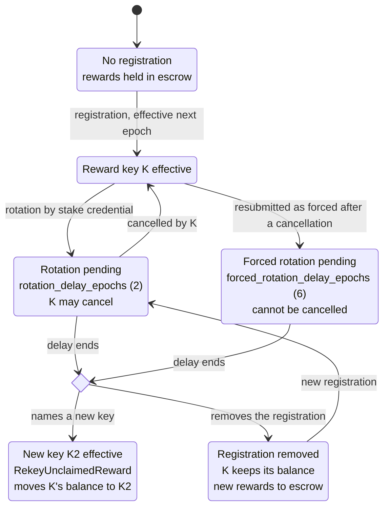

<!--
 Copyright Midnight Foundation

 Licensed under the Apache License, Version 2.0 (the "License");
 you may not use this file except in compliance with the License.
 You may obtain a copy of the License at

     https://www.apache.org/licenses/LICENSE-2.0

 Unless required by applicable law or agreed to in writing, software
 distributed under the License is distributed on an "AS IS" BASIS,
 WITHOUT WARRANTIES OR CONDITIONS OF ANY KIND, either express or implied.
 See the License for the specific language governing permissions and
 limitations under the License.
-->

## Abstract

This proposal defines native Midnight block-production rewards. The protocol records each block
producer, applies the published tokenomics formula, and accumulates the result for the producing
operator. An operator is either an ADA SPO, a Cardano stake pool, or a NIGHT-native SPO, whose
operator record, stakers and stake snapshot a separate NIGHT staking MIP will define. At each
Midnight epoch boundary, the finalized stake snapshot used for committee selection also supplies
the inputs to a public, reproducible split of the pool's reward between its operator and its
delegators or stakers, on the margin each SPO declares: for an ADA SPO, the margin in its Cardano
pool registration certificate.

Rewards accrue automatically as NIGHT entitlements in runtime state and settle into Midnight's
existing ledger reward balances. While Reserve control remains on Cardano, an entitlement becomes
claimable only after Midnight observes finalized scheduled releases from the Cardano Reserve that
cover it. Cardano needs no knowledge of Midnight for this. A recipient then uses the
existing signed reward-claim transaction to create a spendable unshielded NIGHT UTXO on Midnight.
No Cardano per-recipient payout contract, batcher, or virtual account is required.

The proposal reuses Partner Chains producer registration and the existing Cardano observation
infrastructure, with a reward-specific destination registration. Runtime, RPC, indexer, CLI, and SDK interfaces expose
registration, forecasts, accrued and release-gated balances, per-block calculations, epoch splits,
and withdrawals. Independent implementations can recompute payouts from finalized public data and
normative vectors.

## Motivation

As Midnight decentralizes block production, Cardano stake-pool operators need a defined way to
register for rewards, forecast likely returns, observe accrual, verify calculations, and withdraw
spendable NIGHT on Midnight. Delegators need to see how a pool's reward is divided between the
operator and stake-based recipients under the terms the pool's operator has set. None of those
workflows is complete today.

The current codebase already contains most of the native payout substrate. The Midnight ledger has
`block_reward_pool`, `unclaimed_block_rewards`, `DistributeReserve`,
`DistributeNight(Reward)`, `ClaimRewardsTransaction`, a minimum claim amount, replay protection, and
a supply-conservation check. The node exposes a runtime query for an unclaimed amount. The indexer
records block authors and reward-claim transactions.

The production path is nevertheless inactive. The node runtime's block-reward pallet and block
beneficiary inherent are disabled, the configured ledger block reward is `(0, None)`, and there are
no complete production interfaces for reward registration, calculation history, recipient splits,
forecasting, or withdrawal.

The initially proposed MIP-0024 proposes paying NIGHT on Cardano through virtual accounts, contracts, a rewards pool,
batchers, fee pools, and a data pump. That design does not satisfy the current requirement that rewards be distributed as NIGHT on Midnight. Native accrual reuses the ledger's existing conservation and claim machinery and eliminates per-recipient Cardano payouts.
It does not bypass the tokenomics whitepaper's cross-chain supply invariant: while Reserve control
remains on Cardano, Midnight unlocks no more reward NIGHT than the finalized Reserve release it
has observed on Cardano.

Independent verification in this proposal means deterministic recomputation from finalized public
inputs. A verifier may obtain those inputs from its own full node or compare independent indexers.
Succinct verification without a full node is outside this proposal.

## Specification

### Terminology and units

* `STAR` is the smallest NIGHT unit. Consensus arithmetic uses whole STAR.
* `pool_id` is the 28-byte Blake2b-224 hash of a Cardano stake-pool verification key.
* `stake_address` is the network-tagged Cardano reward address for a stake credential.
* `operator_kind` is `AdaSpo` or `NightSpo`; `operator_id` and a *payee* identify an operator and a
  reward recipient across both kinds (see **Operator kinds**).
* `reward_key` is a Midnight signature verification key. Its derived `UserAddress` is the
  recipient's NIGHT address on Midnight: it holds the ledger balance of the unclaimed reward, whose
  entitlement `stake_address` owns, signs withdrawals, and receives the claimed NIGHT. Rewards
  are paid in NIGHT on Midnight and remain on Midnight; this MIP provides no transfer to Cardano.
* `epoch` is the Midnight committee session used for reward calculation and settlement.
* `snapshot_id` identifies the finalized stake snapshot of an operator's kind used to select an
  epoch's committee: the Cardano stake and pool-parameter snapshot for ADA SPOs, and the NIGHT
  stake snapshot for NIGHT-native SPOs, whose 32-byte identifier the NIGHT staking MIP defines.
* `reward_reserve_outstanding` is the canonical economic balance used to calculate future base
  rewards. It corresponds to `B_o` in the tokenomics whitepaper and decreases by `N_b` when each
  reward-eligible block executes. At the best-chain head it also reflects draws by blocks not yet
  finalized, which fork choice may roll back; in finalized state it reflects exactly the finalized
  reward-eligible blocks.
* `unsettled_draw` is finalized base draw not yet consumed by native settlement. It equals `P` of
  the required Reserve MIP.
* `released_credit` is finalized Cardano value released for rewards and not yet consumed by native
  Midnight settlement. A Cardano transaction or release is *finalized* in this MIP when it is
  stable under the network's Cardano stability rule.
* `ledger_reserve_pool` is Midnight's actual `M.R` balance. It moves only when a release-gated
  settlement executes.
* `STAR_PER_NIGHT` is a network constant equal to 1,000,000, as in the required Reserve MIP. It is
  not a governable parameter and MUST be published with the tokenomics parameters.

No consensus calculation uses floating-point arithmetic.

### Operator kinds

An operator is either an ADA SPO or a NIGHT-native SPO, never both, and every committee entry
carries its `operator_kind`. Version 1 of this MIP fully specifies ADA SPOs. For NIGHT-native SPOs
it fixes the interfaces that reward calculation, splitting and settlement use, and leaves their
definitions to a separate NIGHT staking MIP. Until that MIP is active, a committee entry of kind
`NightSpo` is invalid.

| | ADA SPO (`AdaSpo`) | NIGHT-native SPO (`NightSpo`) |
|---|---|---|
| `operator_id` | `pool_id` | Identifier of its Midnight operator record, defined by the NIGHT staking MIP |
| Stake snapshot | Cardano stake and pool-parameter snapshot (`snapshot_id`) | NIGHT stake snapshot, defined by the NIGHT staking MIP |
| Payees | `CardanoStake(stake_address)`: the operator's reward address and its delegators | `MidnightStaker(id)`: the operator and its NIGHT stakers, defined by the NIGHT staking MIP |
| Claim address | The `reward_key` bound under **Producer and reward-destination registration**, with rotation and escrow | The `UserAddress` the NIGHT staking MIP binds to each payee |
| Margin | The margin in its Cardano pool registration certificate, read from the same snapshot | Declared in its operator record, defined by the NIGHT staking MIP |

Both kinds draw the same per-block reward from the same Reserve, under the same release gate, and
split it with the same form in **Epoch reward split**. A pool never mixes kinds: an ADA SPO's
payees are only `CardanoStake` and a NIGHT-native SPO's only `MidnightStaker`. How committee seats
are divided between the kinds is decided by consensus and the NIGHT staking MIP; this MIP reads the
committee record as given.

`operator_id` and every payee are encoded as a one-byte kind tag followed by the kind's identifier
bytes, so that identifiers are unique across kinds and order canonically.

The NIGHT staking MIP MUST define, for `NightSpo`: the operator record and `operator_id`; the NIGHT
stake snapshot and when it is taken; the `MidnightStaker` payee and its binding to a claim-capable
`UserAddress`, or an escrow rule where none exists; how its operator declares its margin; which
stakers are eligible and where its pools' rounding remainders go; and the actions that change who
owns a `MidnightStaker` entitlement. Those actions join the closed list in **Entitlement
ownership** only by that MIP superseding it; until then none exist. It MUST NOT change the per-block
calculation, the split form, the release gate or the settlement queue defined here.

### Producer and reward-destination registration

This section applies to ADA SPOs and their `CardanoStake` payees. Producer eligibility continues
to use the existing Partner Chains candidate registration. The
registered stake-pool public key determines `pool_id`; the finalized Cardano pool parameters in the
epoch snapshot determine the pool reward address, operator stake, delegated stake, and any other
inputs the reward split requires.

Reward ownership uses a reward-specific registration observed through the existing
`pallet_cnight_observation` infrastructure. That pallet was built to observe NIGHT held on Cardano
(cNIGHT) for DUST generation; this MIP reuses only its Cardano-observation machinery to carry the
registration, and the reward asset is NIGHT on Midnight, not cNIGHT. Its logical form is:

```
RewardDestinationV1 {
    stake_address:        bytes29,
    reward_key:           bytes,
    reward_key_signature: bytes,
    purpose:              "midnight-block-reward-v1",
    valid_from_epoch:     u64,
    observed_utxo:        cardano_utxo_id
}
```

The Cardano registration transaction MUST authenticate the stake credential, include the exact
purpose string above, and bind it to a canonically encoded ledger `SignatureVerifyingKey` whose
derived `UserAddress` can authorize `ClaimRewardsTransaction`. A key credential authorizes the
registration with its stake-key signature. A script credential authorizes it through the
policy-defined Cardano script execution, including a zero withdrawal when required by that script.
`reward_key_signature` is a signature by `reward_key` over the canonical encoding of the purpose
string, Midnight network ID, `stake_address`, and `valid_from_epoch`; it proves that the holder of
the claim key consented to the binding. The runtime rejects any other key type or encoding and any
registration whose `reward_key_signature` does not verify.

Only registrations carrying the unique policy identity of the audited reward-binding contract are
accepted. That policy identity, Cardano network, asset name, datum encoding, and stability rule are
versioned protocol parameters. A cNIGHT/DUST registration does not automatically authorize reward
ownership; an existing registration may be migrated only through an explicit reward-purpose opt-in
satisfying these rules.

The registration is usable only when exactly one unambiguous UTXO is final. Existing Cardano
stability, replay-protection, replacement, and ambiguity rules are reused. Ambiguity never removes
or changes an effective registration: the current reward key stays in force until a rotation
activates. A new registration takes
effect no earlier than the next epoch. Reward entitlement is owned by `stake_address`; `reward_key`
is its current Midnight claim authority. A `reward_key`, once bound to a stake address, can never
be bound to a different stake address; a registration naming such a key is rejected. Each
`unclaimed_block_rewards` entry therefore belongs to exactly one stake address.

Any change of claim authority for a stake address that has had an effective registration is a
rotation. This includes a new key, removal of the registration, and a registration submitted after
an earlier removal. Every rotation is authenticated by the same Cardano stake credential and is
publicly queryable while pending. The canonical encodings of removal, cancellation and forced
rotation, and the precedence between them, are Open Question 9.

A rotation first enters a cancellable pending state lasting `rotation_delay_epochs`. During it, the
most recent reward key for the stake address may cancel the rotation. If the rotation is cancelled,
the stake credential may resubmit it as a forced rotation, which activates after
`forced_rotation_delay_epochs` and cannot be cancelled. The initial values are two and six epochs
respectively. When a rotation that names a new reward key activates, the ledger operation
`RekeyUnclaimedReward` moves the stake address's entire `unclaimed_block_rewards` entry to the new
key, and escrow and later earnings settle to that key. When a rotation that removes the
registration activates, the existing unclaimed balance stays with the previous key and remains
withdrawable, and later earnings accrue in escrow. A successful claim before activation remains
final.

The registration and rotation states of one stake address are:



`RekeyUnclaimedReward` is a proposed new ledger system operation, specified in **Ledger operation
`RekeyUnclaimedReward`** below.

Under this rule the exposure in each case is bounded and publicly visible. Loss of the reward key
is repaired by a rotation that nobody cancels. Compromise of the reward key is repaired by a forced
rotation; the attacker can claim at most the existing balance and rewards credited before
activation. Compromise of the stake credential compromises the owner of the entitlement: the
attacker's rotation activates after `rotation_delay_epochs` unless the current reward key cancels
it, and after a cancellation only through a forced rotation after `forced_rotation_delay_epochs`.
Until activation the current reward key keeps receiving and may claim every credit; future rewards
can be protected only by moving the stake to a new credential. Wallets and monitoring tools MUST
surface every pending and forced rotation, because the cancellation window protects only a key
holder who acts within it. The delays change only through the delayed, versioned parameter
process.

The same reward-specific mechanism is available for the operator's reward address and every
delegator stake address. It is not necessary to add every delegator to the producer registration or
committee record. A recipient without an effective registration still earns rewards, but the
runtime holds them in escrow keyed by `stake_address`. Once a valid registration becomes effective,
a bounded settlement step moves that address's escrow to its `reward_key`.

Every committee entry carries a consensus `reward_eligible` flag. In accordance with the
tokenomics whitepaper, the initial trusted permissioned producers are ineligible and their blocks
draw no reward from the Reserve. Participating Cardano SPOs are eligible. A later hybrid-stage
policy may make another producer class eligible only through a superseding MIP and network upgrade
whose activation is announced at least one complete epoch in advance; changing eligibility cannot be
retroactive.

Producer deregistration prevents later selection under the existing Partner Chains rules. Removing
a reward-destination registration is a rotation and follows the rules above. Once it activates, it
prevents new credits to that key but neither destroys escrow nor disables withdrawal of balances
already owned by the key.

Candidate registrations, reward bindings, and per-delegator snapshot entries MUST be ingested in
canonically ordered, commitment-checked pages. The runtime configuration fixes maximum entries and
bytes per page, maximum pages admitted per block, and maximum unprocessed backlog. An incomplete,
duplicated, skipped, or inconsistently committed snapshot cannot activate an epoch. No unbounded
collection may be carried in one inherent or processed in one block. The ratified limits MUST let a
snapshot of the maximum supported size be ingested within one epoch at no more than half the
admitted pages per block, and the activation evidence MUST show the calculation, so that a valid
snapshot can never be too large to activate.

### Ledger operation `RekeyUnclaimedReward`

Rotation moves a stake address's existing unclaimed balance to its new reward key. The current
ledger has no operation that can do this: the only operation that debits `unclaimed_block_rewards`
is a claim signed by the owning key, which pays to that key's own address. This MIP therefore adds
one ledger system operation:

```
RekeyUnclaimedReward {
    from: UserAddress,
    to:   UserAddress
}
```

Its semantics are:

* It moves the whole `unclaimed_block_rewards[from]` entry to `to` and removes the `from` entry. It
  never moves part of an entry.
* If `to` already holds a balance, the two are added. Because a reward key is only ever bound to one
  stake address, `to` can hold only the same stake address's earlier balance.
* If `from` holds no balance, the operation succeeds and changes nothing.
* It is rejected if `from` equals `to`. The runtime therefore never issues it for a rotation whose
  new key is the stake address's most recent key, such as re-registration of the same key after a
  removal; such a rotation activates without moving any balance.
* It changes no other ledger state, and the ledger's NIGHT supply invariant is checked after it, as
  after the existing reward operations.
* `from` is the stake address's most recent reward key, including a key whose registration was
  removed and whose balance therefore stayed with it (see Open Question 5).

Within a block, rotation activations and their `RekeyUnclaimedReward` operations apply first,
followed by settlement chunks, then user transactions. A claim by the previous key in an earlier
block is final; a claim by the previous key in the activating block, or later, finds no balance.
Switching the stake address's current key and the `RekeyUnclaimedReward` operation commit together
or not at all, including across interruption and runtime upgrade.

The ledger cannot tell which component built a system transaction. The restriction that only the
reward-specific executor issues `RekeyUnclaimedReward` is therefore enforced by the node runtime: it
issues the operation only when a rotation activates, and no extrinsic, governance call, or RPC can
cause it to be issued. Runtime events, RPC, and indexer records MUST show each move, with its
source key, target key, amount, and stake address, so that a rotation cannot look like a balance
disappearing.

The operation requires agreement from the ledger maintainers and a ledger release that includes it
(see Open Question 4).

### Author attribution

The block author is derived from the active BABE authority index and the immutable committee
record for the block's epoch. It is never supplied by an environment variable, RPC parameter,
indexer, or other unverified inherent.

For a registered producer, the committee record provides `operator_kind` and `operator_id`: for an
ADA SPO, its `pool_id`, with the epoch snapshot supplying the operator's stake address and reward
parameters; for a NIGHT-native SPO, its operator record identifier, with the NIGHT staking MIP
supplying its payee and terms. An ineligible producer generates an attribution record with zero
reward; if it has no operator identity, the record's `operator_id` and `operator_payee` are
empty. Failure to map an eligible consensus author to the immutable
committee and operator identity is an invalid block transition; it does not pay a fallback recipient or create an
unowned escrow entry.

### Tokenomics parameters

The runtime stores a versioned `RewardParametersV1` containing:

```
RewardParametersV1 {
    version:                  u32,
    activation_slot:          u64,
    reserve_initial_star:     u128,
    initial_expansion_n:      u128,
    initial_expansion_d:      u128,
    reserve_allocation_n:     u128,
    reserve_allocation_d:     u128,
    treasury_allocation_n:    u128,
    treasury_allocation_d:    u128,
    expected_blocks_per_year: u64,
    distribution_rate_n:     u128,
    distribution_rate_d:     u128,
    fixed_subsidy_n:          u128,
    fixed_subsidy_d:          u128,
    recipient_split_policy:   bytes32,
    recipient_policy_hash:    bytes32,
    max_updates_per_block:    u32,
    rotation_delay_epochs:    u32,
    forced_rotation_delay_epochs: u32,
    publication_hash:         bytes32,
    governance_action_hash:   bytes32
}
```

For the initial parameter version, `publication_hash` MUST identify the exact approved edition of
the Midnight Tokenomics and Incentives Whitepaper. The digest and the initial values MUST be
independently verified and ratified before this MIP moves to `Proposed`; apart from the initial
subsidy ratio and rotation delays stated in this MIP, they are not assigned by this MIP. In the
notation of that publication, `initial_expansion` is `pi`,
`reserve_allocation` is `B`, `treasury_allocation` is `T`, and
`expected_blocks_per_year` is `gamma`.

The stored distribution rate MUST be the exactly reduced rational representation of:

```
R_a = pi * (1 - B - T) / B
R   = R_a / gamma
```

where:

* `pi` is the initial annual inflation of the circulating supply: the rate at which NIGHT enters
  circulation, relative to the NIGHT already circulating, during the first year;
* `B` and `T` are the shares of the total supply held in the Reserve and in the Treasury when the
  token distribution ends, so `1 - B - T` is the share then circulating;
* `R_a` is the annual base distribution rate, the fraction of the Reserve distributed as rewards
  per year;
* `gamma` is the expected number of blocks per year, determined by the block time; and
* `R` is the per-block base distribution rate, the fraction of the outstanding Reserve drawn by
  each reward-eligible block (`N_b = B_s * R` in **Per-block reward calculation**).

The first year's rewards are intended to equal `pi` times the circulating supply. Rewards leave a
Reserve of size `B` at rate `R_a`, so `R_a * B = pi * (1 - B - T)`, which gives the first formula;
dividing by the blocks per year gives the second. For illustration only, since the publication does
not state a value for `pi`: with `pi` = 3/100, `B` = 1/4, `T` = 1/20, and six-second blocks
(`gamma` = 5,256,000), `R_a` = 21/250 (8.4% per year) and `R` = 7/438,000,000.

Governance MUST reject a parameter set whose `distribution_rate_n/distribution_rate_d` does not
equal that derivation. Every denominator, `expected_blocks_per_year`, and `B` MUST be non-zero, and
`B + T` MUST be less than or equal to one. `R_a`, `R`, and `gamma` MUST NOT be changed
independently, and the slot duration changes only through a superseding MIP. A monetary update is
valid only through the coordinated cross-chain update procedure defined by the required Reserve MIP:
Cardano stages the version with an activation slot that starts a release interval, Midnight
activates it only after observing that staging, and both chains apply it from that slot. The
activation slot is at least one complete epoch plus the Cardano stability window after staging,
cannot alter a finalized or settled epoch, and the update emits the old and new version hashes. The initial subsidy ratio MUST
be 95/100; a later governance action may change it through the delayed, versioned process without
changing total `N_b`; such a change keeps the current Reserve policy version and policy hash. A
parameter version that changes the distribution rate is a monetary update and corresponds to exactly
one Reserve policy version. `reserve_initial_star` and `expected_blocks_per_year`, like the slot
duration and the denomination, change only through a superseding MIP. A Reserve release
observation's `policy_version` is that Reserve policy version, and the runtime API maps each
`parameters_version` to it. A later parameter version records the hash of its governing published source in
`publication_hash` and that of its approved governance action in `governance_action_hash`.

The parameters and their complete activation history are available through the runtime API and
indexer. This MIP does not grant a new authority to change tokenomics; the existing protocol
governance origin is used.

### Per-block reward calculation

As part of every successfully executed block, the runtime first reads the author's
`reward_eligible` flag from the active committee record. An ineligible author produces a public
zero-reward record and does not reduce the outstanding allocation. For an eligible author, the
runtime calculates:

```
N_b = floor(B_s * r_n / r_d)
N_f = floor(N_b * s_n / s_d)
N_v = floor((N_b - N_f) * u_used / u_max)
N_a = N_f + N_v
N_t = N_b - N_a
```

where:

* `B_s` is `reward_reserve_outstanding` before the block, corresponding to the publication's `B_o`;
* `r_n/r_d` is `R`, the base distribution rate derived above;
* `s_n/s_d` is the fixed subsidy ratio;
* `u_used/u_max` is consensus block utilization, whose exact definition is Open Question 8;
* `N_b` is the total reserve draw;
* `N_a` is the producing pool's reward; and
* `N_t` is the Midnight treasury's share.

The block state transition decreases `reward_reserve_outstanding` by `N_b` and increases
`unsettled_draw` by `N_b`. Normal fork choice rolls back transitions on non-canonical branches;
only finalized draws count towards settlement. The Cardano Reserve releases on its own schedule
under the required Reserve MIP, which, while both chains apply the same policy, covers finalized
draws once the release interval containing them has been released. Consequently, the canonical reconciliation identity is:

```
initial_reward_reserve
    = reward_reserve_outstanding
    + cumulative_finalized_base_draw

cumulative_finalized_base_draw
    = cumulative_settled_draw
    + unsettled_draw
```

`cumulative_finalized_base_draw` and `cumulative_settled_draw` are `D` and `S` of the required
Reserve MIP.

An implementation may represent these quantities through equivalent cumulative counters, but MUST
prove the identities for every finalized block. Division floors only at the points shown. The
remainder of the `N_b` floor stays in `reward_reserve_outstanding`; the remainders of the `N_f` and
`N_v` floors are part of `N_t`. Products use a checked intermediate width
of at least 256 bits. Overflow, an invalid denominator, utilization above `u_max`, or a draw above
the remaining balance makes the block invalid, so no honest node imports or finalizes it; a fault
that every candidate block would hit halts finalization rather than silently changing the monetary
calculation.

Each block produces the following consensus record and event:

```
BlockRewardRecordV1 {
    block_number:           u64,
    epoch:                  u64,
    operator_kind:          u8,
    operator_id:            bytes,
    operator_payee:         bytes,
    base_draw_star:         u128,
    producer_reward_star:   u128,
    treasury_reward_star:   u128,
    utilization_numerator:  u128,
    utilization_denominator:u128,
    parameters_version:     u32,
    snapshot_id:            bytes32
}
```

The containing block hash identifies the record once the block is constructed; it is not a runtime
input stored inside its own record. The producing pool's `N_a` and the treasury's `N_t` are
accumulated for the epoch. The record, its containing block, the parent block's public reward state
(`B_s`), and the identified parameter version are sufficient to recompute the calculation without
consulting private or implementation-specific state.

### Epoch reward split

The reward split for epoch `E` uses, for each operator, the stake snapshot of its kind that
selected epoch `E`'s committee: `snapshot_id` for an ADA SPO, and the NIGHT stake snapshot for a
NIGHT-native SPO. That finalized snapshot supplies the operator's own stake, the stake of each of
its delegators or stakers, and their payees. Nodes MUST NOT substitute a newer local snapshot.

The tokenomics whitepaper establishes that participating SPOs and their enabling delegators can
withdraw rewards, but it does not define how one pool's producer reward is divided among them. As on
Cardano, each SPO sets a margin and the rest is shared in proportion to stake, the operator's own
stake included; this MIP fixes the form of the split and its arithmetic. There is no governed cap on
the margin and no default: backers are protected, as on Cardano, by seeing the margin where they
already look and being able to move their stake. An ADA SPO's margin is the margin in its Cardano
pool registration certificate, as recorded in the pool parameters of the epoch's `snapshot_id`.
Cardano's fixed cost is an ADA amount and is not applied, because no exchange rate enters the
reward. A NIGHT-native SPO's margin is declared in its operator record and recorded in the NIGHT
stake snapshot.

For a pool with producer total `P_pool`, the SPO's margin `m_n/m_d` (with `0 <= m_n <= m_d`), and
stake `s_i` for each eligible payee `i` of the operator's kind in the epoch snapshot, including the
operator's own, with total `s`:

```
operator_cut       = floor(P_pool * m_n / m_d)
shared             = P_pool - operator_cut
share_i            = floor(shared * s_i / s)
operator           = operator_cut + share_operator
rounding_remainder = shared - sum(share_i)
```

If `s` is zero, every `share_i` is zero and `rounding_remainder = shared`.

Every amount is a non-negative integer number of STAR. Multiple entries for one payee are
aggregated before the split is evaluated, and outputs are ordered by canonical payee bytes. The
split's canonical output is the ordered collection of non-negative `(payee, amount_star)`
entitlements plus the rounding remainder, and it MUST satisfy:

```
sum(recipient_entitlements) + rounding_remainder = P_pool
```

The form is identified by `recipient_split_policy` and `recipient_policy_hash`. Their values are fixed
for version 1 of this MIP: they appear in `RewardParametersV1` so that records identify the form, not
so that governance can change it, and changing them requires a superseding MIP. An SPO's change to
its margin applies only from the first epoch whose snapshot records it and cannot alter a calculated
epoch. The destination of the rounding remainder and
the definition of an eligible delegator are part of Open Question 3; this MIP does not silently
select them. Behaviour for zero stake, inactive
credentials and pool retirement follows from the form above, and a missing destination changes no
allocation: its entitlement is held in escrow.

The epoch result records the gross pool reward, the split form's identifier and hash, the pool's
margin, operator aggregate, delegator aggregate, treasury amount, rounding remainder, snapshot ID,
and reward-parameter version. Per-recipient entitlements record their payee, claim address, stake
amount, and credited STAR.

### Cross-chain reserve release and unlock gate

NIGHT is mirrored on Cardano and Midnight. During the initial reserve-control stage defined by the
tokenomics whitepaper, let `C.R` and `C.L` be NIGHT in Cardano Reserve and protocol-locked states,
and let `M.R` and `M.U` be NIGHT in the Midnight Reserve and protocol-unlocked states. Reward
distribution MUST preserve at least:

```
C.R <= M.R
M.U <= C.L
```

Per-block calculation and epoch splitting create deterministic entitlements, but do not by
themselves make those amounts claimable. Under the required Reserve MIP, the Cardano Reserve
contract releases NIGHT from `C.R` to `C.L` on a fixed schedule: once each release interval of
Midnight slots has ended by Cardano's clock, it releases the published curve's maximum draw for
that interval. Cardano needs no knowledge of Midnight to do so. Midnight observes each unique,
stable Cardano Reserve-release transition through its protocol Cardano-observation path and records
it as the `ReserveReleaseObservationV1` defined by the required Reserve MIP. Release credit is:

```
released_credit = L - S
```

where `L` is the cumulative finalized Cardano release and `S` is the cumulative release consumed by
native settlement, as defined in the required Reserve MIP. Committing a valid observation increases
`L` and `released_credit` by its release delta.

An observation is valid only if the Cardano transition releases the interval that follows the last
observed one, its release delta equals the amount Midnight recomputes from the previously observed
Cardano state and the active policy, it reduces `C.R` and increases `C.L` by the same amount, has
the configured Reserve identity and asset, is stable under the network's Cardano rule, and has not
been consumed before. Unstable, rolled-back, malformed, duplicated, skipped, premature, or
wrong-asset transitions provide no credit, nor does an excessive one, whose release delta differs
from the recomputed amount. The Cardano quantity is converted to STAR using the canonical NIGHT
denomination; a non-integral or out-of-range conversion is invalid.

Every Midnight settlement chunk, including its producer, delegator, treasury, and rounding
components, MUST be less than or equal to both its unsettled entitlement total and
`released_credit`. It consumes that credit exactly when `DistributeReserve` reduces `M.R`.
Entitlements above the available credit remain pending in deterministic order and cannot be
withdrawn. While both chains apply the same policy, the schedule covers what has been earned once
the interval containing it has been released, so release is periodic rather than per block without changing reward calculation,
ownership, or ordering. Release credit can exceed earned entitlements, because the schedule
releases the curve's maximum for slots in which no eligible block drew it; that undrawn release can
be settled only against later earned entitlements.

This proposal specifies the observation and unlock gate, but not a new Cardano payout system.
Activation requires an operating Cardano Reserve-release mechanism whose events the Midnight
protocol can observe. Moving control of the Reserve from Cardano to Midnight, and the whitepaper's
corresponding reversal of invariant direction, requires a separate MIP and network upgrade.

The required Cardano Reserve-release MIP MUST define the Reserve UTXO or contract identity, the
release schedule and its arithmetic, the release transaction and event encoding, NIGHT-to-STAR unit
conversion, the Cardano stability rule, unique replay identifiers, initial cumulative balances, fee
funding, liveness monitoring, and recovery behavior after rollback or upgrade. This MIP cannot move
to `Active` until that dependency is accepted and operational. Neither wallets nor the Cardano
Reserve contract verify Midnight state.

### Bounded native settlement

The number of delegators cannot determine the weight of one block. Epoch settlement therefore uses
a deterministic queue. Each block processes no more than `max_updates_per_block` entries. Later
epochs may accumulate while an earlier settlement is in progress, but queue order is fixed and
cannot skip an entry. Within each epoch, the treasury amount is one entry that sorts before every
pool, and each pool's rounding remainder is one entry for its policy-defined destination that sorts
after that pool's recipients. Formally, entries sort by
`(epoch, kind, operator_id, sub_kind, payee)`, compared field by field with byte strings compared
lexicographically: `kind` is 0 for the treasury entry and 1 for pool entries; `sub_kind` is 0 for a
recipient and 1 for the pool's rounding remainder; and `operator_id` and `payee` are empty where an
entry has none.

An entry is settled whole or not at all. A chunk ends before the first entry whose amount exceeds
the release credit that remains, and that entry waits at the head of the queue until enough credit
has been observed.

A `MidnightStaker` entry settles to the claim address the NIGHT staking MIP binds to it, or to
that MIP's escrow. A `CardanoStake` entry whose stake address has no effective registration is
settled to escrow: it consumes
release credit, `DistributeReserve` moves it to `block_reward_pool`, and the runtime records it in
`escrow[stake_address]`. No entry is held at the head of the queue for lack of a registration. When
a registration becomes effective, `DistributeNight` moves that address's whole escrow to its reward
key without consuming further credit. Between chunks, `block_reward_pool` equals its balance at
activation plus the sum of all escrow balances.

Each settlement chunk is a mandatory atomic runtime transition identified by
`(epoch, chunk_index)`. Before changing state, the runtime validates the complete chunk, including
its entitlement sum, release credit, ledger Reserve balance, output encodings, replay identifiers,
treasury amount, and execution limits. It then applies the existing ledger operations to a temporary
state:

1. `DistributeReserve` moves the chunk total from `reserve_pool` to `block_reward_pool`.
2. `DistributeNight(Reward, outputs)` moves the amount for each recipient into
   `unclaimed_block_rewards[reward_key]`.
3. The treasury portion is moved through the ledger's existing treasury path,
   `PayBlockRewardsToTreasury`.

The new ledger state root, consumed release credit, settlement cursor, and used chunk identifier are
committed together only if all three steps succeed. Any failure commits none of them. Retrying the
same valid chunk after a transient failure is safe; retrying a committed chunk is rejected. The
reward-specific system-transaction executor MUST reject every ledger operation other than the three
listed above and `RekeyUnclaimedReward` at rotation activation.

If an output is below the claim minimum, it still accrues and combines with future rewards; a
balance that never reaches the minimum is Open Question 11. An
entitlement does not expire. No operator, delegator, per-recipient batcher, or fee-paying agent is
required to initiate Midnight settlement after release credit exists. Cardano Reserve release and
its final observation remain prerequisites during the initial reserve-control stage.

After every committed chunk, the ledger's NIGHT supply invariant MUST hold. The runtime records the settled
amount, remaining queue length, and last processed key so that interruption and runtime upgrade do
not duplicate or lose rewards.

### Withdrawal into spendable NIGHT

A recipient withdraws with the existing `ClaimRewardsTransaction` and `ClaimKind::Reward`. The
transaction commits to network ID, amount, owner, nonce, and claim kind and is signed by
`reward_key`. A successful claim subtracts the amount from `unclaimed_block_rewards` and creates an
unshielded NIGHT UTXO owned by the same Midnight address.

The existing minimum claim threshold applies; it is the ledger's parameter, and this MIP sets no
separate one. A claim at or above the threshold pays no additional
transaction fee, matching current ledger semantics. Partial withdrawal is allowed. Replay
protection and normal transaction validity checks apply.

CLI and SDK surfaces follow Cardano's explicit query-then-withdraw convention:

```
midnight-cli stake-address register-rewards --stake-address ... --reward-key ...
midnight-cli stake-address deregister-rewards --stake-address ...
midnight-cli stake-address cancel-rewards-rotation --stake-address ... --reward-key ...
midnight-cli stake-address force-rewards-rotation --stake-address ... --reward-key ...
midnight-cli query stake-pool-rewards --stake-address ... [--epoch ...]
midnight-cli transaction withdraw-rewards --stake-address ... --amount all|STAR --out-file ...
```

The SDK provides typed equivalents for registration payload construction, reward queries, offline
claim construction, external signing, submission, and confirmation.

### Public query interface

Runtime API, RPC, and indexer queries are batch-capable and accept `stake_address`, or a NIGHT
staker's payee identifier once the NIGHT staking MIP defines it, as the primary user-facing key.
They return:

* registration status, operator kind and ID, claim address, effective epoch, and observed Cardano
  block;
* current claimable amount, calculated entitlement, release-gated amount, and unsettled amount;
* per-block reward records and per-epoch pool totals;
*  the split form's identifier and hash, each pool's margin, operator aggregate, delegator
  aggregate, treasury amount, and rounding remainder;
* the stake snapshot identifier and relevant pool parameters;
* reward-parameter values and version;
* Cardano Reserve-release observations, available release credit, and settlement progress; and
* withdrawal transaction identifiers and resulting UTXOs.

Queries by pool ID and reward key are also supported. Historical pagination uses stable cursors and
declares the retention window. The node runtime API remains authoritative for current state; the
indexer is a convenient historical projection.

### Forecasting

The SDK and CLI expose a pure forecast function taking published reward parameters, the current
`reward_reserve_outstanding`, the pool's expected number of blocks over the range (derived from its
share of committee seats and the number of slots, with the selection model stated), expected
utilization, the pool's margin, operator
stake, delegated stake, and a time range. The result shows assumptions, low/base/high scenarios,
gross pool rewards, and the policy-defined operator and delegator allocations.

A forecast never changes consensus and MUST be labelled as an estimate. Default assumptions are
versioned and displayed rather than hidden. The implementation includes examples showing that slot
selection and utilization are uncertain and that past performance does not guarantee rewards.

### Independent payout verification

A verifier recomputes a payout using only finalized public data:

1. identify the epoch's stake snapshots and reward-parameter version;
2. derive each finalized block author from consensus data;
3. recompute every `BlockRewardRecordV1` and the pool epoch totals;
4. read the split form's identifier, the pool's margin, and the identified
   snapshot;
5. recompute the policy-defined epoch split in canonical order;
6. verify finalized Cardano Reserve releases and the resulting release-credit balance; and
7. compare the result with Midnight's settlement records, claimable balances, and withdrawals.

A public conformance repository linked from this MIP publishes normative JSON and SCALE test
vectors for every step. At least one
independent reference implementation, maintained outside the node runtime crate, MUST reproduce the
vectors before activation. An indexer response is not itself proof of correctness; operators can
verify against their own Midnight and Cardano nodes.

### Versioning

All new records and canonical encodings carry version 1, denoted by the `V1` suffix of the type
name and encoded as a leading version tag. Unknown versions are rejected. A semantic
change to reward arithmetic, rounding, snapshot selection, author attribution, registration
ownership, or settlement ordering requires a superseding MIP and network upgrade. Governance may
change values already designated as parameters, but only through the delayed, versioned mechanism
defined above.

## Rationale

Native settlement is chosen because Midnight determines who produced its blocks and already has
ledger primitives for reserving, accruing, and claiming NIGHT. It meets the required payout
location without introducing Cardano-side per-recipient payouts. The release-credit gate retains
the whitepaper's initial Cardano Reserve authority instead of allowing Midnight reward accounting
to create independently spendable supply.

### Relationship to MIP-0024

Upon acceptance, this proposal replaces MIP-0024's payout location and delivery state machine.
The following MIP-0024 mechanisms are not used: Cardano virtual-account deposit UTXOs, the Cardano
rewards pool as recipient float, reward Merkle leaves and epoch folds, batcher state, per-recipient
ADA skims, NIGHT distribution fees, payout thresholds, Cardano recipient withdrawals, and the
requirement to lengthen Midnight epochs solely to make those folds practical.

MIP-0024 remains relevant design input. This proposal retains or adapts its:

* per-block integer reward calculation and logical outstanding Reserve model;
* consensus-derived block author and epoch pool accumulator;
* direct protocol allocation to operators and delegators rather than discretionary SPO payment;
* use of the committee-selection stake snapshot and Cardano pool parameters;
* stake-credential authentication for both key and script credentials;
* rule that missing recipient registration delays delivery without forfeiting entitlement;
* deterministic ordering and bounded processing of large recipient sets;
* funded, permissionless submission of Reserve release transactions; and
* Cardano stability, replay, migration, audit, and public-recomputation requirements.

It does not use MIP-0023: Cardano needs no proof of Midnight state. The companion Reserve MIP
changes MIP-0024's time-based worst-case pool refill into an exact per-interval release of the
published curve's maximum draw. It also changes the token path from Cardano-unlocked
recipient payout (`C.R -> C.U`) to protocol-locked backing for native Midnight settlement
(`C.R -> C.L`, followed by `M.R -> M.U`). No MIP-0024 code or contract is assumed reusable until
its state transition, destination, trust boundary, and target-version compatibility are re-audited.

Claimable balances are chosen instead of automatically creating one UTXO per recipient each epoch.
Recipients control consolidation timing, small amounts can accumulate, and settlement does not
produce dust UTXOs. The existing claim transaction already authenticates the owner and creates
spendable unshielded NIGHT.

The Partner Chains registration is reused for producer eligibility rather than creating a second
SPO registry, because it already proves control of the pool and Midnight authority keys. Reward
destinations use a separate purpose-bound registration so that delegators can register without
joining the committee record. The `reward_key_signature` in that registration proves that the
holder of the claim key consented to the binding, which prevents an attacker from binding a key
they do not control.

Rotation lets the stake credential, which already owns the entitlement, eventually prevail. The
cancellation window and the longer forced delay give the current key holder time and a public
signal. Under this rule a lost or compromised reward key is always recoverable, a compromised stake
credential gains control only after a public delay that one cancellation by the current key
lengthens, and the exposure in each case is bounded. Defending against either compromise needs
one timely action, not continuous vigilance.

Operator kinds, kind-tagged identifiers and where each kind declares its margin are fixed now,
before NIGHT-native SPOs exist, so that the NIGHT staking MIP adds definitions rather than migrating
ADA SPO rewards, escrow or settlement records. Keeping each pool to one kind means no exchange rate
between ADA and NIGHT stake is ever needed to split a reward.

The margin follows Cardano: uncapped, with no default and no fixed amount. Reading an ADA SPO's
margin from its Cardano certificate keeps one set of terms where its delegators already look, and
raising it costs the SPO on Cardano too. A fixed amount is dropped because Cardano's is in ADA and a
NIGHT one would be a price in disguise.

The committee-selection snapshot is reused because paying against a different stake view would make
eligibility and compensation inconsistent. Bounded deterministic settlement avoids unbounded block
work while preserving automatic protocol distribution.

Alternatives rejected are:

* **Cardano-side payout from MIP-0024:** rewards would not be NIGHT on Midnight and would depend on
  per-recipient contracts, funded agents, and batchers. This MIP retains only the aggregate Cardano
  Reserve release required by the cross-chain supply invariant.
* **Pay only the operator:** delegator rewards would become discretionary even though delegated
  stake contributes to producer selection.
* **Create UTXOs automatically:** produces avoidable state growth and removes recipient control over
  consolidation.
* **Trust an indexer calculation:** convenient for display, but not independently reproducible.
* **Reward-key veto over rotation:** a compromised reward key could cancel every recovery
  attempt and keep claiming indefinitely, making loss of control permanent.
* **Rotation by stake credential without cancellation:** recovers quickly from a compromised
  reward key, but gives the holder of a compromised stake credential uncontested control after
  the short delay, leaving the owner time only to claim existing balances.
* **Cancellation only by the stake credential:** holds off an attacker only while the owner
  signs a Cardano cancellation within every window; one missed window redirects rewards, and
  each defence costs ADA and a cold-key or multisig signature.
* **Immediate rotation when both keys sign:** saves only the cancellation delay, during which
  the current key still receives rewards, while adding a second authorization path to specify,
  test, and analyse for delay bypass.

### Existing balances at rotation

Rotation exists so that a lost or compromised reward key does not cost its owner the rewards
already credited to it. Moving those balances needs some mechanism, and the alternatives considered
were:

* **Move only future rewards:** needs no ledger change, but a lost key's existing balance is
  stranded permanently, which defeats the recovery that rotation exists for.
* **The previous key claims and transfers to the new key:** needs the previous key, which is
  exactly what is missing after a loss, and which an attacker controls after a compromise.
* **Hold balances on the runtime side, keyed by stake address, until claim:** avoids changing
  ledger balances at rotation, but changes the existing claim transaction and takes unclaimed
  rewards out of the ledger's supply invariant, a larger and riskier change than one operation.
* **Key the ledger's unclaimed map by stake address instead of reward key:** makes rotation a
  key-pointer update, but changes the ledger's state layout and claim authorization, and needs the
  same ledger agreement plus a migration of existing balances.
* **A dedicated ledger operation, `RekeyUnclaimedReward` (proposed):** the smallest ledger change.
  It leaves supply unchanged, keeps the existing claim path, and is used only when a rotation
  activates.

## Path to Active

### Acceptance Criteria

This MIP and Native NIGHT Block Production Rewards: Cardano Reserve Release are activated together.
This MIP depends on the Reserve release MIP for release credit; that MIP depends on this one only
for activation, because it has nothing to release until native rewards are calculated. Criteria
below that name the other MIP are joint-activation conditions. *Activation* is the network
upgrade that enables the feature; the MIP becomes `Active` once the criteria below hold.

This MIP may move from Accepted to Active only when all of the following are true on Midnight
mainnet:

1. An SPO can register and deregister for block production through Partner Chains, and an operator
   or delegator can register, rotate, remove, and query a Midnight reward destination by Cardano
   stake address.
2. Every produced block is attributed from consensus state and its reward is calculated using the
   published formula and exact integer arithmetic.
3. Initial permissioned producers receive zero rewards, while every reward-eligible producer is
   identified by consensus state and the active committee record.
4.  Each pool's margin is publicly queryable, and public interfaces expose the split form's
   identifier, each pool's margin, operator aggregate, delegator aggregate, treasury amount, and
   rounding remainder.
5. An operator or delegator can query accrued rewards and withdraw them through supported CLI and
   SDK flows into spendable unshielded NIGHT on Midnight.
6. The required Cardano Reserve-release MIP is accepted and its release and observation mechanism
   is operational on the target network.
7. Midnight observes finalized Cardano Reserve releases, prevents duplicate credit, and
   automatically settles no more than the available release credit; no entitlement becomes
   claimable while that credit is insufficient.
8. The live system continuously demonstrates `C.R <= M.R`, `M.U <= C.L`, and the Midnight ledger's
   internal supply invariant across settlement, interruption, rollback, and upgrade scenarios.
9. Independent implementations reproduce every normative vector and a representative sample of
   mainnet payouts from finalized Midnight and Cardano data.
10. Registration ambiguity, missing destinations, key rotation, settlement interruption, runtime
    upgrade, and replay do not move rewards away from the owning stake address, duplicate,
    destroy, or strand them.
11. Supply-invariant, migration, performance, and adversarial test suites pass, and the feature has
   completed at least two full committee rotations on a public test network.
12. Committee entries carry an operator kind; per-block calculation, the split form and settlement
    treat both kinds alike; and a committee entry of kind `NightSpo` is rejected until a NIGHT
    staking MIP that defines its operator records, payees and stake snapshot is active.

### Implementation Plan

1. Ratify the published tokenomics constants, derivation, document hash, governance origin, Cardano
   snapshot schema, canonical encodings, and normative calculation vectors before `Proposed`.
2. Connect candidate identities to Cardano pool reward addresses, mark the initial permissioned
   authorities reward-ineligible, and add the reward-specific, purpose-bound destination
   registration for operator and delegator Midnight keys.
3. Activate or replace the block-reward pallet path, derive block authors from consensus, and add
   versioned parameters, per-block records, epoch accumulators, escrow, and the bounded settlement
   queue.
4. Extend Cardano observation with finalized Reserve-release records and replay protection; connect
   release credit and bounded settlement to the existing ledger reserve, distribution, treasury,
   unclaimed-reward, and claim mechanisms.
5. Add runtime APIs, RPCs, indexer storage and GraphQL fields, CLI commands, SDK types, forecasting,
   and withdrawal construction.
6. Publish an independent calculation library and cross-implementation conformance vectors.
7. Run migration rehearsals, cross-chain and internal economic-invariant tests, load tests at the
   maximum supported stake distribution, and at least two public-testnet committee rotations.
8. Activate through a coordinated runtime and node upgrade after operator tooling and documentation
   are released.

## Backwards Compatibility Assessment

This is a consensus-breaking runtime change and requires a coordinated network upgrade. It activates
reward accounting, extends authority registration, adds runtime storage and events, and introduces
mandatory settlement system transactions.

This proposal requires Midnight ledger 9.1 or later, from its first stable release. It relies on
the version-2 `ClaimRewardsTransaction` signing envelope, which places `network_id` and `kind`
under the owner's signature; on `SignatureVerifyingKey` claim owners; and on the supply-invariant
check after `PayBlockRewardsToTreasury`. It also requires a later ledger release, to be named under
Open Question 4, that adds the `RekeyUnclaimedReward` system operation and an atomic reward-chunk
entry point or equivalent temporary-state commit boundary.

Existing Partner Chains registrations remain valid but are subject to the consensus
`reward_eligible` flag; the initial permissioned authorities are ineligible. A cNIGHT/DUST mapping
does not become a reward destination without an explicit purpose-bound opt-in. Rewards for a stake
address without an effective reward destination accrue in escrow until the address is registered.
Existing ledger balances do not change. `block_reward_pool` and
`unclaimed_block_rewards` retain their meaning, and existing version-2
`ClaimRewardsTransaction` transactions remain valid.

Activation also requires the Cardano Reserve-release transition and its Midnight observation path
to be operational. Pending entitlements remain non-claimable if Cardano releases stop or Midnight
cannot finalize their observation.

Wallets and SDKs that do not expose the new convenience methods continue to process ordinary
Midnight transactions but cannot present the complete reward workflow. Indexer schema additions are
additive. Historical per-block records begin at activation; the proposal does not fabricate records
for earlier blocks.

Together with Native NIGHT Block Production Rewards: Cardano Reserve Release
(`mip-xxxx-cardano-reserve-release.md`), this proposal supersedes MIP-0024: this proposal replaces
its Cardano payout location and delivery state machine, and the companion proposal replaces its
Reserve release flow. Neither proposal supersedes MIP-0024 alone. The two are accepted and activated
together, and MIP-0024 is recorded as Superseded only when both are accepted. Neither proposal
depends on MIP-0023.

## Security Considerations

**Supply conservation.** Settlement uses existing reserve and block-reward pools and MUST satisfy
the ledger's total NIGHT invariant after every atomic chunk. It additionally consumes no more
than finalized Cardano release credit, preserving `C.R <= M.R` and `M.U <= C.L`. Checked arithmetic,
unique event and chunk identifiers, and replay protection prevent over-issuance.

**Settlement atomicity.** Reserve movement, recipient credits, treasury credits, release-credit
consumption, and cursor advancement commit under one state root. Prevalidation and temporary-state
execution prevent a failure between ledger operations from creating an underfunded pool, consuming
credit twice, or skipping an entitlement.

**Cross-chain observation.** A forged, duplicated, premature, or rolled-back Cardano release could
unlock unbacked NIGHT on Midnight. Consensus therefore accepts credit only from the configured
Cardano Reserve identity and asset after the established stability window, commits the source event
identifier, and never accepts the same release twice. If observation is unavailable, settlement
continues only within release credit already observed. If it is ambiguous, or a reconciliation
identity fails, settlement halts closed, and entitlement calculation
continues only while `B_o` remains unambiguous.

**Author attribution.** Consensus state is the only source of block authorship. Engine-transition
tests cover BABE boundaries, skipped slots, session rotation, and missing author bindings.

**Reward redirection.** The reward-specific Cardano registration authenticates the stake credential
and purpose string, and the reward key's own signature, that bind a reward address to a
claim-capable Midnight key. A reward key serves at most one stake address. Every change of claim
authority, including removal and re-registration, is a rotation: stability-delayed, epoch-bound,
publicly visible, and cancellable by the current key, with a longer uncancellable forced path for
the stake credential. Entitlement remains owned by the Cardano stake address. At activation,
`RekeyUnclaimedReward` moves its entire unclaimed balance to the new claim key. Claims completed
before activation remain final. A compromised reward key exposes at most the balance credited
before a forced rotation activates. A compromised stake credential redirects later rewards after
the rotation delay unless the current key cancels, and otherwise only after the forced delay; the
current key keeps every credit until activation.

**Snapshot consistency.** Committee selection and reward splitting use the identical finalized
Cardano snapshot. A missing or inconsistent snapshot stops the deterministic epoch transition; a
node cannot substitute another view.

**Arithmetic manipulation.** Consensus integers, checked wide intermediates, specified rounding,
delayed parameter changes, and normative vectors prevent platform-dependent results. Governance
cannot alter an already settled epoch.

**Settlement denial of service.** Work is bounded per block and ordered deterministically. A large
delegator set delays availability but cannot change entitlement amounts or block all later block
production. Performance limits and maximum queue lag are measured before activation.

**Reserve-release liveness.** Claimability depends on periodic Cardano Reserve release while Cardano
controls that Reserve. The CLI and public APIs distinguish calculated, release-gated, settled, and
claimed amounts so that a release outage cannot be mistaken for lost rewards. No timeout forfeits a
pending entitlement.

**Escrow abuse.** Missing registration never pays an arbitrary default. Escrow releases only to a
purpose-bound destination proven to belong to the same stake identity.

**Entitlement ownership.** Once an entitlement is calculated, only these actions change who owns it
or reduce it:

1. a `ClaimRewardsTransaction` signed by the current reward key, paying that key's own address;
2. activation of a rotation authenticated by the stake credential, after its delay, which moves the
   unclaimed balance with `RekeyUnclaimedReward`; and
3. settlement of escrow to the reward key registered for the same stake address through the
   accepted reward-binding contract.

Settling a calculated entitlement into its recipient's balance changes neither its owner nor its
amount. No parameter change or other governance action under this MIP adds an action to this list;
adding one requires a superseding MIP. Action 3 is safe only while the accepted reward-binding
contract authenticates the stake credential; whether governance may change that contract is Open
Question 6. An entitlement calculated in error, for example after a software defect or a corrupted
snapshot, stays as calculated until a superseding MIP specifies the correction, the affected
entitlements and the public evidence for it; nothing in this MIP corrects it.

**Public linkage.** Reward records associate Cardano stake addresses, pools, Midnight reward keys,
amounts, and withdrawals. This is public by design and MUST be documented. This MIP does not provide
shielded reward accrual.

**Trusted data displays.** RPC and indexer responses may be stale or dishonest. The standardized
records, snapshot identifiers, formula, and vectors let users reproduce results with their own
nodes. This MIP does not claim succinct verification for users unwilling to operate or trust a data
source.

## Implementation

The following components change:

* **`midnight-node/runtime`**: activate or replace `pallet_block_rewards`; derive the beneficiary from
  authorship and committee state; store versioned parameters, records, accumulators, registrations,
  escrow, and settlement cursors.
* **`midnight-node/pallets/midnight` and `midnight-system`**: execute bounded
  atomic `DistributeReserve`/`DistributeNight`/treasury settlement through a reward-only executor,
  and expose reward runtime APIs.
* **Partner Chains committee selection and data sources**: carry pool reward address,
  policy-required pool parameters, per-credential delegation, and snapshot identifier.
* **`pallet_cnight_observation`**: add a purpose-bound reward-destination namespace without changing
  cNIGHT/DUST ownership semantics; observe and deduplicate finalized Cardano Reserve-release
  transitions.
* **`midnight-ledger`**: retain the reward pool, entitlement map, claim transaction, minimum claim,
  replay protection, and supply checks; add an atomic reward-chunk entry point or equivalent
  temporary-state commit boundary and the `RekeyUnclaimedReward` system operation, accepted only
  from the reward-specific executor, without widening any other caller's allow-list.
* **`midnight-indexer`**: persist registrations, block reward records, epoch splits, settlement
  progress, claimable projections, and withdrawals; expose batch GraphQL queries.
* **`midnight-wallet` and `midnight-js`**: typed reward queries, forecasting, claim construction,
  offline signing, submission, and confirmation.
* **CLI and toolkit**: registration, deregistration, query, forecast, withdrawal, audit, and
  conformance-vector commands.

No implementation code belongs in the MIP repository. Component repositories link their changes to
the numbered MIP after editor assignment.

## Testing

Testing includes:

* golden vectors for every formula, rounding boundary, zero case, maximum value, recipient-policy
  parameter, version, and encoding;
* property tests proving that allocation decrease equals producer, treasury, and rounding credits;
* derivation tests proving `R = pi * (1 - B - T) / (B * gamma)` for every accepted parameter set;
* differential calculation against an independent implementation and sampled Cardano snapshots;
* duplicate-block, duplicate-chunk, replay, reorganization, skipped-slot, and stalled-settlement
  tests;
* registration ambiguity, invalid purpose or signature, missing or invalid reward-key signature,
  reward-key reuse across stake addresses, rotation, cancellation, forced rotation, removal,
  re-registration after removal, missing destination, and escrow-release tests;
* settlement-queue tests in which an unregistered stake address sits ahead of registered
  recipients, asserting that registered entries settle whenever release credit covers them, that
  `block_reward_pool` equals total escrow between chunks, and that escrow reaches only the key
  later registered for the same stake address;
* adversarial rotation tests in which an attacker holds only the stake credential or only the
  reward key, asserting the bounded exposure stated under Security Considerations;
* BABE transition, committee rotation, and block-author attribution tests;
* ledger supply-invariant, insufficient reserve, overflow, and adversarial over-withdrawal tests;
* cross-chain invariant tests for delayed, partial, excess, duplicated, malformed, unfinalized,
  premature, and rolled-back Cardano Reserve releases and exhausted release credit, including
  release credit that exceeds earned entitlements;
* eligibility tests proving that initial permissioned-authority blocks draw zero Reserve reward;
* indexer reprocessing, pagination, retention, and runtime/indexer consistency tests;
* CLI and SDK offline-signing, partial-withdrawal, withdraw-all, minimum-claim, and confirmation tests;
* runtime migration and interrupted-settlement recovery tests;
* fault injection between every ledger operation proving all-or-nothing chunk behavior;
* maximum-delegator-count benchmarks for runtime weight, queue lag, storage growth, indexer load, and
  query latency; and
* at least two full committee rotations on a public test network with published reconciliation
  results.

## Open Questions

These questions need a decision from the Foundation, governance, or counsel rather than further
specification. Each names who decides and what it blocks.

### 1. Who may change reward parameters

The NIGHT MiCA white paper (section H.5) states that block reward distribution "will be governed by
objective parameters included in the code of the Reserve smart contract, which will operate
autonomously once deployed, and may not be amended except via the decentralized on-chain governance
mechanics that are expected to be developed", and says the same of the subsidy rate. This MIP
changes reward parameters through "the existing protocol governance origin" (see **Tokenomics
parameters**), which during the federated phase is the governance committee described in the
tokenomics white paper (Technical Authority, 6 of 9, and Council, 4 of 6). The required Reserve MIP
prohibits activation while a design choice contradicts a published representation.

Options: (a) counsel confirms that changes by the federated committee are consistent with the MiCA
representation; or (b) this MIP freezes the monetary parameters (base-rate inputs, subsidy ratio)
until decentralized on-chain governance exists, keeping only the emergency pause. Decides:
Foundation and counsel. Blocks: activation.

### 2. Delegator rewards and "the successful block producer"

The tokenomics white paper states that rewards are withdrawn by "participating SPOs and the
delegators whose stake enables those SPOs' block production". The MiCA white paper describes
rewards paid to SPOs acting as block producers and says the fixed part of the base reward is
"distributed entirely to the successful block producer"; it does not mention delegators. This MIP
splits the producing pool's reward between operator and delegators. The two are consistent if "block
producer" means the producing stake pool and the split happens within the pool. Proposed
resolution: state that reading normatively in **Epoch reward split** and record counsel's
confirmation. Decides: counsel. Blocks: activation.

### 3. ADA SPO payees, eligibility and rounding remainders

An ADA SPO's margin is the margin in its Cardano pool certificate, with no cap and Cardano's fixed
cost not applied (see **Epoch reward split**). Still to fix: the destination of rounding remainders,
and which delegators are eligible: for example, every stake credential delegated to the pool in the epoch snapshot with
non-zero stake. It must also say who receives the operator's amounts: a Cardano pool can have
several owner credentials, whose stake makes up the pledge, and a reward account that need not be
any of them. One rule is needed for which stake address receives `operator_cut` and
`share_operator`, and whether each owner credential is paid its own `share_i` like a delegator.
Decides: authors. Blocks: `Proposed`.

### 4. Ledger support for `RekeyUnclaimedReward`

Rotation depends on a ledger operation that no ledger release has (see **Ledger operation
`RekeyUnclaimedReward`**; the alternatives are in **Rationale**). The ledger maintainers need to
agree to add it, with the semantics specified here, together with the atomic reward-chunk entry
point that **Bounded native settlement** requires, and to name the release that will contain it,
which this MIP then cites in **Backwards Compatibility Assessment**. If they decline, the fallback is
to move only future rewards at rotation, which strands a lost key's existing balance. Decides:
ledger maintainers. Blocks: `Proposed`.

### 5. Balances left with a removed key

When a removal activates, the unclaimed balance stays with the previous key and remains
withdrawable. This MIP currently specifies that a later registration for the same stake address
moves that balance to the new key, because the entitlement belongs to the stake address. The
alternative is to leave it with the removed key, which keeps it withdrawable only by that key.
Decides: authors. Blocks: `Proposed`.

### 6. Changing the reward-binding contract

**Producer and reward-destination registration** makes the accepted reward-binding policy identity a
versioned protocol parameter. Governance could therefore activate a contract that accepts
registrations without authenticating the stake credential, and escrowed and future rewards would
follow those registrations. The list of actions in **Entitlement ownership** does not close this
path, because it permits release of escrow to a later registration.

*How registration binding works today.* The reward registration reuses the Cardano observation of
`pallet_cnight_observation`, which today carries cNIGHT/DUST registrations. The node recognizes a
registration as a Cardano UTXO at the configured mapping-validator address that holds exactly one
auth token, whose policy ID is that validator's script hash and whose asset name is configured. Its
datum holds a stake credential and a DUST public key, and the node derives the Cardano reward
address from that credential. The node checks no signature itself: that the stake credential
consented rests entirely on the Cardano contract that mints the auth token. The mapping-validator
address and auth-token asset name are runtime storage, and Root can replace either at once with
`set_mapping_validator_contract_address` or `set_auth_token_asset_name`; the source describes them
as intended for test forks that point at staging contracts. On Midnight, Root is reached by a
federated-authority motion approved by both the Council and the Technical Committee. Mainnet's
genesis configuration sets the mapping validator to
`addr1w9e7ft4rrdd4rkdseguxr9hudfxyytm5ckh2qy0yhz7lfeg9lvhq7`, with an empty auth-token asset name. If the reward namespace inherited these setters, one approved motion could
point reward registration at a different contract, with no delay.

*Options and their cost.*

- (a) Fix the binding policy identity for version 1, set per network in the chain specification,
  with no runtime call that changes it; a new contract needs a superseding MIP and a runtime upgrade.
  This closes the path for both registered and never-registered stake addresses. The code cost is
  small: the reward namespace omits the setters. The costs are elsewhere: the contract must be
  audited before activation, because a defect, or a Cardano change that breaks it, can then be
  repaired only through a superseding MIP; and a runtime upgrade remains a Root action, so the
  protection is the MIP and upgrade review process, not a technical barrier.
- (b) Allow a change only if registrations under the previous identity remain effective and any
  registration under the new identity for an already registered stake address is a rotation. This
  protects registered recipients, but escrow of a stake address that has never registered still
  follows the new contract's registrations. It also needs two identities in force at once and rotation
  rules across contracts, which adds specification, implementation, and test cost.
- (c) Allow a change only through the delayed, versioned parameter process, with the pending change
  publicly queryable. This is the cheapest to build and gives recipients and monitors time to react,
  but it closes nothing: after the delay, the new contract's registrations are accepted.

Decides: authors, with governance agreement. Blocks: `Proposed`.

### 7. Block production when an epoch snapshot cannot activate

**Security Considerations** says a missing or inconsistent snapshot stops the epoch transition, but
this MIP does not say whether the current committee keeps producing blocks, or which snapshot,
committee record, and split apply to blocks produced meanwhile. Options: (a) the existing Partner
Chains rule applies, cited here, and such blocks are attributed and split under the last activated
epoch's snapshot; or (b) block production halts until a complete snapshot is ingested. Decides:
authors, with the node and Partner Chains maintainers. Blocks: `Proposed`.

### 8. Definition of block utilization

`N_v` depends on `u_used/u_max`, so every implementation must compute the same ratio for the same
block, but this MIP says only that it is "consensus block utilization". It must define which
resource is measured, which transactions, inherents and system transactions count, when it is
measured, and, if the block limit has several dimensions, how they reduce to one ratio. Options:
(a) the measure the Midnight ledger already uses to adjust fees, if it is a single ratio; (b) a
specified reduction of the ledger's block-limit dimensions, such as the largest fraction used; or
(c) a single dimension, such as transaction bytes. Decides: authors, with the ledger and node
maintainers. Blocks: `Proposed`.

### 9. Rotation messages and their precedence

`RewardDestinationV1` defines a registration, but this MIP does not define the canonical messages
for removing a registration, cancelling a pending rotation, or submitting a forced rotation; where
each is submitted (a cancellation is signed by a Midnight reward key, the others by a Cardano stake
credential); their replay protection; or what happens when several arrive for the same stake
address in one epoch, for example a new rotation while one is pending, or a forced rotation and a
cancellation in the same block. The same decision must fix two details of `RewardDestinationV1`: what
`valid_from_epoch` means when it is earlier than the first epoch the registration could take effect
(rejected or moved forward) or far in the future (rejected beyond a limit, or accepted); and what
`reward_key_signature` covers, which today omits the reward-binding contract's policy identity and
the kind of action. Binding the policy identity into the signature also means a registration
accepted under one contract cannot be replayed under another (see Open Question 6). Decides:
authors. Blocks: `Proposed`.

### 10. Long-term growth of runtime state

Work per block is bounded, but runtime state is not bounded over time. Key-binding history, escrow
balances that never expire, per-recipient entitlements, epoch split records and per-block reward
records all accumulate. Options include keeping per-block and per-epoch records in runtime state
only until every entitlement they produced has been settled, with the indexer preserving them; keeping only the current and most recent reward key per stake address; and
a cap on unsettled queue length that halts new epochs rather than growing without limit. Escrow is
bounded by the number of stake addresses and is not removed, because entitlements do not expire.
Pruning interacts with **Independent payout verification**: the decision must name which records
must stay obtainable for as long as an entitlement can be claimed (at least the per-block records,
epoch splits, snapshot identifiers and parameter history), where they are kept, and who is
responsible for keeping them available. Decides: authors, with the node maintainers. Blocks:
`Proposed`.

### 11. Reward balances below the claim minimum

The ledger rejects a reward claim below its minimum claimable amount, which it derives from the fee
a claim would cost, and has no exception for withdrawing a final balance. A recipient whose balance
stays below the minimum and who earns no further rewards, such as a delegator who has left the pool
or the operator of a retired pool, can never claim it, although **Acceptance Criteria** require that
rewards are not stranded. Options: (a) a ledger change that allows a claim of the whole remaining
balance below the minimum, paying its fee; (b) moving balances that stay below the minimum for a
long period to the Treasury, which conflicts with entitlements never expiring; or (c) accepting
the loss and stating it in the acceptance criteria and operator documentation. Decides: authors,
with the ledger maintainers. Blocks: `Proposed`.

### 12. Order of work within a block

**Ledger operation `RekeyUnclaimedReward`** orders rotation activation before settlement and user
transactions, but this MIP does not order the rest of a block's work, or say which of it a valid
block must contain. The decision must fix the order of Cardano observations (registrations, Reserve
releases and policy staging), epoch activation (snapshot, committee and registration activations),
rotation activations and escrow release, settlement chunks, user transactions, and the block's own
reward record. It must also say which work is mandatory, so that a block omitting an available
settlement chunk is invalid, and how block weight is reserved for it. A proposed order: Cardano
observations; epoch activation and registration and rotation activations; settlement chunks; user
transactions; then the block's reward record. Under it, credit observed in a block can be settled in the same block, and a registration
effective from an epoch receives that epoch's first settlement. Decides: authors, with the node
maintainers. Blocks: `Proposed`.

## References (Optional)

* [Midnight Tokenomics and Incentives Whitepaper, version 1.81 (May
  2026)](https://45047878.fs1.hubspotusercontent-na1.net/hubfs/45047878/Midnight-Tokenomics-And-Incentives-Whitepaper.pdf)
* [MPS-0019: Block Production Rewards in
  NIGHT](https://github.com/midnightntwrk/midnight-improvement-proposals/blob/main/mps/mps-0019-block-production-rewards-night.md)
* [Discussion #273 acceptance
  criteria](https://github.com/midnightntwrk/midnight-improvement-proposals/discussions/273)
* [MIP-0024: Block Production Rewards Payout on
  Cardano](https://github.com/midnightntwrk/midnight-improvement-proposals/blob/main/mips/mip-0024-block-production-rewards.md)
* [Working draft: Native NIGHT Block Production Rewards: Cardano Reserve
  Release](./mip-xxxx-cardano-reserve-release.md)
* [MIP-0001: Midnight Improvement Proposal
  Process](https://github.com/midnightntwrk/midnight-improvement-proposals/blob/main/mips/mip-0001-mip-process.md)

## Acknowledgements

This draft incorporates the Midnight Tokenomics and Incentives Whitepaper and the requirements and
prior work of the authors and participants of MPS-0019, Discussion #273, and MIP-0024. Named
acknowledgements should be confirmed with contributors before proposal.

## Copyright Waiver

All contributions (code and text) submitted in this MIP must be licensed under the Apache License,
Version 2.0. Submission requires agreement to the Midnight Foundation Contributor License Agreement
[Link to CLA], which includes the assignment of copyright for contributions to the Foundation.
