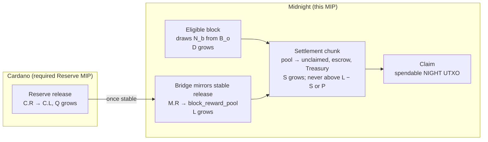

<!--
 Copyright Midnight Foundation

 Licensed under the Apache License, Version 2.0 (the "License");
 you may not use this file except in compliance with the License.
 You may obtain a copy of the License at

     https://www.apache.org/licenses/LICENSE-2.0

 Unless required by applicable law or agreed to in writing, software
 distributed under the License is distributed on an "AS IS" BASIS,
 WITHOUT WARRANTIES OR CONDITIONS OF ANY KIND, either express or implied.
 See the License for the specific language governing permissions and
 limitations under the License.
-->

## Abstract

This proposal defines native Midnight block-production rewards. The protocol records each block
producer, applies the published tokenomics formula, and accumulates the result for the producing
operator. An operator is a Cardano stake pool registered for Midnight under the required staking
MIP, NIGHT Staking on Cardano. Once per Cardano epoch, the stake snapshot that selected that epoch's
committees also supplies the inputs to a public, reproducible split of the pool's reward between its
operator, its ADA delegators and the holders of cNIGHT locked behind it, on the margin in its
Cardano pool registration certificate, plus any fixed cost in NIGHT that its Midnight registration
declares.

Rewards accrue automatically as NIGHT entitlements in runtime state and settle into Midnight's
existing ledger reward balances. While Reserve control remains on Cardano, Midnight's existing
bridge mirrors each finalized scheduled release from the Cardano Reserve into its block-reward pool,
and an entitlement becomes claimable only when settlement pays it out of NIGHT released that way.
Cardano needs no knowledge of Midnight for this. A recipient then uses the
existing signed reward-claim transaction to create a spendable unshielded NIGHT UTXO on Midnight.
No Cardano per-recipient payout contract, batcher, or virtual account is required.

The pool registration, the lock in which a recipient names its Midnight reward address, and the
stake snapshot are those of the required staking MIP; this proposal reads the snapshot record and
defines none of them. Runtime, RPC, indexer, CLI, and SDK interfaces expose reward addresses,
forecasts, accrued and release-gated balances, per-block calculations, epoch splits, and
withdrawals. Independent implementations can recompute payouts from finalized public data and
normative vectors.

## Motivation

As Midnight decentralizes block production, Cardano stake-pool operators need a defined way to
register for rewards, forecast likely returns, observe accrual, verify calculations, and withdraw
spendable NIGHT on Midnight. Delegators, and holders of cNIGHT locked behind a pool, need to see how
a pool's reward is divided between the operator and stake-based recipients under the terms the
pool's operator has set. None of those workflows is complete today.

The current codebase already contains most of the native payout substrate. The Midnight ledger has
`block_reward_pool`, `unclaimed_block_rewards`, `DistributeReserve`,
`DistributeNight(Reward)`, `ClaimRewardsTransaction`, a minimum claim amount, replay protection, and
a supply-conservation check. The node exposes a runtime query for an unclaimed amount. The indexer
records block authors and reward-claim transactions.

The production path is nevertheless inactive. The node runtime's block-reward pallet and block
beneficiary inherent are disabled, the configured ledger block reward is `(0, None)`, and there are
no complete production interfaces for reward addresses, calculation history, recipient splits,
forecasting, or withdrawal.

The initially proposed MIP-0024 proposes paying NIGHT on Cardano through virtual accounts, contracts, a rewards pool,
batchers, fee pools, and a data pump. That design does not satisfy the current requirement that rewards be distributed as NIGHT on Midnight. Native accrual reuses the ledger's existing conservation and claim machinery and eliminates per-recipient Cardano payouts.
It does not bypass the tokenomics whitepaper's cross-chain supply invariant: while Reserve control
remains on Cardano, Midnight unlocks no more reward NIGHT than the finalized Reserve release it
has observed on Cardano.

Independent verification in this proposal means deterministic recomputation from finalized public
inputs. A verifier may obtain those inputs from its own full node or compare independent indexers.
Succinct verification without a full node is outside this proposal.

## Specification

### Terminology and units

* `STAR` is the smallest NIGHT unit. Consensus arithmetic uses whole STAR.
* `pool_id` is the 28-byte Blake2b-224 hash of a Cardano stake-pool verification key.
* `stake_address` is the network-tagged Cardano reward address for a stake credential. The snapshot
  record gives a stake credential as a kind byte and a 28-byte hash, and on one network the two
  forms name the same credential.
* The *required staking MIP* is NIGHT Staking on Cardano (`mip-xxxx-night-staking-on-cardano.md`).
  This MIP cites its rules as "staking rule N, Name", and takes from it the pool registration, the
  lock, `cnight_weight` and the stake snapshot record. It defines none of them.
* *cNIGHT* is NIGHT on Cardano. A *lock* is the delegation lock of the required staking MIP: a UTXO
  at its staking contract whose datum names an owner credential, one pool and a `reward_address`,
  and which holds the cNIGHT it stakes, which may be none.
* `operator_id` identifies an operator and is its `pool_id` (see **Operators and payees**).
* `reward_address` is a Midnight `UserAddress`, 32 bytes, that a pool names in its Midnight
  registration and a recipient names in a lock. It holds the ledger balance of the unclaimed reward
  and receives the claimed NIGHT, and a withdrawal is signed by the key from which the ledger
  derives it. Rewards are paid in NIGHT on Midnight and remain on Midnight; this MIP provides no
  transfer to Cardano.
* `epoch` is a Cardano epoch `E`. A block belongs to epoch `E` when its committee was selected from
  the stake snapshot of epoch `E` (staking rule 24, Selection). Rewards are calculated per block,
  and are split and settled once per epoch. A *Midnight epoch* is one committee session, and one
  Cardano epoch holds many of them.
* `snapshot_id` identifies the stake snapshot record of an epoch, `NightStakeSnapshotV1` (staking
  rule 23, Snapshot record): the one record per Cardano epoch that lists the operators, the locks
  and the ADA delegators, and from which that epoch's committees are selected.
* `reward_reserve_outstanding` is the canonical economic balance used to calculate future base
  rewards. It corresponds to `B_o` in the tokenomics whitepaper and decreases by `N_b` when each
  reward-eligible block executes. At the best-chain head it also reflects draws by blocks not yet
  finalized, which fork choice may roll back; in finalized state it reflects exactly the finalized
  reward-eligible blocks.
* `unsettled_draw` is finalized base draw not yet paid out by native settlement, `P` in **Settlement
  gate and supply invariant**.
* `unassigned_released` is released NIGHT available to settle: the balance of `block_reward_pool`
  less its balance at activation and less all escrow. A Cardano transaction or release is
  *finalized* in this MIP when it is stable under the network's Cardano stability rule.
* `reserve_pool` is Midnight's actual `M.R` balance. It moves only when the bridge mirrors a
  finalized Cardano Reserve release.
* `STAR_PER_NIGHT` is a network constant equal to 1,000,000; the required Reserve MIP uses the same
  denomination. It is not a governable parameter and MUST be published with the tokenomics
  parameters.

No consensus calculation uses floating-point arithmetic.

### Operators and payees

An operator is a Cardano stake pool that the required staking MIP admits at the stake snapshot
(staking rule 18, Pools at the snapshot): the registration set on Cardano holds an active and valid
registration for its `pool_id`, and Cardano holds the pool as registered, with or without ADA
delegated to it. `operator_id` is its `pool_id`. A pool that Cardano has retired, or whose
registration is inactive or invalid at the snapshot, is no operator in that epoch and earns nothing
in it. This MIP reads the snapshot record (staking rule 23, Snapshot record) and nothing else about
a pool, a lock or a delegator. For each operator the record carries the `margin` and the `owners` of
its Cardano pool registration certificate and the `fixed_cost` and `reward_address` of its Midnight
registration, and it lists the locks and the ADA delegators that are the pool's payees (see **Epoch
reward split**). The split needs the per-delegator rows of the record, and whether the record
carries those rows or only a commitment to them is Open Question 4 of the required staking MIP.

A recipient names the Midnight address at which it is paid in a lock, in a Cardano transaction that
the lock's owner credential authorizes (staking rule 5, Owner authorization). The key behind a
`reward_address` signs nothing on Cardano, because a recipient chooses where its own rewards go. The
owner names a new address with an Update of the lock, and the new address applies from the first
snapshot that records it. An amount already calculated goes to the address in its snapshot record,
and a balance already credited stays with the address that holds it: no rule moves a credited
balance to another address, so a recipient that loses the key of an address loses the balance
credited to it.

A holder of locked cNIGHT is paid at the `reward_address` of its lock. An ADA delegator names its
address in a lock whose owner is its stake credential and which names the pool that it delegates to,
and that lock may hold no cNIGHT. A stake credential that is delegated to a pool and owns no lock
for that pool still earns, and the runtime holds its share in escrow keyed by `stake_address`;
**Bounded native settlement** states when that escrow moves to a reward address.

Every committee entry carries a consensus `reward_eligible` flag. In accordance with the tokenomics
whitepaper, the initial trusted permissioned producers are ineligible and their blocks draw no
reward from the Reserve. Participating Cardano SPOs are eligible. A later hybrid-stage policy may
make another producer class eligible only through a superseding MIP and network upgrade whose
activation is announced at least one complete Cardano epoch in advance; changing eligibility cannot
be retroactive.

A pool leaves block production with a Deactivate of its registration node, which is permanent for
that node (staking rule 10, Changes), and it is no operator at a later snapshot until it creates
another node. Rewards calculated for earlier epochs settle as before. A delegator whose lock no
longer counts (staking rule 14, Effective lock) keeps the rewards already credited, and its later
ADA share is held in escrow.

This MIP reads the record as the required staking MIP adopts it (staking rule 17, Snapshot
finality), and that MIP bounds how Midnight reads locks and registrations from Cardano and returns
the record in bounded pages (staking rule 27, Bounded units).

### Author attribution

The block author is derived from the active BABE authority index and the immutable committee
record for the block's Midnight epoch. It is never supplied by an environment variable, RPC parameter,
indexer, or other unverified inherent.

For a registered producer, the committee record provides `operator_id`, its `pool_id` (staking rule
24, Selection), and the epoch's snapshot record supplies the operator's `reward_address` and reward
terms. An ineligible producer generates an attribution record with zero reward; if it has no
operator identity, the record's `operator_id` is empty. Failure to map an eligible consensus author
to the immutable committee and operator identity is an invalid block transition; it does not pay a
fallback recipient or create an unowned escrow entry.

### Tokenomics parameters

The runtime stores a versioned `RewardParametersV1` containing:

```
RewardParametersV1 {
    version:                  u32,
    activation_slot:          u64,
    initial_reward_reserve_star: u128,
    initial_expansion_n:      u128,
    initial_expansion_d:      u128,
    reserve_allocation_n:     u128,
    reserve_allocation_d:     u128,
    treasury_allocation_n:    u128,
    treasury_allocation_d:    u128,
    expected_blocks_per_year: u64,
    distribution_rate_n:     u128,
    distribution_rate_d:     u128,
    fixed_subsidy_n:          u128,
    fixed_subsidy_d:          u128,
    recipient_split_policy:   bytes32,
    recipient_policy_hash:    bytes32,
    max_updates_per_block:    u32,
    publication_hash:         bytes32,
    governance_action_hash:   bytes32
}
```

For the initial parameter version, `publication_hash` MUST identify the exact approved edition of
the Midnight Tokenomics and Incentives Whitepaper. The digest and the initial values MUST be
independently verified and ratified before this MIP moves to `Proposed`. This MIP assigns the
initial subsidy ratio and recommends `pi` (Open Question 8); `B`, `T` and
`gamma` come from the publication and the active slot duration. In the
notation of that publication, `initial_expansion` is `pi`,
`reserve_allocation` is `B`, `treasury_allocation` is `T`, and
`expected_blocks_per_year` is `gamma`.

The stored distribution rate MUST be the exactly reduced rational representation of:

```
R_a = pi * (1 - B - T) / B
R   = R_a / gamma
```

where:

* `pi` is the initial annual inflation of the circulating supply: the rate at which NIGHT enters
  circulation, relative to the NIGHT already circulating, during the first year;
* `B` and `T` are the shares of the total supply held in the Reserve and in the Treasury when the
  token distribution ends, so `1 - B - T` is the share then circulating;
* `R_a` is the annual base distribution rate, the fraction of the Reserve distributed as rewards
  per year;
* `gamma` is the expected number of blocks per year, determined by the block time; and
* `R` is the per-block base distribution rate, the fraction of the outstanding Reserve drawn by
  each reward-eligible block (`N_b = B_s * R` in **Per-block reward calculation**).

The first year's rewards are intended to equal `pi` times the circulating supply. Rewards leave a
Reserve of size `B` at rate `R_a`, so `R_a * B = pi * (1 - B - T)`, which gives the first formula;
dividing by the blocks per year gives the second. With the recommended `pi` = 3/100, `B` = 1/4,
`T` = 1/20, and six-second blocks (`gamma` = 5,256,000), `R_a` = 21/250 (8.4% per year) and
`R` = 7/438,000,000.

Governance MUST reject a parameter set whose `distribution_rate_n/distribution_rate_d` does not
equal that derivation. Every denominator, `expected_blocks_per_year`, and `B` MUST be non-zero, and
`B + T` MUST be less than or equal to one.

The distribution rate is derived from the `pi` this MIP recommends, settled before the Reserve logic
of the required Reserve MIP is frozen, and changes only if `pi` changes. `R_a` is the only input to
the Cardano release, so after the Reserve logic is frozen it is permanent. The initial subsidy ratio
is 95/100. Under the current NIGHT MiCA white paper, monetary-policy parameters are outside the scope
of today's governance authorities (Open Question 1), so `pi`, `R_a` and the subsidy ratio are not
changed by any governance action under this MIP; a change requires a superseding MIP under the
decentralized on-chain governance that the disclosure anticipates.

Block time stays on Midnight. `gamma` is derived from the slot duration, and `R` from `R_a` and
`gamma`. A change of slot duration MUST rescale `gamma` and `R` in the same runtime upgrade, so that
`R * gamma = R_a` still holds, and the Cardano release does not move. Such a change MUST take effect
at a release-interval boundary and only to a slot duration that divides the required Reserve MIP's
`release_interval_ms`, which keeps the release covering what Midnight can draw. A parameter version
that only rescales `R` and `gamma` this way is not a monetary change. `initial_reward_reserve_star`
and the denomination change only through a superseding MIP. A later parameter version records the
hash of its governing published source in `publication_hash` and that of its approved governance
action in `governance_action_hash`; it cannot alter a finalized or settled epoch.

The parameters and their complete activation history are available through the runtime API and
indexer. This MIP does not grant a new authority to change tokenomics.

### Per-block reward calculation

As part of every successfully executed block, the runtime first reads the author's
`reward_eligible` flag from the active committee record. An ineligible author produces a public
zero-reward record and does not reduce the outstanding allocation. For an eligible author, the
runtime calculates:

```
N_b = floor(B_s * r_n / r_d)
N_f = floor(N_b * s_n / s_d)
N_v = floor((N_b - N_f) * u_used / u_max)
N_a = N_f + N_v
N_t = N_b - N_a
```

where:

* `B_s` is `reward_reserve_outstanding` before the block, corresponding to the publication's `B_o`;
* `r_n/r_d` is `R`, the base distribution rate derived above;
* `s_n/s_d` is the fixed subsidy ratio;
* `u_used/u_max` is consensus block utilization, whose exact definition is Open Question 4;
* `N_b` is the total reserve draw;
* `N_a` is the producing pool's reward; and
* `N_t` is the Midnight treasury's share.

The block state transition decreases `reward_reserve_outstanding` by `N_b` and increases
`unsettled_draw` by `N_b`. Normal fork choice rolls back transitions on non-canonical branches;
only finalized draws count towards settlement. The Cardano Reserve releases on its own schedule
under the required Reserve MIP, which covers finalized draws once the release interval containing
them has been released. Consequently, the canonical reconciliation identity is:

```
initial_reward_reserve
    = reward_reserve_outstanding
    + cumulative_finalized_base_draw

cumulative_finalized_base_draw
    = cumulative_settled_draw
    + unsettled_draw
```

`cumulative_finalized_base_draw` and `cumulative_settled_draw` are `D` and `S` in **Settlement gate
and supply invariant**.

An implementation may represent these quantities through equivalent cumulative counters, but MUST
prove the identities for every finalized block. Division floors only at the points shown. The
remainder of the `N_b` floor stays in `reward_reserve_outstanding`; the remainders of the `N_f` and
`N_v` floors are part of `N_t`. Products use a checked intermediate width
of at least 256 bits. Overflow, an invalid denominator, utilization above `u_max`, or a draw above
the remaining balance makes the block invalid, so no honest node imports or finalizes it; a fault
that every candidate block would hit halts finalization rather than silently changing the monetary
calculation.

Each block produces the following consensus record and event:

```
BlockRewardRecordV1 {
    block_number:           u64,
    midnight_epoch:         u64,
    cardano_epoch:          u32,
    operator_id:            bytes,
    base_draw_star:         u128,
    producer_reward_star:   u128,
    treasury_reward_star:   u128,
    utilization_numerator:  u128,
    utilization_denominator:u128,
    parameters_version:     u32,
    snapshot_id:            bytes32
}
```

The containing block hash identifies the record once the block is constructed; it is not a runtime
input stored inside its own record. The producing pool's `N_a` and the treasury's `N_t` are
accumulated for the epoch. The record, its containing block, the parent block's public reward state
(`B_s`), and the identified parameter version are sufficient to recompute the calculation without
consulting private or implementation-specific state.

### Epoch reward split

The split for epoch `E` uses the stake snapshot record of epoch `E`, the record that `snapshot_id`
identifies, and no other source. The required staking MIP takes that record from the Cardano ledger
state at the start of Cardano epoch `E - 3`, before the nonce that seeds the committees of epoch `E`
is known (staking rule 16, Snapshot point), and selects those committees from it (staking rule 24,
Selection), so one record fixes who produces the blocks of an epoch and who is paid for them. Nodes
MUST NOT substitute a newer local snapshot. The split runs once per epoch, after the last block of
the epoch is finalized, for each pool that produced a block in the epoch, on its producer total
`P_pool`, the sum of `N_a` over those blocks.

The tokenomics whitepaper establishes that participating SPOs and their enabling delegators can
withdraw rewards, but it does not define how one pool's producer reward is divided among them. As on
Cardano, each SPO sets a margin and the rest is shared in proportion to stake, the operator's own
stake included; this MIP fixes the form of the split and its arithmetic. Backers are protected, as
on Cardano, by seeing the margin where they already look and being able to move their stake. A
pool's margin is the margin in its Cardano pool registration certificate, which the snapshot record
carries as `margin`.

An SPO may also declare a fixed cost in NIGHT, taken off the top of its pool's reward before the
margin, as Cardano's fixed cost is. Cardano's own fixed cost, an ADA amount, is not used: no
conversion takes place, and the SPO chooses a number of NIGHT. The SPO declares it as `fixed_cost`
in its Midnight registration, in STAR per Cardano epoch, and the snapshot record carries it. Like
the margin, it takes effect only from the snapshot that selects the committee, so an SPO cannot
raise it after learning it was selected and how many slots it holds.

The payees of a pool in epoch `E` are fixed by the snapshot record:

* each row of `delegators` that names the pool, except a row whose stake credential is the key
  credential of one of the pool's `owners`, with `s_i` its `lovelace`; and
* each row of `locks` that names the pool, with `s_i = floor(cnight * w_n / w_d)`, where `cnight` is
  the STAR of cNIGHT in the lock and `w_n/w_d` is the record's `cnight_weight`, the lovelace of
  stake per STAR of cNIGHT (staking rule 19, Virtual stake).

The lovelace of the `delegators` rows that name the pool and belong to its `owners` is the pool's
pledge, and it is the operator's own stake, `s_operator`. An owner is not paid as a delegator: the
share of the pledge goes to the operator. Each lock is its own payee with its own term, so two locks
that name one `reward_address` are two entries, and both settle to that address.

For a pool with producer total `P_pool`, fixed cost `fixed_cost`, margin `m_n/m_d` (with
`0 <= m_n <= m_d`), stake `s_i` for each payee `i`, and total stake `s`, the sum of `s_operator` and
every `s_i`:

```
fixed              = min(P_pool, fixed_cost)
operator_cut       = fixed + floor((P_pool - fixed) * m_n / m_d)
shared             = P_pool - operator_cut
share_i            = floor(shared * s_i / s)
share_operator     = floor(shared * s_operator / s)
rounding_remainder = shared - share_operator - sum(share_i)
operator           = operator_cut + share_operator + rounding_remainder
```

`s` equals the pool's virtual stake, which is above zero for every pool that a committee holds
(staking rule 24, Selection). As on Cardano, if the pool's reward is at or below the fixed cost, the
operator takes all of it; delegators are protected by seeing the amount and being able to leave.

The operator's amount is paid at the pool's `reward_address`, and a lock's `share_i` at the lock's
`reward_address`. A stake credential's `share_i` is paid at the `reward_address` that its locks for
the pool name: the locks in the record whose owner is that credential and whose pool is that pool.
It is held in escrow when the credential has no lock for the pool, or when its locks for the pool
name different addresses.

Every amount is a non-negative integer number of STAR. The operator, each `delegators` row that is
not an owner's and each `locks` row is one payee, a `RewardPayeeV1`, and outputs are ordered as the
payees of a pool are in **Bounded native settlement**. The split's canonical output is the ordered
collection of non-negative `(payee, amount_star)` entitlements, the operator's among them, and it
MUST satisfy:

```
sum(recipient_entitlements) = P_pool
```

The form is identified by `recipient_split_policy` and `recipient_policy_hash`. Their values are
fixed for version 1 of this MIP: they appear in `RewardParametersV1` so that records identify the
form, not so that governance can change it, and changing them requires a superseding MIP. An SPO's
change to its margin or fixed cost applies only from the first epoch whose snapshot records it and
cannot alter a calculated epoch. A pool that is no operator at a snapshot holds no seat in that
epoch, so neither the pool nor the cNIGHT locked behind it earns in that epoch. A missing reward
address changes no allocation: the entitlement is held in escrow.

The epoch result records the gross pool reward, the split form's identifier and hash, the pool's
fixed cost and margin, operator aggregate, delegator aggregate, lock aggregate, treasury amount,
rounding remainder, snapshot ID, and reward-parameter version. Per-recipient entitlements record
their payee, reward address, stake amount, and credited STAR.

### Settlement gate and supply invariant

NIGHT is mirrored on Cardano and Midnight. During the initial reserve-control stage defined by the
tokenomics whitepaper, let `C.R` and `C.L` be NIGHT in Cardano Reserve and protocol-locked states,
and let `M.R`, `M.L` and `M.U` be NIGHT in the Midnight Reserve, protocol-locked and
protocol-unlocked states. Per-block calculation and epoch splitting create deterministic
entitlements, but do not by themselves make those amounts claimable.

Under the required Reserve MIP, the Cardano Reserve contract releases NIGHT from `C.R` to `C.L` on a
fixed POSIX timer, and Midnight's existing bridge mirrors each finalized release: it moves the same
amount from `reserve_pool` (`M.R`) to `block_reward_pool` with `DistributeReserve`, and records a
`ReserveReleaseObservationV1`. The unassigned balance of `block_reward_pool` is protocol-locked
(`M.L`) until settled: it is credited to no one, and only settlement pays it out. Settled amounts,
whether to a recipient's unclaimed balance, to escrow, or to the Treasury, leave it.

**The settlement gate.** Settlement consumes one interface, *released NIGHT available to settle*,
which is `unassigned_released`. While Cardano controls the Reserve, observation supplies it, through
the bridge's mirroring. After a handover under the required Reserve MIP, a later MIP supplies it
from the computed schedule instead; nothing else in this MIP changes.

**State.** Midnight keeps, in finalized state:

- `B_o`, the canonical outstanding reward Reserve, used for the next reward calculation;
- `D`, the cumulative finalized base draw earned by eligible Midnight blocks;
- `L`, the cumulative release mirrored from Cardano, the sum of `release_delta_star` over all
  observation records;
- `S`, the cumulative NIGHT paid out of the unassigned balance by native settlement; and
- `P = D - S`, earned value not yet settled.

At activation `D`, `L`, `S` and `P` are zero, `B_o` and `M.R` equal `initial_reward_reserve`, and
the existing `block_reward_pool` balance is recorded as the activation baseline (**Backwards
Compatibility Assessment**). After activation, the following MUST hold in the state of every
finalized Midnight block, where `Q` is the Cardano Reserve contract's cumulative release:

```
initial_reward_reserve = B_o + D
D = S + P
0 <= S <= D
S <= L <= Q
M.R = initial_reward_reserve - L
unassigned_released = L - S
C.R <= M.R
M.U <= C.L
```

`L` trails `Q` only by releases not yet stable, so `M.R = initial_reward_reserve - L >= C.R`, with
equality once every release is stable. Settlement moves into `M.U` no more than `S <= L`, and the
bridge's mirroring moves into `M.L` no more than Cardano has moved into `C.L`. That preserves
`M.U <= C.L` given that it holds at activation, which the activation state checks, and that ordinary
bridge movements preserve it on their own (required Reserve MIP, Open Question 5). An implementation
MAY store equivalent cumulative or delta values, but all public reconciliation interfaces and test
vectors use the definitions above.



**Coverage.** The required Reserve MIP's schedule guarantees that once an interval's release is
mirrored, `L` is at least the cumulative draw of every block in that interval and earlier ones.
Midnight checks this after mirroring each release, and again whenever a block in an already released
interval becomes finalized: the cumulative draw of all finalized blocks up to that interval's end
MUST NOT exceed `L`. Coverage counts slots, so it can fail only if Midnight broke the slot-duration
rule in **Tokenomics parameters**, or through a fault. Its failure would delay claims; it cannot
unlock unbacked NIGHT, because settlement never exceeds `unassigned_released`.

`L - D`, when positive, is *undrawn release*: NIGHT released for slots in which no eligible block
drew the curve's maximum. It sits in `block_reward_pool`, unassigned, and can be settled only
against later earned entitlements.

At the best-chain head, `B_o` also reflects draws by blocks that are not yet finalized. Fork choice
may roll those draws back, so the identities above are required only of finalized state.

**Halt and reconciliation.** Settlement halts closed, and stays halted until a published incident
reconciliation resolves the cause, if any of the following occurs:

- a finalized state fails one of the identities above;
- coverage fails;
- the Cardano Reserve has an unexpected spend, as the required Reserve MIP defines it;
- a previously stable release is later absent because of an exceptional rollback or consensus
  failure; or
- `reserve_pool` moves other than by the bridge's `DistributeReserve` for a valid, mirrored release,
  including a `DistributeReserve` or `UnlockToReserve` for any other cause.

Reward calculation MAY continue while settlement is halted if `B_o` remains unambiguous, causing `P`
to grow, but no new value becomes claimable. A halt MUST NOT subtract already claimed NIGHT,
fabricate a compensating release, or silently adopt a different Cardano history. The reconciliation
identifies the last common mirrored release, the Cardano Reserve state, Midnight's `L` and `S`, and
the resulting invariant status. Any state repair requires its own auditable action, and it can
change who owns an entitlement, or reduce one, only through the actions in **Entitlement ownership**.

### Bounded native settlement

The number of delegators cannot determine the weight of one block. Epoch settlement therefore uses a
deterministic queue. Each block processes no more than `max_updates_per_block` entries. Later epochs
may accumulate while an earlier settlement is in progress, but queue order is fixed and cannot skip
an entry. An entry of the queue is a `SettlementEntryV1` of one epoch:

```
SettlementEntryV1 = enum {
    Treasury,
    Pool          { operator_id: [u8; 28], payee: RewardPayeeV1 },
    EscrowRelease { stake_credential: (u8, [u8; 28]) }
}

RewardPayeeV1 = enum {
    Operator,
    Delegator { stake_credential: (u8, [u8; 28]) },
    Lock      { utxo: ([u8; 32], u16) }
}
```

Entries sort by epoch, then by variant in the order shown, then by their fields in order, each
compared by value. Within an epoch the treasury amount therefore comes before every pool and the
escrow releases come after every pool, and within a pool the operator comes first, then its
delegators, then its locks. `stake_credential` and `utxo` have the forms that the snapshot record
gives them (staking rule 23, Snapshot record). Both types are encoded with SCALE like the other
records of this MIP, so the codec writes the variant, and this MIP assigns no byte value by hand.

An entry is settled whole or not at all. Every chunk, including its operator, delegator, lock, and
treasury components, MUST be less than or equal to both its unsettled entitlement total and
`unassigned_released`. A chunk ends before the first entry whose amount exceeds the
`unassigned_released` that remains, and that entry waits at the head of the queue until enough
release has been mirrored.

An operator's entry settles to the pool's `reward_address`, and a lock's entry to the lock's
`reward_address`. A stake credential's entry settles to the `reward_address` that its locks for the
pool name. When the credential has no lock for the pool, or its locks for the pool name different
addresses, the entry is settled to escrow: it stays in `block_reward_pool`, moves from the
unassigned balance into `escrow[stake_address]`, and counts towards `S`. No entry is held at the
head of the queue for lack of a lock. An epoch holds one escrow release for each stake address whose
escrow is not empty once the pool entries of the epoch are settled, and whose credential owns one or
more locks in the snapshot record of the epoch that all name one `reward_address`. The release moves
the whole of `escrow[stake_address]` to that address with `DistributeNight`, without changing `S`.
The credential needs no share in that epoch, so a delegator that has left its pool collects its
escrow with a lock that holds no cNIGHT. That lock must name a pool that is an operator at the
snapshot, because the record lists no other lock (staking rule 23, Snapshot record); a lock that
names a retired pool releases nothing. Between chunks, `block_reward_pool` equals its balance at
activation plus the sum of all escrow balances plus `unassigned_released`.

Each settlement chunk is a mandatory atomic runtime transition identified by
`(epoch, chunk_index)`. Before changing state, the runtime validates the complete chunk, including
its entitlement sum, `unassigned_released`, output encodings, replay identifiers, treasury amount,
and execution limits. It then applies the existing ledger operations to a temporary state:

1. `DistributeNight(Reward, outputs)` moves the amount for each recipient from `block_reward_pool`
   into `unclaimed_block_rewards[reward_address]`.
2. The treasury portion is moved through the ledger's existing treasury path,
   `PayBlockRewardsToTreasury`.

The new ledger state root, `S`, escrow balances, settlement cursor, and used chunk identifier are
committed together only if both steps succeed. Any failure commits none of them. Retrying the same
valid chunk after a transient failure is safe; retrying a committed chunk is rejected. The
reward-specific system-transaction executor MUST reject every ledger operation other than the two
listed above. It never issues `DistributeReserve`; only the bridge does, for a mirrored release.

If an output is below the claim minimum, it still accrues and combines with future rewards; a
balance that never reaches the minimum is Open Question 6. An
entitlement does not expire. No operator, delegator, per-recipient batcher, or fee-paying agent is
required to initiate Midnight settlement once released NIGHT is available. Cardano Reserve release
and its mirroring remain prerequisites during the initial reserve-control stage.

After every committed chunk, the ledger's NIGHT supply invariant MUST hold. The runtime records the settled
amount, remaining queue length, and last processed key so that interruption and runtime upgrade do
not duplicate or lose rewards.

### Withdrawal into spendable NIGHT

A recipient withdraws with the existing `ClaimRewardsTransaction` and `ClaimKind::Reward`. The
transaction commits to network ID, amount, owner, nonce, and claim kind and is signed by the owner
key, whose `UserAddress` is the `reward_address`. A successful claim subtracts the amount from that
address's `unclaimed_block_rewards` entry and creates an unshielded NIGHT UTXO owned by the same
Midnight address.

The existing minimum claim threshold applies; it is the ledger's parameter, and this MIP sets no
separate one. A claim at or above the threshold pays no additional
transaction fee, matching current ledger semantics. Partial withdrawal is allowed. Replay
protection and normal transaction validity checks apply.

CLI and SDK surfaces follow Cardano's explicit query-then-withdraw convention:

```
midnight-cli query stake-pool-rewards --stake-address ... [--epoch ...]
midnight-cli query stake-pool-rewards --reward-address ... [--epoch ...]
midnight-cli transaction withdraw-rewards --reward-address ... --amount all|STAR --out-file ...
```

A recipient creates, updates, unbonds and unlocks a lock with Cardano transactions, with the tooling
of the required staking MIP, and this MIP adds no command for it. The SDK provides typed equivalents
for reward queries, offline claim construction, external signing, submission, and confirmation.

### Public query interface

Runtime API, RPC, and indexer queries are batch-capable and accept `stake_address` as the primary
user-facing key: the network-tagged form of an ADA delegator's stake credential or of a lock's owner
credential. Each query mirrors a Koios endpoint and uses its response shape, with batch queries by
POST, so that wallets, explorers and test harnesses can port existing Cardano integrations:

| Midnight query | Koios counterpart | Fields, in Koios's names where one exists |
|---|---|---|
| Account status | `account_info` | `stake_address`, `status` (whether it owns a lock for its pool, and whether its locks for that pool name one reward address), `delegated_pool`, `rewards` (calculated entitlement), `withdrawals` (claims), `rewards_available` (claimable); plus its locks with their reward addresses, escrow, release-gated and unsettled amounts |
| Reward history | `account_reward_history` | `earned_epoch`, `spendable_epoch` (the epoch the entitlement became claimable), `amount`, `type` (`leader` or `member`), `pool_id` |
| Pool epoch totals | `pool_history` | `epoch_no`, `active_stake`, `block_cnt`, `delegator_cnt`, `margin`, `fixed_cost` (the fixed cost in NIGHT), `pool_fees` (operator aggregate), `deleg_rewards` (delegator aggregate); plus locked cNIGHT, `cnight_weight`, lock aggregate, treasury amount, rounding remainder, split form identifier and hash, snapshot identifier |
| Pool delegators | `pool_delegators` | `stake_address`, `amount`, `active_epoch_no`; plus the pool's locks, each with its owner, cNIGHT and reward address |
| Lock and claim history | `account_update_history` | `action_type` (lock, update, unbond, unlock, claim), `tx_hash`, `epoch_no`, `block_time`; the claim history takes the place of Cardano withdrawals |

Amounts are in STAR and epochs are Cardano epochs, as in Koios. The Koios API version mirrored is fixed with the
normative vectors. Further queries, with no Koios counterpart, return:

* per-block reward records;
* reward-parameter values and version;
* `ReserveReleaseObservationV1` records, `unassigned_released`, and settlement progress; and
* withdrawal transaction identifiers and resulting UTXOs.

Queries by pool ID and reward address are also supported. Historical pagination uses stable cursors and
declares the retention window. The node runtime API remains authoritative for current state; the
indexer is a convenient historical projection.

### Forecasting

The SDK and CLI expose a pure forecast function taking published reward parameters, the current
`reward_reserve_outstanding`, the pool's expected number of blocks over the range (derived from its
share of committee seats and the number of slots, with the selection model stated), expected
utilization, the pool's margin and fixed cost, operator
stake, delegated stake, locked cNIGHT and `cnight_weight`, and a time range. The result shows assumptions, low/base/high scenarios,
gross pool rewards, and the policy-defined operator and delegator allocations.

A forecast never changes consensus and MUST be labelled as an estimate. Default assumptions are
versioned and displayed rather than hidden. The implementation includes examples showing that slot
selection and utilization are uncertain and that past performance does not guarantee rewards.

### Independent payout verification

A verifier recomputes a payout using only finalized public data:

1. identify the epoch's stake snapshot record and reward-parameter version;
2. derive each finalized block author from consensus data;
3. recompute every `BlockRewardRecordV1` and the pool epoch totals;
4. read the split form's identifier and, from the identified snapshot record, the pool's terms,
   locks and delegators;
5. recompute the policy-defined epoch split in canonical order;
6. verify finalized Cardano Reserve releases and the resulting `unassigned_released`; and
7. compare the result with Midnight's settlement records, claimable balances, and withdrawals.

A public conformance repository linked from this MIP publishes normative JSON and SCALE test
vectors for every step. At least one
independent reference implementation, maintained outside the node runtime crate, MUST reproduce the
vectors before activation. An indexer response is not itself proof of correctness; operators can
verify against their own Midnight and Cardano nodes.

### Versioning

All new records and canonical encodings carry version 1, denoted by the `V1` suffix of the type
name and encoded as a leading version tag. Unknown versions are rejected. A semantic
change to reward arithmetic, rounding, snapshot selection, author attribution, payee
selection, or settlement ordering requires a superseding MIP and network upgrade. Governance may
change values already designated as parameters, but only through the delayed, versioned mechanism
defined above.

## Rationale

Native settlement is chosen because Midnight determines who produced its blocks and already has
ledger primitives for reserving, accruing, and claiming NIGHT. It meets the required payout
location without introducing Cardano-side per-recipient payouts. The settlement gate retains
the whitepaper's initial Cardano Reserve authority instead of allowing Midnight reward accounting
to create independently spendable supply.

Settlement pays out of `block_reward_pool`, which the existing bridge fills by mirroring each
Cardano release, rather than moving `M.R` itself. The bridge already answers every Reserve release
with a `DistributeReserve`; a second, settlement-driven `DistributeReserve` would drain
`reserve_pool` twice per release and halt settlement at the first one. Mirroring keeps `M.R` equal to
`C.R`, as the tokenomics whitepaper describes, and the pool's unassigned balance already records
what has been released and not yet settled, so no separate release-credit counter is needed.
Stating the gate as an interface, released NIGHT available to settle, lets a later handover change
its producer without changing this MIP.

The supply invariant is stated beside the settlement executor that must keep it, and the halt rules
beside the state they protect, so that one document holds the whole Midnight side. The required
Reserve MIP holds only what becomes permanent when the Cardano Reserve logic is frozen, plus the
observation record.

### Relationship to MIP-0024

Upon acceptance, this proposal replaces MIP-0024's payout location and delivery state machine.
The following MIP-0024 mechanisms are not used: Cardano virtual-account deposit UTXOs, the Cardano
rewards pool as recipient float, reward Merkle leaves and epoch folds, batcher state, per-recipient
ADA skims, NIGHT distribution fees, payout thresholds, Cardano recipient withdrawals, and the
requirement to lengthen Midnight epochs solely to make those folds practical.

MIP-0024 remains relevant design input. This proposal retains or adapts its:

* per-block integer reward calculation and logical outstanding Reserve model;
* consensus-derived block author and epoch pool accumulator;
* direct protocol allocation to operators and delegators rather than discretionary SPO payment;
* use of the committee-selection stake snapshot and Cardano pool parameters;
* stake-credential authentication for both key and script credentials;
* rule that a missing reward address delays delivery without forfeiting entitlement;
* deterministic ordering and bounded processing of large recipient sets;
* funded, permissionless submission of Reserve release transactions; and
* Cardano stability, replay, migration, audit, and public-recomputation requirements.

It does not use MIP-0023: Cardano needs no proof of Midnight state. The companion Reserve MIP
changes MIP-0024's time-based worst-case pool refill into an exact per-interval release of the
published curve's maximum draw. It also changes the token path from Cardano-unlocked
recipient payout (`C.R -> C.U`) to protocol-locked backing for native Midnight settlement
(`C.R -> C.L`, mirrored by `M.R -> M.L`, followed by settlement into `M.U`). No MIP-0024 code or contract is assumed reusable until
its state transition, destination, trust boundary, and target-version compatibility are re-audited.

Claimable balances are chosen instead of automatically creating one UTXO per recipient each epoch.
Recipients control consolidation timing, small amounts can accumulate, and settlement does not
produce dust UTXOs. The existing claim transaction already authenticates the owner and creates
spendable unshielded NIGHT.

The pool registration, the lock and the stake snapshot are taken from the required staking MIP
rather than defined here, so that committee selection and rewards read one registration and one
snapshot record. A recipient names its reward address in a lock that its own Cardano credential
authorizes, and the key behind the address signs nothing, because the address only receives and a
recipient chooses where its own rewards go.

A change of reward address moves only future rewards: the new address applies from the next
snapshot, and a balance already credited stays with the address that holds it. This needs no new
ledger operation and no rotation state, because the existing claim remains the only operation that
debits an unclaimed balance. The cost is that a recipient whose key is lost or stolen loses the
balance credited to that key's address, and this MIP accepts that loss and adds no mechanism to
recover it.

Every operator is a Cardano stake pool, backed by ADA delegated to it and by cNIGHT locked behind
it, so one snapshot record and one split serve every pool. ADA stake and cNIGHT stake are added
through `cnight_weight`, the rate that the required staking MIP sets and that the snapshot record
carries, so the split uses the same weight that selected the committee.

The margin follows Cardano: reading a pool's margin from its Cardano certificate keeps one set of
terms where its delegators already look, and raising it costs the SPO on Cardano too. The owners'
stake is the pool's pledge and counts as the operator's own stake, as on Cardano, so its share of
the reward goes to the operator and no owner is also paid a delegator's share. A fixed cost in NIGHT
follows Cardano as well, so that a small pool can cover its running costs without a high margin.
Cardano's ADA figure is not reused, because that would need an exchange rate; a fixed cost declared
in NIGHT needs none, and keeping it in line with costs is the operator's business, as keeping
Cardano's ADA cost current is on Cardano. It is declared in the pool's Midnight registration on
Cardano, so SPOs keep using Cardano tools, and the query interface exposes it beside the margin,
because standard pool explorers do not show it.

The committee-selection snapshot is reused because paying against a different stake view would make
eligibility and compensation inconsistent. That snapshot is one record per Cardano epoch and fixes
every input to the split, the stake, the terms and the reward addresses, so the split runs once per
Cardano epoch, and the fixed cost, which is stated per Cardano epoch, needs no proration across
Midnight epochs. Bounded deterministic settlement avoids unbounded block work while preserving
automatic protocol distribution.

Alternatives rejected are:

* **Cardano-side payout from MIP-0024:** rewards would not be NIGHT on Midnight and would depend on
  per-recipient contracts, funded agents, and batchers. This MIP retains only the aggregate Cardano
  Reserve release required by the cross-chain supply invariant.
* **Pay only the operator:** delegator rewards would become discretionary even though delegated
  stake contributes to producer selection.
* **Create UTXOs automatically:** produces avoidable state growth and removes recipient control over
  consolidation.
* **Trust an indexer calculation:** convenient for display, but not independently reproducible.
* **Move a credited balance to a new reward address:** recovers the balance of a lost key, but needs
  a new ledger operation and a delayed, cancellable rotation so that a stolen Cardano credential
  cannot take the balance. A change of address moves only future rewards.

## Path to Active

### Acceptance Criteria

This MIP requires Native NIGHT Block Production Rewards: Cardano Reserve Release, whose
`ReserveReleaseObservationV1` records it consumes as the released NIGHT available to settle, and
NIGHT Staking on Cardano, whose stake snapshot record supplies the operators, the payees and their
reward addresses. The Reserve MIP depends on no other MIP, and the staking MIP is accepted and
activated together with this one. Reward calculation starts with the first Midnight block at or
after the required Reserve MIP's `anchor_posix_ms`. *Activation* is the network upgrade that enables
the feature; the MIP becomes `Active` once the criteria below hold.

This MIP may move from Accepted to Active only when all of the following are true on Midnight
mainnet:

1. An SPO can create, update and deactivate its Midnight registration on Cardano, and a
   delegator or a holder of cNIGHT can create, update, unbond, unlock and query a lock that
   names its Midnight reward address.
2. Every produced block is attributed from consensus state and its reward is calculated using the
   published formula and exact integer arithmetic.
3. Initial permissioned producers receive zero rewards, while every reward-eligible producer is
   identified by consensus state and the active committee record.
4. Each pool's margin and fixed cost are publicly queryable, and public interfaces expose the
   split form's identifier, each pool's fixed cost and margin, operator aggregate, delegator
   aggregate, lock aggregate, treasury amount, and rounding remainder, in the Koios response
   shapes of **Public query interface**.
5. An operator, a delegator or a holder of locked cNIGHT can query accrued rewards and withdraw
   them through supported CLI and SDK flows into spendable unshielded NIGHT on Midnight.
6. The required Cardano Reserve-release MIP is Active on the target network, and the required
   staking MIP meets its other acceptance criteria and activates in the same coordinated
   upgrade.
7. Settlement pays only out of `unassigned_released`, never above it; no entitlement becomes
   claimable while released NIGHT is insufficient; and the reward executor never moves
   `reserve_pool`.
8. The live system continuously demonstrates every identity in **Settlement gate and supply
   invariant**, coverage, and the Midnight ledger's internal supply invariant across settlement,
   interruption, rollback, and upgrade scenarios, and halts closed on each condition listed there.
9. Independent implementations reproduce every normative vector and a representative sample of
   mainnet payouts from finalized Midnight and Cardano data.
10. Locks that name different addresses, a missing lock, a change of reward address, settlement
    interruption, runtime upgrade, and replay do not move rewards away from their payee,
    duplicate, destroy, or strand them.
11. Supply-invariant, migration, performance, and adversarial test suites pass, and the feature has
   completed at least two full epochs on a public test network.

### Implementation Plan

1. Ratify the published tokenomics constants, derivation, document hash, governance origin, Cardano
   snapshot schema, canonical encodings, and normative calculation vectors before `Proposed`.
2. Read each pool's Midnight registration and each lock from the snapshot record of the required
   staking MIP, and mark the initial permissioned authorities reward-ineligible.
3. Activate or replace the block-reward pallet path, derive block authors from consensus, and add
   versioned parameters, per-block records, epoch accumulators, escrow, and the bounded settlement
   queue.
4. Consume the bridge's `ReserveReleaseObservationV1` records, add the supply identities, coverage
   check and halt rules, and connect bounded settlement out of `block_reward_pool` to the existing
   distribution, treasury, unclaimed-reward, and claim mechanisms.
5. Add runtime APIs, RPCs, indexer storage and GraphQL fields, CLI commands, SDK types, forecasting,
   and withdrawal construction.
6. Publish an independent calculation library and cross-implementation conformance vectors.
7. Run migration rehearsals, cross-chain and internal economic-invariant tests, load tests at the
   maximum supported stake distribution, and at least two public-testnet epochs.
8. Activate through a coordinated runtime and node upgrade after operator tooling and documentation
   are released.

## Backwards Compatibility Assessment

This is a consensus-breaking runtime change and requires a coordinated network upgrade. It activates
reward accounting, adds runtime storage and events, and introduces
mandatory settlement system transactions.

This proposal requires Midnight ledger 9.1 or later, from its first stable release. It relies on
the version-2 `ClaimRewardsTransaction` signing envelope, which places `network_id` and `kind`
under the owner's signature; on `SignatureVerifyingKey` claim owners; and on the supply-invariant
check after `PayBlockRewardsToTreasury`. It also requires a later ledger release, to be named under
Open Question 3, that adds an atomic reward-chunk entry point or equivalent temporary-state commit
boundary.

Producer registration is the Midnight registration of the required staking MIP, and no pool holds
one before that MIP is active. The initial permissioned authorities are ineligible under the
consensus `reward_eligible` flag. A cNIGHT/DUST registration names no reward address; only a lock
does. Rewards for a stake address without a lock for its pool accrue in escrow until it has one.
Existing ledger balances do not change. `block_reward_pool` and `unclaimed_block_rewards` retain
their meaning, and existing version-2 `ClaimRewardsTransaction` transactions remain valid.

Activation also requires the Cardano Reserve-release transition and the bridge's mirroring of it
to be operational. Pending entitlements remain non-claimable if Cardano releases stop or Midnight
cannot finalize their observation.

The activation state is constructed as follows:

1. At the audited activation block, read the Cardano Reserve balance, Midnight's `reserve_pool`
   (`M.R`), Midnight's `block_reward_pool`, and the total of `unclaimed_block_rewards`, and publish
   them with the audit.
2. Activation requires the Cardano Reserve balance, `M.R` and the ratified `initial_reward_reserve`
   to be equal. If they differ, activation is prohibited until a published reconciliation explains
   the difference and the initial values are ratified again with the corrected value.
3. Check that `M.U <= C.L` holds, and set `D`, `L`, `S` and `P` to zero and `B_o` to
   `initial_reward_reserve`, with escrow empty. The existing `block_reward_pool` balance and
   unclaimed balances are unchanged; the pool balance is recorded as the activation baseline that
   `unassigned_released` excludes.
4. Reward calculation starts with the first Midnight block at or after the required Reserve MIP's
   `anchor_posix_ms`.

Wallets and SDKs that do not expose the new convenience methods continue to process ordinary
Midnight transactions but cannot present the complete reward workflow. Indexer schema additions are
additive. Historical per-block records begin at activation; the proposal does not fabricate records
for earlier blocks.

Together with Native NIGHT Block Production Rewards: Cardano Reserve Release
(`mip-xxxx-cardano-reserve-release.md`), this proposal supersedes MIP-0024: this proposal replaces
its Cardano payout location and delivery state machine, and the companion proposal replaces its
Reserve release flow. Neither proposal supersedes MIP-0024 alone, and MIP-0024 is recorded as
Superseded only when both are accepted. Neither proposal depends on MIP-0023.

## Security Considerations

**Supply conservation.** Settlement uses the existing block-reward pool and MUST satisfy the
ledger's total NIGHT invariant after every atomic chunk. It additionally pays out no more than the
pool's unassigned balance, which only the bridge's mirroring of finalized Cardano releases fills,
preserving `C.R <= M.R` and `M.U <= C.L`. `reserve_pool` is drained once per release, by the bridge.
Checked arithmetic, unique event and chunk identifiers, and replay protection prevent over-issuance.

**Settlement atomicity.** Recipient credits, escrow, treasury credits, `S`, and cursor advancement
commit under one state root. Prevalidation and temporary-state execution prevent a failure between
ledger operations from overdrawing the pool, settling an entry twice, or skipping an entitlement.

**Cross-chain observation.** A forged, duplicated, premature, or rolled-back Cardano release could
unlock unbacked NIGHT on Midnight. The bridge therefore mirrors a release only from the configured
Cardano Reserve identity and asset after the established stability window, recomputes its amount,
commits the source event identifier, and never mirrors the same release twice. If observation is
unavailable, settlement continues only within released NIGHT already mirrored. On any condition in
**Settlement gate and supply invariant**, settlement halts closed, and entitlement calculation
continues only while `B_o` remains unambiguous.

**Author attribution.** Consensus state is the only source of block authorship. Engine-transition
tests cover BABE boundaries, skipped slots, session rotation, and missing author bindings.

**Reward redirection.** Only the owner credential of a lock can create or change it (staking rule 5,
Owner authorization), so only that credential names the `reward_address` at which the lock, or the
owner's ADA share, is paid. A pool's `reward_address` changes only with an Update of its
registration, under the pool's owner or its cold key (staking rule 10, Changes). A new address
applies from the first snapshot that records it and moves no balance already credited. A compromised
owner credential can therefore redirect later rewards and cannot reach a credited balance. The loss
or theft of the key of a reward address exposes the balance credited to that address, which no rule
moves, and the owner limits the loss by naming a new address.

**Snapshot consistency.** Committee selection and reward splitting use the identical stake snapshot
record, and a node cannot substitute another view: a block whose committee does not match the record
fails (staking rule 26, Determinism).

**Arithmetic manipulation.** Consensus integers, checked wide intermediates, specified rounding,
fixed monetary parameters, and normative vectors prevent platform-dependent results. Governance
cannot alter an already settled epoch.

**Snapshot flooding.** The required staking MIP reads Cardano in bounded units (staking rule 27,
Bounded units), and each lock holds a refundable ADA deposit of at least `lock_deposit_lovelace`, so
filling a snapshot with locks costs locked ADA, not only Cardano fees.

**Snapshot timing.** The snapshot record is taken at the start of Cardano epoch `E - 3`, before the
nonce that seeds the committees of epoch `E` is known, and a pool's margin and fixed cost are read
in the same state (staking rule 16, Snapshot point), so neither stake nor terms can be moved after
the committee is known.

**Settlement denial of service.** Work is bounded per block and ordered deterministically. A large
delegator set delays availability but cannot change entitlement amounts or block all later block
production. Performance limits and maximum queue lag are measured before activation.

**Reserve-release liveness.** Claimability depends on periodic Cardano Reserve release while Cardano
controls that Reserve. The CLI and public APIs distinguish calculated, release-gated, settled, and
claimed amounts so that a release outage cannot be mistaken for lost rewards. No timeout forfeits a
pending entitlement.

**Escrow abuse.** A missing lock never pays an arbitrary default. Escrow releases only to the
`reward_address` of a lock whose owner is the same stake credential.

**Entitlement ownership.** Once an entitlement is calculated, only these actions change who owns it
or reduce it:

1. a `ClaimRewardsTransaction` signed by the key of the reward address, paying that key's own
   address; and
2. settlement of escrow to the `reward_address` of a lock owned by the same stake credential.

Settling a calculated entitlement into its recipient's balance changes neither its owner nor its
amount. No parameter change or other governance action under this MIP adds an action to this list;
adding one requires a superseding MIP. Action 2 rests on the staking contract, which is a fixed
script whose hash is a constant of the chain specification with no governance setter, so that only
the owner credential names the address. An entitlement calculated in error, for example after a
software defect or a corrupted snapshot, stays as calculated until a superseding MIP specifies the
correction, the affected entitlements and the public evidence for it; nothing in this MIP corrects
it.

**Public linkage.** Reward records associate Cardano stake addresses, locks, pools, Midnight reward
addresses, amounts, and withdrawals. This is public by design and MUST be documented. This MIP does
not provide shielded reward accrual.

**Trusted data displays.** RPC and indexer responses may be stale or dishonest. The standardized
records, snapshot identifiers, formula, and vectors let users reproduce results with their own
nodes. This MIP does not claim succinct verification for users unwilling to operate or trust a data
source.

## Implementation

The following components change:

* **`midnight-node/runtime`**: activate or replace `pallet_block_rewards`; derive the beneficiary from
  authorship and committee state; store versioned parameters, records, accumulators, escrow, and
  settlement cursors.
* **`midnight-node/pallets/midnight` and `midnight-system`**: execute bounded
  atomic `DistributeNight`/treasury settlement out of `block_reward_pool` through a reward-only
  executor, and expose reward runtime APIs.
* **`pallet-c2m-bridge`**: keep mirroring each Reserve release with `DistributeReserve`, extended as
  the required Reserve MIP specifies to emit `ReserveReleaseObservationV1`.
* **Stake snapshot**: read the pools, locks and delegators of the snapshot record that the required
  staking MIP builds, and its `snapshot_id`; this MIP adds no Cardano data source of its own.
* **`midnight-ledger`**: retain the reward pool, entitlement map, claim transaction, minimum claim,
  replay protection, and supply checks; add an atomic reward-chunk entry point or equivalent
  temporary-state commit boundary, accepted only from the reward-specific executor, without
  widening any other caller's allow-list.
* **`midnight-indexer`**: persist block reward records, epoch splits, settlement
  progress, claimable projections, and withdrawals; expose batch GraphQL queries.
* **`midnight-wallet` and `midnight-js`**: typed reward queries, forecasting, claim construction,
  offline signing, submission, and confirmation.
* **CLI and toolkit**: query, forecast, withdrawal, audit, and conformance-vector commands.

No implementation code belongs in the MIP repository. Component repositories link their changes to
the numbered MIP after editor assignment.

## Testing

Testing includes:

* golden vectors for every formula, rounding boundary, zero case, maximum value, recipient-policy
  parameter, version, and encoding;
* property tests proving that allocation decrease equals producer, treasury, and rounding credits;
* derivation tests proving `R = pi * (1 - B - T) / (B * gamma)` for every accepted parameter set;
* differential calculation against an independent implementation and sampled Cardano snapshots;
* duplicate-block, duplicate-chunk, replay, reorganization, skipped-slot, and stalled-settlement
  tests;
* payee tests for a stake credential with no lock for its pool, with one lock, with several locks
  that name one address and with several that name different addresses, for a change of reward
  address between two snapshots, and for escrow release, with and without a share in the epoch of
  the release;
* settlement-queue tests in which a stake address without a lock sits ahead of other recipients,
  asserting that the other entries settle whenever `unassigned_released` covers them, that
  `block_reward_pool` equals its activation baseline plus total escrow plus `unassigned_released`
  between chunks, and that escrow reaches only the reward address of a lock owned by the same stake
  credential;
* split tests for the pledge, in which an owner's row adds to the operator's stake and is paid no
  delegator's share, and for `cnight_weight`, in which a lock's term uses the value in the record;
* BABE transition, committee rotation, and block-author attribution tests;
* ledger supply-invariant, insufficient reserve, overflow, and adversarial over-withdrawal tests;
* cross-chain invariant tests for delayed, partial, excess, duplicated, malformed, unfinalized,
  premature, and rolled-back Cardano Reserve releases and an exhausted unassigned balance,
  including released NIGHT that exceeds earned entitlements;
* tests that each release drains `reserve_pool` exactly once, through the bridge, and that any other
  `reserve_pool` movement halts settlement;
* split tests for the fixed cost: zero, below, equal to and above the pool's reward, and a change
  after the selecting snapshot, which must not apply;
* snapshot tests proving that the split of an epoch uses the record that selected its committees,
  and that stake, terms and reward addresses changed after that snapshot do not count for the epoch;
* golden vectors for every Koios-shaped query response;
* eligibility tests proving that initial permissioned-authority blocks draw zero Reserve reward;
* indexer reprocessing, pagination, retention, and runtime/indexer consistency tests;
* CLI and SDK offline-signing, partial-withdrawal, withdraw-all, minimum-claim, and confirmation tests;
* runtime migration and interrupted-settlement recovery tests;
* fault injection between every ledger operation proving all-or-nothing chunk behavior;
* maximum-delegator-count benchmarks for runtime weight, queue lag, storage growth, indexer load, and
  query latency; and
* at least two full epochs on a public test network with published reconciliation
  results.

## Open Questions

These questions need a decision from the Foundation, governance, or counsel rather than further
specification. Each names who decides and what it blocks.

### 1. Who may change reward parameters

*Resolved by the current MiCA white paper.* The NIGHT MiCA white paper notified on 2026-07-28 says
the Reserve contract's parameters "may not be amended except via the applicable governance mechanics
for the Midnight network" (section H.5), and keeps "the base distribution rate is a system
constant". Its section G.3 says that in the current federated phase changes are made by the
governance authorities, the Technical Authority (6 of 9) and the Council (4 of 6), and that a future
decentralized on-chain governance system may cover "elements that are not currently within the
federated committee's scope, such as monetary-policy parameters". This MIP therefore adopts option
(b) of the earlier draft: the monetary parameters (base-rate inputs and subsidy ratio) stay fixed
until decentralized on-chain governance exists, keeping only the emergency pause, which ends when
the Reserve logic is frozen (see **Tokenomics parameters**). With the release rate a constant of the
frozen Reserve logic, it needs no change unless `pi` changes.

### 2. Delegator rewards and "the successful block producer"

The tokenomics white paper states that rewards are withdrawn by "participating SPOs and the
delegators whose stake enables those SPOs' block production". The MiCA white paper describes rewards
paid to SPOs acting as block producers and says the fixed part of the base reward is "distributed
entirely to the successful block producer"; it does not mention delegators. This MIP splits the
producing pool's reward between its operator, its ADA delegators and the holders of cNIGHT locked
behind it. The two are consistent if "block producer" means the producing stake pool and the split
happens within the pool, and if a holder of cNIGHT locked behind a pool counts among the delegators
whose stake enables its block production. Proposed resolution: state that reading normatively in
**Epoch reward split** and record counsel's confirmation, for ADA delegators and for holders of
locked cNIGHT. Decides: counsel. Blocks: activation.

### 3. Ledger support for the atomic reward chunk

Settlement depends on an atomic reward-chunk entry point, or an equivalent temporary-state commit
boundary, that no ledger release has (see **Bounded native settlement**). The ledger maintainers
need to agree to add it and to name the release that will contain it, which this MIP then cites in
**Backwards Compatibility Assessment**. Decides: ledger maintainers. Blocks: `Proposed`.

### 4. Definition of block utilization

`N_v` depends on `u_used/u_max`, so every implementation must compute the same ratio for the same
block, but this MIP says only that it is "consensus block utilization". It must define which
resource is measured, which transactions, inherents and system transactions count, when it is
measured, and, if the block limit has several dimensions, how they reduce to one ratio. Options:
(a) the measure the Midnight ledger already uses to adjust fees, if it is a single ratio; (b) a
specified reduction of the ledger's block-limit dimensions, such as the largest fraction used; or
(c) a single dimension, such as transaction bytes. Decides: authors, with the ledger and node
maintainers. Blocks: `Proposed`.

### 5. Long-term growth of runtime state

Work per block is bounded, but runtime state is not bounded over time. Escrow
balances that never expire, per-recipient entitlements, epoch split records and per-block reward
records all accumulate. Options include keeping per-block and per-epoch records in runtime state
only until every entitlement they produced has been settled, with the indexer preserving them; and
a cap on unsettled queue length that halts new epochs rather than growing without limit. Escrow is
bounded by the number of stake addresses and is not removed, because entitlements do not expire.
Pruning interacts with **Independent payout verification**: the decision must name which records
must stay obtainable for as long as an entitlement can be claimed (at least the per-block records,
epoch splits, snapshot identifiers and parameter history), where they are kept, and who is
responsible for keeping them available. Decides: authors, with the node maintainers. Blocks:
`Proposed`.

### 6. Reward balances below the claim minimum

The ledger rejects a reward claim below its minimum claimable amount, and has no exception for
withdrawing a final balance. The minimum is a multiple (½ by default) of the NIGHT whose
DUST-generation capacity would cover a claim's fee; no exchange between DUST and NIGHT is involved,
and the claim itself pays no fee. A recipient whose balance
stays below the minimum and who earns no further rewards, such as a delegator who has left the pool
or the operator of a retired pool, can never claim it, although **Acceptance Criteria** require that
rewards are not stranded. Options: (a) a ledger change that allows a claim of the whole remaining
balance below the minimum, paying its fee; (b) moving balances that stay below the minimum for a
long period to the Treasury, which conflicts with entitlements never expiring; or (c) accepting
the loss and stating it in the acceptance criteria and operator documentation. Decides: authors,
with the ledger maintainers. Blocks: `Proposed`.

### 7. Order of work within a block

This MIP does not order a block's work, or say which of it a valid block must contain. The decision
must fix the order of Cardano observations (mirrored Reserve releases), epoch activation (the
snapshot record and the committee), settlement chunks with their escrow releases, user transactions,
and the block's own reward record. It must also say which work is mandatory, so that a block
omitting an available settlement chunk is invalid, and how block weight is reserved for it. A
proposed order: Cardano observations; epoch activation; settlement chunks; user transactions; then
the block's reward record. Under it, a release mirrored in a block can be settled in the same block.
Decides: authors, with the node maintainers. Blocks: `Proposed`.

### 8. The value of `pi`

`pi` is the only input to the Cardano release rate, and once the required Reserve MIP's logic is
frozen it is permanent. The tokenomics whitepaper says "The initial (annual) inflation rate on
Midnight is set at π." and gives no number. This MIP recommends `pi` = 3/100, which with the
published `B` and `T` gives `R_a` = 21/250 (8.4% per year); the release interval and factor are
derived from that `R_a`. The value is accepted with this MIP and MUST be settled before the freeze.
Decides: Foundation and economics owner. Blocks: `Proposed`.

## References (Optional)

* NIGHT MiCA White Paper, notified 2026-07-28, SHA-256
  `519e002f38574fa455cf9e763bd88abee4b50598ae6c0769484a2fcf0312258d` (stable URL to be supplied by
  the Foundation)
* [Koios API](https://api.koios.rest/)
* [Midnight Tokenomics and Incentives Whitepaper, version 1.81 (May
  2026)](https://45047878.fs1.hubspotusercontent-na1.net/hubfs/45047878/Midnight-Tokenomics-And-Incentives-Whitepaper.pdf)
* [MPS-0019: Block Production Rewards in
  NIGHT](https://github.com/midnightntwrk/midnight-improvement-proposals/blob/main/mps/mps-0019-block-production-rewards-night.md)
* [Discussion #273 acceptance
  criteria](https://github.com/midnightntwrk/midnight-improvement-proposals/discussions/273)
* [MIP-0024: Block Production Rewards Payout on
  Cardano](https://github.com/midnightntwrk/midnight-improvement-proposals/blob/main/mips/mip-0024-block-production-rewards.md)
* [Working draft: Native NIGHT Block Production Rewards: Cardano Reserve
  Release](./mip-xxxx-cardano-reserve-release.md)
* [Working draft: NIGHT Staking on Cardano, `mip-xxxx-night-staking-on-cardano.md`, in pull
  request 421](https://github.com/midnightntwrk/midnight-improvement-proposals/pull/421)
* [MIP-0001: Midnight Improvement Proposal
  Process](https://github.com/midnightntwrk/midnight-improvement-proposals/blob/main/mips/mip-0001-mip-process.md)

## Acknowledgements

This draft incorporates the Midnight Tokenomics and Incentives Whitepaper and the requirements and
prior work of the authors and participants of MPS-0019, Discussion #273, and MIP-0024. Named
acknowledgements should be confirmed with contributors before proposal.

## Copyright Waiver

All contributions (code and text) submitted in this MIP must be licensed under the Apache License,
Version 2.0. Submission requires agreement to the Midnight Foundation Contributor License Agreement
[Link to CLA], which includes the assignment of copyright for contributions to the Foundation.
