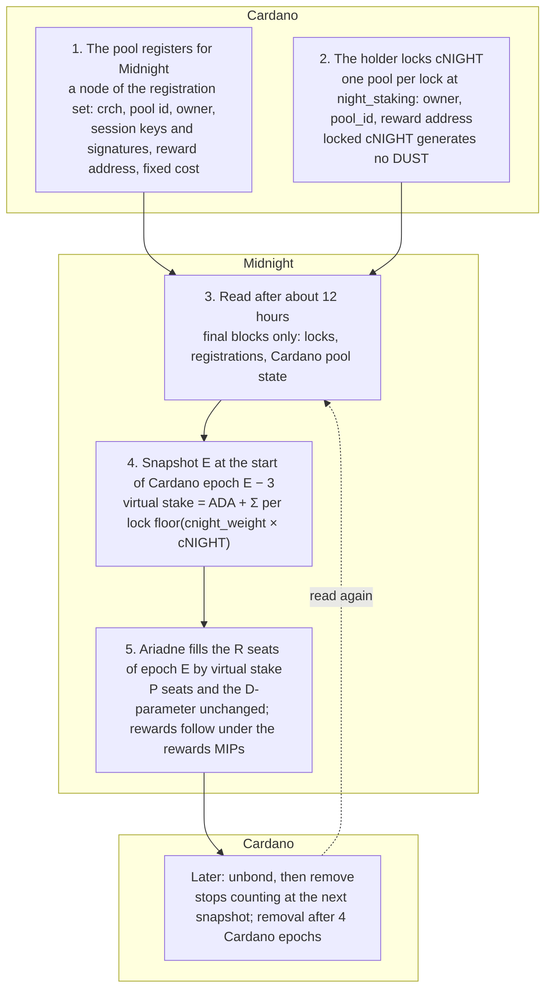

<!--
 Copyright Midnight Foundation

 Licensed under the Apache License, Version 2.0 (the "License");
 you may not use this file except in compliance with the License.
 You may obtain a copy of the License at

     https://www.apache.org/licenses/LICENSE-2.0

 Unless required by applicable law or agreed to in writing, software
 distributed under the License is distributed on an "AS IS" BASIS,
 WITHOUT WARRANTIES OR CONDITIONS OF ANY KIND, either express or implied.
 See the License for the specific language governing permissions and
 limitations under the License.
-->

This document is authoritative: the contracts in `midnight-reserve-contracts` and the node code are evidence of it, and where they differ from this text, the text wins and the code is a bug.

## Abstract

This proposal lets a holder of NIGHT on Cardano (*cNIGHT*) stake it behind a Cardano stake pool that produces Midnight blocks, and lets Midnight count that stake when it selects each epoch's committee and when it splits the pool's reward. Every permissionless Midnight block producer is a Cardano SPO registered for Midnight by a node of a registration set on Cardano that holds its keys, the pool's Midnight reward address, an optional fixed cost in NIGHT and a signature by each session key the runtime requires. A holder stakes by locking cNIGHT in a *delegation lock*, a UTXO at the staking contract whose datum names its *owner*, a key or a script, one pool and a Midnight reward address. A lock with no cNIGHT lets an ADA delegator name where its share is paid. Locked cNIGHT generates no *DUST*. Unlocking takes an unbond and a wait of four Cardano epochs.

Midnight already reads cNIGHT balances and their registrations from final Cardano blocks for DUST generation, and this proposal reads locks and pool registrations the same way. At the start of Cardano epoch `E − 3`, Midnight takes a *stake snapshot* of the cNIGHT behind each pool. That boundary is where Cardano fixed the ADA stake that *Ariadne*, the Partner Chains committee selection, reads for epoch `E`, and it comes before the nonce that seeds its committees is known.

Within the registered seats of the D-parameter, Ariadne weights each pool by its *virtual stake*, its ADA stake plus `cnight_weight` times its staked cNIGHT, with the weighted selection it uses for ADA stake today. Nothing else in selection changes, except that the filter that drops a candidate with no stake tests virtual stake.

This proposal enforces the lock contract, the pool registration, the stake snapshot and the virtual-stake weight in committee selection. It leaves the reward split to the companion NIGHT rewards MIP (alongside the native rewards MIPs that bobblessinghartley proposed in midnight-improvement-proposals PR 406), DUST generation itself to the existing cNIGHT observation rules with one exclusion, and the selection algorithm to Ariadne (Partner Chains), which needs no new candidate class and no new D-parameter definition.

## Motivation

**NIGHT carries no weight in its own network.** Who produces Midnight blocks is decided by ADA delegated to Cardano stake pools and by a permissioned list. Most NIGHT sits on Cardano as cNIGHT, and the one thing a holder can do with it is register it for DUST generation. The network buys all of its security from another chain's token while its own token is idle. The cost is a holder base with no stake in block production.

**A holder has nothing to point stake at.** A Midnight block producer exists as a Cardano stake pool's registration, and ADA is the only stake behind it. A pool that wants NIGHT holders behind it has no way to take their stake, and a holder who wants to back a pool with NIGHT has no way to give it. Staking cNIGHT toward the pools that already produce Midnight blocks fills that gap without a new kind of producer. cNIGHT is not needed to earn NIGHT rewards: it is a second asset a holder can stake, so that a pool earns more and its backers share in it.

**The rewards MIPs are waiting for this one.** The two native rewards MIPs (midnight-improvement-proposals PR 406) pay a pool's ADA delegators from one reward per pool, and they need a stake snapshot that adds cNIGHT stakers to that pool, each with a weight and a reward address, before NIGHT can earn anything. Without this proposal the weight the Foundation wants NIGHT to carry in block production cannot start.

**The holders are already known to Midnight, on Cardano.** Every cNIGHT holder who generates DUST has a Cardano registration that Midnight reads, and Midnight already attributes every cNIGHT UTXO to its stake credential. A lock at one script address adds one datum and one exclusion to that path. It needs no new ledger object, so it needs no hard fork, and it reaches the NIGHT that exists today rather than NIGHT that must first cross a bridge.

**A unit of NIGHT does one job.** Every cNIGHT generates DUST today, and DUST is what pays for Midnight transactions. The FinDaS reward design lets a holder choose, for each unit, between staking it and generating DUST with it, so that no unit earns rewards and pays for fees at once. This proposal adopts that choice, no split: locked cNIGHT generates no DUST, and a holder's unlocked cNIGHT generates DUST as today.

## Specification

### Normative language and sources

The key words MUST, MUST NOT, SHOULD and MAY are to be interpreted as described in BCP 14 ([RFC 2119](https://www.rfc-editor.org/rfc/rfc2119), [RFC 8174](https://www.rfc-editor.org/rfc/rfc8174)) when they appear in capitals. They bind the implementers of Midnight, the contract tooling and wallets. Validator rules and the consensus rule (rule 26, Determinism) are numbered "Fail if" rules; the Midnight rules are MUST rules. A transaction or a block is valid if no rule marks it failed. Two verbs name what Midnight does with Cardano data. Midnight *reads* a lock event or a pool registration when one of its nodes takes it from a Cardano block that is final (rule 11, Reading); the verb names what each node does on its own, says nothing about when or on which path, and implies no agreement among nodes. Midnight *adopts* a value when the value enters its consensus, which this document requires only of the snapshot record and the committee selected from it, each by a deadline (rule 17, Snapshot finality). `pallet_cnight_observation` calls both steps observation; this document keeps that word only in the names of the pallet and its existing rule.

This proposal relies on these external facts. It cites them and does not restate them.

- Committee selection: `select_authorities` and `weighted_with_guaranteed_assignment` in [`ariadne_v2.rs`](https://github.com/midnightntwrk/midnight-node/blob/main/partner-chains/toolkit/committee-selection/selection/src/ariadne_v2.rs); the D-parameter `DParameter { num_permissioned_candidates, num_registered_candidates }` and the data offset `DATA_MC_EPOCH_OFFSET = 2` in `sidechain_domain`.
- Registered candidates: the candidate data source and the candidate filter `filter_invalid_candidates`, which verifies the signature entries, as vendored in [midnight-node](https://github.com/midnightntwrk/midnight-node/tree/main/partner-chains/toolkit); the committee candidate validator and `RegisterValidatorDatum` are not read.
- Candidate keys: `CandidateKey { id: [u8; 4], bytes }` in `sidechain_domain`. The runtime's session keys decide which keys a registration must carry; this proposal names none beyond `crch`.
- cNIGHT observation: `pallet_cnight_observation` in midnight-node and [`cnight_generates_dust.ak`](https://github.com/midnightntwrk/midnight-reserve-contracts/blob/main/validators/cnight_generates_dust.ak) in midnight-reserve-contracts.
- Rewards: the native rewards MIPs in [midnight-improvement-proposals PR 406](https://github.com/midnightntwrk/midnight-improvement-proposals/pull/406), which read this proposal's snapshot record.

The cNIGHT policy and the `night_staking` and `night_registration` script hashes and the set's initialization UTXO are constants per network. The mainnet values of the cNIGHT policy and the script hashes in the Parameters table are informational and are not enforced by this proposal.

### Notation

- `NIGHT`, `STAR`: 1 NIGHT is 1,000,000 STAR. Every amount in a rule is an integer number of STAR.
- *cNIGHT*: NIGHT on Cardano, the native asset `cnight_policy` / `cnight_name` of the network's configuration.
- *stake credential*: a Cardano stake credential, key or script, with a 28-byte hash: `blake2b_224` of the verification key for a key credential, the script hash for a script credential.
- `uN` is an unsigned N-bit integer.
- *lock*: a UTXO at the `night_staking` script address that holds the cNIGHT it stakes and exactly one token of the `night_staking` policy, with an empty name. Its *owner* is the `Credential` its datum names, `VerificationKey(hash)` or `Script(hash)` as the Aiken standard library defines it: a key authorizes by its hash in `extra_signatories`, a script by a withdrawal from it (rule 5, Owner authorization). `night_staking` is one fixed Plutus V3 script, used as the minting policy and as the spending, withdrawal and publish script; its address has no stake part.
- holder: the party that controls a lock's owner. A holder with a lock is a staker.
- pool: a Cardano stake pool registered for Midnight by a node of the registration set. `pool_id` is the 28-byte hash of its cold key. `crch` is the pool's cross-chain key, the 32-byte BABE key under which Midnight knows the candidate; Midnight runs BABE before this proposal activates. An operator is a pool that rule 18, Pools at the snapshot, admits at a snapshot.
- cnight(L): for a lock L, the STAR of cNIGHT in its value; the locks that count for a snapshot are those of rule 14, Effective lock.
- *reward address*: a Midnight address that can claim rewards, as the companion rewards MIP defines the claim; 32 bytes, to confirm with that MIP.
- stake snapshot: the per-pool and per-lock cNIGHT stake Midnight fixes for one Cardano epoch (rules 16 to 23, Snapshot point to Snapshot record).
- virtual stake: a pool's ADA stake in lovelace plus the sum over its locks L of floor(cnight(L) × cnight\_weight) (rule 19, Virtual stake).
- `E` is a Cardano epoch. A *Midnight epoch* is an interval of slots, 300 slots of 6 s today. The committees of every Midnight epoch within Cardano epoch `E` are selected from the data of Cardano epoch `E − 2`.
- cnight\_weight: the lovelace of virtual stake per STAR of staked cNIGHT, a runtime parameter (rule 25, cnight\_weight). UNBONDING\_DELAY: four Cardano epochs, 20 days, the time a lock waits between its unbond and its removal (rule 4, Burn).
- `P`, `R`: the permissioned and registered seat counts of a committee, the two counts of the D-parameter.

### The pool registration

A pool is a Cardano stake pool registered for Midnight by a node of the *registration set*, a UTXO at the `night_registration` script. The set is a sorted linked list in the Aiken design pattern, with two links per node: one by `crch` over every node, and one by `pool_id` over the active nodes, so one `crch` registers once and one pool is active once. Every node carries one token of the script's policy, with an empty name, which proves that the script checked it, and everything Midnight reads is in the datum. The Partner Chains registration plays no part:

```
Node = Head         { next_crch: ByteArray, next_pool: ByteArray }
     | Reserved     { crch: ByteArray, next_crch: ByteArray }   -- a permissioned candidate's crch; created at initialization only; Midnight does not read it
     | Registration {                                        -- once inactive: crch, active False, next_crch, next_pool None, all else empty (rule 10)
         crch:           ByteArray                    -- the cross-chain key, the pool's 32-byte BABE key; one node per crch, for good
         crch_signature: ByteArray                    -- by crch, 64 bytes, set at the Create, unchanged while active (rule 21)
         pool_id:        ByteArray                    -- the 28-byte pool id, the hash of the pool's cold key; one active node per pool
         owner:          Credential                   -- the key or script that authorizes an Update; changed under the cold key only (rule 10)
         keys:           Pairs<ByteArray, ByteArray>  -- the other session keys by 4-byte id, as the runtime names them
         signatures:     Pairs<ByteArray, ByteArray>  -- one per key in keys, by the same id (rule 21)
         reward_address: ByteArray                    -- the Midnight address that claims the pool's rewards, 32 bytes
         fixed_cost:     Int                          -- STAR per Cardano epoch, taken before the margin
         attributes:     Pairs<ByteArray, Data>       -- open map for the registration (rule 13)
         active:         Bool                         -- the state Midnight reads (rule 20); False once deactivated, for good (rule 10)
         next_crch:      ByteArray                    -- the next node by crch
         next_pool:      Option<ByteArray>            -- the next active node by pool_id; None once inactive
       }
```

| Map | Name | Value | Meaning |
| --- | --- | --- | --- |
| `keys` | the 4-byte id of a key | the key's bytes | A session key, under the id the runtime gives that key type; the runtime decides which ids it requires |
| `signatures` | the id of a key in `keys` | the length the key's scheme fixes | One signature entry per key in keys, named by the id of that key, over the message bytes the runtime defines (rule 21, Signature). Cardano does not check them; Midnight does |
| `attributes` | any | any | Open map for the registration itself; this proposal defines no entry (rule 13, Datum validation) |

`margin` and `fixed_cost` are the pool's reward terms. The margin and the owners stay in the pool's Cardano certificate, as on Cardano, and Midnight reads them there at the snapshot and carries them in the record (rule 18, Pools at the snapshot, and rule 23, Snapshot record). The fixed cost is the one term Midnight must carry, because Cardano's fixed cost is in ADA and Midnight pays in NIGHT. This proposal fixes their source and encoding and gives them no meaning; the companion NIGHT rewards MIP does.

A pool changes its keys, its signatures and its terms under its owner, a hot key or a script, and its owner and its node's state under its cold key, which signs the Create and MAY sign any change (rule 10, Changes). A node is never removed, and an inactive node never goes active again, so a `crch` is taken for good: a pool that needs a new `crch` deactivates its node in one transaction and creates another, with new session keys, in the next. An inactive node keeps only its `crch` and its link, so it holds the least ADA.

9. **Nodes.** `night_registration` is one script, parameterized by its initialization UTXO. Every node is a UTXO at its address that holds ADA, one token of its policy with an empty name and an inline `Node` datum, and nothing else. Nodes form two sorted linked lists in the Aiken design pattern, by `crch` over every node and by `pool_id` over the active `Registration` nodes, and a transaction that breaks either list fails. Fail if a `Registration` node's `crch` is not 32 bytes, or, while it is active, if its `crch_signature` is not 64 bytes, its `pool_id` or the hash in its `owner` is not 28 bytes, its `reward_address` is not 32 bytes, its `fixed_cost` is below 0, or two entries of `keys`, `signatures` or `attributes` share a name. The initialization transaction spends the initialization UTXO and creates the head and one `Reserved` node per permissioned candidate; nothing else creates a `Reserved` node, and no node is ever removed.
10. **Changes.** A Create inserts one `Registration` node into both lists, with `active` True, and fails unless the pool's cold key, whose hash is `pool_id`, signs the transaction and the transaction carries a stake delegation certificate to `pool_id`, which the ledger accepts only for a registered pool; rule 18, Pools at the snapshot, checks the registration again at each snapshot. An Update MAY change `keys`, `signatures`, `reward_address`, `fixed_cost` and `attributes` under the `owner` or the cold key, and `owner` under the cold key only, and MUST NOT change `crch`, `crch_signature` or `pool_id`; the `owner` authorizes as a lock's does, a key credential by its hash in `extra_signatories` and a script credential by a withdrawal from it (rule 5, Owner authorization). A Deactivate, under the cold key only, unlinks the node from the pool list, for good, and leaves it with `crch`, `active` False, `next_crch` and `next_pool` None, every other field empty and `fixed_cost` 0; an inactive node changes only as the `crch` list requires, and nothing links it back. A transaction does one Create, one Update or one Deactivate, on one node; the head, a `Reserved` node and the nodes it links through change only as the lists require. A pool whose node is inactive creates another, with a new `crch`; it SHOULD rotate the other session keys at the same time, which no script enforces.

### The lock contract

The inline datum of a lock is:

```
DelegationLock {
  owner:          Credential             -- the key or script that authorizes every change (rule 5); never changed
  pool_id:        ByteArray              -- the 28-byte pool_id of the pool the cNIGHT backs (rule 2)
  reward_address: ByteArray              -- the Midnight address that claims the rewards, 32 bytes
  unbond_at:      Option<Int>            -- the POSIX time of the unbond, in milliseconds; None while the lock stakes (rule 3)
  attributes:     Pairs<ByteArray, Data> -- open map for the lock itself (rule 13)
}
```

A lock holds ADA of at least `lock_deposit_lovelace`, the token, the cNIGHT it stakes, and nothing else, and it MAY hold no cNIGHT. `attributes` is an open map of named values, as `CandidateKeys` is for a registered candidate: the contract checks only that names are unique (rule 2, Output), and Midnight defines the names it understands and validates their values (rule 13, Datum validation), so a later need adds entries, not fields. This proposal defines no entry.

**Every transaction.** `night_staking` is one script: its hash is the payment credential of the address, the policy of the token and a stake credential. A transaction is a *Create*, an *Update* or a *Remove* by its shape (rule 7, Withdrawal), and the rules of its kind apply once, for the whole transaction, together with the purpose rules.

**Create**, with no input at the address, one output and a mint of 1:

1. **Mint.** Fail if the mint under the policy is not exactly one token of quantity 1 with the empty name.
2. **Output.** Fail if the output does not carry the token with an inline `DelegationLock` datum, if its address has a stake part, or if the datum or the value breaks any of these:
   - `owner` holds a 28-byte hash and is not `Script(night_staking)`, `pool_id` is 28 bytes and `reward_address` is 32 bytes.
   - `unbond_at` is `None`, and no two entries of `attributes` share a name.
   - The value holds nothing but ADA, the token and cNIGHT, and ADA of at least `lock_deposit_lovelace`.

**Update**, with one input and one output at the address and no mint:

3. **Output.** Fail if the output breaks rule 2, Output, except that `unbond_at` MAY be `Some`. The new datum MAY change `pool_id`, `reward_address` and `attributes`, and MUST NOT change `owner`. Fail if the output's cNIGHT is less than the input's. Fail if the input's `unbond_at` is `Some` and the output's differs from it. Fail if the output's `unbond_at` is `Some` while the input's is `None` and it is earlier than the upper bound of the transaction's validity interval, so that an unbond records a time no earlier than the transaction could be included.

**Remove**, with one input at the address, no output there and a mint of −1:

4. **Burn.** Fail if the mint under the policy is not exactly the spent token with quantity −1. Fail if the input holds cNIGHT and its `unbond_at` is `None`, or is `Some` and later than the lower bound of the transaction's validity interval minus `UNBONDING_DELAY`: a lock that holds cNIGHT is removed only after its unbond has aged four Cardano epochs, and a lock that holds none is removed at once. The cNIGHT and the ADA go where the transaction sends them.

**Every kind**:

5. **Owner authorization.** Fail if the lock's `owner`, the output datum's for a Create and the input datum's otherwise, does not authorize the transaction: a key credential by its hash in `extra_signatories`, a script credential by a withdrawal from it, as `cnight_generates_dust.check_auth` does.

**Purposes**:

6. **Gate.** In the spending and minting purposes, fail if the transaction has no withdrawal from the stake credential `Script(night_staking)`. Those purposes check nothing else.
7. **Withdrawal.** The withdrawal purpose runs the rules once, whatever amount it withdraws. Fail if more than one input, or more than one output, is at the `night_staking` address, or if an output at another address carries a token of the policy. Fail if the transaction is not exactly one of Create, Update and Remove by its inputs, outputs and mint, and then apply that kind's rules.
8. **Certificates.** In the publish purpose, fail if the certificate is not a stake credential registration. Fail in the vote and propose purposes. Any party may register the credential, once per network, and nobody can delegate or deregister it.

Cardano's ledger accepts a withdrawal only from a registered account and only for its whole balance, which is normally zero for a credential that is never delegated (References, Conway ledger; Security Considerations, Reward account). The credential is registered before the first lock transaction (Implementation Plan, step 1).

`night_staking` MUST NOT be upgradable: its logic and its constants are fixed at compile time, it reads no input that a governance body controls, and only a lock's owner can move its cNIGHT (rule 5, Owner authorization). Its script hash is a per-network constant of the Midnight chain specification. Beyond rule 2, Output, the contract reads nothing inside `attributes`, and it does not check that `pool_id` names a registered pool, because Midnight does that under rule 18, Pools at the snapshot, and rule 19, Virtual stake.

### What Midnight reads

11. **Reading.** Midnight reads a lock event or a pool registration event only from a Cardano block that is final under the existing cNIGHT observation rule, at least `k + block_stability_margin` blocks below the tip, about 12 hours. It reads the creation, update, unbond and removal of locks and every state of a registration node (rule 12, Transaction filter, and rule 13, Datum validation); when it does so, and on which path, is left to the implementation, which today is the candidate data source for registrations and, for locks, `pallet_cnight_observation`, under a new namespace keyed by the `night_staking` script hash.
12. **Transaction filter.** Midnight reads a lock transaction only if the ledger applied it and it carries a withdrawal from the stake credential `Script(night_staking)`, and by rule 6, Gate, and rule 7, Withdrawal, such a transaction holds at most one lock event. An output at the address from any other transaction carries no token, is not a lock, and MUST NOT be read. Midnight reads a registration node from every output at the `night_registration` address that carries the set's token, as that node's state from its block; an output there without the token is not a node and MUST NOT be read.
13. **Datum validation.** Midnight MUST accept a lock only from the configured script hash, and MUST reject a datum that fails the datum checks of rule 2, Output, except that unbond\_at MAY be Some as rule 3, Output, allows, however it reached the chain. It reads `attributes` by name: it MUST validate every entry whose name it defines and MUST ignore a name it does not define, and this proposal defines none. It reads a registration's `keys`, `signatures` and `attributes` maps the same way, and the names it defines are in the table under The pool registration.
14. **Effective lock.** A lock counts for a snapshot if it is unspent at the snapshot and its `unbond_at` is `None`. An unbonded lock counts for nothing from the first snapshot after its unbond, and a spent lock counts for nothing. An owner may hold several locks, each naming one pool, and every one of them counts; two locks of one owner that name the same pool both count, each with its own cNIGHT and reward address.
15. **DUST generation.** A lock generates no DUST. When Midnight computes a credential's DUST generation it MUST exclude every cNIGHT UTXO whose payment credential is the `night_staking` script hash, whatever the stake credential of its address, and a lock's cNIGHT counts as stake instead (rule 19, Virtual stake). A holder's other cNIGHT generates DUST under its `cnight_generates_dust` registration as today, and an unbonded lock generates no DUST until it is removed.
16. **Snapshot point.** The stake snapshot for Cardano epoch `E` is taken from the Cardano ledger state after the last block of epoch `E − 4` and before the first block of epoch `E − 3`. That is the boundary at which Cardano took the stake distribution that Ariadne reads for epoch `E`, the `epoch_stake` of epoch `E − 2` (`DATA_MC_EPOCH_OFFSET = 2`), and it precedes the nonce of epoch `E − 2` that seeds the committees of epoch `E`. Midnight MUST read locks, pool registrations and Cardano's pool state in that state. It MUST NOT read them at the last block of epoch `E − 2`, where Ariadne reads ADA candidate registrations.
17. **Snapshot finality.** Snapshot `E` is fixed once the last block of Cardano epoch `E − 4` is final under rule 11, Reading, about 12 hours into epoch `E − 3`, and no later Cardano block changes it. Midnight MUST adopt snapshot `E` before it selects the committee of the first Midnight epoch within Cardano epoch `E`, which leaves most of three Cardano epochs between the two. A node that has not yet read that block cannot author or verify a committee inherent for epoch `E` until it has, as with Ariadne's ADA data today.
18. **Pools at the snapshot.** A pool is an operator at the snapshot if the set holds an active `Registration` node for its `pool_id` there and that node is valid (rule 20, Registration validity), and Cardano holds the pool as registered there. Its margin and its owners are those of its Cardano certificate in the same state, and the record of rule 23, Snapshot record, carries them. Whether a pool must hold a minimum pledge, and whether a cap applies to the cNIGHT behind it, is Open Question 1, and until that is decided no minimum and no cap applies.
19. **Virtual stake.** For each pool `O` at the snapshot, `virtual_stake(O) = ada(O) + Σ floor(cnight(L) × cnight_weight)`, summed over every lock `L` that counts and names `O` (rule 14, Effective lock), where `ada(O)` is the pool's stake in lovelace in the stake distribution Ariadne reads for the epoch, 0 when that distribution has no entry for the pool, and `cnight_weight` is the value the snapshot's record carries (rule 25, cnight\_weight). Each such lock enters the reward split with its own term, `floor(cnight(L) × cnight_weight)`, so the lock terms sum to the pool's cNIGHT term. cNIGHT behind a pool that is not an operator at the snapshot counts for nothing in that snapshot.
20. **Registration validity.** Midnight accepts a `Registration` node only if its `active` is True, its `keys` map holds the keys the runtime requires, its `signatures` map holds one entry for every key in `keys`, and its `crch_signature` and every entry of `signatures` are valid under rule 21, Signature; the token proves that the script checked the rest (rule 9, Nodes). Validity is a property of each state of the node: Midnight ignores an invalid state as it ignores an inactive one, so an update that breaks a signature takes the pool out of the next snapshot, and an update that makes the node valid again brings it back. An invalid node keeps its links, so no other node can go active for that pool until its owner corrects it or its cold key deactivates it (rule 10, Changes).
21. **Signature.** `crch_signature` is a signature by `crch`, 64 bytes (rule 9, Nodes), over message bytes the runtime defines from fields the node never changes, set at the Create and unchanged while the node is active (rule 10, Changes), so the `crch` private key signs once. A `signatures` entry is named by the 4-byte id of a key in `keys` and holds a signature by that key, of the length its scheme fixes, over message bytes the runtime defines that bind the key to this node's `crch`, so that a signature from one node proves nothing for another and a key rotates with its own signature only. The bytes signed are Open Question 4. Midnight verifies each signature as the runtime verifies that key type, so the message, the hashing and the schemes are the runtime's, and this proposal names no key beyond `crch`. Valid signatures prove possession of `crch` and of every key in `keys`. Cardano does no validation of them, so Midnight alone handles a missing or invalid signature, and a node whose `crch` its author does not hold is invalid (rule 22, Uniqueness).
22. **Uniqueness.** The set holds at most one node per crch and at most one active node per pool\_id (rule 9, Nodes), in Cardano order, by block, then transaction, then output: if two or more registrations claim the same crch, only the one whose claim came earliest, by that order, is valid, because the later Create fails on Cardano, and a crch is never freed. Midnight keeps no key history, and a session key is not unique: a copied one fails rule 21, Signature, without its private key.
23. **Snapshot record.** Midnight stores one record per Cardano epoch, `NightStakeSnapshotV1` below, with `snapshot_id = blake2b_256(SCALE(NightStakeSnapshotV1))` and every list sorted ascending by its fields in order. The record carries the `cnight_weight` in force when it is built, which rule 19, Virtual stake, and the companion rewards MIP use for the epoch (rule 25, cnight\_weight). `pools` lists every operator at the snapshot, with `cnight`, the sum of `cnight(L)` over the locks that count and name it, 0 included, and the `fixed_cost` and `reward_address` of its registration at the snapshot, and the `margin` and `owners` of its Cardano certificate in the same state (rule 18, Pools at the snapshot), `owners` sorted ascending. `locks` lists every lock that counts and names an operator at the snapshot, cnight 0 included, each with its owner, as a kind byte, 0 for a key and 1 for a script, and the 28-byte hash, and the `reward_address` its datum names at the snapshot. `delegators` lists every stake credential delegated to an operator in the stake distribution Ariadne reads for the epoch, an owner's credential that delegates to its pool included, each as a kind byte and the 28-byte hash, as a lock's owner is, with its `lovelace`, and the rows of a pool sum to `ada(O)` (rule 19, Virtual stake). The companion rewards MIP accrues each epoch's entitlement from the record alone. `snapshot_id` is the 32-byte NIGHT snapshot identifier that the native rewards MIPs expect. Midnight MUST expose the record and `snapshot_id` through a runtime API, and the indexer MUST keep every past record.

```
NightStakeSnapshotV1 {
  cardano_epoch: u32,
  cnight_weight: (u64, u64),
  pools: Vec<{ pool_id: [u8; 28], cnight: u128, fixed_cost: u128, reward_address: [u8; 32],
               margin: (u64, u64), owners: Vec<[u8; 28]> }>,
  locks: Vec<{ owner: (u8, [u8; 28]), pool_id: [u8; 28], utxo: ([u8; 32], u16), cnight: u128,
               reward_address: [u8; 32] }>,
  delegators: Vec<{ stake_credential: (u8, [u8; 28]), pool_id: [u8; 28], lovelace: u64 }>,
}
```

### Committee selection

24. **Selection.** Ariadne selects the committees of the Midnight epochs within Cardano epoch `E` as today: `P` seats from permissioned candidates at weight 1 and `R` seats from registered candidates with `weighted_with_guaranteed_assignment`, with the D-parameter unchanged. The registered candidates of epoch `E` are the operators of snapshot `E` (rule 18, Pools at the snapshot), and each enters with `virtual_stake(O)` from that snapshot in place of its ADA stake alone. The candidate filter that rejects a pool whose ADA stake is zero or unknown rejects instead a pool whose virtual stake is 0, so a pool with no ADA delegated and cNIGHT behind it is a candidate.
25. **cnight\_weight.** `cnight_weight` is a runtime parameter of `pallet_system_parameters`, a rational of two `u64` that gives the lovelace of virtual stake per STAR of staked cNIGHT, set by the governance origin as the D-parameter override is set today. The value in force when Midnight builds the record of snapshot `E` applies to the committees and the rewards of epoch `E`, and the record carries it (rule 23, Snapshot record); a later change counts from the next snapshot, so every input to an epoch is fixed at its snapshot.
26. **Determinism.** Every node derives the snapshot and the committee from the same final Cardano state and the same runtime storage. Fail if a block's committee inherent does not match the committee the node computes from the snapshot, the D-parameter and the snapshot's `cnight_weight`.

### Parameters

| Parameter | Value | Set in | Note |
| --- | --- | --- | --- |
| `lock_deposit_lovelace` | 2,000,000, placeholder | `night_staking`, compile time | Cardano's stake key deposit; returned on removal (Open Question 2) |
| `UNBONDING_DELAY` | 4 Cardano epochs, 20 days | night\_staking, compile time | Rule 4, Burn, checks it against the transaction's validity interval |
| `cnight_weight` | 1 at activation, placeholder | pallet\_system\_parameters, by governance | Lovelace of virtual stake per STAR; a change counts from the next snapshot |
| Snapshot boundary | The start of Cardano epoch E − 3, the ADA snapshot of data epoch E − 2 | Partner Chains `DATA_MC_EPOCH_OFFSET` | Not changed by this proposal |
| Finality depth | `k + block_stability_margin`, 2160 + 30 blocks | existing node configuration | About 12 hours |
| `night_staking` script hash | per network | chain specification | Fixed; informational on Cardano |
| night\_registration script hash | per network | chain specification | Fixed; informational on Cardano |
| Registration set initialization UTXO | per network | night\_registration, compile time | Parameter of the script; its initialization transaction creates the head and the Reserved nodes (rule 9, Nodes) |
| `night_staking` stake credential | registered once | Cardano, before activation | Any party may register it; the script allows registration only (rule 8, Certificates) |
| cNIGHT policy | `0691b2fecca1ac4f53cb6dfb00b7013e561d1f34403b957cbb5af1fa` / `NIGHT` on mainnet | network configuration | Informational |
| Minimum pledge, saturation | undecided | to be decided | Open Question 1 |

### Order of the flow



The drawing is not normative.

Rules 9 and 10 (the pool registration) govern step 1, rules 1 to 8 (the lock contract) govern step 2, the unbond and the removal, rules 11 to 23 (what Midnight reads) govern steps 3 and 4, and rules 24 to 26 (committee selection) govern step 5.

### Examples

A lock that backs pool `O` with cNIGHT:

```
DelegationLock {
  pool_id:        <28-byte pool_id of O>,
  reward_address: <32-byte Midnight address>,
  unbond_at:      None,
  attributes:     [],
}
```

A pool's `Registration` node, with a fixed cost of 340 NIGHT per Cardano epoch, its `crch_signature` and one signature per key the runtime requires:

```
Registration {
  crch:           <32 bytes>,
  crch_signature: <64 bytes>,                                   -- by crch, never changed
  pool_id:        <28 bytes>,                                   -- the hash of the cold key that signed the Create
  owner:          VerificationKey(<28 bytes>),                  -- or Script(<28 bytes>)
  keys:           [ (<key id>, <key bytes>), ... ],             -- one entry per key the runtime requires
  signatures:     [ (<key id>, <signature>), ... ],
  reward_address: <32 bytes>,
  fixed_cost:     340_000_000,
  attributes:     [],
  active:         True,
  next_crch:      <32 bytes>,
  next_pool:      Some(<28 bytes>),
}
```

Virtual stake: with `cnight_weight = 1`, a pool with 2,000,000 ADA delegated and 500,000 NIGHT locked behind it enters selection with 2,500,000 ADA of virtual stake, and a pool with no ADA delegated and 500,000 NIGHT behind it enters with 500,000 ADA.

## Rationale

### Why does the stake stay on Cardano?

The NIGHT that can stake is on Cardano, and Midnight already attributes every cNIGHT UTXO to its stake credential for DUST generation. A lock at one script address adds one datum and one exclusion to a path that exists. It adds no object to the Midnight ledger, so it needs no hard fork, and it needs no bridge transfer before a holder can take part. It does not rule out staking NIGHT held on Midnight: a later proposal can add that as another source of stake, and nothing here prevents it.

### Why does locked cNIGHT generate no DUST?

DUST generation has its own registration, `cnight_generates_dust`, and its own node path. The FinDaS reward design gives a unit of NIGHT one job: a holder chooses, for each unit, between staking it and generating DUST with it, and a lock is where that choice is made. Midnight attributes a cNIGHT UTXO to the stake credential of its address, whatever the payment credential, and a lock's address has no stake part (rule 2, Output), so Midnight attributes a lock to no holder. Rule 15, DUST generation, states the exclusion by the payment credential, so it holds for all cNIGHT at the staking script, and the holder's `cnight_generates_dust` registration covers its unlocked cNIGHT as today. Counting a unit for both would pay it twice, and a split by weight would need weights, a DUST key and a second feed into the ledger.

### Why one pool per lock?

Cardano allows one pool per stake credential, and stakers know that model. One pool per lock keeps each lock's cNIGHT a plain term of one pool's virtual stake and the snapshot record one row per lock, and a holder who wants to back two pools holds two locks from the same credential, which costs one lock deposit each and nothing else.

### Why does the owner authorize every change?

A separate editing key was considered, so that a cold stake key or a hardware wallet would sign only once, at creation. Cardano asks the stake key to sign every delegation change and wallets handle that, and a script owner authorizes by its withdrawal, so a second key would add a field, a rule and a compromised-key case for nothing. A holder who wants more than one key behind a lock names a script as its owner.

### Why no linked list for locks?

The spike kept deposit UTXOs in a sorted list so that one account per credential held by construction and a batcher could walk them, but there is no batcher here. An owner may hold several locks, each naming one pool, so there is nothing to make unique: only the owner can create a lock that names it (rule 5, Owner authorization), a second lock for the same pool is the holder's own and counts on its own (rule 14, Effective lock), and Midnight resolves nothing. The list cost most of the spike's contract code and tests, and the registration set reuses it where uniqueness is the point (rule 9, Nodes).

### Why is the owner a Credential in the datum?

A 28-byte hash does not say whether the credential is a key or a script. The contract needs the kind to choose between a signature and a withdrawal, and Midnight needs it to build the credential to which it attributes the lock, so `owner` is a `Credential`, the ledger's own type, and carries both. It sits in the datum beside the other fields Midnight reads, and the token's name is empty, as a node's is: the token proves that the script checked the datum, and the datum says whose the lock is.

### Why one UTXO where the spike had two?

The spike's deposit UTXO held ADA for batcher fees and received NIGHT paid on Cardano. Rewards are now paid on Midnight by the companion rewards MIP, so nothing is paid into Cardano and nothing needs an ADA float, and the lock, the user zone of the spike with the cNIGHT inside it, is all that remains.

### Why a fixed contract whose hash is a chain-spec constant?

Midnight's DUST mapping address is runtime storage that a governance motion can replace at once, and if locks inherited that setter, one motion could point every holder's cNIGHT at a different contract; an upgradable lock script would likewise let a captured set of authorities take the locked cNIGHT. A hash fixed per network in the chain specification makes a change a runtime upgrade, which carries review, at the cost that a defect in the contract is fixed by a new contract and a migration, not by an edit.

### Why one lock event per transaction?

One Cardano transaction can create and consume many UTXOs at the address. A node that treats each one as an event does unbounded work for one hostile transaction, on every node, for the price of one fee. Honest use never needs more than one event per transaction, so rule 7, Withdrawal, caps the inputs and outputs at the address at one each. It also keeps the token at the address until it is burned, which stops a token from being minted, parked elsewhere and re-deposited in bulk. Midnight's work per transaction read is then bounded by the transaction size, a bound the pallet's engineers asked for. The registration set holds the same bound by construction: a Create spends two anchor nodes and makes one node, and every other change touches one node (rule 10, Changes).

### Why a withdrawal as the gate?

A withdrawal from a script stake credential runs its script once per transaction with the whole transaction in view. Putting every rule there gives one place for the rules, whatever a transaction spends or mints, and the spending and minting purposes only look for the withdrawal. It also gives Midnight its filter: a transaction can touch a lock only if it withdraws from one known stake credential, a field Midnight reads directly, so it never scans the address. The ledger requires a withdrawal to equal the account's balance, so a withdrawal of zero from a registered credential is valid, and rule 8, Certificates, keeps the credential from ever being delegated. CIP-0112 proposes an observe purpose that would gate without a stake credential, and a successor script may use it.

### Why only ADA, the token and cNIGHT in a lock?

Every node parses a lock, so its size is bounded to one token, the ADA floor, the cNIGHT and the datum. A foreign token would enlarge the UTXO for nothing Midnight reads, and would let a holder park unrelated assets behind a datum that every node must parse. A lock has no stake part, so every lock sits at one address, the one Midnight and the indexer read. The ADA floor is the deposit of Open Question 2.

### Why does Midnight, not the contract, verify the keys?

A fixed contract cannot know the keys a later node release will require, so it cannot check them. The contract checks what holds still: one node per `crch`, one active node per pool, the cold key and a delegation to the pool on the Create, the cold key on a change of owner and on a Deactivate, the owner on the rest, and the lengths of the fixed fields (rule 9, Nodes, and rule 10, Changes). Midnight verifies the signatures with the verifiers it already runs for every candidate, the `keys` map can grow, and a malformed node costs its author a node and counts for nothing.

### Why does every session key sign, and why does only Midnight check?

Without the signature entries, anyone could register another node's session keys as their own. The seats that registration won would be produced by the victim's node, and the companion rewards MIP would pay the registrant. So every key in the node signs, `crch` included, and only the holder of every private key can register that set. Cardano never checks the entries: Midnight must verify the keys anyway and holds the verifier for every scheme the runtime uses, so Midnight alone rejects an invalid signature. Uniqueness is the one thing Cardano holds (rule 9, Nodes): a squatter can insert a `crch` it does not hold, and that node is invalid, but the key's holder then registers with a new `crch`, which costs a key, not a pool.

### Why the boundary of the ADA stake snapshot?

Ariadne weighs the registered seats of epoch `E` by the ADA stake distribution of Cardano epoch `E − 2`, which Cardano fixed at the boundary into epoch `E − 3`, and seeds the draw with the nonce of epoch `E − 2`, which Cardano settles later. Cardano chose that order so that no stake can move after the randomness that weighs it is known. A NIGHT reading at a Midnight epoch boundary, or at the last block of epoch `E − 2` where Ariadne reads ADA candidate registrations, would come after that nonce, so a holder could see which pool is drawn and re-point stake to it. Reading NIGHT at the same boundary as ADA describes the same moment and closes that move. Stake that moves after the boundary still counts for the epoch, as ADA does on Cardano.

### Why a snapshot record with an id?

The companion rewards MIP pays from the weights that selection used, so both must read one record that every node derives identically, and `snapshot_id` is the hash by which that MIP names it. The record carries the ADA of each delegator beside the locks, so one id names every input of the split and the rewards MIP reads Cardano by no second path. Sorted lists make the hash the same on every node.

### Why must the committee inherent match?

Partner Chains already rejects a block whose committee inherent differs from the one the node computes, and rule 26, Determinism, extends that check to virtual stake and `cnight_weight`. Without it a block author could seat pools the snapshot does not support, and no other rule would catch it.

### Why is uniqueness on Cardano, and only for crch?

The session pallet maps every session key to the `crch` that owns it, and a `crch` that changed owner would break committee rotation downstream. The registration set makes that impossible on Cardano: one `crch` has one node for good, nobody removes a node, and the permissioned candidates' `crch` are reserved at initialization (rule 9, Nodes), so Midnight keeps no history and resolves no clash. One active node per pool is the same mechanism, so a pool is never registered twice by mistake. An inactive node keeps only its `crch` and its link, like a `Reserved` node, so the ADA locked in it for good is the minimum for a small UTXO. The other keys rotate without uniqueness: a copied one fails rule 21, Signature, and a pool that loses one rotates that key only.

### Why does the registration carry the reward address and the fixed cost?

Every pool's registration must say where Midnight pays it: a pool without a reward address has nothing to collect its share, so the entry is required, and it should have been part of the registration from the start. The fixed cost is Cardano's fixed cost in the one form Midnight can pay, NIGHT, and it sits beside the address so that a pool's backers see both terms in one record. The Cardano pool certificate can carry neither: the ledger decodes it as a closed record of nine fields and rejects a tenth, and its reward account must be a Cardano account address, so the one place for Midnight's terms is the registration Midnight already reads. The margin and the owners stay in that certificate, where Cardano fixes them, and Midnight reads them there at the snapshot and carries them in the record.

### Why open-ended maps?

A fixed contract cannot learn a new field, and Midnight's needs will change: a pool may need a new key type or a declaration the rewards MIP has not thought of yet, and a lock may need an attribute. Partner Chains solved the same problem with `CandidateKeys`, an open list of typed entries that Midnight interprets, and the `keys`, `signatures` and `attributes` maps do the same. The contract leaves them opaque, Midnight defines the names it understands and validates their values, and unknown names are ignored, so a new entry is a node release, not a new contract.

### Why does stake behind an unregistered pool count for nothing?

On Cardano, delegation to a retired pool earns nothing until the delegator moves, and counting such stake for another pool, or for the network as a whole, would move the holder's choice for them. The holder re-points it with one update.

### Why a lock, and why an unbonding delay?

Cardano stake never moves, and a holder registration that left the cNIGHT where it was would let a unit count for stake and generate DUST at once, which the single-job rule forbids. A lock moves the cNIGHT to one address Midnight can exclude from DUST with one rule, and it makes the stake visible as a balance. Unbonding closes the gap between the two uses: a snapshot taken just before an unbond counts the lock for one epoch, which ends four Cardano epochs later, and the contract releases the cNIGHT only after that delay, so no unit earns rewards and generates DUST for the same period. Re-pointing a lock or changing its address is one update that keeps the cNIGHT locked, and a lock that holds no cNIGHT is removed at once, with no unbond.

### Why virtual stake within the registered seats, not a third class?

A third class needed its own seat count, its own ceiling and its own candidate record, and it made every cNIGHT backer choose an operator that was not a pool. Every permissionless Midnight block producer is already a registered pool, and the registered class is already trustless and stake-weighted, so cNIGHT fits it as a second kind of stake: one pool, one candidate, one weight, and the D-parameter is unchanged. `cnight_weight` is the one new knob, and governance turns it rather than a seat count.

### Why is cnight\_weight a Midnight parameter?

The weight of cNIGHT against ADA is Midnight's own economic choice, and the runtime already holds the D-parameter override that governance sets by the same path, so a Midnight parameter needs no Cardano datum and no new read. The value is read when the snapshot's record is built and carried in it, so a change counts from the next snapshot and every input to an epoch stays fixed at the snapshot, as rule 16, Snapshot point, fixes the rest.

## Path to Active

This proposal and the companion NIGHT rewards MIP are accepted and activated together, so the first cNIGHT-weighted committee and its first reward land in one coordinated upgrade.

### Acceptance Criteria

This MIP moves from Accepted to Active when all of the following hold on Midnight mainnet:

1. The `night_staking` contract is deployed, its stake credential is registered on Cardano, its hash is in the chain specification, and an independent audit of the contract reports no unresolved critical or high finding.
2. The contract and node tests of the Testing section pass, including every boundary vector: a 27-byte and a 29-byte `pool_id`; a 31-byte and a 33-byte `reward_address`; ADA of `lock_deposit_lovelace` and one lovelace less; an Update that keeps and one that reduces the cNIGHT; a Remove one slot before and one slot after `UNBONDING_DELAY`.
3. On a public test network, at least three pools register in the registration set and ten locks back them, and cNIGHT-weighted seats are held across at least two full Cardano epochs.
4. For ten consecutive Cardano epochs, an implementation maintained outside the node runtime reproduces every `virtual_stake(O)`, every lock's `cnight` and every `snapshot_id` from Cardano and Midnight chain data alone, and a block whose committee was selected from different totals is rejected.
5. A lock unbonded just after a snapshot counts for that epoch and for no later one, its cNIGHT generates no DUST until it is removed, and the contract refuses its removal before `UNBONDING_DELAY` and accepts it after, on the test network, with published results.
6. A squatted `crch`, a deactivated node, a failed signature and a re-pointed lock each produce the snapshot this document specifies, on the test network, with published results.
7. One wallet, Lace as the target, builds the lock, update, unbond and remove transactions and shows the pool and the reward address before signing.
8. The companion NIGHT rewards MIP meets its own acceptance criteria, and the two activate in one coordinated upgrade.

### Implementation Plan

1. Build `night_staking` from the spike's `virtual_account` validator, dropping the deposit list and the batcher gate and adding the cNIGHT value and the unbond rules, and `night_registration` from the spike's linked list, with two links per node, the `Reserved` nodes, the delegation certificate and the owner and cold-key rules; publish golden vectors for rules 1 to 10; register the staking script's stake credential and initialize the set with the permissioned candidates' `crch` on each network.
2. In the Partner Chains toolkit copy of midnight-node: read the registration set in the candidate data source, decode the `Registration` datum and verify its signature entries in the candidate filter, and feed virtual stake and `cnight_weight` into the candidate inputs.
3. Add the lock namespace and the DUST exclusion to `pallet_cnight_observation`, the snapshot computation and its runtime API, and `cnight_weight` to `pallet_system_parameters`.
4. Run the flow on the local-env devnet of the block rewards demo, then on a public test network through at least four Cardano epochs, so that a lock reaches a committee, and publish the reproduction results of criterion 6 of the problem statement.
5. Audit the contract and the Midnight changes together with the companion rewards MIP, and activate on mainnet in one runtime upgrade, after the node release.

## Backwards Compatibility Assessment

No hard fork: the change is a node release, a Midnight runtime upgrade and two Cardano contract deployments.

**Midnight runtime.** `pallet_cnight_observation` gains the lock namespace and the DUST exclusion of rule 15, and no ledger object, transaction type or pot is added. The committee data source reads the registration set and gains virtual stake and `cnight_weight`, and no candidate class is added. Nodes that do not upgrade stop validating at the runtime upgrade, as with any runtime change.

**Existing DUST registrations.** A credential's `cnight_generates_dust` registration is untouched. The cNIGHT it locks stops generating DUST while it is locked, and the rest generates DUST as today.

**Registered candidates.** No pool is registered for Midnight on any network: registration begins with this proposal, in the registration set, and the committee candidate validator is not read. The D-parameter on Cardano is unchanged, and a pool's cNIGHT stakers are paid from the same pool reward as its ADA delegators.

**Activation.** Activation is the runtime upgrade that brings rules 11 to 26 into force together with the rewards MIP. Every node runs the node release that reads the registration set from it.

**Partner Chains toolkit.** The changes are to the toolkit copy vendored in midnight-node: the candidate data source reads the registration set in place of the committee candidate validator, the candidate filter verifies the signature entries, and the candidate's stake input becomes virtual stake. `select_authorities`, the D-parameter and `DATA_MC_EPOCH_OFFSET` are unchanged.

**MIP-0024 and the spike contracts.** MIP-0024's virtual account had a deposit UTXO and a registration UTXO, and the lock of this proposal is that user zone with `payout_threshold` removed, the cNIGHT held inside it and the unbond added. The deposit UTXO, the linked list, the batcher state, the fee schedule and the rewards pool are not used. The `block-rewards-validators` branch of midnight-reserve-contracts is the starting point for `night_staking`, and the registration reader of the `pallet_block_rewards` spike becomes the lock reader of the new policy.

**Cardano.** Two new fixed scripts, no change to any existing contract, and a cNIGHT holder who does nothing is unaffected.

## Security Considerations

**Concentration.** Two entities hold just over half of NIGHT, and with no cap (Open Question 1) they could lock it behind pools of their own and take most of the registered seats. `cnight_weight` bounds the harm: governance keeps it low until the cNIGHT behind pools is diverse, the permissioned seats are untouched, and no seat class is added, so the finality bound is as today.

**Pool multiplication.** A per-pool cap is defeated by registering more pools, each at the cost of Cardano's pool deposit and a registration, so only a minimum of the pool's own stake makes pools costly to multiply. That is Open Question 1, and this proposal applies no minimum until it is decided.

**Stake moved after the snapshot.** Stake present at the snapshot counts for the whole Cardano epoch, even if it unbonds straight after, as Cardano accepts for ADA. The snapshot precedes the nonce that seeds the epoch, so the move buys no knowledge of the committee, and the unbonding delay keeps the cNIGHT locked until that epoch has ended.

**A compromised lock owner.** The owner authorizes every change (rule 5, Owner authorization), so a stolen owner key can re-point a lock, change its reward address, unbond it and, after `UNBONDING_DELAY`, take the cNIGHT. That is more than a Cardano stake key exposes, because the lock holds the funds: the delay gives the holder four Cardano epochs to notice an unbond it did not make, but no rule lets it stop one. Entitlements already in a snapshot go to the address recorded then. A holder who wants more protection names a script as the owner, which rule 5 accepts.

**Key duplication.** Copying a pool's keys into a registration gives the attacker nothing: the set refuses a second node with the same `crch` (rule 9, Nodes), and every key in the node must sign (rule 21, Signature), so a registration without the private keys is invalid, and a registration that holds them is the key holder's own. Cardano validates nothing about the signatures, but Midnight rejects a missing or invalid one, so a forged registration never seats a pool, and a squatted `crch` costs its holder a new key. The pool itself is proven on Cardano: the Create fails unless the pool's cold key signs it and the transaction delegates to the pool, which the ledger accepts only for a registered pool (rule 10, Changes), so a node's `pool_id`, the hash of that key, is a registered pool that only its key holder could register.

**A compromised node owner.** The owner is a hot credential, a key or a script: a stolen owner key can change the pool's keys, terms and reward address, but it moves no cNIGHT, cannot change `owner` and cannot deactivate the node. The cold key MAY sign every change (rule 10, Changes), so the pool recovers by setting a new `owner` under its cold key.

**Governance keys.** The contract hash is a chain-spec constant, so no runtime call redirects or opens locks. `cnight_weight` is set by the governance origin, so a captured governance can raise the weight of cNIGHT at once, which shifts seats toward cNIGHT-backed pools but adds no seat class. The federated authorities already hold runtime-upgrade power, so this proposal adds no authority.

**Liveness.** A pool that is offline misses its slots, as today. cNIGHT changes the weight of registered candidates and nothing else, so the share of seats that finality needs is unchanged.

**Finality lag.** A lock change enters the first snapshot boundary after its block, is final about 12 hours later, and counts three to four Cardano epochs after the change, 15 to 20 days, the delay an ADA delegation change has today. An unbond stops counting from the next snapshot and releases the cNIGHT 20 days after the request. An attacker gains nothing from the lag, and a holder gets a slower response.

**Read load.** A transaction without the withdrawal of rule 6, Gate, cannot spend or mint under the script, so whatever it places at the address carries no token and is never read. A transaction with it holds at most one event (rule 7, Withdrawal), and Midnight reads no pool registration transaction with more than one registration (rule 12, Transaction filter), so no transaction makes a node read more than one lock or one registration. ADA sent to the address outside a lock is locked for good, and a wallet MUST NOT build such an output.

**Reward account.** The script's stake credential is a reward account, so a pool that names it as its reward account, or a treasury withdrawal to it, raises its balance above zero. The next gated transaction withdraws the whole balance, as the ledger requires, and whoever builds it keeps the ADA; the contract fixes no amount, so nothing locks.

**Public linkage.** A lock links its owner to a pool and a Midnight reward address in public, and the snapshot publishes every lock's cNIGHT, which is by design and MUST be documented for holders.

**One lock, one balance.** A lock stakes only the cNIGHT it holds, so no lock can change another holder's stake, and nothing a holder keeps outside a lock is staked.

**Contract defects.** The script is fixed, so a defect can be repaired only by a new script and a runtime upgrade that names its hash, and locked cNIGHT would move to the new script by its holders' own transactions. The migration rule between the two would be specified with that upgrade; this proposal defines none.

## Implementation

**`midnight-reserve-contracts`.** `validators/night_staking.ak` with the datum and rules 1 to 8, as one script with spend, mint, withdraw and publish handlers, built from the spike's `virtual_account.ak` without the deposit list and the batcher gate, and reusing `stake_auth` from `lib/rewards/auth.ak`. Blueprint bindings and TypeScript tooling for lock, update, unbond and remove, golden vectors for the datum and the unbond timing, and the per-network `night_staking` hash in the deployed-scripts record.

**`midnight-node`.**

- `pallet_cnight_observation`: the lock namespace keyed by the `night_staking` hash, transactions selected by their withdrawal from the script's stake credential (rule 12, Transaction filter), the effective-lock rule (rule 14, Effective lock) and the DUST exclusion (rule 15, DUST generation).
- Partner Chains toolkit, as vendored: a candidate data source that reads the registration set at the snapshot read point (rule 16, Snapshot point), the `Registration` datum and the signature entries in `filter_invalid_candidates`, verified with the runtime's verifiers (rule 20, Registration validity, and rule 21, Signature), and virtual stake in the candidate inputs (rule 24, Selection).
- Snapshot and parameters: the stake snapshot at the `DATA_MC_EPOCH_OFFSET` boundary, each operator's margin and owners from its certificate in that state, its delegators and their lovelace from the stake distribution of that boundary, `NightStakeSnapshotV1` storage, a runtime API that returns the record and `snapshot_id` for an epoch, and `cnight_weight` in `pallet_system_parameters` with its governance setter (rule 25, cnight\_weight).
- Chain specification: the `night_staking` and `night_registration` hashes and the set's initialization UTXO per network.

**`midnight-indexer`.** Locks, unbonds, snapshots, the pool list with its NIGHT terms, per-lock cNIGHT and seat history, queryable by owner and by `pool_id`.

**Wallets and CLI.** Lace as the target wallet, and the toolkit CLI: lock, update, unbond and remove, each with the gate withdrawal of rule 6, Gate, and at most one lock, the pool list from the indexer, and, for pools, the `register` command that builds a node and its delegation certificate and signs with the cold key and with each key the runtime requires from the node keystore, `update` under the owner and `deactivate` under the cold key.

**Dependencies.** The companion NIGHT rewards MIP, for joint activation, and Midnight's move to BABE, which makes the BABE key the pool's crch. No bridge and no ledger release.

## Testing

**Contract tests**, property and unit tests on the Aiken script:

- Datum: an `owner` hash of 27, 28 and 29 bytes, an `owner` of `Script(night_staking)`, a `pool_id` of 27, 28 and 29 bytes, and a `reward_address` of 31, 32 and 33 bytes.
- Attributes: a repeated name rejected; unknown names accepted; an Update that changes `attributes`, `pool_id` or `reward_address` accepted.
- cNIGHT: a Create with and without cNIGHT; an Update that adds cNIGHT accepted and one that removes any rejected.
- Unbond and Remove: an Update that sets `unbond_at` below the validity upper bound rejected and at or above it accepted; an Update that changes a set `unbond_at` rejected; a Remove of a lock with cNIGHT and no unbond rejected, one slot before `UNBONDING_DELAY` rejected and one slot after accepted; a Remove of a lock without cNIGHT accepted at once.
- Authorization and token: create, update and remove without the owner's authorization, each rejected; a key owner with its hash in `extra_signatories` accepted, and without it rejected, and a script owner with its withdrawal accepted, and without it rejected; an Update that changes `owner` rejected; a mint whose token name is not empty rejected.
- Shape and gate: two locks spent in one transaction, and a Create and an Update in one, each rejected; a spend or a mint without the withdrawal, and a withdrawal with no spend and no mint, each rejected; a withdrawal of a non-zero balance accepted; a delegation or deregistration certificate for the script credential rejected, and a registration certificate accepted.
- Value: ADA at `lock_deposit_lovelace` and one lovelace less; a foreign token in the output; two tokens minted; the token moved to another address; a lock output whose address has a stake part; a burn with a token left at the address; the deposit and the cNIGHT returned on remove.

**Node tests**:

- Registration set: a second node with a `crch` already in the set, a Create while another node is active for the `pool_id`, a Create without the cold key or without a delegation certificate to its `pool_id`, a change without the owner's authorization or the cold key, a new owner set or a Deactivate under the owner, a change of `crch`, `crch_signature` or `pool_id`, a Deactivate that leaves `active` True, the node in the pool list or any field but `crch`, `active` and `next_crch` set, a transaction that links an inactive node back into the pool list, a transaction that creates one node and deactivates another, a 31-byte `crch`, a 63-byte `crch_signature`, a 27-byte `pool_id`, a 27-byte `owner` hash, a 31-byte `reward_address`, a negative `fixed_cost` and cNIGHT in a node's value all fail; a Create after a Deactivate of the pool's other node, a pool's second node after its first is inactive, a script owner's Update with a withdrawal from it, and a new `owner` set under the cold key pass.
- Effective lock: a lock counts while unspent and not unbonded; two locks of one credential for one pool both count; an unbonded lock stops counting from the next snapshot.
- Reading: a transaction without the withdrawal that places thirty outputs at the address, with and without datums, yields no event; a transaction with the withdrawal yields exactly one; a Create that would make two nodes fails, and an output at the `night_registration` address without the token is not read.
- DUST exclusion: a locked UTXO generates no DUST for its holder; the holder's unlocked cNIGHT generates DUST as before; an unbonded lock generates none until it is removed.
- Snapshot: taken at the boundary of rule 16, Snapshot point, and not at the last block of `E − 2`; a lock created in the first block after the boundary is absent from snapshot E, and one created in the last block before the boundary is present once that block is final; cNIGHT behind a non-operator counts zero; an inactive node, a node with a missing or failed signature entry, or one with a signature valid for another node is invalid; a certificate update after the boundary leaves the snapshot's margin and owners unchanged; every stake credential delegated to an operator is in `delegators` with its lovelace, and a pool's rows sum to its ADA stake; sorted lists and a `snapshot_id` golden vector.
- Selection: virtual stake against a reference implementation with a fixed seed; a pool with zero ADA and cNIGHT behind it is a candidate, and one with zero virtual stake is not; the floor is per lock, so with cnight\_weight = 1/2 two locks of 3 STAR behind one pool give 2 lovelace, not 3; a change to `cnight_weight` made after snapshot E is built leaves snapshot E unchanged and counts from snapshot E + 1; a committee inherent that disagrees with the computed committee is rejected.
- Activation: rule 20 applies from the upgrade, and a pool whose node fails it is no operator.

**End to end**, on the local-env devnet of the block rewards demo: register one pool in the set, lock cNIGHT from two credentials, wait four Cardano epochs, check the pool's virtual stake and seats, re-point one lock, unbond the other, remove it after `UNBONDING_DELAY`, deactivate the pool, and check the snapshot and the committee at each step. Then the same on a public test network across at least four Cardano epochs, with published results.

## Open Questions

1. Minimum pledge and saturation. A pool must be registered on Cardano to be a Midnight block producer. Must it also hold a minimum stake of its own, in ADA or in cNIGHT, and is there a saturation cap for the cNIGHT behind one pool? Cardano's saturation covers ADA only, so nothing caps the cNIGHT behind one pool today. Decides: authors with the Foundation. Blocks: Active.
2. Lock deposit. 2,000,000 lovelace is a placeholder that mirrors Cardano's stake key deposit. The value must exceed the minimum ADA of a UTXO that holds cNIGHT and make a flood of locks cost locked ADA. Decides: authors. Blocks: Proposed.
3. Cancelling an unbond. Rule 3, Output, does not let an Update clear `unbond_at`, so a holder who unbonds by mistake waits out the delay and locks again. Whether a cancel is worth a rule is open. Decides: authors. Blocks: nothing.
4. The signed message. Rule 21, Signature, fixes what each signature proves and that `crch_signature` never changes, not the bytes signed: whether `crch_signature` covers `crch` alone or `pool_id` and `crch`, whether each session key signs the `crch` key or its hash, and the hashing. Decides: authors with the midnight-node maintainers. Blocks: Proposed.

## References

- [MPS-0019: Block Production Rewards in NIGHT](https://github.com/midnightntwrk/midnight-improvement-proposals/blob/main/mps/mps-0019-block-production-rewards-night.md)
- [midnight-improvement-proposals PR 406](https://github.com/midnightntwrk/midnight-improvement-proposals/pull/406): Native NIGHT Block Production Rewards, Accrual and Claims, and Cardano Reserve Release. `operator_id`, `snapshot_id`.
- [MIP-0024: Block Production Rewards Payout on Cardano](https://github.com/midnightntwrk/midnight-improvement-proposals/blob/main/mips/mip-0024-block-production-rewards.md). The virtual account the lock descends from.
- [MIP-0023: Committee Bridge Consensus Integration](https://github.com/midnightntwrk/midnight-improvement-proposals/blob/main/mips/mip-0023-committee-bridge-consensus.md). Not required by this proposal.
- NIGHT staking and block rewards: decisions for review. The snapshot point, operator terms and the seat fraction; this revision keeps the snapshot point only.
- Backing Midnight Pools with cNIGHT, dzajkowski, draft problem statement, 2026-11-04, not yet submitted to this repository. The decisions it records and its success criteria; criterion 6 on reproducible per-pool totals.
- Review of midnight-improvement-proposals PR 406. Findings 1.6 and 1.7 on registration cost and the snapshot clock.
- [Midnight Tokenomics and Incentives Whitepaper, v1.81](https://45047878.fs1.hubspotusercontent-na1.net/hubfs/45047878/Midnight-Tokenomics-And-Incentives-Whitepaper.pdf) and the [NIGHT MiCA White Paper](https://45047878.fs1.hubspotusercontent-na1.net/hubfs/45047878/NIGHT%20MiCA%20White%20Paper.pdf).
- midnight-reserve-contracts, branch `block-rewards-validators`: [`docs/rewards/spec.md`](https://github.com/midnightntwrk/midnight-reserve-contracts/blob/block-rewards-validators/docs/rewards/spec.md), [`validators/virtual_account.ak`](https://github.com/midnightntwrk/midnight-reserve-contracts/blob/block-rewards-validators/validators/virtual_account.ak); main: [`validators/cnight_generates_dust.ak`](https://github.com/midnightntwrk/midnight-reserve-contracts/blob/main/validators/cnight_generates_dust.ak).
- midnight-node: [`pallets/cnight-observation`](https://github.com/midnightntwrk/midnight-node/tree/main/pallets/cnight-observation); [`ariadne_v2.rs`](https://github.com/midnightntwrk/midnight-node/blob/main/partner-chains/toolkit/committee-selection/selection/src/ariadne_v2.rs); [`sidechain/domain/src/lib.rs`](https://github.com/midnightntwrk/midnight-node/blob/main/partner-chains/toolkit/sidechain/domain/src/lib.rs) for `DParameter`, `CandidateKey` and `DATA_MC_EPOCH_OFFSET`; [`filter_invalid_candidates.rs`](https://github.com/midnightntwrk/midnight-node/blob/main/partner-chains/toolkit/committee-selection/authority-selection-inherents/src/filter_invalid_candidates.rs) for the registration signatures the node verifies.
- [RFC 2119](https://www.rfc-editor.org/rfc/rfc2119) and [RFC 8174](https://www.rfc-editor.org/rfc/rfc8174).
- [Cardano ledger, Conway era specification](https://github.com/IntersectMBO/cardano-ledger): withdrawal, certificate and witness rules.
- [CIP-0112: Observe Script Type](https://github.com/cardano-foundation/CIPs/tree/master/CIP-0112), proposed. A possible successor to the withdrawal gate.
- cNIGHT Staking Through Cardano SPOs (luminight99, 2026-11-03): the SPO-centred design this revision adopts.
- FinDaS, Midnight block rewards proposal, draft v0.02 (2024-11-06), section Single $NIGHT function.
- Partner Chains toolkit: `filter_invalid_candidates` and the candidate data source, as vendored in midnight-node.
- midnight-reserve-contracts, branch `block-rewards-validators`: `lib/rewards/linked_list.ak`, the sorted on-chain linked list that the registration set follows, with two links per node.

## Acknowledgements

luminight99, for cNIGHT Staking Through Cardano SPOs, the design this revision adopts, and for the decisions on the snapshot point. bobblessinghartley, for the native rewards MIPs and the snapshot interface this proposal supplies. dzajkowski, for the problem statement Backing Midnight Pools with cNIGHT and its success criteria. LGLO, for the read-load constraint that fixed the transaction shape. The node and contract engineers behind the block rewards spike. Named acknowledgements are to be confirmed with the contributors before submission.

## Copyright Waiver

All contributions (code and text) submitted in this MIP must be licensed under the Apache License, Version 2.0. Submission requires agreement to the Midnight Foundation Contributor License Agreement, which includes the assignment of copyright for your contributions to the Foundation.
