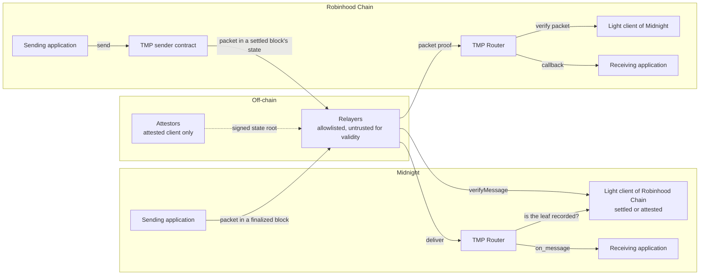
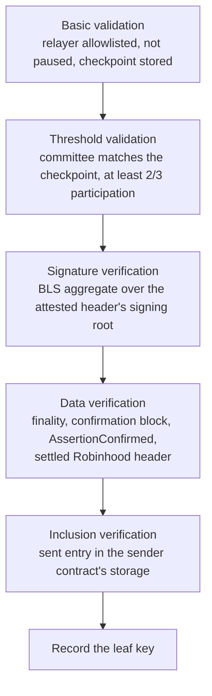
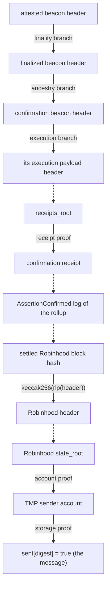
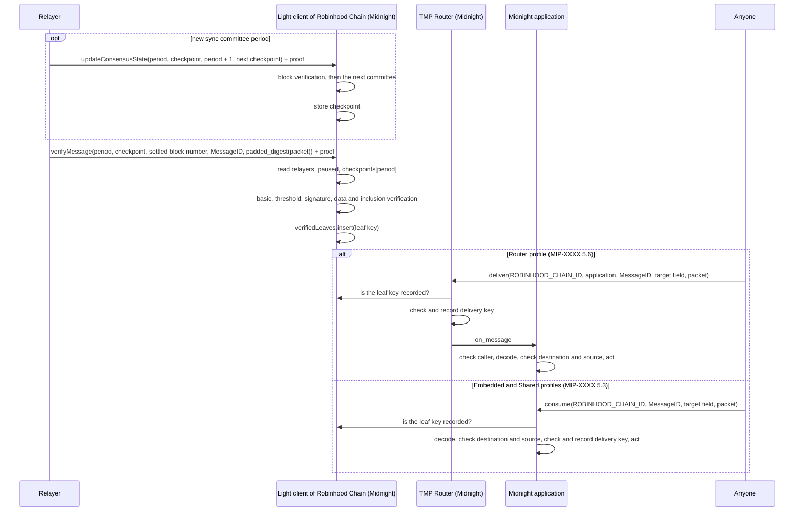
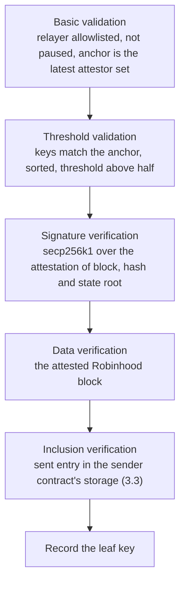
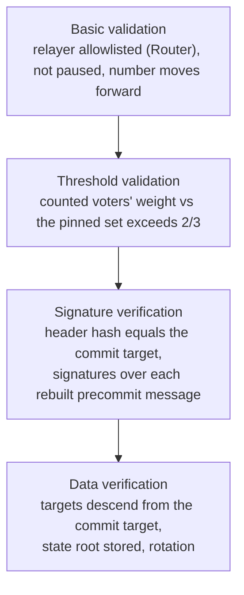
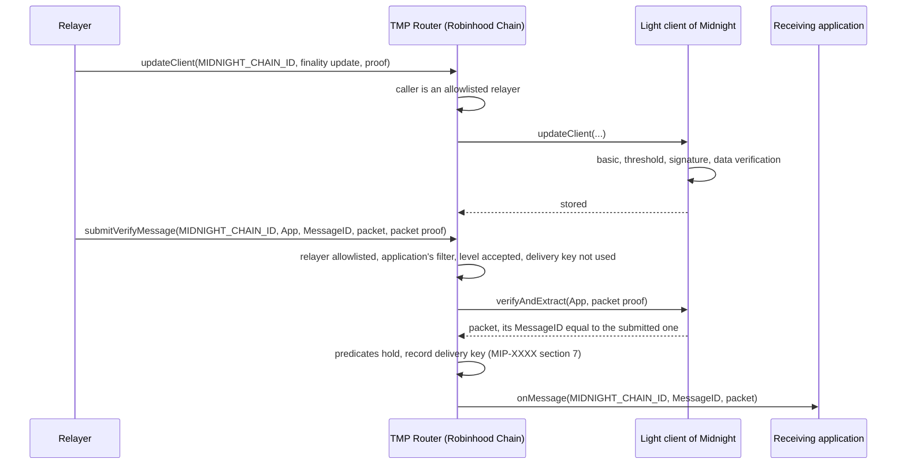

<!--
 Copyright Midnight Foundation

 Licensed under the Apache License, Version 2.0 (the "License");
 you may not use this file except in compliance with the License.
 You may obtain a copy of the License at

     https://www.apache.org/licenses/LICENSE-2.0

 Unless required by applicable law or agreed to in writing, software
 distributed under the License is distributed on an "AS IS" BASIS,
 WITHOUT WARRANTIES OR CONDITIONS OF ANY KIND, either express or implied.
 See the License for the specific language governing permissions and
 limitations under the License.
-->

## Abstract

This MIP specifies the light clients that connect Midnight and **Robinhood Chain** under the Trustless Messaging Protocol (MIP-XXXX, TMP): a light client of Robinhood Chain on Midnight for messages coming in, and a light client of Midnight on Robinhood Chain for messages going out.

Robinhood Chain is an Arbitrum rollup that settles on Ethereum. A message from it is written into the state of a **TMP sender contract** and accepted on Midnight once a Robinhood block holding it is **settled**: Ethereum finalized a block in which Robinhood's rollup contract confirmed an assertion for that Robinhood block. Checking settlement needs pairing checks Midnight does not have yet. Until it does, and only for that reason, a **temporary attested client** serves the route: it accepts a Robinhood state root signed by a threshold of independent attestors once the batch holding that block is in a finalized Ethereum block, and is retired when the settled light client can run.

This MIP is a companion to MIP-XXXX and covers everything its section 4.6 lists.

## Motivation

Dollar stablecoins and tokenized equities live on Robinhood Chain, and MPS-XXXX names moving value into Midnight as the first priority. TMP defines the messaging rules once; this MIP defines what is specific to Robinhood Chain.

Connecting the two runs into three gaps:

- **Robinhood Chain does not finalize itself.** Its blocks are final for its sequencer within seconds, but they are settled only when an assertion covering them is confirmed on Ethereum after a challenge window. A light client of Robinhood Chain is therefore a light client of Ethereum, bound to Robinhood state through the rollup contract.
- **Midnight cannot check Ethereum's signatures.** Ethereum's sync committee signs with BLS12-381 aggregate signatures, and Midnight contracts have no pairing operation. The check has to arrive as a proof Midnight can verify.
- **Robinhood Chain cannot cheaply check Midnight's signatures.** GRANDPA signs with Ed25519, and the EVM has no Ed25519 precompile.

## Specification

The key words MUST, MUST NOT, SHOULD, SHOULD NOT and MAY are to be interpreted as described in RFC 2119. Notation, pseudocode conventions, data types and keys are those of MIP-XXXX. Ethereum functions and constants (`hash_tree_root`, `is_valid_merkle_branch`, `compute_signing_root`, `compute_domain`, `compute_fork_version`, `compute_epoch_at_slot`, `compute_sync_committee_period_at_slot`, `bls.FastAggregateVerify`, `is_valid_light_client_header`, `floorlog2`, `get_subtree_index`, `DOMAIN_SYNC_COMMITTEE`, `FINALIZED_ROOT_GINDEX`, `NEXT_SYNC_COMMITTEE_GINDEX`) are used as the Ethereum consensus specifications define them, at the fork Ethereum mainnet runs, including the generalized indices Electra moved.

### 1. Overview

Each direction needs a light client on its destination chain, and the two directions face different problems, so they use different light clients.

**Robinhood Chain → Midnight.** Robinhood Chain is a rollup: a Robinhood block becomes trustworthy only when Ethereum settles it, about a week after it is produced. Checking that settlement on Midnight means checking Ethereum's BLS signatures, which needs a pairing operation Midnight does not have yet. So this MIP defines the light client this direction should use, and a temporary one for as long as it cannot run:

- the **settled light client** (3.1 to 3.8) follows Ethereum and Robinhood's rollup contract and adds no trusted party; it waits for settlement and needs Midnight's pairing capability;
- the **attested client** (3.9) is the temporary one: it accepts a Robinhood state root signed by a threshold of independent attestors, each re-executing Robinhood from batches in finalized Ethereum blocks. It needs only signature checks, available from ledger 9, and serves the route until the settled light client runs, then is retired.

**Midnight → Robinhood Chain.** Midnight finalizes blocks in seconds with GRANDPA, so a packet needs no settlement wait. Its Ed25519 signatures are what the EVM cannot check cheaply, so they arrive in one Groth16 proof (section 4).

**The messaging layer does not change with the light client.** Both Robinhood clients read the same message, a packet in the TMP sender contract (3.5), and give it the same `MessageID`. Delivery keys and filters see only verified leaves (MIP-XXXX section 4), never which client recorded them. The destination's client registry can therefore point Robinhood Chain at the attested client first and at the settled one later (MIP-XXXX 4.7): on a Router, applications need no change beyond accepting the new client's settlement level; in the Embedded and Shared profiles, each application points its own registry. A packet already taken is never delivered twice.

| Direction                      | Verifier                                                        | Source signatures                  | How they are verified                                                                                                           | What the destination trusts                                                                                      |
| ------------------------------ | --------------------------------------------------------------- | ---------------------------------- | ------------------------------------------------------------------------------------------------------------------------------- | ---------------------------------------------------------------------------------------------------------------- |
| **Robinhood Chain → Midnight** | Light client of Robinhood Chain, a Compact contract on Midnight | Ethereum sync committee, BLS12-381 | **One ZK proof** from the committee's signature to the message in Robinhood state, checked through the operation's verifier key | at least ⅔ of the sync committee signed a finalized Ethereum block, which holds Robinhood's confirmation of the block whose state holds the message |
| **Robinhood Chain → Midnight, attested** | Attested client, the light client contract of MIP-XXXX 5.1 | Attestor set, secp256k1 | Threshold of signatures over a Robinhood state root, checked in Compact; the message as above | the attestor threshold, each re-executing Robinhood from batches in finalized Ethereum blocks |
| **Midnight → Robinhood Chain** | Light client of Midnight, Solidity contracts on Robinhood Chain | Midnight GRANDPA, Ed25519          | **One ZK proof** of the signature batch (Groth16, BN254 precompiles); stake and data checked on-chain                           | more than ⅔ of Midnight's authority set weight finalized a Midnight block                                        |



Both directions have the same shape on every route. Into Midnight, a relayer proves the message to the light client with `verifyMessage`, then the TMP Router on Midnight checks the record and calls the application (MIP-XXXX 5.6); without the Router, the application consumes the message itself (MIP-XXXX 5.3). Out of Midnight, a relayer submits the packet proof to the TMP Router on the destination, which has the light client of Midnight verify it and calls the application (MIP-XXXX section 7).

### 2. Constants

| Name | Value | Meaning |
|---|---|---|
| `ROBINHOOD_CHAIN_ID` | `H(utf8("eip155:<Robinhood Chain id>"))` | `ChainId` of Robinhood Chain |
| `SYNC_COMMITTEE_SIZE` | `512` | Members of an Ethereum sync committee |
| `SLOTS_PER_HISTORICAL_ROOT` | `8192` | Slots whose block roots a beacon state holds directly, about 27 hours |
| `GENESIS_VALIDATORS_ROOT` | Ethereum mainnet's | Bound into every sync committee signature |
| `ROLLUP_ADDRESS` | Set at creation | Robinhood Chain's BoLD rollup contract on Ethereum |
| `ASSERTION_CONFIRMED` | `keccak256("AssertionConfirmed(bytes32,bytes32,bytes32)")` | Topic of the rollup contract's confirmation event |
| `TMP_SENDER_ADDRESS` | Set at creation | The TMP sender contract on Robinhood Chain (3.5) |
| `SENT_SLOT` | Set at creation | Storage slot of the sender contract's `sent` mapping |
| `DOMAIN_RH_ATTESTATION` | `pad32("tmp:rh-attestation:v1")` | Domain tag of an attestation (3.9) |
| `GROTH16_BUCKETS` | Set at creation | Batch sizes of the GRANDPA signature circuit, one verifier each |

Values set at creation change only by replacing the light client (MIP-XXXX section 9).

### 3. Robinhood Chain → Midnight

This is the light client of Robinhood Chain that lives on Midnight. It lets Midnight **verify messages that Robinhood Chain settled**. It does not check Robinhood Chain's sequencer or Ethereum's full validator set. Instead it follows Ethereum's **sync committee** to a finalized Ethereum block, reads Robinhood's **rollup contract** confirming a Robinhood block in it, and reads the message from that Robinhood block's state. Relayers use it two ways: **consensus updates** that move it to the next sync committee, and **message proofs** that record a Robinhood message as verified.

#### 3.1 Settlement

A message proof must show that a Robinhood block is settled, so the client first needs Robinhood Chain's definition of settled.

Ethereum's beacon chain finalizes blocks. A 512-member **sync committee**, replaced every 256 epochs (about 27 hours), signs beacon block headers, and a header proves which block is finalized through a Merkle branch into its state. Robinhood Chain posts **assertions** about its state to its rollup contract on Ethereum. An assertion is **confirmed** once its challenge window has passed without a successful challenge, and the rollup contract then emits `AssertionConfirmed(assertion_hash, block_hash, send_root)`, naming the Robinhood block the assertion settles; `assertion_hash` is an indexed parameter, so the log's data holds `block_hash` and `send_root`.

So the client's settlement level is `SETTLED`: a Robinhood block is settled if an `AssertionConfirmed` event of `ROLLUP_ADDRESS` names its hash, in a successful transaction of an Ethereum block that is finalized. Robinhood's sequencer signs nothing the client checks.

A Robinhood block's state holds everything written before it, so one settled block is enough for every earlier message: the client reads a message from the state of any settled block at or after the one that sent it, and never walks back through Robinhood blocks.

#### 3.2 Data types

**Sync committee.**

| Field | Type | Description |
|---|---|---|
| `pubkeys` | `BLSPubkey[512]` | Members, in the order the participation bits follow |
| `aggregate_pubkey` | `BLSPubkey` | Part of the committee's `hash_tree_root` |

Members sign with BLS12-381: keys are 48-byte G1 points, so a full committee is 512 x 48 = 24,576 bytes. `pubkeys` is a vector, fixed in order for the whole period, which is what lets a signature name its signers by position.

**Sync aggregate.**

| Field | Type | Description |
|---|---|---|
| `sync_committee_bits` | `Bitvector[512]` | Who signed |
| `sync_committee_signature` | `BLSSignature` | Aggregate signature over the attested header's signing root |

Bit `i` marks whether `pubkeys[i]` signed. The client reads bits and keys in the same order, aggregates the keys whose bit is set, and checks the one signature against the result. The bit count is also the input to threshold validation.

**Light client header.** As the Ethereum light client specification defines it, from Capella on: a beacon block header, its execution payload header, and the branch between them. The fields the client uses:

| Field | Type | Description |
|---|---|---|
| `beacon.slot` | `uint64` | Selects the committee period and fork version |
| `beacon.state_root` | `bytes32` | Root that finality, committee and ancestry branches resolve against |
| `execution.receipts_root` | `bytes32` | Root of the Ethereum block's receipt trie, where the confirmation event is |
| `execution_branch` | `bytes32[]` | Proves `execution` under the beacon block body |

**Robinhood header.** An Arbitrum execution header. Its hash is `keccak256(rlp(header))`.

| Field | Type | Description |
|---|---|---|
| `state_root` | `bytes32` | Root of Robinhood's state trie, where the sender contract's storage lives |
| `number` | `uint64` | The settled block |
| remaining fields | | Needed only to recompute the hash |

`state_root` here is a Merkle-Patricia trie root, a different kind of root from a beacon `state_root`, which is an SSZ root over consensus state, despite the shared name.

**Consensus update.**

| Field | Type | Description |
|---|---|---|
| `committee` | `SyncCommittee` | The committee of the anchor period |
| `update` | `LightClientUpdate` | Attested and finalized headers, the finality branch, the next committee and its branch, the sync aggregate, `signature_slot` |

**Message proof.**

| Field | Type | Description |
|---|---|---|
| `committee` | `SyncCommittee` | The committee of the anchor period |
| `update` | `LightClientFinalityUpdate` | Attested and finalized headers, the finality branch, the sync aggregate, `signature_slot` |
| `confirm_header` | `LightClientHeader` | The Ethereum block holding the confirmation, at or before the finalized one |
| `ancestry_branch` | `bytes32[]` | Proves `confirm_header.beacon` in the finalized block's state: through `block_roots` within `SLOTS_PER_HISTORICAL_ROOT` slots, through `historical_summaries` beyond |
| `receipt_index`, `receipt_proof` | `uint64`, `bytes[]` | The confirmation transaction's receipt, Merkle-Patricia proof under `confirm_header.execution.receipts_root` |
| `log_index` | `uint64` | The `AssertionConfirmed` log in that receipt |
| `robinhood_header` | `RobinhoodHeader` | The settled Robinhood block |
| `sender_account_proof` | `bytes[]` | Merkle-Patricia proof of `TMP_SENDER_ADDRESS` under `robinhood_header.state_root` |
| `sent_storage_proof` | `bytes[]` | Merkle-Patricia proof of the message's `sent` entry under the sender's storage root |

The fields do four jobs. `committee` and `update` prove that a known committee signed one beacon header, and that an older, finalized header sits in its state. `confirm_header`, `ancestry_branch` and the receipt read Robinhood's confirmation out of a finalized Ethereum block. `robinhood_header` turns the confirmed block hash into a state root. The two storage proofs read the message's entry from that state. Every other field exists to establish one value, the message's digest, which the client records.

#### 3.3 Verification

This client runs the checks of MIP-XXXX 4.2: block verification in four steps, then, for a message proof, inclusion verification. They run in one circuit per operation (MIP-XXXX 5.1) whose public inputs are the operation's arguments. Basic validation is the part that reads the light client's ledger state; the other checks use the proof data the relayer supplies as private inputs.



**Basic validation.** On Midnight, as MIP-XXXX 4.4: the relayer is allowlisted, the client is not paused, and `checkpoints[anchor_index] == anchor`. The structural checks on the update itself (slot order, execution branches of the headers) run in the circuit with signature verification below.

**Threshold validation.** A committee of 512 always contains some offline or dishonest members, so the count matters as much as the cryptography. The committee supplied must be the one the checkpoint commits to, it must be the committee of the period the signature was made in, and at least two thirds of it must have signed. On mainnet that is **342 of 512**.

```ruby
verify_threshold(anchor_index, anchor, proof)
    require robinhood_checkpoint(anchor_index, proof.committee) == anchor
    require compute_sync_committee_period_at_slot(proof.update.signature_slot) == anchor_index
    require sum(proof.update.sync_aggregate.sync_committee_bits) * 3 >= SYNC_COMMITTEE_SIZE * 2
```

**Signature verification.** The committee signs not the attested header itself but its signing root, which mixes in the fork version and `genesis_validators_root` so a signature cannot be replayed onto another fork or chain. The fork version is read at the epoch of `signature_slot - 1`, since the committee signs the block of the slot before. Two inputs come from what the client holds, `GENESIS_VALIDATORS_ROOT` and the committee's keys (through the checkpoint); the rest arrive in the update.

```ruby
verify_signature(proof)
    u := proof.update
    # well formed and ordered
    require u.signature_slot > u.attested_header.beacon.slot >= u.finalized_header.beacon.slot
    require is_valid_light_client_header(u.attested_header)
    keys := [pk for pk, bit in zip(proof.committee.pubkeys, u.sync_aggregate.sync_committee_bits) if bit]
    fork_version := compute_fork_version(compute_epoch_at_slot(u.signature_slot - 1))
    domain := compute_domain(DOMAIN_SYNC_COMMITTEE, fork_version, GENESIS_VALIDATORS_ROOT)
    require bls.FastAggregateVerify(keys, compute_signing_root(u.attested_header.beacon, domain),
                                    u.sync_aggregate.sync_committee_signature)
```

**Data verification and inclusion verification.** The two checks above make `attested_header.beacon` trusted, so its `state_root` becomes a root the client can prove further data against. Every root after the first is a field of something the tree above it proved. The scheme changes twice: from SSZ branches to Merkle-Patricia proofs at the confirmation block's `receipts_root`, and from Ethereum to Robinhood at the confirmed block hash.



How to read this diagram: dotted edges point from a structure to one of its fields; solid edges point from a root or hash to what is proven under it.

```ruby
verify_data(height, proof)
    u := proof.update
    # Ethereum: the finalized block, and the earlier block holding the confirmation
    require is_valid_merkle_branch(hash_tree_root(u.finalized_header.beacon), u.finality_branch,
                                   floorlog2(FINALIZED_ROOT_GINDEX),
                                   get_subtree_index(FINALIZED_ROOT_GINDEX),
                                   u.attested_header.beacon.state_root)
    c := proof.confirm_header
    require c.beacon.slot <= u.finalized_header.beacon.slot
    require verify_beacon_ancestry(u.finalized_header.beacon.state_root, c.beacon, proof.ancestry_branch)
    require is_valid_light_client_header(c)                             # includes the execution branch

    # settlement: the rollup contract's confirmation in a successful transaction
    receipt := mpt_value(c.execution.receipts_root, rlp(proof.receipt_index), proof.receipt_proof)
    require receipt.status == 1
    log := receipt.logs[proof.log_index]
    require log.address == ROLLUP_ADDRESS and log.topics[0] == ASSERTION_CONFIRMED
    (block_hash, _send_root) := abi_decode((bytes32, bytes32), log.data)

    # the settled Robinhood block
    require keccak256(rlp(proof.robinhood_header)) == block_hash
    require proof.robinhood_header.number == height
    return proof.robinhood_header

verify_inclusion(block, id, leaf_digest, proof)
    # the message: its entry in the sender contract's state at that block
    require id.root == leaf_digest
    require id.commitment_path == text_hash("sent/" ‖ lower_hex(TMP_SENDER_ADDRESS))     # as a MessageId carries it
    sender := mpt_account(block.state_root, TMP_SENDER_ADDRESS, proof.sender_account_proof)
    require mpt_storage(sender.storage_root, keccak256(leaf_digest ‖ uint256(SENT_SLOT)),
                        proof.sent_storage_proof) == 1
```

Data verification ends at a settled Robinhood block; inclusion verification reads the message's entry from its state. The helpers:

- `verify_beacon_ancestry` checks that `hash_tree_root(c.beacon)` is the block root of slot `c.beacon.slot` in the finalized state, through `block_roots[slot mod SLOTS_PER_HISTORICAL_ROOT]` when the slot is within `SLOTS_PER_HISTORICAL_ROOT` of the finalized one, and through the matching `historical_summaries` entry and its block roots otherwise, as the Ethereum consensus specifications lay out those fields. When the confirmation block is the finalized block itself, the branch is empty and `hash_tree_root(c.beacon)` MUST equal `hash_tree_root(u.finalized_header.beacon)`.
- `mpt_account`, `mpt_storage` and `mpt_value` verify Ethereum Merkle-Patricia proofs with Keccak-256 and return the proven value, aborting otherwise: accounts are keyed by `keccak256(address)` and return the RLP account `[nonce, balance, storage_root, code_hash]`, storage values are keyed by `keccak256(slot)` and RLP-encoded, and a typed receipt has its EIP-2718 type byte removed before it is RLP-decoded.
- `lower_hex` is lowercase hexadecimal without a `0x` prefix.

**Rotation.** A consensus update moves the checkpoint from period `p` to `p + 1`. Threshold validation and signature verification run as above, against period `p`'s committee; consensus state verification (MIP-XXXX 4.2) proves the next committee under the attested header. As in the Ethereum light client protocol, the next committee is taken only from an attested header of period `p` whose finalized header is also in period `p`: an attested header from period `p - 1` would name period `p`'s committee as its next, and an unfinalized one could be reorganized.

```ruby
verify_rotation(anchor_index, new_index, new_checkpoint, proof)
    u := proof.update
    require new_index == anchor_index + 1
    require compute_sync_committee_period_at_slot(u.attested_header.beacon.slot) == anchor_index
    require is_valid_merkle_branch(hash_tree_root(u.finalized_header.beacon), u.finality_branch,
                                   floorlog2(FINALIZED_ROOT_GINDEX),
                                   get_subtree_index(FINALIZED_ROOT_GINDEX),
                                   u.attested_header.beacon.state_root)
    require compute_sync_committee_period_at_slot(u.finalized_header.beacon.slot) == anchor_index
    require is_valid_merkle_branch(hash_tree_root(u.next_sync_committee), u.next_sync_committee_branch,
                                   floorlog2(NEXT_SYNC_COMMITTEE_GINDEX),
                                   get_subtree_index(NEXT_SYNC_COMMITTEE_GINDEX),
                                   u.attested_header.beacon.state_root)
    require is_valid_light_client_header(u.finalized_header)
    require new_checkpoint == robinhood_checkpoint(new_index, u.next_sync_committee)
```

The relayer's duty is to rotate every period. The Ethereum light client protocol accepts updates with fewer signers for optimistic tracking; this client acts on what it verifies, so it requires two thirds for every update.

**The two operations.** MIP-XXXX 4.4 calls the companion's checks through two functions, which compose the steps above:

```ruby
validate_message_proof(anchor_index, anchor, settlement_level, height, id, leaf_digest, proof)
    verify_threshold(anchor_index, anchor, proof)        # the anchor is compatible: the signature's period
    verify_signature(proof)
    block := verify_data(height, proof)
    verify_inclusion(block, id, leaf_digest, proof)

validate_consensus_update(anchor_index, anchor, new_index, new_checkpoint, proof)
    verify_threshold(anchor_index, anchor, proof)
    verify_signature(proof)
    verify_rotation(anchor_index, new_index, new_checkpoint, proof)
```

On this client `height` is the settled Robinhood block's number, not a sync committee period: the anchor's compatibility is checked through the signature's period in threshold validation instead.

#### 3.4 State

The light client contract of MIP-XXXX 5.1. Its checkpoints hold a 32-byte commitment per period, never the 24,576 bytes of a committee: every proof supplies the full committee as a private input, and the circuit recomputes the commitment. Its values on this client:

| Field | Value on this client |
|---|---|
| `chainId` | `ROBINHOOD_CHAIN_ID` |
| `settlementLevel` | `settled` |
| `governed_checkpoints` | `false` |
| Checkpoint index | Ethereum sync committee period |
| Checkpoint | `robinhood_checkpoint(period, committee) = H(uint64_le(period) ‖ hash_tree_root(committee))` |
| Leaf digest | `padded_digest(packet)`, as every light client on Midnight (MIP-XXXX 3.3) |

The client is created from the committee of one period, taken from a finalized beacon state.

#### 3.5 Messages

A message is a **packet** written into the **TMP sender contract**, an immutable contract on Robinhood Chain with no owner and no upgrade path. Any contract or account sends through it:

```ruby
send(sender_contract, destination_chain, destination_application, payload)
    packet := abi.encode(SPEC_VERSION, msg.sender, sender_contract.nonce[msg.sender],
                         destination_chain, destination_application, payload)
    require len(packet) <= MAX_LEAF
    sender_contract.nonce[msg.sender] += 1
    sender_contract.sent[padded_digest(packet)] := true
    emit PacketSent(padded_digest(packet), packet)                  # for relayers
```

`msg.sender`, the EVM's caller, is the packet's `source_application`, so no contract can send in another's name. The entry is never removed, so a packet stays provable from the state of every later settled block.

| Field | Value |
|---|---|
| Leaf | The packet |
| `commitment_path` | The text `"sent/" ‖ lower_hex(TMP_SENDER_ADDRESS)`: `lower_hex` writes the sender contract's 20-byte address as 40 lowercase hexadecimal characters with no `0x` prefix, for example `sent/5fbdb2…0aa3`. Every packet has the same path; the `root` tells packets apart |
| `root` | `padded_digest(packet)`, the key it is stored under |
| `target_field` | Per the application's extract pattern, for example `[5]` for the payload |
| `encoding` | `abi`: `(uint8 version, address source_application, uint64 nonce, bytes32 destination_chain, bytes32 destination_application, bytes payload)` |

The `root` is the packet's own key, not the Robinhood state root: the state root changes with every block, and a `MessageID` that changed with it would let the same packet be delivered once per settled block. `source_application` and `nonce` make every key unique.

An application MUST check that `destination_chain` is Midnight's and `destination_application` is itself, and SHOULD pin the `source_application` values it accepts. Every packet in `sent` was written by a successful transaction, so an application that moves value needs no further check of execution.

#### 3.6 Operations



#### 3.7 Methods

| Method | Called by | Proof public inputs, in order |
|---|---|---|
| `updateConsensusState` | allowlisted relayer | `anchorIndex`, `anchor`, `newIndex`, `newCheckpoint` |
| `verifyMessage` | allowlisted relayer | `anchorIndex`, `anchor`, `height`, `id.commitmentPath`, `id.targetField`, `id.root`, `leafDigest` |
| `isVerified` | anyone | none |

The Security Admin operations of MIP-XXXX 4.5 (`pause`, `propose`, `approve`, `apply`) are unchanged on this client.

#### 3.8 Latency

On the settled client, a message is recorded only after an assertion covering its block is confirmed, at least one challenge window after it was posted (6 days 8 hours, L2BEAT, 2026-10-14), and the confirmation is in a finalized Ethereum block. On the attested client of 3.9, it is the time until Robinhood posts the batch holding the message to Ethereum, plus Ethereum finality, which takes about 13 minutes.

#### 3.9 Attested client

The settled light client needs pairing checks Midnight does not have yet. The **attested client** is a temporary light client of Robinhood Chain on Midnight that serves the route until then: attestors are used only because no other check is available, and the client is retired, by pointing Robinhood Chain at the settled light client (MIP-XXXX 4.7), as soon as that one can run.

It is the same light client contract of MIP-XXXX 5.1, created with `governed_checkpoints` and its own `client_id`, and reads messages exactly as 3.3 and 3.5 do, from the TMP sender contract's state; only how it comes to trust the state root differs. It declares the level **`ATTESTED`**, the value `attested` that the Solana companion MIP adds to MIP-XXXX's `SettlementLevel` (MIP-XXXX 4.1), and an application opts in to it by accepting that level for Robinhood Chain (MIP-XXXX 5.6).

**Attestors.** An attestor is an independent operator that runs its own Robinhood full node. A full node re-executes Robinhood Chain from the transaction batches Robinhood posts to Ethereum, so it computes each block's state root itself rather than taking the sequencer's word. An attestor signs a Robinhood block only once the node reports it **finalized**, meaning the batch holding it is in a finalized Ethereum block, so the block's transactions and their order can no longer change. It signs with ECDSA over secp256k1, which Compact verifies from ledger 9:

```ruby
attestation_digest(client, set, number, block_hash, state_root)
    return H(DOMAIN_RH_ATTESTATION ‖ ROBINHOOD_CHAIN_ID ‖ TMP_SENDER_ADDRESS ‖ client ‖ set
             ‖ uint64_le(number) ‖ block_hash ‖ state_root)
```

`client` is the attested client's address and `set` the commitment of the attestor set signing, so a signature cannot be replayed on another client or under another set, even by a key that stays in the next set. Attestors sign the digest itself, with no message prefix.

In the digest, `TMP_SENDER_ADDRESS` is its 20 bytes and every other field 32 bytes; an attestor key is a 33-byte compressed secp256k1 point, the keys of a set are sorted by those bytes, and a signature is 64 bytes, `r ‖ s`, with `s` in the lower half of the curve order.

Each attestor also watches Robinhood's confirmed assertions on Ethereum, and on any confirmed block hash that differs from one it signed, stops signing and alerts the Security Admin.

**Checkpoint.** The attestor set: its index counts the sets, starting at 0, its value is `attestor_set_commitment(keys, threshold) = H(uint8(threshold) ‖ keys, sorted)` with `threshold` more than half of the keys, and a new set is added by an `addCheckpoint` change after `GOVERNANCE_DELAY` (MIP-XXXX 4.4). Message proofs anchor only on the latest set (MIP-XXXX 4.4), and every signature names its set, so a retired set's signatures are void. There is no consensus update.

**Message proof.** A relayer calls `verifyMessage` (MIP-XXXX 4.4) with the latest checkpoint as anchor, `height` the attested block's number, the packet's `MessageID` and `leafDigest`. The proof carries the attested block, the attestors' signatures over it, and the storage proofs of 3.2:



```ruby
validate_message_proof(anchor_index, anchor, settlement_level, height, id, leaf_digest, proof)
    # threshold validation
    require attestor_set_commitment(proof.keys, proof.threshold) == anchor
    require proof.keys strictly ascending                              # distinct keys
    require proof.threshold * 2 > len(proof.keys)
    # signature verification
    d := attestation_digest(self_address(), anchor, height, proof.block_hash, proof.state_root)
    signers := {}
    for (index, sig) in proof.signatures
        require index < len(proof.keys) and index not in signers
        require secp256k1_verify(proof.keys[index], d, sig)
        signers.add(index)
    require len(signers) >= proof.threshold
    # data verification: the attested block; inclusion verification as 3.3
    verify_inclusion(RobinhoodBlock(number = height, state_root = proof.state_root), id, leaf_digest, proof)
```

`self_address()` is the client's own contract address. Inclusion verification needs Keccak-256 for the Merkle-Patricia proofs, which Compact has from ledger 9; the operation's circuit MAY instead be installed as its verifier key (MIP-XXXX 5.1), with bounded proof sizes fixed at creation. No pairing is needed, so this client can run before the verification capabilities MIP. Here `height` is the attested Robinhood block's number, and its public inputs are those of 3.7.

| Field | Value on this client |
|---|---|
| `chainId` | `ROBINHOOD_CHAIN_ID` |
| Settlement level | `ATTESTED`: the attestor threshold signed the state root of a Robinhood block whose batch is in a finalized Ethereum block |
| `governed_checkpoints` | `true` |
| Checkpoint index, checkpoint | Attestor set number, `attestor_set_commitment` |
| Leaf digest | `padded_digest(packet)`, as 3.4 |

**Moving between the two clients.** The destination's client registry points `ROBINHOOD_CHAIN_ID` at one of them at a time (MIP-XXXX 4.7). Both give a packet the same `MessageID` (3.5), so its delivery key is the same whichever recorded it: when the registry moves from the attested client to the settled one, a packet already taken is never delivered again.

**Latency.** As 3.8.

#### 3.10 Limits

- **Packet size.** A packet is at most `MAX_LEAF` bytes (MIP-XXXX 3.3), so its `payload` is at most 544 bytes once the ABI encoding of the other fields is counted.
- **Execution.** Robinhood Chain commits execution: an entry in `sent` exists only if the transaction that wrote it succeeded, so applications MAY move value on either client.
- **Trust at `ATTESTED`.** An application that moves value on the attested client trusts the attestor threshold for it, and states so when it accepts that level.

### 4. Midnight → Robinhood Chain

This is the light client of Midnight that lives on Robinhood Chain, the mirror of the one above. It lets Robinhood Chain **verify packets committed on Midnight**. It does not check Ed25519 signatures itself: the EVM has no precompile for them, so a Groth16 proof carries them. It implements MIP-XXXX section 6. Relayers use it two ways: **finality updates** that bring new Midnight state roots to Robinhood Chain, and **packet proofs** that deliver a Midnight packet to a Robinhood application through the Router.

#### 4.1 Finality

As MIP-XXXX 6.1: a Midnight block is final once more than two thirds of the current GRANDPA authority set's weight precommitted to it or a descendant. A packet is committed by an output of the sender's packet token, recorded in `System::Events` with the `TxApplied` of its transaction (MIP-XXXX 6.2).

#### 4.2 Data types

The finality update and packet proof of MIP-XXXX 6.3, with the signatures replaced by a batch proof:

**Batch proof.**

| Field | Type | Description |
|---|---|---|
| `proof` | `bytes` | The Groth16 proof, 384 bytes: the three proof points, and the commitment with its proof of knowledge that the gnark Groth16 library adds |
| `bucket` | `uint16` | Batch size, selecting the verifier from `GROTH16_BUCKETS` |
| `signer_keys` | `bytes32[]` | Each counted voter's Ed25519 key |
| `pinned_indices` | `uint32[]` | Each counted voter's position in the pinned authority set, no repeats |
| `targets` | `(bytes32, uint32)[]` | Each counted voter's precommit target |
| `active` | `bool[]` | Real voter or padding slot |

The circuit's public input is the **witness digest**, passed as two BN254 scalars, its high and low 128 bits:

```ruby
witness_digest(set_id, round, batch)
    return sha256(uint64_le(set_id) ‖ uint64_le(round)
                  ‖ for each slot i: byte(batch.active[i]) ‖ batch.signer_keys[i]
                                     ‖ batch.targets[i].hash ‖ uint32_le(batch.targets[i].number))
```

Two inputs to the digest come from what the contract holds, `set_id` and, through `pinned_indices`, the pinned keys; the rest arrive in the update. The circuit proves only that, for every active slot, the signature is valid over `SCALE((Precommit(targets[i]), round, set_id))` under `signer_keys[i]`. The keys and targets are in the digest because the contract uses them: the keys to count weight, the targets to check descent. Without that binding, a proof could be credited to other keys.

#### 4.3 Verification



**Basic validation.** As MIP-XXXX 6.5.

**Threshold validation.** Against the client's own pinned set, before the proof is checked.

```ruby
verify_threshold(client, batch)
    require every per-slot array has length batch.bucket
    weight := 0
    seen := {}
    for each slot i where batch.active[i]
        require batch.pinned_indices[i] not in seen
        seen.add(batch.pinned_indices[i])
        (key, w) := client.authorities[batch.pinned_indices[i]]
        require key == batch.signer_keys[i]
        weight += w
    require weight * 3 > client.total_weight * 2
```

**Signature verification.**

```ruby
verify_signatures(client, update, batch)
    require blake2b_256(SCALE(update.header)) == update.justification.commit.target_hash
    digest := witness_digest(client.set_id, update.justification.round, batch)
    require groth16_verifier[batch.bucket].verify(batch.proof, digest)
```

`blake2b_256` uses the BLAKE2 precompile at `0x09`; the Groth16 verifiers use the BN254 precompiles at `0x06` to `0x08`, with their verifying keys compiled in.

**Data verification.** Each counted target descends from the commit target (`votes_ancestries`, hashed with `blake2b_256`); the state root is stored; rotation follows MIP-XXXX 6.5, failing closed on any change it cannot follow.

When Midnight signs BEEFY, a **BEEFY client** (MIP-XXXX 6.5, BEEFY) replaces the batch proof and needs no circuit: signatures are checked with `ecrecover` against the signer leaves' keys, Keccak-256 serves the commitment, the key multiproof and the MMR proof, and the BLAKE2 precompile hashes the packet block's header (MIP-XXXX 6.6). It is a separate light client registered for the same chain (MIP-XXXX section 9).

#### 4.4 State

The contract keeps three records: `ClientState`, the pinned authority set, and one `ConsensusState` per stored block.

**`ClientState`.** Six fields. `chainId` is fixed at creation; `setId` and `totalWeight` change only on a handover; `latestNumber` on every update; `layouts` and `isPaused` only by the Security Admin.

| Field | Type | Description |
|---|---|---|
| `chainId` | `bytes32` | Midnight's `ChainId` |
| `setId` | `uint64` | The pinned authority set id |
| `totalWeight` | `uint64` | The pinned set's total weight |
| `latestNumber` | `uint32` | The newest finalized Midnight block stored |
| `layouts` | map of runtime version to event layout | How to decode `System::Events` (MIP-XXXX 6.4); added by the Security Admin after `GOVERNANCE_DELAY` |
| `isPaused` | `bool` | Set by any one Security Admin member at once; cleared by the threshold |

**`ConsensusState`.** One Midnight block hash and state root per stored block number, written by every update and never overwritten, so a packet in an older block is reached through its headers (MIP-XXXX 6.6).

**Pinned authority set.** The `(key, weight)` list, stored by the contract rather than supplied per update. Midnight's authority set lists an operator's key once per seat; the pinned set holds each distinct key once, with its seats summed as its weight, so one signature counts all of them.

#### 4.5 Operations



An update that does not move forward is rejected, as MIP-XXXX 6.5 requires, so when two relayers race with the same update the second reverts harmlessly. Two valid justifications for different blocks at one height mean Midnight's finality failed: monitoring alerts the Security Admin, who pauses the client (MIP-XXXX section 9).

#### 4.6 Methods

Every state-changing method is reached through the Router, which holds the light client's roles.

| Method | Reached through | What it does |
|---|---|---|
| `updateClient` | Router, relayer role | Stores a finalized Midnight block, rotating the set on handover |
| `verifyAndExtract` | Router, inside `submitVerifyMessage` | MIP-XXXX 6.6 against a stored block, directly or through its headers, for the application the Router names |
| `getClientState`, `getStateRoot` | anyone | Reads |

The Router implements MIP-XXXX section 7. Its relayer role and its admin are held as MIP-XXXX section 9 requires: every change behind a timelock of at least `GOVERNANCE_DELAY`, except pausing, which any one Security Admin member can do at once.

## Rationale

### Why `SETTLED` and not `FINALIZED`?

A Robinhood block is final for its sequencer long before it is settled. Until an assertion covering it is confirmed on Ethereum, its state can still be replaced through a successful challenge, so a message from it would rest on trust in the sequencer. MPS Goal 1 excludes that.

### Why read settlement from the confirmation event?

The rollup contract's `AssertionConfirmed` event names the settled Robinhood block hash directly, so the client needs no assertion preimage and no knowledge of how the BoLD contracts lay out their storage, both of which change with BoLD versions. Reading the event from a finalized Ethereum block makes Robinhood's settlement as final as Ethereum.

### Why messages in contract state and not in receipts?

A receipt is reachable only from its own block's header, and a confirmed assertion settles one block among the thousands produced since the last one, so a receipt proof would walk back through every header in between. State carries every earlier write forward: one storage proof under the settled block's state root reaches any message sent before it, however old. The sender contract is the smallest piece that puts messages in state, and it authenticates the sending contract through `msg.sender`.

### Why a temporary attested client?

The settled light client is the one this route should use, and it cannot run until Midnight can check BLS pairings. Attestors, each re-executing Robinhood Chain from batches in finalized Ethereum blocks, are the only check available until then. They are a temporary measure with a declared level, so an application opts in knowingly, and both clients read the same sender contract, so retiring the attested client changes nothing else.

### Why a two-thirds committee threshold?

The Ethereum light client protocol accepts updates with fewer signers for optimistic tracking and relies on later updates to correct itself. A TMP light client acts on what it verifies, so it uses the supermajority Ethereum uses for finality.

### Why split the checks differently on each side?

On Robinhood Chain the EVM can count weight and hash headers cheaply; only Ed25519 is missing, so only signatures go into the circuit, and the contract keeps the pinned set it counts against. On Midnight, the BLS pairing, the SSZ branches and the Merkle-Patricia proofs would all be expensive in a user's circuit, so all of them go into one proof checked by the verifier key.

### Open questions

- How often Robinhood Chain posts batches and confirms assertions, which sets the latency of the attested and settled clients.

## Path to Active

### Acceptance Criteria

1. MIP-XXXX and the verification capabilities MIP are Active.
2. The light client of Robinhood Chain is live on Midnight mainnet and records `SETTLED` messages with no trusted party. The attested client MAY go live earlier, since it needs only ledger 9, which is on mainnet.
3. The TMP sender contract, the light client of Midnight and the Router are live on Robinhood Chain mainnet, with audited circuits from a multi-party setup.
4. The test vectors below pass against every implementation.

### Implementation Plan

Every step is rehearsed on Midnight preprod and Robinhood Chain Testnet first, in the same order.

1. **Generate the proving artifacts.** Run the multi-party setup for the GRANDPA signature circuit, one per bucket, and publish the keys. Generate the verifier keys of the Robinhood light client's circuits in the format of the verification capabilities MIP.
2. **Deploy on Robinhood Chain.** The TMP sender contract; the light client of Midnight and the Router, created from an agreed Midnight authority set, behind the timelock.
3. **Deploy on Midnight.** The attested client with the agreed attestor set; the light client of Robinhood Chain, created from the committee of an agreed period, once the verification capabilities MIP is.
4. **Start the attestors and relayers** on both sides, at least `MIN_RELAYERS_PER_ROUTE` per direction, and keep both clients rotating.
5. **Hand over control** to the agreed Security Admin, and check on-chain that every role is held by exactly the intended accounts.
6. Later: the **direct BEEFY** light client of Midnight, once MIP-0023 is on mainnet.

## Backwards Compatibility Assessment

No change to Midnight beyond MIP-XXXX and the verification capabilities MIP. On Robinhood Chain all contracts are new. A change to the rollup contract's confirmation event or to Robinhood Chain's header format, or an Ethereum fork that moves a generalized index, is handled by replacing the light client (MIP-XXXX section 9).

## Security Considerations

The parties of MIP-XXXX's trust model, plus those specific to this route:

| Party | Trusted for | If compromised | Bounded by |
|---|---|---|---|
| Ethereum sync committee, at least ⅔ of 512 | the finality of the beacon headers it signs | can sign a false header, and the client accepts it | an honest two thirds of the committee; sync committee signatures are not slashable; monitoring detects conflicting finality and the Security Admin pauses the client |
| Robinhood Chain's BoLD validators | confirming correct assertions | can confirm a false assertion if no one challenges it in time; L2BEAT lists challenges as limited to whitelisted validators (2026-10-14) | a property of Robinhood Chain itself, inherited, not added |
| Robinhood Chain's rollup upgrade authority | keeping the rollup contract's rules | an upgrade could emit an `AssertionConfirmed` for a block that was never settled | a property of Robinhood Chain itself, inherited, not added; L2BEAT lists the rollup as upgradable by a multisig without delay (2026-10-26) |
| Robinhood Chain's sequencer | liveness | can delay or censor Robinhood transactions | not trusted for validity: only settled state is read |
| Attestor set, at its threshold (attested client only) | the state root of the Robinhood blocks it signs | can record a false state root, and with it false packets | applications opt in to `ATTESTED`; independent operators, each with its own full node; each signature names its client; a retired set's signatures are void; attestors and monitoring alert on two attested blocks at one height or a conflict with a confirmed assertion, and the Security Admin pauses the client (MIP-XXXX section 9) |
| TMP sender contract | writing an entry only for a packet its caller sent | if it could be changed, its owner could write entries for packets no one sent | immutable: no owner, no proxy, no upgrade; its address is fixed in the light client at creation |
| GRANDPA circuit and its multi-party setup | correct signature verification on Robinhood Chain | a soundness bug lets a forged finality update pass | the relayer allowlist; a forgery also needs an allowlisted relayer |
| Router admin, behind the timelock | upgrades, roles, client replacement | can install a light client that accepts forged packets | the timelock: public for at least `GOVERNANCE_DELAY` |

Further points:

- **Wrong rollup contract, event or sender contract.** Fixed at creation; changed only by replacing the client.
- **One packet, many settled blocks.** The `MessageID` is keyed by the packet, not the state root, so proving it again under a later block records the same leaf and delivers it once (3.5).
- **Ethereum fork.** A fork that moves a generalized index or changes the execution header needs a replaced client, scheduled before the fork activates.

## Implementation

| Component | Where |
|---|---|
| Light client of Robinhood Chain: the Compact contract of MIP-XXXX 5.1 with this MIP's verifier keys | Midnight |
| Proof circuits for 3.3 (message proof and rotation) | Off-chain prover; verified on Midnight |
| Attested client (3.9), the light client contract of MIP-XXXX 5.1 | Midnight, Compact, ledger 9 |
| TMP sender contract | Robinhood Chain, Solidity |
| Light client of Midnight and Router | Robinhood Chain, Solidity |
| GRANDPA signature circuit, one per bucket | Off-chain prover; verified on Robinhood Chain |
| Relayers, provers, monitoring | Off-chain |

## Testing

### Light client of Robinhood Chain

- Accepts: a rotation across a real committee change; a packet read from the confirmed block's state; a packet sent long before the confirmed block; a confirmation more than `SLOTS_PER_HISTORICAL_ROOT` slots before the finalized block, through `historical_summaries`.
- Rejects: participation below two thirds; a committee that does not match the checkpoint; a signature period other than the anchor; a rotation whose attested or finalized header is outside the anchor period, or whose finality branch is invalid; a confirmation header that is not an ancestor of the finalized one; a log from another address or with another topic; a failed confirmation transaction; a Robinhood header that does not hash to the confirmed block hash; a block number other than `height`; a storage proof for another contract or key, or an entry that is not set; an `id.root` other than `leafDigest`.

### Attested client

- `verifyMessage` rejects: keys not in strictly ascending order, a threshold not above half of the keys, a signer index out of range, a signature made under another attestor set, fewer than the threshold of distinct signers, a key set that does not match the anchor, an anchor other than the latest checkpoint, a signature for another client, block or state root, a paused client, a relayer not on the allowlist, and every inclusion case of the light client above.
- `addCheckpoint` takes effect only after `GOVERNANCE_DELAY`, and the previous set's signatures are rejected from then on.
- A packet recorded by the attested client and later by the `SETTLED` client is delivered once.

### TMP sender contract

- Writes the entry and increments the nonce only for its caller; has no owner or upgrade function; rejects a packet above `MAX_LEAF`.
- `padded_digest` in Solidity equals `padded_digest` in Compact for shared test vectors.

### Light client of Midnight

- Accepts real justifications at authority set handovers, and a packet in a block older than the newest stored one through its headers.
- Rejects: an update from a caller that is not an allowlisted relayer; an update that does not move forward; a proof for another witness digest; a key that does not match the pinned index; a repeated pinned index; weight at or below two thirds; a header that does not hash to the commit target; a target that does not descend from it.
- `verifyAndExtract` rejects the cases of MIP-XXXX 6.6.

### Test vectors

To be published with this MIP: Ethereum light client updates across a period boundary; a full message proof for one packet, from a real `AssertionConfirmed` event of Robinhood's rollup contract through the sender contract's storage; Groth16 proofs of Midnight justifications with the verifying keys; `System::Events` storage proofs.

## References

1. MIP-XXXX: Trustless Messaging Protocol (TMP)
2. MPS-XXXX: Trustless Cross-Chain Messaging
3. MIP-0023: Committee Bridge Consensus Integration
4. Ethereum consensus specifications, Altair light client sync protocol and later forks: https://github.com/ethereum/consensus-specs
5. Arbitrum BoLD: https://docs.arbitrum.io/how-arbitrum-works/bold/gentle-introduction
6. L2BEAT, Robinhood Chain: https://l2beat.com/layer2s/projects/robinhood (read 2026-10-14 and 2026-10-26)
7. MIP-XXXX: TMP Routes for Solana (companion)

## Acknowledgements

TBD.

## Copyright Waiver

All contributions (code and text) submitted in this MIP must be licensed under the Apache License, Version 2.0. Submission requires agreement to the Midnight Foundation Contributor License Agreement, which includes the assignment of copyright for your contributions to the Foundation.
