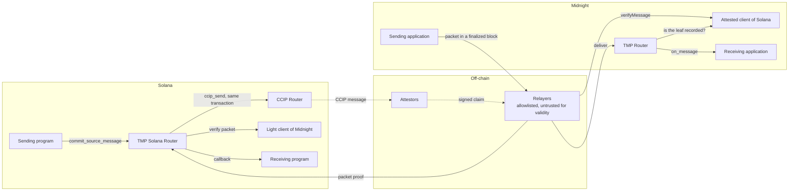
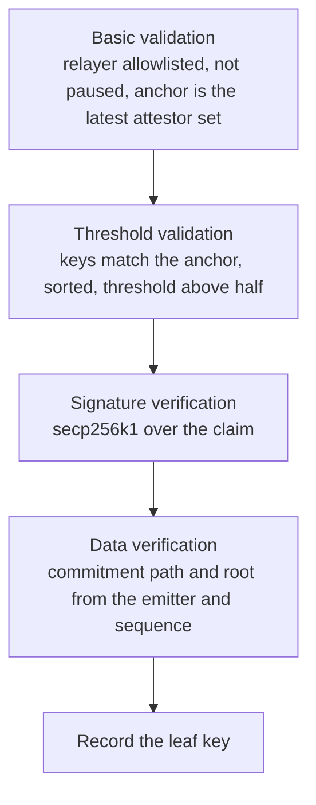
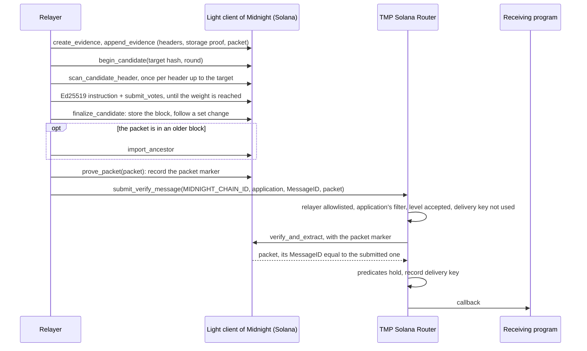

<!--
 Copyright Midnight Foundation

 Licensed under the Apache License, Version 2.0 (the "License");
 you may not use this file except in compliance with the License.
 You may obtain a copy of the License at

     https://www.apache.org/licenses/LICENSE-2.0

 Unless required by applicable law or agreed to in writing, software
 distributed under the License is distributed on an "AS IS" BASIS,
 WITHOUT WARRANTIES OR CONDITIONS OF ANY KIND, either express or implied.
 See the License for the specific language governing permissions and
 limitations under the License.
-->

## Abstract

This MIP specifies the two routes that connect Midnight and **Solana** under the Trustless Messaging Protocol (MIP-XXXX, TMP). From Midnight to Solana, a **light client of Midnight** runs as a Solana program and checks Midnight's GRANDPA finality directly, with Solana's native Ed25519 signature check and no proof system. From Solana to Midnight, the TMP Solana Router commits every message through **Chainlink CCIP**, Chainlink's cross-chain interoperability protocol, in the same transaction that sends it. Midnight cannot check Solana's consensus yet, and CCIP does not reach Midnight yet. Only for that reason, and only until one of them changes, an **attestor set** reads each commitment from CCIP and signs it into Midnight, where an **attested client** implements MIP-XXXX's light client interface at a level this MIP adds, `ATTESTED`. A CCIP receiver on Midnight replaces the attestor set once CCIP serves Midnight. It is a companion to MIP-XXXX and covers everything its section 4.6 lists.

## Motivation

MPS-XXXX names Solana as a priority chain. TMP defines the messaging rules once; this MIP defines what is specific to Solana, in each direction.

**Midnight to Solana** can be checked directly today. Midnight finalizes blocks with GRANDPA, whose votes are Ed25519 signatures, and Solana has a native program that checks Ed25519 signatures cheaply. What Solana lacks, a built-in Blake2b hash for Midnight's headers and state trie, a Solana program can compute itself.

**Solana to Midnight** cannot yet be checked against Solana's consensus, for three reasons:

- **Midnight cannot check Solana's signatures.** Solana's Alpenglow consensus signs with BLS12-381 aggregate signatures, and Midnight contracts have no pairing operation.
- **Solana does not commit its validator set.** Each epoch's set of `(BLS key, stake)` is in no block or certificate (SIMD-0326, SIMD-0387), so a light client cannot follow it from one epoch to the next.
- **Solana does not commit execution.** Blocks contain failed transactions, and consensus commits no per-transaction status (SIMD-0191), so a light client could prove that a transaction was in a block, not that it ran.

CCIP already carries messages out of Solana: a Solana program sends a message to the CCIP Router, which assigns it a **CCIP message ID** and has Chainlink's network deliver it to the destination chain. A TMP message committed through CCIP in the transaction that sends it is committed only if that transaction succeeded, which closes the execution gap. CCIP has no lane to Midnight yet; until it does, an attestor set reads the commitment from CCIP and brings it to Midnight.

## Specification

The key words MUST, MUST NOT, SHOULD, SHOULD NOT and MAY are to be interpreted as described in RFC 2119. Notation, pseudocode conventions, data types and keys are those of MIP-XXXX.

### 1. Overview

Each direction needs a verifier on its destination chain, and the two directions face different problems, so they use different verifiers.

**Midnight → Solana.** Midnight finalizes blocks with GRANDPA, whose Ed25519 signatures Solana checks natively and cheaply, so a light client of Midnight runs as a Solana program and checks everything directly (section 4).

**Solana → Midnight.** A light client of Solana on Midnight is not possible yet: Midnight cannot check Solana's BLS signatures, and Solana's consensus commits neither its next validator set nor whether a transaction succeeded. So the route starts from the strongest record Solana offers today, a commitment written through CCIP in the transaction that sends the message, and moves through three verifiers as the missing pieces arrive:

- the **attested client** (section 3), fed by an attestor set that reads CCIP's record: a temporary measure, used only because neither of the others is available yet;
- an attested client fed by a **CCIP receiver** instead of attestors, once CCIP serves Midnight (3.6);
- a **light client of Solana**, once Solana commits its validator set and transaction status and Midnight can check BLS signatures (3.6).

**The messaging layer does not change with the verifier.** Each verifier implements MIP-XXXX's light client interface, so delivery keys, filters, the Router and the applications see only verified leaves (MIP-XXXX section 4), never which verifier recorded them. Each verifier has its own `client_id`, and moving to the next one only points `SOLANA_CHAIN_ID` at it in the destination's client registry (MIP-XXXX 4.7). On a Router, applications need no change beyond accepting the new client's level (MIP-XXXX 5.6). Every verifier on this route MUST record the same `MessageID` for a message (3.3), so a message already taken is never delivered twice.

| Direction | Verifier on the destination | What it checks | What the destination trusts |
|---|---|---|---|
| **Midnight → Solana** | Light client of Midnight, a Solana program | GRANDPA votes through Solana's Ed25519 program; headers, state trie and `System::Events` in the program itself | more than ⅔ of Midnight's authority set weight finalized the block holding the packet |
| **Solana → Midnight** | Attested client, the light client contract of MIP-XXXX 5.1 | at least `ATTESTOR_THRESHOLD` attestor signatures over a commitment the Solana Router sent through CCIP | the attestor set, and the Solana Router program |



Both directions have the same shape on every route. Into Midnight, a relayer proves the message to the light client with `verifyMessage`, then the TMP Router on Midnight checks the record and calls the application (MIP-XXXX 5.6); without the Router, the application consumes the message itself (MIP-XXXX 5.3). Out of Midnight, a relayer submits the packet proof to the TMP Router on the destination, which has the light client of Midnight verify it and calls the application (MIP-XXXX section 7).

### 2. Constants

| Name | Value | Meaning |
|---|---|---|
| `SOLANA_CHAIN_ID` | `H(utf8("solana:<genesis hash prefix>"))` | `ChainId` of Solana mainnet |
| `DOMAIN_SOLANA_CLAIM` | `pad32("tmp:solana-claim:v1")` | Domain tag of an attestor claim |
| `ATTESTOR_THRESHOLD` | Per attestor set | Distinct attestor signatures a claim needs; more than half of the set (3.3) |
| `MAX_AUTHORITIES` | `64` | Most GRANDPA voters the light client of Midnight holds; Midnight mainnet has 13 today |
| `MAX_ANCESTRY_LINKS` | `16` | Most headers between a vote's target and the justified block |
| `MAX_TRIE_NODES` | `32` | Most nodes in a `System::Events` storage proof |
| `EVIDENCE_BUFFER` | `9900` | Bytes of staged evidence per buffer, appended in chunks of at most 900 |

### 3. Solana → Midnight

This route lets a Midnight contract act on a message a Solana program sent. It has three parts: the TMP Solana Router commits the message through CCIP on Solana (3.1); an attestor set reads the commitment and signs a claim (3.2); and the attested client, MIP-XXXX's light client contract, checks the claim and records the message (3.3).

#### 3.1 Committing on Solana

A sending program calls the TMP Solana Router's `commit_source_message` through a cross-program invocation, signed by the sending program's **emitter** account, an address only that program can sign for. The Router:

1. checks the emitter is registered, that the destination is a registered route, and that the payload fits (below);
2. assigns the emitter's next **sequence**, starting at 0;
3. builds the **Solana packet** below and computes `packet_hash = padded_digest(packet)` (MIP-XXXX 3.3), so a Midnight contract can recompute it;
4. sends a data-only CCIP message whose data is the **commitment** below, and reads back its 32-byte CCIP message ID;
5. emits `SourceMessageCommitted(emitter_id, sequence, destination_chain, destination_application, packet_hash, ccip_message_id)`.

`emitter_id` is the sending program's ID. Its emitter account is the program-derived address with seed `"tmp-emitter"` under that program, which only the program can sign for, and the Router's Security Admin registers each emitter.

All five happen in one Solana transaction, together with whatever the sending program does in it, such as locking tokens. If any step fails, the whole transaction fails and no commitment exists. The packet itself is in the transaction's instruction data, not in the CCIP message.

**Solana packet.** The packet of MIP-XXXX 3.1 in Solana's encoding, and the leaf this route delivers to Midnight. Borsh-encoded, in this order:

| Field | Type | Description |
|---|---|---|
| `version` | `u8` | `SPEC_VERSION` (MIP-XXXX section 10) |
| `emitter_id` | `[u8; 32]` | The sending program |
| `sequence` | `u64` | As above |
| `destination_chain` | `[u8; 32]` | `MIDNIGHT_CHAIN_ID` (MIP-XXXX 3.2) on this route |
| `destination_application` | `[u8; 32]` | The receiving Midnight application's address |
| `payload` | `Vec<u8>` | For the application; at most 659 bytes, so the packet fits `MAX_LEAF` |

Because the destination and the sender are inside the leaf, every application reads and checks them itself (3.4).

**Commitment.** Borsh-encoded, in this order:

| Field | Type | Description |
|---|---|---|
| `domain` | `bytes` | `"tmp:solana-commitment:v1"` |
| `source_selector`, `destination_selector` | `u64`, `u64` | CCIP's identifiers of Solana and of the destination lane |
| `source_chain_id` | `string` | Solana's CAIP-2 identifier |
| `router_program_id` | `[u8; 32]` | The TMP Solana Router |
| `destination` | `[u8; 32]` | The configured CCIP receiver |
| `destination_chain` | `[u8; 32]` | The TMP `chain_id` of the destination chain, Midnight's for this route |
| `destination_application` | `[u8; 32]` | The receiving application on the destination chain |
| `emitter_id` | `[u8; 32]` | The sending program |
| `sequence` | `u64` | As above |
| `packet_hash` | `[u8; 32]` | As above |

Until CCIP has a lane to Midnight, the Router sends on a configured lane to another chain. That message is not meant to be executed there: it gives each commitment a CCIP message ID and a record in Chainlink's network that the attestors read (3.2). Once CCIP serves Midnight, the Router sends on that lane instead, as a new route version.

#### 3.2 Attestors

An **attestor** is an independent operator that watches CCIP and Solana and signs claims about commitments. Attestors are a temporary measure: they are used only because no other way to check this route exists yet, and are retired as soon as one does (3.6). The attestor set and its threshold are the attested client's signer set (3.3).

For each commitment, an attestor:

1. reads the CCIP message by its message ID from Chainlink's record: its source selector, its sender, which must be the TMP Solana Router's CCIP sender account, its data, which must decode as a commitment, and no token transfer;
2. reads the Solana transaction that sent it at `finalized` commitment, and checks it succeeded, that its `SourceMessageCommitted` event names the same message ID, emitter, sequence, destination and packet hash, and that the packet in its instruction data hashes to that packet hash;
3. checks the commitment's route fields (source selector, Router program, CCIP sender) against the route's published configuration, and that `destination_chain` is `MIDNIGHT_CHAIN_ID`;
4. signs the **claim**, with ECDSA over secp256k1, which Compact verifies from ledger 9:

```ruby
claim_digest(client, set, ccip_message_id, emitter_id, sequence, packet_hash)
    return H(DOMAIN_SOLANA_CLAIM ‖ client ‖ set ‖ ccip_message_id ‖ emitter_id ‖ uint64_le(sequence) ‖ packet_hash)
```

The claim names the attested client and `set`, the commitment of the attestor set signing, so it cannot be used on another client or under another set. Attestors sign the digest itself, with no message prefix.

**Encodings.** Every field of the digest is 32 bytes except `sequence`; an attestor key is a 33-byte compressed secp256k1 point, the keys of a set are sorted by those bytes, and a signature is 64 bytes, `r ‖ s`, with `s` in the lower half of the curve order.

#### 3.3 Attested client

The attested client is the light client contract of MIP-XXXX 5.1, like every light client on Midnight, created with `governed_checkpoints`. This MIP defines its checkpoint and the checks MIP-XXXX 4.4 leaves to the companion; everything else, from basic validation to the leaf key it records, is MIP-XXXX's.

**Checkpoint.** The attestor set. Its index counts the sets, starting at 0; its value is `attestor_set_commitment(keys, threshold) = H(uint8(threshold) ‖ keys, sorted)`, with `threshold` more than half of the keys. A new set is added by an `addCheckpoint` change after `GOVERNANCE_DELAY` (MIP-XXXX 4.4), and from then on only the new set can sign. There is no consensus update.

**Message proof.** A relayer collects the attestors' signatures and calls `verifyMessage` (MIP-XXXX 4.4) with the latest checkpoint as anchor, `height = 0`, the message's `MessageID` and `leafDigest = packet_hash`. The proof carries the set's keys and threshold, the CCIP message ID, the emitter and sequence, and the signatures:



```ruby
validate_message_proof(anchor_index, anchor, settlement_level, height, id, leaf_digest, proof)
    # threshold validation
    require attestor_set_commitment(proof.keys, proof.threshold) == anchor
    require proof.keys strictly ascending                              # distinct keys
    require proof.threshold * 2 > len(proof.keys)
    require height == 0
    # signature verification
    d := claim_digest(self_address(), anchor, proof.ccip_message_id, proof.emitter_id, proof.sequence, leaf_digest)
    signers := {}
    for (index, sig) in proof.signatures
        require index < len(proof.keys) and index not in signers
        require secp256k1_verify(proof.keys[index], d, sig)
        signers.add(index)
    require len(signers) >= proof.threshold
    # data verification: the message's identity is the signed occurrence
    require id.commitment_path == text_hash(commitment_path(proof.emitter_id, proof.sequence))
    require id.root == H(proof.emitter_id ‖ uint64_le(proof.sequence))
```

`self_address()` is the client's own contract address. There is no separate inclusion step: the signed claim fixes the packet hash, which is the leaf digest.

**Message identity.** `commitment_path(emitter_id, sequence)` is the text `"solana/" ‖ lower_hex(emitter_id) ‖ "/" ‖ decimal(sequence)`, where `lower_hex` writes the 32-byte program ID as 64 lowercase hexadecimal characters with no `0x` prefix and `decimal` writes the sequence as a base-10 number; for example `solana/0a1b…9f/42` for the 43rd message of a program. A `MessageId` carries its hash (MIP-XXXX 5.1), and `id.root` is `H(emitter_id ‖ uint64_le(sequence))`.

The message's identity is therefore the occurrence, the emitter and its sequence, never the CCIP message ID, so two claims about one occurrence give one `MessageID` and one delivery, and the identity does not change when the route moves to another CCIP lane (3.6). `height` is unused on this client.

| Field                        | Value on this client                                                                                                                               |
| ---------------------------- | -------------------------------------------------------------------------------------------------------------------------------------------------- |
| `chainId`                    | `SOLANA_CHAIN_ID`                                                                                                                                  |
| Settlement level             | `ATTESTED`: a commitment the Solana Router sent through CCIP in a successful transaction of a finalized block, as signed by the attestor threshold |
| `governed_checkpoints`       | `true`                                                                                                                                             |
| Checkpoint index, checkpoint | Attestor set number, `attestor_set_commitment`                                                                                                     |
| Leaf digest | `padded_digest(packet)` (MIP-XXXX 3.3), the packet hash the Solana Router computed |
| Profiles                     | All of MIP-XXXX 5.5                                                                                                                                |

MIP-XXXX 4.1 lets a light client declare its own level and stated trust. This MIP adds that level to MIP-XXXX's `SettlementLevel` as `attested`, below `finalized`:

```compact
export enum SettlementLevel { finalized, settled, attested }
```

An `attested` light client accepts a block only on its attestors' signatures, so for INV-5 it is the lowest level. An application opts in to it by accepting that level for Solana (MIP-XXXX 5.6).

#### 3.4 Messages

| Field | Value |
|---|---|
| Leaf | The Solana packet (3.1) |
| `commitment_path` | `commitment_path(emitter_id, sequence)` (3.3) |
| `root` | `H(emitter_id ‖ uint64_le(sequence))` |
| `target_field` | Per the application's extract pattern, for example `[5]` for the payload |
| Encoding | `borsh`, schema `[uint8, bytes32, uint64, bytes32, bytes32, bytes]` |

An application MUST check, as predicates on the leaf (MIP-XXXX 3.4), that `version` (`[0]`) is one it supports, `destination_chain` (`[3]`) is `MIDNIGHT_CHAIN_ID` and `destination_application` (`[4]`) is its own address, and SHOULD pin the emitters it accepts (`[1]`). The leaf carries all three, and the claim fixes the leaf through its hash, so a relayer can change none of them.

#### 3.5 Value

The commitment exists only if the Solana Router's transaction succeeded, and so did whatever else that transaction did, such as a lock in an escrow program. An application MAY therefore mint or release value on this route. Doing so trusts the attestor set as much as it trusts the escrow program, and the application states it when it opts in to `ATTESTED`.

#### 3.6 Moving to CCIP and to a light client

When CCIP opens a lane to Midnight, a **CCIP receiver** contract on Midnight records each commitment CCIP delivers, accepting a message only from CCIP's own delivery contract on Midnight, with Solana's source selector, the TMP Solana Router's CCIP sender account and no tokens. A new light client, again the contract of MIP-XXXX 5.1, then accepts a message proof that the receiver holds the commitment, read through a cross-contract call. It records the same `MessageID` and leaf digest, so the client registry points `SOLANA_CHAIN_ID` at it (MIP-XXXX 4.7).

Commitments sent on the stand-in lane before the switch never reach the receiver: the new client also accepts attestor claims, checked as in 3.3 against the last attestor set, for each emitter's sequences below a cutoff fixed at its creation, so those messages stay provable, and the attestor set is retired.

When Solana commits its validator set and transaction status, and Midnight can check BLS12-381 signatures, a light client of Solana at `FINALIZED` replaces this route the same way; it MUST record the same `MessageID` and leaf digest for each Solana packet.

#### 3.7 Latency

A message from Solana is recorded once the sending transaction is finalized on Solana and the attestor threshold has read CCIP's record and signed; there is no settlement wait. A packet from Midnight (section 4) arrives once GRANDPA finalizes its block and a relayer has run the Solana transactions of 4.2 and 4.3.

### 4. Midnight → Solana

This is the light client of Midnight on Solana. It implements MIP-XXXX section 6 for GRANDPA and delivers through the TMP Solana Router (3.1, 4.3). Every check runs in the Solana program; no proof system is involved.

#### 4.1 How it checks Midnight

Three facts shape it:

- **Ed25519 through Solana's native program.** Solana checks Ed25519 signatures in a native program that other programs cannot call directly. A transaction instead carries an Ed25519 instruction listing signatures, keys and messages, and the light client reads that instruction from Solana's instructions sysvar, the account that lists the current transaction's instructions.
- **Blake2b in the program.** Midnight's header hashes and state trie use Blake2b-256, which Solana has no native operation for, so the light client computes it.
- **Several transactions per update.** A Solana transaction holds at most 1,232 bytes. Headers, votes, storage proofs and packets are staged in **evidence buffers** across transactions. A value larger than one buffer, such as the `System::Events` of a busy block, is staged across several buffers that the program reads in order. A buffer is untrusted until an instruction checks it, sealed once checked so it cannot change before it is used, and closed by its creator after use.

#### 4.2 Finality updates

A finality update stores a later finalized Midnight block, its `ConsensusState` (MIP-XXXX 6.4): block hash, parent hash, state root and number. It runs MIP-XXXX 6.5's four steps across these instructions:

| Instruction | Step | What it does |
|---|---|---|
| `create_evidence`, `append_evidence` | | Stage a header, ancestry, storage proof or packet, at most `EVIDENCE_BUFFER` bytes |
| `begin_candidate(target_hash, round)` | Basic validation | Opens a candidate for a justified target header above the latest stored block, staged and hashed with Blake2b-256. The candidate records the current `set_id` and the stored block it starts from; one candidate per target and round, so a later justification can be retried |
| `scan_candidate_header` | Data verification | Checks one header from the candidate's starting block up to the target by its parent hash; a header that changes the authority set must itself be the justified target |
| `register_ancestry` | Data verification | Links a vote for a descendant of the target, at most `MAX_ANCESTRY_LINKS` headers above it |
| `submit_votes` | Threshold and signature verification | Requires the client's `set_id` to equal the candidate's. Reads the Ed25519 instruction; each precommit `0x01 ‖ target_hash ‖ uint32_le(number) ‖ uint64_le(round) ‖ uint64_le(set_id)` must be signed by a voter in the pinned set, counted once with its weight; votes may span transactions |
| `finalize_candidate` | Threshold validation, data verification | Requires the client's `set_id` to still equal the candidate's, more than two thirds of the set's weight and a complete scan; stores the block; adopts a scheduled change with zero delay in the target's digest; a forced change freezes the client |

`submit_votes` MUST check, before counting any vote, that:

- the instructions sysvar account is the real one, at its fixed address;
- the instruction it reads is the one just before its own, and its program is Solana's Ed25519 program;
- every signature, key and message offset in that instruction points into that same instruction, not into another;
- the number of signatures is the number of votes it counts.

The client rotates its authority set only from a finalized header that enacts the change, and fails closed on any change it cannot follow, as MIP-XXXX 6.5 requires; a set larger than `MAX_AUTHORITIES` also fails closed, and the client is then replaced (MIP-XXXX section 9). Stored blocks are never overwritten; competing candidates for one height cannot both store one.

#### 4.3 Packet proofs

A packet is proven as MIP-XXXX 6.6 specifies, in two instructions:

| Instruction | What it does |
|---|---|
| `import_ancestor` | Follows parent hashes from a stored block down to the packet's block, so a packet in an older block stays provable |
| `prove_packet(packet)` | Takes the staged packet's fields, rebuilds `encode(packet)` (MIP-XXXX 3.1) and its commitment, and runs MIP-XXXX 6.6's `verify_packet` checks: the `System::Events` value under the block's state root through a Substrate trie proof of at most `MAX_TRIE_NODES` nodes, the packet's output in `Midnight.UnshieldedTokens.created` owned by the commitment and of the token type of the packet's `source_application`, and a `Midnight.TxApplied` record of the same extrinsic. It records a **packet marker**, an account keyed by the packet commitment, holding the packet's `MessageID` |

The event layouts are part of the program, pinned to the Midnight runtime versions it was built for; an unknown version fails closed, and a new layout is a program upgrade under the timelock of 4.4.

The TMP Solana Router then calls the client's `verify_and_extract` (MIP-XXXX section 7) with the packet marker. The client checks that the Router signed the call, that the marker exists for this packet and its `MessageID` equals the one submitted, and that the packet names Solana and the application the Router delivers to, and returns the packet. The Router applies the application's filter, records delivery and calls the application; a callback error reverts the whole transaction, leaving the message undelivered and retryable.

How a packet reaches a Solana program, across several transactions:



#### 4.4 State, upgrades and limits

| Account | Holds |
|---|---|
| Client state | `MIDNIGHT_CHAIN_ID`, the pinned authority set (at most `MAX_AUTHORITIES` keys with weights) and its `set_id`, the latest stored block, the relayer allowlist, `paused` |
| Stored block, one per block | Block hash, parent hash, state root, number; never overwritten |
| Candidate, one per target and round | `set_id`, starting block, accumulated weight and voters, scan progress |
| Packet marker, one per packet | Its `MessageID` |
| Evidence buffers | Staged bytes, sealed once checked |

Every instruction that writes a candidate, stored block or packet marker requires an allowlisted relayer (MIP-XXXX INV-7). The light client and the TMP Solana Router are upgradeable Solana programs; their upgrade authority is the Security Admin's multisig behind a timelock of at least `GOVERNANCE_DELAY`, and any one member can pause either at once (MIP-XXXX section 9).

A packet's `payload` is at most `MAX_PACKET_PAYLOAD` bytes (MIP-XXXX 3.2). The packet travels with only the bytes it uses and is staged in an evidence buffer when it does not fit beside the other accounts of one transaction.

#### 4.5 BEEFY

When Midnight signs BEEFY, a BEEFY client (MIP-XXXX 6.5) can check signed commitments with Solana's secp256k1 recovery and Keccak-256 operations. It is another light client of Midnight, which the Router's client registry can point Midnight at (MIP-XXXX 4.7).

## Rationale

### Why CCIP for Solana to Midnight?

A light client of Solana on Midnight needs three things Solana and Midnight do not have yet: a committed validator set, committed execution, and pairing checks on Midnight. CCIP commits each message in the transaction that sends it, so a commitment exists only for a transaction that succeeded, and Chainlink's network already watches Solana. Committing through CCIP now means the route moves to a native CCIP lane, and later to a light client, without changing the Solana Router or the applications on either side.

### Why a temporary attestor set?

Attestors are a last resort. Midnight cannot check Solana's consensus yet, and CCIP does not deliver to Midnight yet, so nothing else can bring a Solana message across today. An attestor set with a threshold, held as the client's checkpoint and changed under the governance delay, is the smallest trusted party that does it, every claim names the client it is for, and the set is retired as soon as a CCIP receiver or a light client of Solana can take its place (3.6).

### Why the packet hash is `padded_digest`?

A Midnight contract cannot hash bytes of unknown length. Hashing the packet with its length into a fixed buffer lets the attested client, a Router and an application all recompute it in Compact (MIP-XXXX 3.3).

### Why direct verification on Solana?

Solana's Ed25519 program checks GRANDPA votes at native cost, so no proof system, trusted setup or prover is needed, and every check stays in auditable program code. The price is several transactions per update, because of Solana's transaction size.

### Open questions

- When CCIP will open a lane to Midnight, and the exact authentication of CCIP's delivery contract there (3.6).
- Whether Solana will commit its validator set and transaction status (SIMD-0064 or a successor), which a light client of Solana needs (3.6).
- Votes more than `MAX_ANCESTRY_LINKS` headers above their target, which today delay an update until a usable justification appears.

## Path to Active

### Acceptance Criteria

1. MIP-XXXX is Active.
2. The light client of Midnight and the TMP Solana Router are live on Solana mainnet, after audits.
3. The attested client is live on Midnight mainnet with an attestor set of independent operators.
4. The test vectors below pass against every implementation.

### Implementation Plan

Every step is rehearsed on Midnight preprod and Solana devnet first, in the same order.

1. **Deploy on Solana.** The light client of Midnight, created from an agreed Midnight authority set, and the TMP Solana Router.
2. **Deploy on Midnight.** The attested client, with the agreed attestor set as its first checkpoint; register it under its `client_id` in the Router of MIP-XXXX 5.6, and point `SOLANA_CHAIN_ID` at it.
3. **Start the attestors and relayers** for both directions.
4. **Mainnet**, after audits.
5. **CCIP lane to Midnight**, when available: deploy the CCIP receiver and a new attested client, and move applications to it (3.6).

## Backwards Compatibility Assessment

No change to Midnight beyond MIP-XXXX and ledger 9. On Solana all programs are new. A change to Midnight's runtime event layouts is handled by a light client update under the governance delay; a change to CCIP's message format by a new route version.

## Security Considerations

The parties of MIP-XXXX's trust model, plus those specific to this route:

| Party | Trusted for | If compromised | Bounded by |
|---|---|---|---|
| Attestor set, at `ATTESTOR_THRESHOLD`, until it is retired (3.6) | that a commitment was sent through CCIP in a successful, finalized Solana transaction | can record a false commitment on Midnight | the threshold of independent operators; each claim names its client; a retired set's signatures are void; applications opt in to `ATTESTED`; monitoring alerts on two claims for one emitter and sequence, and the Security Admin pauses the client (MIP-XXXX section 9) |
| CCIP and Chainlink's network | the record attestors read | a false record misleads attestors | attestors also check the finalized Solana transaction and its event |
| TMP Solana Router program | committing each message once, for the emitter that signed | can commit a message no program sent | audits; its program ID is pinned in every commitment |
| Upgrade authority of the Solana programs | not changing the Router or the light client of Midnight | an upgrade could commit messages for any emitter or accept forged packets | the Security Admin's multisig behind a timelock of at least `GOVERNANCE_DELAY`; any one member pauses at once (4.4) |
| Midnight's validators, above two thirds of the weight | the finality of the blocks they sign | can sign a false block | Midnight's own security; monitoring and pause |
| Light client of Midnight program | correct checks of votes, headers, trie proofs and events | a bug lets a forged packet pass | the relayer allowlist; audits |

Further points:

- **Replay.** One leaf key and one delivery key per message on Midnight (MIP-XXXX 3.3); one packet marker per packet commitment and one delivery marker per application on Solana.
- **Sender authentication.** On Midnight an application checks the emitter in the leaf (3.4); on Solana the Router checks the packet's `source_application` through the application's filter.
- **Fail closed.** Unknown runtime layouts, forced GRANDPA changes and authority changes inside a scanned gap are rejected.

## Implementation

| Component | Where |
|---|---|
| TMP Solana Router, light client of Midnight | Solana programs |
| Attested client (the light client contract of MIP-XXXX 5.1) | Midnight, Compact, ledger 9 |
| Attestors, relayers, monitoring | Off-chain |

## Testing

### Solana → Midnight

- The Router commits a message and its CCIP send in one transaction, and a failure of either leaves no commitment and no sequence change.
- `packet_hash` equals `padded_digest(packet)` computed in Compact, for a shared test vector.
- `verifyMessage` rejects: keys not in strictly ascending order, a threshold not above half of the keys, a signer index out of range, a claim signed under another attestor set, a `root` other than `H(emitter_id ‖ uint64_le(sequence))`, fewer than the threshold of distinct signers, a key set that does not match the anchor, an anchor other than the latest checkpoint, a claim for another client, a `commitment_path` other than the signed emitter and sequence, a packet hash other than `leafDigest`, a paused client.
- `addCheckpoint` takes effect only after `GOVERNANCE_DELAY`, and the previous set's claims are rejected from then on.
- Applications reject a packet that does not match the recorded digest, an emitter they do not accept, and a message for another destination application.
- Attestors refuse a commitment whose `destination_chain` is not Midnight's.
- Two claims for one emitter and sequence with different CCIP message IDs give one `MessageID`, delivered once.

### Midnight → Solana

- Accepts real justifications across authority set handovers, sparse checkpoints with every header scanned, and votes for descendants within `MAX_ANCESTRY_LINKS`.
- Rejects: an instructions sysvar at another address, an instruction of another program, signature, key or message offsets pointing outside the Ed25519 instruction, a signature count that differs from the votes counted, votes or a finalization after the authority set changed under the candidate, a target not above the latest stored block, an Ed25519 instruction that is not the one before `submit_votes`, a key outside the pinned set, a repeated voter, weight at or below two thirds, an incomplete scan, an authority change inside the gap, a forced change.
- `prove_packet` rejects: an unknown runtime version, a storage proof for another key, an output of another token type or owner, a transaction without `TxApplied`, an applied record of another extrinsic.
- `verify_and_extract` rejects a call not signed by the Router, a missing packet marker, a `MessageID` other than the marker's, and a packet for another chain or application.

### Test vectors

To be published with this MIP: Solana Router commitments with their CCIP messages and claim digests; Midnight justifications, headers and `System::Events` proofs from mainnet, including a handover block.

## References

1. MIP-XXXX: Trustless Messaging Protocol (TMP)
2. MPS-XXXX: Trustless Cross-Chain Messaging
3. MIP-0008: CAIP-2 Network Identifiers for Midnight
4. Solana SIMD-0326 (Alpenglow), SIMD-0387 (BLS public keys in vote accounts), SIMD-0191 (fees for transactions that fail to load), SIMD-0064 (transaction receipts): https://github.com/solana-foundation/solana-improvement-documents
5. Chainlink CCIP, SVM API reference v1.6.0: https://docs.chain.link/ccip/v1/svm/api-reference/v1.6.0/router
6. Midnight, Compact toolchain 0.35.0 release notes (ledger 9: `kernel.caller()`, secp256k1 ECDSA): https://docs.midnight.network/relnotes/compact/toolchain-0.35.0, and the release notes overview (ledger 9 on mainnet, preprod and preview since November 2026): https://docs.midnight.network/relnotes/overview

## Acknowledgements

TBD.

## Copyright Waiver

All contributions (code and text) submitted in this MIP must be licensed under the Apache License, Version 2.0. Submission requires agreement to the Midnight Foundation Contributor License Agreement, which includes the assignment of copyright for your contributions to the Foundation.
