<!--
 Copyright Midnight Foundation

 Licensed under the Apache License, Version 2.0 (the "License");
 you may not use this file except in compliance with the License.
 You may obtain a copy of the License at

     https://www.apache.org/licenses/LICENSE-2.0

 Unless required by applicable law or agreed to in writing, software
 distributed under the License is distributed on an "AS IS" BASIS,
 WITHOUT WARRANTIES OR CONDITIONS OF ANY KIND, either express or implied.
 See the License for the specific language governing permissions and
 limitations under the License.
-->

## Abstract

The **Trustless Messaging Protocol (TMP)** lets a contract on one chain act on data that another chain finalized, with no bridge committee or multisig of its own vouching for it. The destination accepts a message only after verifying a cryptographic proof that the block is final, and for each source chain it uses the most trust-minimized check that chain allows: the chain's own consensus wherever possible.

TMP has two layers. The **messaging layer** is defined once for every chain: what a message is, how its bytes are read, how it reaches an application, and how it is kept from being used twice. The **verification layer** is one **light client** per source chain: it checks, from the source chain's consensus, that a block is final and that the message is in it, and declares what "final" means for that chain. Adding a chain, or changing how a chain is checked, replaces only its light client.

This MIP specifies both layers, how Midnight **receives** messages (applications pull verified messages, or a Router on Midnight pushes them, using ledger 9's cross-contract calls), and how it **sends** them (proven on other chains by a light client of Midnight's GRANDPA or BEEFY consensus). It also states what Midnight must add so inbound messages need no trusted party, which a separate MIP will specify. Each source chain's light client is specified in a companion MIP; the first two cover Robinhood Chain and Solana. This MIP addresses MPS-XXXX (Trustless Cross-Chain Messaging).

## Motivation

MPS-XXXX states the problem: Midnight has no trustless cross-chain messaging protocol, the only external route is a one-way path for NIGHT from Cardano, and any route built today would add a trusted party and be specific to one chain.

The MPS recommends six MIPs. This one answers the first and parts of two others:

| MPS Recommended MIP | Answered by |
|---|---|
| 1. Cross-chain messaging protocol | This MIP |
| 2. Verification for each source chain | The companion MIPs, one per chain |
| 3. Verification capabilities on Midnight | The verification capabilities MIP, which this one requires |
| 4. Provable outgoing messages | In part, by this MIP: an interim commitment to each outgoing **packet** (a message a Midnight contract sends), which a later MIP can replace (6.2) |
| 5. Upgrade and pause governance | In part, by this MIP: the rules a route needs (section 9) |
| 6. Asset transfer | Its own MIP; section 12 outlines it |

Existing designs do not meet the MPS goals:

| Existing design | Why it falls short |
|---|---|
| Committee or multisig bridges | Add a party that can mint unbacked assets (MPS Goal 1) |
| MIP-0023 committee bridge | Lets Cardano verify Midnight; it does not bring messages into Midnight, and covers one chain |
| A bridge built per chain | Bundles messaging with chain verification, so each new chain or consensus upgrade changes the whole route (MPS Goal 2) |

TMP was designed for chains whose contracts can call each other and learn who called them. Midnight differs: contracts are ZK circuits, cannot read each other's state, cannot yet learn who called them on mainnet, and cannot yet check pairing-based signatures. This MIP specifies how TMP works under those constraints. [Goal satisfaction](#goal-satisfaction) checks the result against each MPS goal.

## Specification

The key words MUST, MUST NOT, SHOULD, SHOULD NOT and MAY are to be interpreted as described in RFC 2119.

In pseudocode, `require` aborts the operation and reverts all its effects, `:=` assigns, and `‖` is byte concatenation. Functions marked *companion-defined* are specified by each source chain's companion MIP. `H(x)` is SHA-256; on Midnight it equals Compact's `persistentHash` over the same bytes (fields concatenated, `Bytes<n>` raw, `Uint<64>` as 8 bytes little-endian). `pad32(s)` is the UTF-8 bytes of `s` right-padded with zeros to 32 bytes, as Compact's `pad(32, s)`. `uint16_le(n)` and `uint64_le(n)` are `n` as 2 and 8 bytes little-endian, and `zeros(n)` is `n` zero bytes. Compact declarations are normative for state names, types and operation signatures on Midnight.

### 1. Overview

#### 1.1 The problem

A blockchain cannot read another blockchain. To act on something that happened elsewhere, a contract needs evidence it can check, and most bridges supply that evidence through a third party: a committee, multisig or oracle that watches one chain and vouches for it on the other. That party becomes the weakest point, and every new chain brings a new one to trust (Motivation).

TMP is built on the strongest evidence a destination can check, the source chain's own: the signatures its validators already put on every final block. Whoever uses the source chain already trusts those signatures, so a destination that checks them trusts nothing more.

#### 1.2 Two layers

TMP splits the work into two layers, so that what differs between chains stays in one place:

- The **messaging layer** is defined once, for every chain. It says what a message is, how its bytes are read, how it reaches an application, and how it is kept from being used twice.
- The **verification layer** is one **light client** per source chain. It answers one question for the messaging layer: is this piece of data really in a final block of that chain? It answers from the source chain's **consensus**, holding a recent view of the chain's validators and checking their signatures.

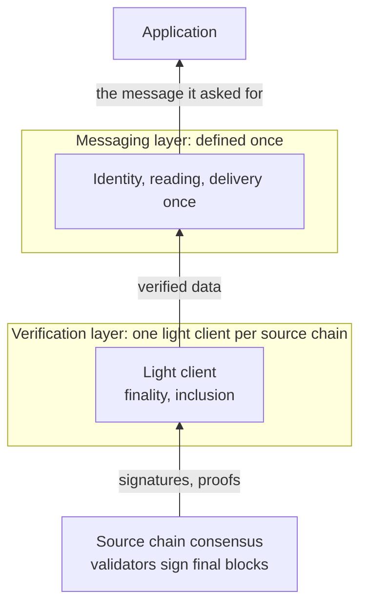

Each layer only trusts the one below it. The messaging layer sees only what a light client verified, never how, so a light client can be replaced without changing messages or filters: the destination's client registry points the chain at the new one (4.7, section 9).

#### 1.3 Parties and components

Besides the two chains and their applications, three roles take part. A **relayer** is an off-chain operator that watches the source chain and brings the destination what it needs to check a message; it is trusted to keep messages moving, not for their validity (2.3). On chains where one contract can call another and learn who called it, a **Router** is a contract that hands verified messages to applications: on other chains it also has the light client check a relayer's submission (section 7), and on Midnight it delivers what a light client already recorded (5.6). The **Security Admin** is a group of members acting by threshold: any one member can pause a light client at once, and every other change waits out a public delay (section 9).

A **route** is one direction between two chains, for example Robinhood Chain to Midnight. Light clients are named by where they run and what they check: a light client **on** Midnight runs on Midnight and checks another chain; a light client **of** Midnight runs on another chain and checks Midnight.

The table lists every component, with the phase of a message it takes part in: **Send** on the source chain, **Prove** to the destination's light client, and **Deliver** to the application (2.3).

| Component | Function | Used in | Runs on | Trusted |
| ---------------------------------- | ----------------------------------------------------------------------- | -------------- | --------------------------------------------- | ------------------------------------------------ |
| Light client on Midnight           | verifies a source chain's consensus, records what it verified           | Prove, Deliver | Midnight, a Compact contract                  | yes, it is the verifier                          |
| Proof circuit of that light client | proves finality and inclusion where Midnight cannot check them directly | Prove          | proving infrastructure                        | yes, for soundness (it is code, not an operator) |
| TMP Router on Midnight             | delivers recorded leaves to applications, once each                    | Deliver        | Midnight, a Compact contract, from ledger 9   | for delivery only; it never reads the leaf       |
| Receiving application              | reads, filters and records the message, then acts on it                 | Deliver        | Midnight                                      | for its own logic                                |
| Sending application                | writes a packet and its commitment (6.2)                                | Send           | Midnight                                      | for its own logic                                |
| Light client of Midnight, Router   | verify Midnight's consensus and deliver on another chain                | Prove, Deliver | each destination chain, per its companion MIP | yes, they are the verifier                       |
| Prover                             | produces proofs on demand                                               | Prove          | proving infrastructure                        | not for validity; it sees the relayer secret, so each relayer runs its own (5.2) |
| Relayer                            | watches the source, assembles proofs, submits                           | Prove          | operator infrastructure                       | for liveness and following the canonical fork    |
| Relayer allowlist                  | lists the relayers a light client accepts                               | Prove          | each light client                             | for admission only                               |
| Monitoring                         | cross-checks and alerts                                                 | throughout     | operator infrastructure                       | no                                               |
| Security Admin                     | pauses at once; approves every other change, which waits a public delay | throughout     | each light client and each Router                   | for pause and upgrades; never one key      |

#### 1.4 Document map

| Part | Section |
|---|---|
| How a light client verifies a chain, and how a message flows | 2 |
| Messages, their identity and their keys | 3 |
| The interface every light client provides | 4 |
| Receiving messages on Midnight | 5 |
| Sending messages from Midnight, and checking Midnight's consensus elsewhere | 6 |
| Routers on other chains | 7 |
| Invariants, governance, versioning and scope | 8 to 11 |
| Example: asset transfer (informative) | 12 |

Each source chain's light client is specified in a companion MIP (4.6).

### 2. How verification works

#### 2.1 Light clients

The obvious way to check another chain would be to replay it: run every block and see the message appear. That is a full node, far too heavy to run inside a contract. A **light client** is the small version: it keeps only a compact view of the source chain, enough to tell whether a given block is real and final, without replaying anything.

What makes a block real and final is the source chain's **consensus**: the rules by which its validators agree on blocks. A block is final once validators holding enough of the chain's stake have signed it, and that stake is what they put at risk by signing two conflicting blocks. A light client checks the same signatures the source chain's own users rely on.

#### 2.2 Consensus verification

A light client checks a message in two steps:

1. **Block verification.** The block is final: validators holding enough stake, in the set the light client trusts, signed it. That trusted set is the light client's **checkpoint**. Validator sets change over time, and each change is recorded in a final block, so from one trusted checkpoint the light client follows every later set.
2. **Inclusion verification.** The message is inside that block. A block's header commits to its contents through **roots**, hashes that each fix a whole set of items, such as all its transactions or all its receipts. A short **inclusion proof** shows one item sits under a root of a verified header, without the rest of the block. Its form depends on the chain, for example a Merkle or Merkle-Patricia path.

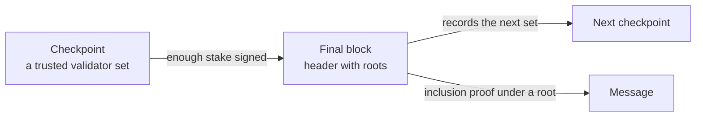

On-chain, block verification runs as four steps, followed by inclusion verification for a message, or by verification of the next checkpoint for a consensus update (4.2).

Each chain's consensus differs: who signs, with which signature scheme, what threshold counts as final, and how the set changes. Section 4 states what every light client provides; each companion MIP says how its source chain meets it; section 6 does the same for Midnight's consensus.

#### 2.3 Message flow

Every TMP message runs in three phases:

- **Send.** An application on the source chain writes the message into its chain's state or logs, and the chain finalizes the block that holds it.
- **Prove.** A relayer gives the light client on the destination what it needs: if the validator set has moved on, a **consensus update** to a newer checkpoint, then a **message proof** that the block is final and the message is in it. The light client checks both and records the message as verified.
- **Deliver.** The destination application reads the verified message with its own filter, checks it has not taken it before, records that it has, and acts on it.

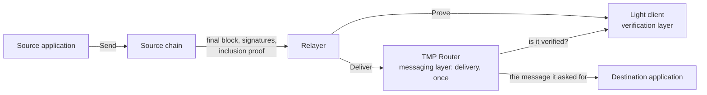

**Prove** is where the security lies: whatever convinces the light client decides what every application accepts. The relayer carries data but decides nothing about validity: it can delay a message, and cannot forge one on its own (Security Considerations). TMP messages are one-way; a reply, an acknowledgement or a refund is another message sent back the same way (section 12).

### 3. Messages

#### 3.1 Data types

A source chain commits its data in **leaves**: the units a root in its block header commits to, such as one receipt, one transaction or one storage value. A leaf can hold several items, for example the event logs in a receipt, and a message is one of them.

Five structures carry a message from one chain to an application on another. This section says what each one means; 3.4 defines descriptors, paths and predicates exactly.

| Structure | What it is | Why it exists |
|---|---|---|
| **MessageID** | Where a message sits: one element (`target_field`) of one leaf (`commitment_path`) under one root (`root`) of a final block | It is the message's identity. Proofs cover the leaf; replay protection keys on the full identity, so two elements of one leaf are two messages sharing one proof |
| **Message** | The raw leaf as the source chain committed it, with its source chain and its destination application | TMP never re-encodes a message. On Midnight the light client sees only the leaf's hash, and the application receives the bytes, checks they match, and checks the destination as one of its predicates |
| **Encoding descriptor** | How to read a leaf's bytes: the encoding (`rlp`, `abi`, `borsh`, `protobuf`, or `scale`, added by this MIP for Substrate chains), an optional prefix, and the leaf's structure | It separates reading from proving: the same proven bytes can be read differently, and a new encoding needs a new decoder, not a new protocol |
| **Filter** | What an application accepts, in three parts: a descriptor; an **extract pattern**, the `target_field` shapes it accepts, where `[*]` stands for any index; and **predicates**, conditions the element must meet (for example "emitted by contract X with event Y") | It takes every choice away from the relayer. The proof fixes which bytes, the filter fixes how they are read and which element counts |
| **Packet** | A message an application sends through TMP: its sender, a nonce or sequence, the destination chain and application, and a payload. Each chain encodes packets natively: this MIP fixes Midnight's layout (below), and each companion MIP fixes its chain's and where applications there send from (4.6) | Sender and nonce make it unique; the destination fields stop it being delivered anywhere else |

**MessageID.** Three fields: `commitment_path` and `target_field`, both text of at most `MAX_TEXT` bytes, and `root`, 32 bytes. On Midnight a `MessageId` carries `text_hash` of the two texts instead of the texts (3.3, 5.1). For example, the first event log of the 43rd receipt in an Ethereum block has `commitment_path = "receipts_trie/42"`, `target_field = "[3][0]"` (field 3 of the receipt is its logs, element 0 the first log) and `root` = the block's `receiptsRoot`.

Applying a filter takes three steps, defined in 3.4: `target_field_is_instance` checks a `target_field` against the extract pattern, `decode_and_extract` reads the leaf with the descriptor and returns the element at `target_field`, and `predicates_hold` checks the element.

A chain is named by `chain_id = H(utf8(c))`, where `c` is the chain's CAIP-2 identifier, the standard `namespace:reference` chain name such as `eip155:1` (for Midnight, MIP-0008).

**Midnight packet.** A fixed layout, so that a Compact contract can hash it: every field has a fixed width, and each field of variable length is its length followed by its bytes, zero-padded to the maximum. `encode(packet)` is the fields in this order, 1,132 bytes; padding bytes MUST be zero.

| Field | Type | Description |
|---|---|---|
| `version` | `u8` | `SPEC_VERSION` |
| `source_application` | `[u8; 32]` | Address of the sending Midnight contract |
| `nonce` | `u64`, little-endian | Per sender, starting at 0 and increasing by one per packet |
| `destination_chain` | `[u8; 32]` | `chain_id` of the destination chain |
| `destination_application_length`, `destination_application` | `u8`, `[u8; 32]` | The receiving application in the destination's address format (20 bytes on EVM chains, 32 on Solana), followed by zeros |
| `payload_length`, `payload` | `u16` little-endian, `[u8; MAX_PACKET_PAYLOAD]` | Read by the receiving application, followed by zeros |

#### 3.2 Constants

| Name                     | Value                      | Meaning                                                                     |
| ------------------------ | -------------------------- | --------------------------------------------------------------------------- |
| `SPEC_VERSION`           | `1`                        | Version of this specification                                               |
| `DOMAIN_LEAF`            | `pad32("tmp:leaf:v1")`     | Domain tag of `leaf_key`                                                    |
| `DOMAIN_DELIVERY`        | `pad32("tmp:delivery:v1")` | Domain tag of `delivery_key`                                                |
| `DOMAIN_RELAYER`         | `pad32("tmp:relayer:v1")`  | Domain tag of relayer key commitments                                       |
| `DOMAIN_ADMIN`           | `pad32("tmp:admin:v1")`    | Domain tag of Security Admin member commitments                             |
| `DOMAIN_PACKET`          | `pad32("tmp:packet:v1")`   | Domain tag of packet commitments and the packet token type                  |
| `MIN_RELAYERS_PER_ROUTE` | `2`                        | Independent relayers each live route must have                              |
| `GOVERNANCE_DELAY`       | `7 days`                   | Minimum delay before any Security Admin change takes effect, except pausing and unpausing |
| `MAX_PACKET_PAYLOAD`     | `1024`                     | Bytes                                                                       |
| `DOMAIN_PADDED_LEAF`     | `pad32("tmp:padded-leaf:v1")` | Domain tag of `padded_digest` (3.3)                                      |
| `MAX_LEAF`               | `768`                      | Most bytes of a leaf delivered on Midnight (3.3)                            |
| `MAX_TEXT`               | `128`                      | Most bytes of a `commitment_path` or `target_field` (3.3)                   |
| `MIDNIGHT_CHAIN_ID`      | `H(utf8(c))`, `c` Midnight's CAIP-2 identifier | Midnight's `chain_id` (MIP-0008)                          |

#### 3.3 Keys

Two keys, two jobs: the **leaf key** says a leaf was proven; the **delivery key** says an application took one element of it. One proven leaf can serve many deliveries.

```ruby
leaf_key(chain_id, id, leaf_digest)
    return H(DOMAIN_LEAF ‖ chain_id ‖ text_hash(id.commitment_path) ‖ id.root ‖ leaf_digest)

delivery_key(application, chain_id, id)
    return H(DOMAIN_DELIVERY ‖ application ‖ chain_id
             ‖ text_hash(id.commitment_path) ‖ text_hash(id.target_field) ‖ id.root)

padded_digest(leaf)
    return H(DOMAIN_PADDED_LEAF ‖ uint16_le(len(leaf)) ‖ leaf ‖ zeros(MAX_LEAF - len(leaf)))

text_hash(text)
    return H(uint8(len(text)) ‖ text ‖ zeros(MAX_TEXT - len(text)))
```

`text_hash` hashes a text through a fixed buffer for the same reason, so a Compact circuit can recompute it whatever the text's length.

`leaf_digest` is the leaf's hash in the leaf key. On Midnight every light client, whatever its source chain, uses `leaf_digest = padded_digest(leaf)` for leaves of at most `MAX_LEAF` bytes: a Compact circuit cannot hash bytes of unknown length, but it can hash a fixed buffer with the length in front, so an application and a Router recompute the same digest for every source chain (5.3, 5.6). A leaf longer than `MAX_LEAF` cannot be delivered on Midnight; each companion MIP says which leaves this excludes (4.6).

| Key | Question it answers | Granularity |
|---|---|---|
| `leaf_key` | Has this leaf been proven final and included? | per leaf, shared by every element and every application |
| `delivery_key` | Has this application already taken this element? | per element, per application |

Each key is built from the message's location, `(commitment_path, root)` for a leaf and `(application, commitment_path, target_field, root)` for a delivery, with `chain_id` and a domain tag added, so keys from two chains or two purposes never collide. The leaf key also includes the leaf's hash. Both use `commitment_path` and `target_field` only through their hashes, which is what a `MessageId` carries on Midnight (5.1).

#### 3.4 Descriptors, paths and predicates

An **encoding descriptor** has three parts: the `encoding`, one of `rlp`, `abi`, `borsh`, `scale`, `protobuf` or `packet`, the fixed layout of a Midnight packet (3.1); an optional `prefix`, bytes the leaf must start with, removed before decoding, such as an EIP-2718 transaction type; and the `schema`, the leaf's structure.

**Schema.** For `rlp`, `abi`, `borsh`, `scale` and `packet`, fields have no names and are identified by position; for `packet` the schema is fixed, `[uint8, bytes32, uint64, bytes32, bytes, bytes]`, each variable field read through its length. A node is a scalar or a list, and a list holds either one node, repeated any number of times, or a fixed tuple of nodes; the top of a schema is a tuple. The scalars are `uintN` and `intN` (`N` a multiple of 8, up to 256), `bool`, `bytesN` (exactly `N` bytes), `address` (the chain's account format, 20 bytes on EVM chains), `bytes` and `string`. For `protobuf`, fields are identified by field number, each with a name and a type, and fields of type `message` hold their own fields.

**Paths.** A `target_field` selects one element of the decoded leaf. For the positional encodings it is a sequence of indices: `[3][0]` is element 3 of the top tuple, then element 0 of that list. For `protobuf` it is field numbers joined by dots, each optionally indexed: `1.1[2]` is field 1, then its field 1, then element 2 of it. An **extract pattern** is a path in which `[*]` may stand for an index, and every `[*]` at the same position stands for the same index. `target_field_is_instance(pattern, target_field)` is true when replacing each `[*]` with one index gives `target_field`. Each instance is its own message, so a pattern with `[*]` can deliver one element of a leaf per matching index; an application that wants one delivery per leaf uses a pattern without `[*]`.

**Decoding.** `decode_and_extract(descriptor, leaf, target_field)` removes the prefix, decodes the leaf by the schema and returns the encoded bytes of the element at `target_field`. It rejects, never returning a default or a partial value, when the prefix does not match, the bytes do not fit the schema (wrong structure, a length past the end, bytes left over), a value does not fit its declared type, or the path leaves the decoded structure.

**Predicates.** A filter's predicates are a list, all of which must hold. Each has a path inside the extracted element, an operator and a value. `equals`, `notEquals` and `in` (equal to one of several values) apply to any field; `prefix` (the field starts with the value) to byte and text fields; `gt`, `gte`, `lt` and `lte` to integers. Values of up to 32 bytes compare as big-endian numbers, so a 20-byte address equals the same address given as 32 bytes; longer values compare byte for byte. `predicates_hold(filter, element)` is true when every predicate holds.

On Midnight a filter is compiled into the application, which decodes only the shapes its pattern fixes (5.4). On other chains the light client runs `decode_and_extract` for the Router, and the Router runs `predicates_hold` (section 7).

### 4. Light client interface

This section is the boundary between messaging and chain verification that MPS Goal 2 asks for. A light client for any source chain provides it; nothing above it depends on how a companion MIP meets it.

#### 4.1 Settlement level

Each light client declares, at creation, the **settlement level** its message proofs establish:

| Level       | Meaning                                                                                                                |
| ----------- | ---------------------------------------------------------------------------------------------------------------------- |
| `FINALIZED` | The source chain's consensus finalized the block                                                                       |
| `SETTLED`   | The block is final on the source chain **and** settled on the chain it settles to, past any challenge window (rollups) |

A light client never accepts a block below its level. A light client that accepts blocks at a lower level is a separate light client with its own declared level and stated trust, so an application opts in explicitly (MPS Goal 7).

#### 4.2 Verification steps

A light client does two things, the two submissions a relayer brings in the Prove phase (2.3). A **message proof** shows that a leaf sits in a final block of the source chain, and records the leaf for applications. A **consensus update** moves the light client to the source chain's next set of validators when the set changes, so that later blocks can still be checked. Both start the same way, by checking that a block is final, then check one more thing in that block, and write nothing until every check passes:

| Operation | First | Then |
|---|---|---|
| Message proof (`verify_message`, 4.4) | Block verification | **Inclusion verification**: the leaf sits under a root of the verified block |
| Consensus update (`update_consensus_state`, 4.4) | Block verification | **Consensus state verification**: the next checkpoint's signer set is committed in, or derived from, the verified block |

Every checkpoint commits to a **signer set**, the source chain's validators, and the chain's finality rule says how much of that set must sign, usually a share of stake.

**Block verification** establishes that a block is final, and settled where the light client requires it. It runs in four steps, cheapest first, so that a submission without enough signers is rejected before the expensive signature check:

| Step | What it checks |
|---|---|
| **Basic validation** | the submission is well formed, the relayer is allowlisted, the client is not paused, and the named checkpoint is stored |
| **Threshold validation** | the signers are enough of the checkpoint's signer set for its finality rule |
| **Signature verification** | the signers' signatures are valid over the data their rule has them sign |
| **Data verification** | the signed data establishes the final block and the roots in its header, and its settlement at `SETTLED` |

Reading the message out of the leaf, by decoding it and taking the element an application asked for, is not part of either operation on Midnight: the application does it (section 5). On other chains the light client does it for the Router, after the message proof (section 7).

The companion MIP defines every check except basic validation for its chain. On Midnight all of them form one circuit per operation, whose proof Midnight checks against the operation's **verifier key** (5.1). Where Compact cannot express the companion's checks, that circuit is compiled outside Compact; the checks and their order are the same either way.

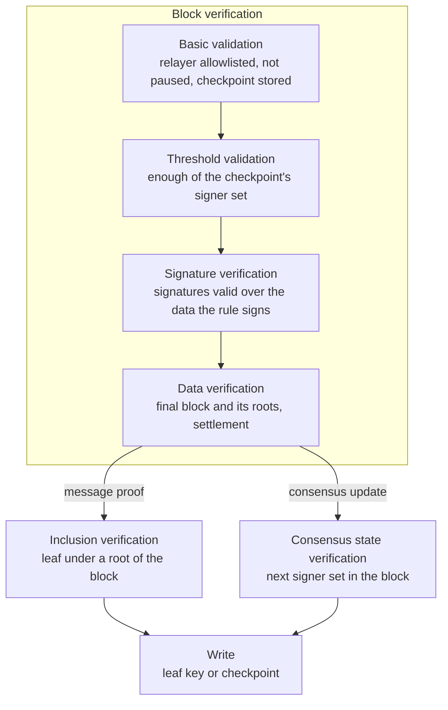

#### 4.3 State

The light client keeps four records: `ClientState`, what every submission is checked against; the **checkpoints**, what a consensus update or a message proof is checked against; the **verified leaves**, what applications read; and the **pending changes** of the Security Admin. Which light client serves a chain is recorded outside it, in a client registry (4.7).

**`ClientState`.** Eleven fields. `chain_id`, `settlement_level`, `spec_version` and `governed_checkpoints` are fixed at creation; the others change as the client runs.

| Field              | Type          | Description                                                                     |
| ------------------ | ------------- | ------------------------------------------------------------------------------- |
| `chain_id`         | `bytes32`     | The source chain. Fixed at creation                                             |
| `settlement_level` | enum          | As 4.1. Fixed at creation                                                       |
| `spec_version`     | `uint8`       | `SPEC_VERSION` (section 10). Fixed at creation                                  |
| `governed_checkpoints` | `bool`    | Whether checkpoints are added by the Security Admin instead of consensus updates (4.4). Fixed at creation |
| `relayers`         | `bytes32` set | Allowlist: `H(DOMAIN_RELAYER ‖ secret)` per relayer (5.2)                       |
| `admins`           | `bytes32` set | Security Admin members: `H(DOMAIN_ADMIN ‖ secret)` per member                   |
| `admin_threshold`  | `uint8`       | How many members must approve a change                                          |
| `admin_epoch`      | `uint64`      | Counts changes to `admins` or `admin_threshold`                                 |
| `latest_index`     | `uint64`      | The newest checkpoint index stored                                              |
| `paused`           | `bool`        | Set by any one member at once; cleared by `admin_threshold` members (section 9) |
| `pausers`          | `bytes32` set | Members who have paused under the current `admin_epoch`; each can pause once per epoch |

`relayers`, `admins` and `admin_threshold` are written at creation and by Security Admin changes after `GOVERNANCE_DELAY`; `admin_epoch` with every change to the members; `latest_index` by every consensus update, or by `addCheckpoint` on a client with governed checkpoints; `paused` as its row says; `pausers` by every pause, emptied when `admin_epoch` changes.

The Security Admin is a set of members with a threshold, not one key (section 9). Each member holds its own secret and approves in its own transaction, so no single secret can approve a change. Bumping `admin_epoch` on every membership change cancels approvals given under the old membership.

**Checkpoints.** One record per verified consensus state, keyed by the companion MIP's **checkpoint index** (a block height, slot, epoch or committee period). Each holds a 32-byte commitment to the consensus state, never the state itself: a signer set can be thousands of keys, so every proof supplies the full set as a private input and the circuit checks it against the commitment. Checkpoints are written at creation and by every consensus update, or by the Security Admin on a client with governed checkpoints, and are never overwritten or pruned, so a message of any age keeps a checkpoint it can be checked against. The exception is a client with governed checkpoints, where only the latest checkpoint anchors a message proof (4.4): relayers record every message signed under a set before its successor takes effect, which `GOVERNANCE_DELAY` gives them time to do.

**Verified leaves.** The set of `leaf_key` values the light client has proven. Written by every message proof. This is a cache, not a record that must last: this MIP defines no pruning, and if a leaf were pruned it would only need proving again before it is consumed.

**Pending changes.** One record per proposed change, keyed by the hash of the change and the `admin_epoch` it was proposed under. It holds the change, that `admin_epoch`, and the time it may take effect (`GOVERNANCE_DELAY` after it was proposed; at once for an unpause). The members who approved it are kept beside it, in `approvals`, and both are removed when the change is applied.

#### 4.4 Operations

Two operations do the verifying. `update_consensus_state` turns a consensus update into a stored checkpoint, and `verify_message` turns a message proof into a recorded leaf. Each is checked against one stored checkpoint, the **anchor**, and the rest arrives in the submission.

The relayer chooses the anchor, and it must be **compatible** with the block: the signer set it commits to is the one whose signatures finalize that block, for example the sync committee of the block's period. Each companion MIP defines compatibility for its chain. `height` is the block's position as the companion MIP defines it, usually its block number or slot, which is what the compatibility check compares.

**Consensus update.** A relayer brings the next signer set when the source chain changes it. The light client checks the update against the anchor and stores the new checkpoint at a higher index; an older checkpoint is never overwritten.

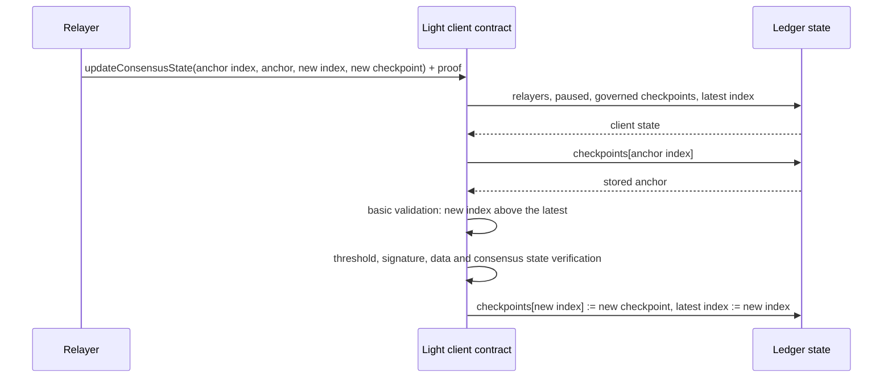

```ruby
update_consensus_state(client, relayer_secret, anchor_index, anchor, new_index, new_checkpoint, proof)
    # basic validation
    require not client.paused
    require H(DOMAIN_RELAYER ‖ relayer_secret) in client.relayers
    require client.checkpoints[anchor_index] == anchor
    require not client.governed_checkpoints                                  # those are added by the Security Admin
    require new_index > client.latest_index                                  # forward only, never overwritten
    # block verification and consensus state verification
    validate_consensus_update(anchor_index, anchor, new_index, new_checkpoint, proof)   # companion-defined
    # write
    client.checkpoints[new_index] := new_checkpoint
    client.latest_index := new_index
```

**Message proof.** A relayer proves that a leaf sits in a final block. The light client checks the proof against the anchor and records the leaf's key, which applications later look up.

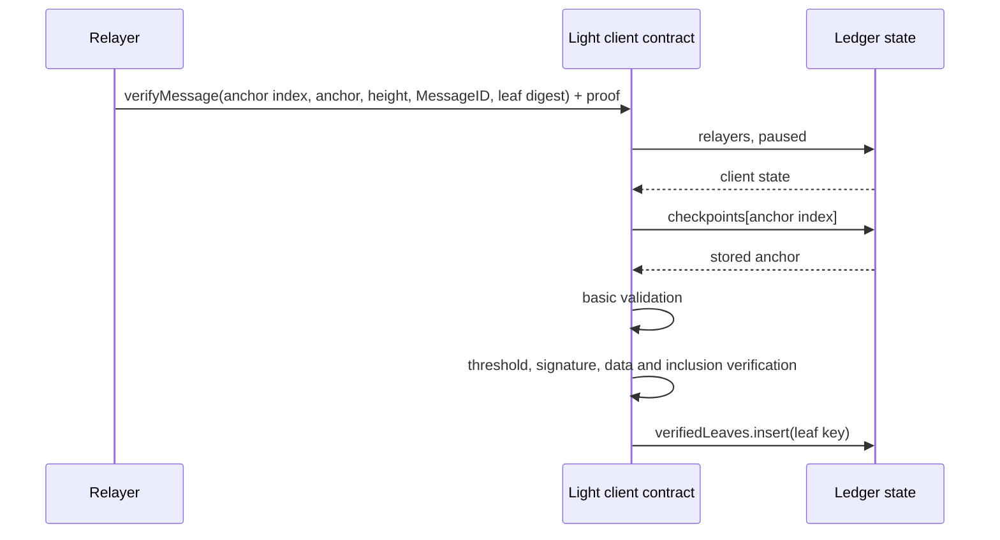

```ruby
verify_message(client, relayer_secret, anchor_index, anchor, height, id, leaf_digest, proof)
    # basic validation
    require not client.paused
    require H(DOMAIN_RELAYER ‖ relayer_secret) in client.relayers
    require client.checkpoints[anchor_index] == anchor
    if client.governed_checkpoints
        require anchor_index == client.latest_index                          # a retired signer set is no longer trusted
    # threshold, signature and data verification, including that the anchor is compatible with the block,
    # then inclusion verification of the leaf
    validate_message_proof(anchor_index, anchor, client.settlement_level, height, id, leaf_digest, proof)  # companion-defined
    # write
    client.verified_leaves.add(leaf_key(client.chain_id, id, leaf_digest))

is_verified(client, key)
    return key in client.verified_leaves
```

**Security Admin.** The Security Admin acts through four operations. Pausing needs one member, because it only stops new proofs; each member can pause once per `admin_epoch`, so after the threshold unpauses, no single member can pause again until the membership changes. Every other change needs `admin_threshold` approvals, each in its own transaction, and then, except an unpause, waits `GOVERNANCE_DELAY`.

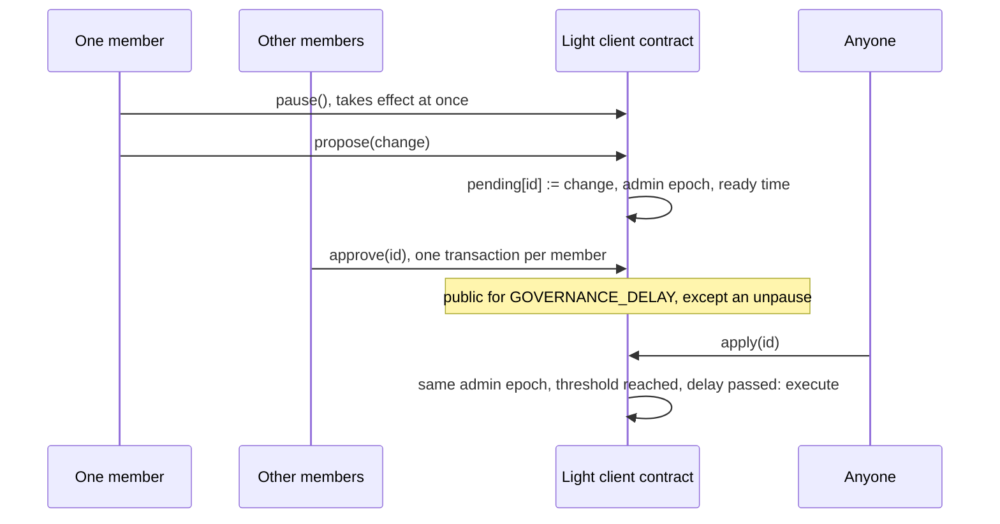

```ruby
member(client, secret)
    m := H(DOMAIN_ADMIN ‖ secret)
    require m in client.admins
    return m

pause(client, secret)
    m := member(client, secret)
    require m not in client.pausers                                  # one pause per member per admin epoch
    client.pausers.add(m)
    client.paused := true

propose(client, secret, change)          # add or remove a relayer or member, set the threshold, add a checkpoint, or unpause
    member(client, secret)
    require change.kind != AddCheckpoint or client.governed_checkpoints
    id := H(uint64_le(client.admin_epoch) ‖ change)                  # the Change fields as H hashes them; a stale proposal never blocks a new one
    require id not in client.pending
    ready_at := now() if change is Unpause else now() + GOVERNANCE_DELAY
    client.pending[id] := (change, epoch = client.admin_epoch, ready_at)
    client.approvals[id] := {}

approve(client, secret, id)
    require id in client.pending
    client.approvals[id].add(member(client, secret))

apply(client, id)                        # anyone, once approved and due
    p := client.pending[id]
    require p.epoch == client.admin_epoch
    require len(client.approvals[id]) >= client.admin_threshold
    require now() >= p.ready_at
    execute(client, p.change)
    require 1 <= client.admin_threshold <= len(client.admins)        # governance stays usable
    if p.change changes admins or admin_threshold
        client.admin_epoch += 1
        client.pausers := {}
    delete client.pending[id], client.approvals[id]
```

`now()` is the block time of the transaction. `execute` makes the change: it adds or removes the relayer or member, sets `admin_threshold`, clears `paused`, or stores the checkpoint at `latest_index + 1` and advances `latest_index`. Adding a checkpoint is available only on a light client with `governed_checkpoints`, whose companion MIP defines no consensus update; it waits `GOVERNANCE_DELAY` like every other change, and from then on message proofs anchor only on the new checkpoint. How a verifier key is replaced, and how `GOVERNANCE_DELAY` applies to that, belongs to the verification capabilities MIP (section 11).

#### 4.5 Who may call what

| Method                              | Called by                      | What it does                                                       |
| ----------------------------------- | ------------------------------ | ------------------------------------------------------------------ |
| `updateConsensusState`              | allowlisted relayer            | Stores a new checkpoint (4.4)                                      |
| `verifyMessage`                     | allowlisted relayer            | Records a verified leaf (4.4)                                      |
| `isVerified`                        | anyone, including applications | Returns whether a leaf key is recorded                             |
| `pause`                             | any one Security Admin member  | Pauses at once (section 9)                                         |
| `propose`, `approve`                | Security Admin members         | Proposes a change, and approves it, one member per transaction     |
| `apply`                             | anyone                         | Applies a change once approved and due (`GOVERNANCE_DELAY`)        |

#### 4.6 Companion MIPs

For its source chain, a companion MIP specifies:

1. The **definition** of final, the settlement level, and the facts proven to reach it.
2. Its **data types** and update messages.
3. The **verification logic**: block verification plus consensus state verification for `validate_consensus_update`, and block verification plus inclusion verification for `validate_message_proof`, and which run inside a proof circuit.
4. The **checkpoint**: its index, what it commits to, when an anchor is compatible with a block, and how the signer set rotates, by consensus update or by an `addCheckpoint` change sent through `propose` (4.4).
5. **Messages**: the `commitment_path` format, the `root`, the encodings and descriptors, how its circuit binds a leaf to `padded_digest(leaf)` on Midnight, which leaves exceed `MAX_LEAF` (3.3), and, for packets sent from that chain, their encoding and where applications send them. A leaf that stays in state across blocks MUST get a `root` that does not change with the block, so one message has one `MessageID` and one delivery key, however many blocks it is proven under.
6. On Midnight, the **verifier-key public inputs** of each operation, in order (5.1), and what the light client needs from Midnight to run, such as a ledger version or a verification capability.
7. The **light client of Midnight and Router** on that chain, if messages leave Midnight for it.
8. Its **limits**: what the source chain does not commit, and which uses (for example moving value) are therefore not allowed.

#### 4.7 Client registry

Every light client has a **`client_id`**: the address of its contract, or, for a light client state embedded in an application (5.5), an identifier the application assigns, so no two light clients share one. A destination's **client registry** maps each source `chain_id` to the `client_id` of the light client that serves it, with that light client's declared settlement level (4.1). Applications register for source chains, never for light clients: which light client serves a chain is the destination's configuration.

Where the registry lives decides who changes it:

- **On a Router**, on Midnight (5.6) or on another chain (section 7): the Router's Security Admin, through a `setClient(chain_id, client_id, level)` change that waits `GOVERNANCE_DELAY`, during which anyone can check that `level` is the light client's declared level. Applications need no change.
- **In an application**, in the Embedded and Shared profiles (5.3): the application itself, through its upgrade rules, public for at least `GOVERNANCE_DELAY`. An Embedded application that accepts several chains holds one light client state per chain, each under its own `client_id`.

Replacing a light client points the chain at a new `client_id`. Verified leaves are a cache (4.3), so a leaf recorded only by the old light client is proven again to the new one, and delivery keys use the `chain_id`, not the `client_id`, so nothing already delivered is delivered again.

### 5. Receiving on Midnight

On chains with contract calls and caller identity, a Router verifies a submission and calls the application in the same transaction. On Midnight the base model is that the **application pulls** a verified leaf: the light client records what it verified, and the application checks that record when someone consumes a message. The application enforces its own filter and delivery log. This moves the reading of the leaf (descriptor, `target_field`, predicates) from the light client and Router, where it runs on other chains (section 7), into the application, where the filter is compiled in (5.4). The guarantee is the same: the relayer never chooses how the proven bytes are read.

> **Pull or push.** The pull model needs neither cross-contract calls nor `kernel.caller()`, which tells a called contract which contract called it: the application asks the light client a question, and the light client does not need to know who asked. Both arrived with ledger 9 (MPS-0040), so a Router can also push messages to applications as on other chains (5.6). The profiles in 5.5 cover each case.

How the three phases run on Midnight:

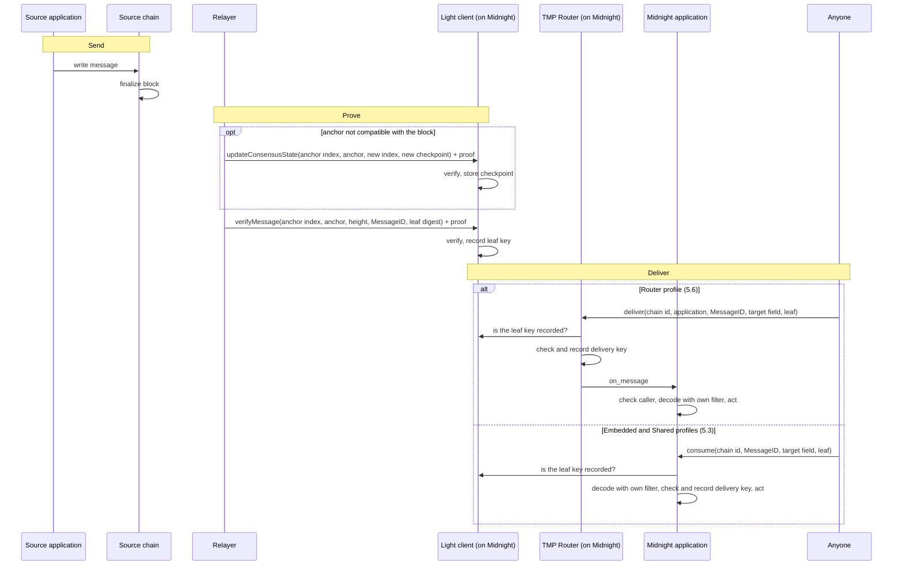

#### 5.1 Light client contract

```compact
pragma language_version 0.28;
import CompactStandardLibrary;

export enum SettlementLevel { finalized, settled }

export struct MessageId {
  commitmentPath: Bytes<32>,  // text_hash(commitment_path)
  targetField: Bytes<32>,     // text_hash(target_field)
  root: Bytes<32>,
}

export sealed ledger specVersion: Uint<8>;
export sealed ledger chainId: Bytes<32>;
export sealed ledger settlementLevel: SettlementLevel;
export sealed ledger governedCheckpoints: Boolean;
export ledger checkpoints: Map<Uint<64>, Bytes<32>>;  // never pruned
export ledger latestIndex: Uint<64>;
export ledger verifiedLeaves: Set<Bytes<32>>;        // leaf_key values
export ledger relayers: Set<Bytes<32>>;              // H(DOMAIN_RELAYER ‖ secret)
export ledger admins: Set<Bytes<32>>;                // H(DOMAIN_ADMIN ‖ secret) per member
export ledger adminThreshold: Uint<8>;
export ledger adminEpoch: Counter;
export ledger paused: Boolean;
export ledger pausers: Set<Bytes<32>>;             // members who paused in this admin epoch

export enum ChangeKind { addRelayer, removeRelayer, addMember, removeMember, setThreshold, addCheckpoint, unpause }

export struct Change {
  kind: ChangeKind,
  key: Bytes<32>,        // the relayer or member commitment, or the checkpoint; unused otherwise
  threshold: Uint<8>,    // for setThreshold; unused otherwise
}

export struct PendingChange {
  change: Change,
  epoch: Uint<64>,
  readyAt: Uint<64>,     // block time in seconds
}

export ledger pending: Map<Bytes<32>, PendingChange>;
export ledger approvals: Map<Bytes<32>, Set<Bytes<32>>>;  // change id -> approving members

witness localSecret(): Bytes<32>;

export circuit updateConsensusState(anchorIndex: Uint<64>, anchor: Bytes<32>,
                                    newIndex: Uint<64>, newCheckpoint: Bytes<32>): [];

export circuit verifyMessage(anchorIndex: Uint<64>, anchor: Bytes<32>, height: Uint<64>,
                             id: MessageId, leafDigest: Bytes<32>): [];

export circuit isVerified(key: Bytes<32>): Boolean;

export circuit pause(): [];
export circuit propose(change: Change): [];
export circuit approve(id: Bytes<32>): [];
export circuit apply(id: Bytes<32>): [];
```

A `MessageId` on Midnight carries the hashes of `commitment_path` and `target_field`, which is all the keys of 3.3 use; the strings themselves stay off the ledger.

Each of `updateConsensusState` and `verifyMessage` is one circuit that covers both the basic validation and write of 4.4 and the companion MIP's threshold, signature, data and inclusion verification. Where Compact cannot express the companion's checks, the circuit, basic validation included, is compiled outside Compact and installed as the operation's verifier key, with the operation's arguments as public inputs in the order the companion MIP fixes. Every operation's proof also covers its **public transcript**, the ledger reads and writes the operation performs: the allowlist lookup, the `paused` flag, the stored anchor and the write of the leaf key. The ledger runs that transcript against its own state when it applies the call. A circuit compiled outside Compact reproduces exactly the transcript of the Compact operation it replaces, so basic validation and the write are still checked by the ledger. Supporting such verifier keys is the subject of the verification capabilities MIP (section 11).

#### 5.2 Relayer allowlist

A Compact operation cannot reliably see who submitted its transaction (MPS-0029): ledger 9's `kernel.caller()` names a calling contract, not the user behind a top-level call, so the allowlist cannot check a sender. Instead the light client stores `H(DOMAIN_RELAYER ‖ secret)` for each relayer, and every relayer operation proves knowledge of one such `secret` through the witness `localSecret`. The proof covers the whole operation, so it is bound to that operation's arguments and cannot be reused for another submission. `ownPublicKey()` MUST NOT be used for authorization, because it is a witness value the caller chooses. The secret is a private input of the relayer's proof, so a relayer MUST make its proofs itself, or on a proof server it runs, never on a shared one that would see the secret.

#### 5.3 Consuming a message

```ruby
consume(app, filter, chain_id, id, target_field, leaf)
    # the light client the application's registry names for this chain, never chosen by the caller
    light_client := app.light_clients[app.clients[chain_id]]
    # the leaf was proven for this source chain
    require len(leaf) <= MAX_LEAF
    require is_verified(light_client, leaf_key(chain_id, id, padded_digest(leaf)))
    # the element is one this application asked for
    require text_hash(target_field) == id.target_field
    require target_field_is_instance(filter.extract_pattern, target_field)
    element := decode_and_extract(filter.descriptor, leaf, target_field)
    require predicates_hold(filter, element)
    # once per application
    key := delivery_key(app.address, chain_id, id)
    require key not in app.delivered
    app.delivered.add(key)
    # act on element in the same operation
    return element
```

```compact
export ledger delivered: Set<Bytes<32>>;  // delivery_key values, never pruned
```

`app.clients` and `app.light_clients` are the application's client registry (4.7), fixed in its state: each source chain it accepts maps to one `client_id`, and each `client_id` to its light client. In the **Embedded** profile, available now, a light client's state lives in the application's own contract and its record is the application's own `verifiedLeaves`; in the **Shared** profile, once cross-contract calls are on mainnet, it is a separate light client contract whose address is fixed in the application's state (5.5). If a caller could name the light client, they could point it at one they control, so the caller names only the source chain. The delivery key uses the `chain_id`, not the `client_id`, so a message is taken once even if the chain's light client was replaced in between.

An application changes its client registry only through its own upgrade rules, which MUST make the change public for at least `GOVERNANCE_DELAY` (4.7).

Any failure reverts the whole transaction, so nothing is recorded and the message can be consumed later (MPS Goal 3). Consuming needs no permission: anyone, including the user the message is for, can consume a verified message.

#### 5.4 Filters

Compact circuits have fixed shapes, so an application's filter is compiled into its consume operation, and the leaf is a `MAX_LEAF` buffer with its length (3.3). Because the filter is part of the application's code, no caller can change it. An application that accepts several message types has one consume operation per filter.

The consume operation takes `target_field` as a private input, a `MAX_TEXT` buffer with its length, and the circuit checks that its `text_hash` is `id.targetField` and that it is an instance of the compiled extract pattern.

#### 5.5 Profiles

| | **Embedded** | **Shared** | **Router** |
|---|---|---|---|
| Available | Now, for a light client whose checks Midnight can run (4.6) | Now (ledger 9 cross-contract calls) | Now (ledger 9 cross-contract calls, `kernel.caller()`) |
| Light client state | In the application's own contract | In one light client contract per source chain | In one light client contract per source chain |
| Delivery | Anyone calls the application's `consume` (5.3) | As Embedded, which calls the light client's `isVerified` | Anyone calls the Router's `deliver`, which calls the application's `on_message` (5.6) |
| Delivery log | The application's `delivered` | The application's `delivered` | The Router's `delivered` |

All profiles are one standard: messaging rules, keys and data types are identical; they differ in where `verifiedLeaves` and `delivered` live. An Embedded application includes the light client contract of 5.1 in its own code, its ledger fields and its operations, so relayers call `verifyMessage` and Security Admin members call `propose` on the application itself. An application MAY move from Embedded to Shared; its `delivered` set moves with it unchanged. An application that moves to a Router removes its `consume` operation, keeps its own `delivered` set and checks it in `on_message`, so the two logs never both accept one message and a message it consumed before the move is not delivered again.

#### 5.6 Router profile

Since ledger 9 a Midnight contract can call another, and the called contract learns which contract called it through `kernel.caller()`, which returns `some(left(address))` for a call from a contract. That is what a Router needs (section 7), so a deployment MAY run one **Router** on Midnight that pushes verified messages to every application registered with it. Proving is unchanged: a relayer records the leaf with the light client's `verify_message` (4.4). Delivering moves to the Router: anyone submits the recorded leaf to the Router, the Router checks the record and its delivery log, and calls the application, which checks that the Router called it and applies its own filter.

Two limits of cross-contract calls shape the profile. A called circuit cannot call witnesses, so the application receives everything as public arguments. A contract type cannot be generic, so the leaf crosses as a fixed buffer of `MAX_LEAF` bytes with its length, which `padded_digest` already assumes (3.3). One Router serves every source chain: its client registry (4.7) names the light client of each, and nothing in it depends on the chain.

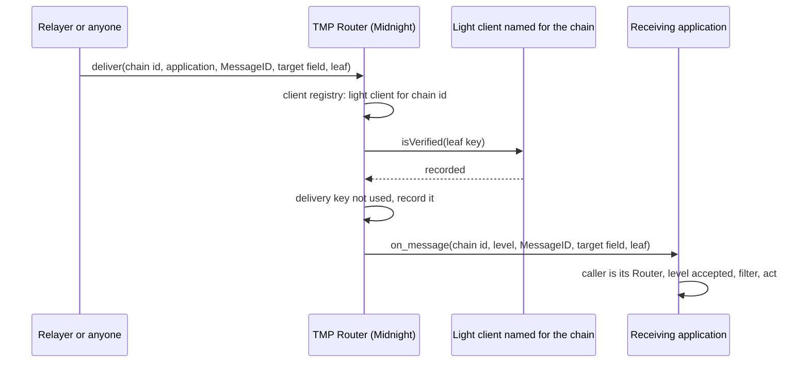

```ruby
deliver(router, chain_id, application, id, target_field, leaf)     # anyone, usually the relayer
    require len(leaf) <= MAX_LEAF
    entry := router.clients[chain_id]                                 # the client registry (4.7)
    require entry.client.is_verified(leaf_key(chain_id, id, padded_digest(leaf)))
    app := router.applications[application]                           # registered by the Security Admin
    key := delivery_key(application, chain_id, id)
    require key not in router.delivered
    router.delivered.add(key)
    app.on_message(chain_id, entry.level, id, target_field, leaf)     # a failure reverts all of the above

on_message(app, chain_id, level, id, target_field, leaf)              # in the application
    require kernel.caller() == some(left(app.router))                 # only its Router delivers
    require level in app.accepted_levels[chain_id]                    # the chains and levels it opted in to
    key := delivery_key(app.address, chain_id, id)
    require key not in app.delivered                                  # also covers a change of Router
    app.delivered.add(key)
    require text_hash(target_field) == id.target_field
    require target_field_is_instance(app.filter.extract_pattern, target_field)
    element := decode_and_extract(app.filter.descriptor, leaf, target_field)
    require predicates_hold(app.filter, element)
    # act on element in the same operation
```

Like the light client contract of 5.1, the Router's contract targets Compact language 0.28 on ledger 9. Its Security Admin state and operations are those of 5.1 (`pause`, `pausers`, `propose`, `approve`, `apply`), with the changes below:

```compact
pragma language_version 0.28;
import CompactStandardLibrary;

// SettlementLevel and MessageId as in 5.1

contract LightClient {
  circuit isVerified(key: Bytes<32>): Boolean;
}

contract Application {
  circuit onMessage(chainId: Bytes<32>, level: SettlementLevel, id: MessageId,
                    targetField: Bytes<128>, targetFieldLength: Uint<8>,
                    leaf: Bytes<768>, leafLength: Uint<16>): [];
}

export struct ClientEntry {
  clientId: Bytes<32>,
  client: LightClient,
  level: SettlementLevel,    // the light client's declared level, recorded by setClient
}

export enum RouterChangeKind { setClient, addApplication, removeApplication,
                               addMember, removeMember, setThreshold, unpause }

export struct RouterChange {
  kind: RouterChangeKind,
  chainId: Bytes<32>,        // setClient
  entry: ClientEntry,        // setClient
  application: Bytes<32>,    // addApplication, removeApplication: the application's address
  receiver: Application,     // addApplication
  key: Bytes<32>,            // addMember, removeMember
  threshold: Uint<8>,        // setThreshold
}

export ledger clients: Map<Bytes<32>, ClientEntry>;      // chain_id -> the light client that serves it
export ledger applications: Map<Bytes<32>, Application>; // application address -> its contract
export ledger delivered: Set<Bytes<32>>;                 // delivery_key values, never pruned

export circuit deliver(chainId: Bytes<32>, application: Bytes<32>, id: MessageId,
                       targetField: Bytes<128>, targetFieldLength: Uint<8>,
                       leaf: Bytes<768>, leafLength: Uint<16>): [];
```

`leaf` is the leaf zero-padded to `MAX_LEAF` bytes and `leafLength` its length, so `padded_digest` is computed over exactly these bytes. `targetField` and `targetFieldLength` are the text of `target_field`, followed by zeros to `MAX_TEXT` bytes, and its length; the application checks their `text_hash` against `id.targetField`, as `consume` does (5.4).

The Router keeps its client registry, its application registry, its `delivered` set and a Security Admin as in 4.3; pointing a chain at another `client_id`, and registering an application by its address, are Security Admin changes that wait `GOVERNANCE_DELAY` (4.7). `deliver` only reads what light clients recorded, so it has no pause of its own: pausing a light client stops new proofs, and leaves already recorded stay deliverable (INV-8).

An application registers for source chains, not light clients: it fixes its Router and `app.accepted_levels`, the settlement levels it accepts from each chain (4.1), in its state, and changes them only through its upgrade rules, public for at least `GOVERNANCE_DELAY`. When the Router points a chain at a light client of a level the application did not accept, its messages from that chain stop until it accepts the level or the chain is pointed back. The delivery key uses the `chain_id`, not the `client_id`, so a message already delivered stays delivered after a replacement; a message recorded only by the old light client is proven again to the new one.

The Router never reads the leaf: the application's filter stays compiled into the application (INV-3), and the Router keeps the delivery log (INV-2). One call delivers to one application, so a failing application blocks only its own messages, and a failure reverts the whole transaction, leaving the message undelivered and retryable (MPS Goal 3).

### 6. Sending from Midnight

This section defines what a light client of Midnight on another chain checks, whatever that chain is; each companion MIP says how its chain runs these checks. There, a **finality update** plays the role of section 4's consensus update, and a **packet proof** that of a message proof.

As on Midnight, only an allowlisted relayer can submit a finality update or a packet proof (INV-7). The light client checks this itself, or a Router in front of it does (section 7); the companion MIP says which. The pseudocode below writes it as `relayer_allowed(sender)`: `sender` is an allowlisted relayer, or the client's own Router when the Router holds the allowlist. The allowlist and the Security Admin live in the client or its Router, as the companion MIP says.

#### 6.1 Finality

Midnight finalizes blocks with **GRANDPA**. A block is final once voters of the current **authority set** holding more than two thirds of the set's weight have precommitted to it or to a descendant; a **precommit** is GRANDPA's final-round vote. The authority set changes through a change signalled in a block header's **digest**, the list of consensus items every header carries.

**BEEFY** runs on top of GRANDPA, with the same validators, once Midnight enables it (MIP-0023), and signs only blocks GRANDPA has finalized. Every block appends a leaf to a **Merkle Mountain Range** (MMR, Keccak-256), an append-only Merkle structure whose root commits to every leaf added so far, and puts the new root in its header's digest; the leaf names the block's parent and the next BEEFY committee.

The committee changes at **session** boundaries, the periods in which one validator set serves. Each member holds a number of **seats**, and the quorum counts seats, not members: `required(seat_count, 2, 3) = seat_count - (seat_count - 1) / 3`, the smallest count above two thirds (MIP-0023). The committee signs, with ECDSA secp256k1, a commitment to the MMR root of a finalized block. Because a root commits to every earlier block, one signed root proves any past block.

A light client of Midnight follows one of the two:

|                       | **GRANDPA client**                                                 | **BEEFY client**                                                       |
| --------------------- | ------------------------------------------------------------------ | ---------------------------------------------------------------------- |
| Signed by             | The authority set, Ed25519                                         | The BEEFY committee, ECDSA secp256k1                                   |
| What is signed        | A precommit for a block                                            | `Keccak-256` of a commitment to an MMR root                            |
| Quorum                | More than ⅔ of the set's weight                                    | `required(seat_count, 2, 3)` seats (MIP-0023)                          |
| Checkpoint            | The authority set and its id                                       | The current and next committee commitments                             |
| Handover              | A set change in a finalized header's digest                        | The next committee named in a proven MMR leaf                          |
| State root of a block | From its finalized header                                          | From its header, proven through the MMR leaf of the next block         |
| Cheap to check on     | Destinations with Ed25519, or through a ZK proof of the signatures | EVM, Cardano and others with `ecrecover`-style recovery and Keccak-256 |
| Available             | Now                                                                | Once Midnight signs BEEFY on mainnet (MIP-0023)                        |

Either way, everything the client trusts traces back to a block Midnight's validators finalized, and from there to its state root. Both declare settlement level `FINALIZED`.

#### 6.2 Sending a packet

Contract events are not consensus state (MIP-0002), so a contract's message cannot be proven from its events. Until contract messages are provable (MPS Recommended MIP 4), a Midnight contract commits a packet by minting one unit of its own **packet token** to an address equal to the **packet commitment**, `H(DOMAIN_PACKET ‖ encode(packet))` (3.1). Only the issuing contract can mint its token type, which the ledger derives from the contract's address. The node records every new unshielded output, with its owner, token type and amount, in **`System::Events`**, the runtime's list of everything that happened in the block, as an `UnshieldedTokens` event of the Midnight pallet. The same list records each transaction's outcome: `TxApplied` when it fully succeeded, `TxPartialSuccess` when part of it failed. That list is one value in the block's **state trie**, the Merkle structure over all of Midnight's state whose root is the header's `state_root`, so it can be proven from a final header.

```ruby
send_packet(sender, destination_chain, destination_application, payload)
    require len(payload) <= MAX_PACKET_PAYLOAD
    packet := Packet(SPEC_VERSION, sender.address, sender.next_nonce,
                     destination_chain, destination_application, payload)
    sender.next_nonce += 1
    sender.outbox[packet.nonce] := packet            # public preimage for relayers
    mint_unshielded(token_type(DOMAIN_PACKET, sender.address), 1,
                    recipient = H(DOMAIN_PACKET ‖ encode(packet)))   # a user address: a mint to a contract creates no output
```

`token_type(d, c)` is the token type contract `c` issues under domain separator `d`, as the ledger derives it.

```compact
export struct OutboxEntry {
  destinationChain: Bytes<32>,
  destinationApplicationLength: Uint<8>,   // 20 on EVM chains, 32 on Solana
  destinationApplication: Bytes<32>,       // zero-padded
  payloadLength: Uint<16>,
  payload: Bytes<1024>,                    // MAX_PACKET_PAYLOAD, zero-padded
}

export ledger nextNonce: Counter;
export ledger outbox: Map<Uint<64>, OutboxEntry>;  // by nonce; public preimage for relayers
```

`OutboxEntry` holds the fields of 3.1 a relayer cannot know: `version` is `SPEC_VERSION`, `source_application` the contract's address and `nonce` the map key.

A relayer rebuilds the packet from the sending contract's address, the nonce and its `outbox` entry. When provable contract events or ledger read proofs exist, they replace this commitment through a new descriptor, without changing the messaging rules.

#### 6.3 Data types

What matters is what each structure proves. Encodings are Substrate's (SCALE, `blake2b_256` header hashes) for GRANDPA and MIP-0023's for BEEFY, which are normative; the names in parentheses are the parts the logic below uses.

**Common to both clients.**

| Structure | What it is | What it proves |
|---|---|---|
| **Header** | A Midnight block header (`number`, `parent_hash`, `state_root`, `digest`) | Once its hash is shown final, its `state_root` commits to all of that block's state, including `System::Events`, and its `digest` carries authority set changes |

**Packet proof.** Together its fields prove that a contract committed this packet in a final block.

| Field | Type | Description |
|---|---|---|
| `number` | `uint32` | The block that holds the packet |
| `events`, `storage_proof` | `bytes`, `bytes[]` | That block's `System::Events` value, and its trie proof under the block's state root |
| `event_index`, `output_index`, `applied_index`, `runtime_version` | `uint32` each | The `UnshieldedTokens` event inside `events`, the packet's output in that event's list of created outputs, the `TxApplied` event of the same transaction, and the runtime version whose event layout decodes them |
| `packet` | `Packet` | The packet preimage (3.1) |
| `ancestry` | `Header[]` | GRANDPA only: the headers from block `number` up to a stored block; empty when block `number` is stored |
| `root_number`, `leaf`, `mmr_proof`, `header` | `uint32`, `MmrLeaf`, `bytes32[]`, `Header` | BEEFY only: a stored signed root, the MMR leaf of block `number + 1` with its proof under that root, and the header of block `number` |

**GRANDPA.**

| Structure | What it is | What it proves |
|---|---|---|
| **Authority set** | The voters' Ed25519 keys and weights, with a `set_id`; a key listed more than once, one entry per seat, is held once with its weights summed | Whose signatures count, and how much |
| **Justification** | Signed precommits of a GRANDPA round (`round`, `commit`, `precommits`), plus the headers linking each vote to the finalized block (`votes_ancestries`) | That voters holding more than two thirds of the set's weight agreed the block is final |
| **Finality update** | A header, its justification, and the next authority set when the header enacts a change (`new_authorities`) | A new final block and its state root, and on a handover, the next set |

Each voter signs a precommit message that binds the block, the `round` and the `set_id`, so a vote cannot be replayed in another round or under another set. Its encoding, `SCALE((Precommit(target_hash, target_number), round, set_id))`, is 53 bytes: `0x01 ‖ target_hash ‖ uint32_le(target_number) ‖ uint64_le(round) ‖ uint64_le(set_id)`. A voter may vote for a descendant of the block, which is why the ancestry headers come along.

**BEEFY.**

| Structure | What it is | What it proves |
|---|---|---|
| **Committee commitment** | A 44-byte summary of a committee: its id, its total seats, and a Merkle root of its distinct keys with their seats (`validator_set_id`, `seat_count`, `keyset_commitment`) | Which keys may sign and how many seats each holds, at a fixed size whatever the committee's size |
| **Signed commitment** | What the committee signs: an MMR root, the block it is in, and the committee's id (`mmr_root`, `block_number`, `validator_set_id`) | Once a quorum signed it, that root, and through it every earlier block |
| **MMR leaf** | What each block appends to the MMR: its parent's number and hash, and the next committee (`parent_number`, `parent_hash`, `beefy_next_authority_set`) | Which block came before, and which committee comes next. It carries no state root |
| **BEEFY update** | A signed commitment, the signers' keys and signatures (`multiproof`, `signatures`), and the leaf of the signed block with its proof (`leaf`, `mmr_proof`) | A new signed root, and the next committee read out of it |

Because the leaf carries no state root, a BEEFY client reaches a block's state through its header: the leaf of the next block holds the block's hash, and the header that hashes to it holds the root.

#### 6.4 State

A light client of Midnight keeps `ClientState`, what a finality update is checked against, and one `ConsensusState` per accepted block, what packet proofs are checked against. `ConsensusState` plays the role of the checkpoints of 4.3; the pseudocode calls it `client.blocks` in the GRANDPA client and `client.mmr_roots` in the BEEFY client.

##### GRANDPA client

**`ClientState`.** Seven fields. `chain_id` is fixed at creation; `set_id`, `authorities` and `total_weight` change only on a handover; `latest_number` on every update; `layouts` and `paused` only by the Security Admin.

| Field | Type | Description |
|---|---|---|
| `chain_id` | `bytes32` | Midnight's `chain_id` (3.1). Fixed at creation |
| `set_id` | `uint64` | The current authority set id |
| `authorities`, `total_weight` | `AuthoritySet`, `uint64` | The current set and its total weight |
| `latest_number` | `uint32` | The newest finalized block stored |
| `layouts` | map of runtime version to event layout | How to decode `System::Events` for each known runtime version; added by the Security Admin after `GOVERNANCE_DELAY` |
| `paused` | `bool` | Set by any one Security Admin member; cleared by the threshold |

**`ConsensusState` (`client.blocks`).** One block hash and state root per block the client accepts an update for, keyed by block number, never overwritten. Blocks need not be contiguous: the relayer finalizes handover blocks and enough later blocks to reach packets through their headers (6.6).

##### BEEFY client

**`ClientState`.** Seven fields. `chain_id` and `mmr_first` are fixed at creation; `current` and `next` change only on a handover; `latest_number` on every update; `layouts` and `paused` only by the Security Admin.

| Field | Type | Description |
|---|---|---|
| `chain_id` | `bytes32` | Midnight's `chain_id` (3.1). Fixed at creation |
| `mmr_first` | `uint32` | The first block that appended an MMR leaf. Fixed at creation |
| `current` | `CommitteeCommitment` | The committee authorized to sign now |
| `next` | `CommitteeCommitment` | Its successor, taken from a proven leaf |
| `latest_number` | `uint32` | The newest signed block stored |
| `layouts` | map of runtime version to event layout | As in the GRANDPA client |
| `paused` | `bool` | Set by any one Security Admin member; cleared by the threshold |

**`ConsensusState` (`client.mmr_roots`).** One signed MMR root per accepted block, keyed by block number, never overwritten. A root proves every block before it, so the client needs one signed root per session at least, and relayers add more only when a packet must be proven sooner.

#### 6.5 Verification

Each client runs the four steps of block verification (4.2) on a finality update. Its data verification also applies a handover when the block carries one, which is the consensus state verification of 4.2. Packets are proven by inclusion under a verified block's state root (6.6).

##### GRANDPA

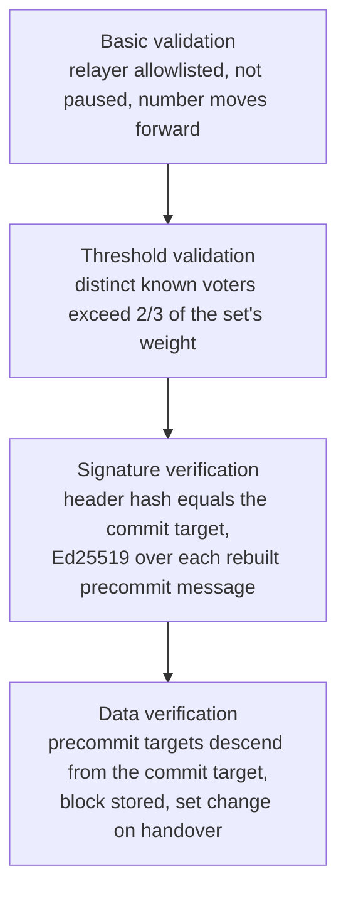

**Basic validation.** Before any signature is checked, the update must be admissible against what the client already stores.

```ruby
basic_validation(client, sender, update)
    require relayer_allowed(sender)
    require not client.paused
    require update.header.number > client.latest_number
    require update.justification.commit.target_number == update.header.number
```

Finality updates move forward, because a handover must be applied in order. That does not strand packets in older blocks: the client stores the hash of every block it accepts an update for, and a packet proof reaches an older block through the headers that link it to a stored one (6.6). Nor does the packet's block need its own justification, which a relayer may not be able to obtain for every block: a justification of any later block is enough.

**Threshold validation.** Weight is counted against the light client's **own** authority set, never one the update supplies, and before any signature is checked, so an update without enough weight is rejected before the expensive step. Each voter counts once.

```ruby
verify_threshold(client, update)
    weight := 0
    seen := {}
    for p in update.justification.commit.precommits
        require p.id in client.authorities and p.id not in seen
        seen.add(p.id)
        weight += client.authorities[p.id].weight
    total := client.total_weight
    require weight >= total - (total - 1) / 3          # more than two thirds
```

**Signature verification.** Two parts: fix *what* was signed, then check the signatures over it. Voters sign a block hash, not the header's fields, so the client recomputes the hash and requires it to equal the commit target; that binding is what later makes `state_root` and the digest trustworthy. Two inputs come from what the client already holds, `set_id` and the voters' keys; the rest arrive in the update.

```ruby
verify_signatures(client, update)
    # what was signed
    require blake2b_256(SCALE(update.header)) == update.justification.commit.target_hash
    # each voter's precommit, rebuilt from the justification
    for p in update.justification.commit.precommits
        msg := SCALE((Precommit(p.target_hash, p.target_number),
                      update.justification.round, client.set_id))
        require ed25519_verify(p.id, msg, p.signature)
```

**Data verification.** With the header trusted, the client accepts what it carries: every precommit must vote for the commit target or a descendant, the block's hash and state root are stored, and a set change in the digest is applied.

```ruby
verify_data(client, update)
    j := update.justification
    for p in j.commit.precommits
        require descends_from(p.target_hash, j.commit.target_hash, j.votes_ancestries)
    client.blocks[update.header.number] := (j.commit.target_hash, update.header.state_root)
    client.latest_number := update.header.number
    rotate(client, update)
```

**Rotation.**

```ruby
rotate(client, update)
    change := grandpa_scheduled_change(update.header.digest)   # None if absent
    if change is not None
        require change.delay == 0                                # enacted at this block
        require update.new_authorities.authorities == change.next_authorities
        client.authorities := update.new_authorities.authorities
        client.total_weight := sum(a.weight for a in client.authorities)
        client.set_id := client.set_id + 1
    require grandpa_forced_change(update.header.digest) is None  # fail closed
```

On Midnight every authority set change comes from a new session: the runtime's GRANDPA pallet schedules it with delay 0, so the block that announces the change also enacts it, and the current set finalizes that block. The only change with a delay is a **forced change**, which the runtime issues after a root call notes that finality has stalled, and which the current set does not finalize. The light client therefore follows a scheduled change with delay 0 in a finalized header, and fails closed on anything else: a scheduled change with a delay or a forced change. Recovering from those is a replacement through governance (section 9).

##### BEEFY

These are MIP-0023's validity rules 0 to 9, restated for any destination. MIP-0023 is normative where they differ.

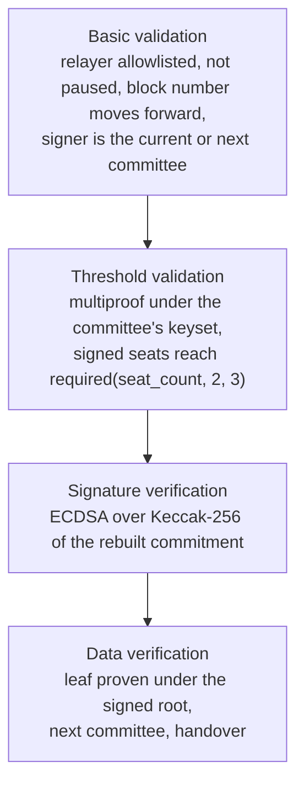

**Basic validation.** The update must be newer than what the client holds, and signed by a committee the client can already name: the current one, or the next one, which a proven leaf named earlier. It returns that committee's commitment, `S`, which the next steps count against.

```ruby
basic_validation(client, sender, update)
    require relayer_allowed(sender)
    require not client.paused
    require update.block_number > client.latest_number
    if update.validator_set_id == client.current.validator_set_id
        return client.current
    require update.validator_set_id == client.next.validator_set_id
    return client.next

S := basic_validation(client, sender, update)
```

**Threshold validation.** Seats are counted against `S`, the committee commitment the client holds, never one the update supplies. The multiproof shows the signers' leaves are in that committee; only leaves with a signature count.

```ruby
verify_threshold(client, S, update)
    require multiproof_root(update.multiproof) == S.keyset_commitment
    require len(update.signatures) == len(leaves(update.multiproof))
    seats := sum(leaf.seats for leaf, sig in zip(leaves(update.multiproof), update.signatures)
                 if sig is not empty)
    require seats >= S.seat_count - (S.seat_count - 1) / 3          # required(seat_count, 2, 3)
```

**Signature verification.** The client rebuilds the 48-byte commitment from the update's fields and never accepts signed bytes from the relayer. One input comes from what the client holds, the committee's keys, which the multiproof tied to `S.keyset_commitment`; the rest arrive in the update.

```ruby
verify_signatures(client, S, update)
    digest := keccak256(SCALE(Commitment(payload = [("mh", update.mmr_root)],
                                         block_number = update.block_number,
                                         validator_set_id = update.validator_set_id)))
    for leaf, sig in zip(leaves(update.multiproof), update.signatures) where sig is not empty
        require secp256k1_verify(leaf.key, digest, sig)               # low-S
```

**Data verification.** With the root trusted, the leaf of the signed block is proven under it, and the next committee it names drives the handover. A committee can sign only after a root signed by the one before it proved a leaf naming it, so every committee traces back to the first by induction.

The MMR gains one leaf per block from the block where it started, `mmr_first`, which need not be block 1 when BEEFY is enabled after genesis. So the leaf appended by block `n` sits at index `n - mmr_first`, and the root signed at block `n` covers `n - mmr_first + 1` leaves.

```ruby
leaf_index(client, n) = n - client.mmr_first
leaf_count(client, n) = n - client.mmr_first + 1

verify_data(client, update)
    require update.leaf.parent_number == update.block_number - 1
    require mmr_verify(update.mmr_root, keccak256(SCALE(update.leaf)),
                       index = leaf_index(client, update.block_number),
                       leaf_count = leaf_count(client, update.block_number), proof = update.mmr_proof)
    L := update.leaf.beefy_next_authority_set
    require L.validator_set_id in (client.next.validator_set_id, client.next.validator_set_id + 1)
    if update.validator_set_id == client.next.validator_set_id
        require L.validator_set_id == client.next.validator_set_id + 1
    if L.validator_set_id == client.next.validator_set_id
        require L == client.next                                      # no second committee under one id
    client.mmr_roots[update.block_number] := update.mmr_root
    client.latest_number := update.block_number
    if L.validator_set_id == client.next.validator_set_id + 1        # handover
        client.current := client.next
        client.next := L
```

`mmr_verify` follows `mmr-lib` 0.8.2 `MerkleProof::calculate_root` with the Keccak-256 merge, as MIP-0023 makes normative. MIP-0023 places the leaf of block `n` at index `n - 1`, which is `mmr_first = 1`; `mmr_first` covers a network where BEEFY started after genesis, and MIP-0023 itself lists confirming the index on the target network as a test. The first committee is the base case of the induction: the client is created from the current and next committee commitments, and `mmr_first`, at an agreed block, all recomputable by anyone from public Midnight state, as MIP-0023's bootstrap describes.

#### 6.6 Packet proof

The packet is proven under the block's state root. The two clients reach that root differently, then share the rest.

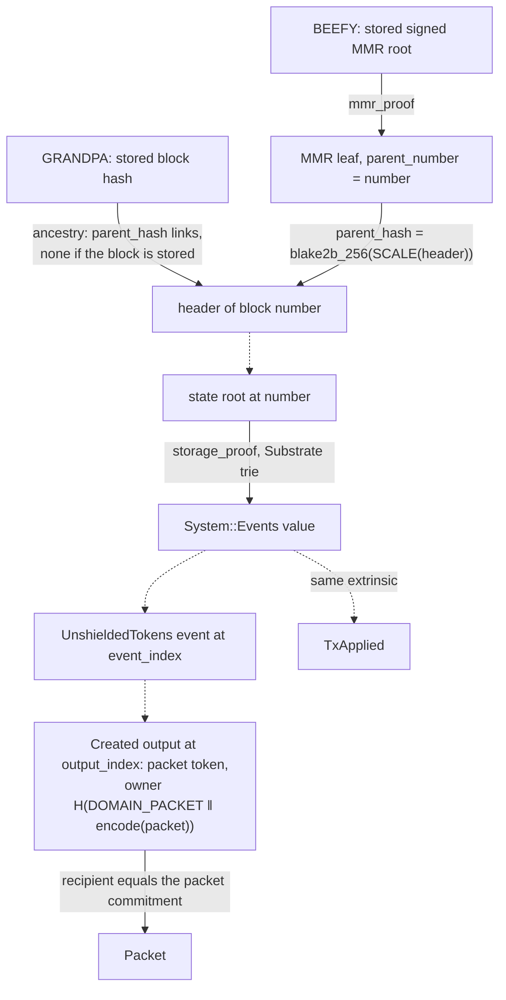

How to read this diagram: dotted edges point from a structure to a part of it; solid edges point from a root or hash to what is proven under it.

```ruby
state_root_of(client, proof)
    if client is GRANDPA
        if proof.ancestry is empty
            require proof.number in client.blocks
            return client.blocks[proof.number].state_root
        # headers from the packet's block up to a stored block, each the parent of the next
        h := proof.ancestry
        require h[0].number == proof.number
        for i in 1 .. len(h) - 1
            require h[i].parent_hash == blake2b_256(SCALE(h[i - 1]))
        top := h[len(h) - 1]
        require top.number in client.blocks
        require blake2b_256(SCALE(top)) == client.blocks[top.number].hash
        return h[0].state_root
    # BEEFY: the leaf of block number + 1 holds the hash of block number
    require proof.root_number in client.mmr_roots
    root := client.mmr_roots[proof.root_number]
    require proof.number < proof.root_number
    require proof.leaf.parent_number == proof.number
    require mmr_verify(root, keccak256(SCALE(proof.leaf)),
                       index = leaf_index(client, proof.number + 1),
                       leaf_count = leaf_count(client, proof.root_number), proof = proof.mmr_proof)
    require blake2b_256(SCALE(proof.header)) == proof.leaf.parent_hash
    return proof.header.state_root

verify_packet(client, sender, proof, application)
    require relayer_allowed(sender)
    require not client.paused
    # the packet is for this chain and this application
    require proof.packet.destination_chain == LOCAL_CHAIN_ID
    require proof.packet.destination_application == application
    root := state_root_of(client, proof)
    require substrate_trie_value(root, SYSTEM_EVENTS_KEY, proof.storage_proof) == proof.events
    require proof.runtime_version in client.layouts               # unknown layouts fail closed
    layout := client.layouts[proof.runtime_version]
    # the output_index-th output created in the event_index-th event, an UnshieldedTokens event
    output := decode_and_extract(scale(layout), proof.events,
                                 "[" ‖ proof.event_index ‖ "][" ‖ proof.output_index ‖ "]")
    require output.token_type == token_type(DOMAIN_PACKET, proof.packet.source_application)
    require output.address == H(DOMAIN_PACKET ‖ encode(proof.packet))
    # the transaction that created it fully succeeded
    require tx_applied(proof.events, layout, proof.applied_index, proof.event_index)
    # the packet's identity: its commitment, whichever block and output prove it
    return ("packet", H(DOMAIN_PACKET ‖ encode(proof.packet)), proof.packet)   # commitment_path, root, packet
```

The helpers read Substrate and the ledger as they are: `substrate_trie_value` checks a storage proof under a state root and returns the value; `SYSTEM_EVENTS_KEY` is that value's storage key, `twox_128("System") ‖ twox_128("Events")`; `layout` reads the record at `event_index` only if it is the Midnight pallet's `UnshieldedTokens` event, and its second index selects one output from that event's `created` list, with its `address`, `token_type` and `value`. `tx_applied` requires the record at `applied_index` to be the Midnight pallet's `TxApplied`, not `TxPartialSuccess`, emitted by the same extrinsic as the record at `event_index`. `token_type(d, c)` is the ledger's derivation (6.2). `LOCAL_CHAIN_ID` is the `chain_id` of the chain the light client runs on, and `application` is the one the Router delivers to (section 7). Without these last two checks a packet sent to one application could be delivered to another, or on another chain.

A GRANDPA client stores the hash of every block it accepts an update for, and a BEEFY client every signed root, and neither overwrites one, so a proof built against an older stored block stays valid after the client advances.

`verify_packet` returns the packet's `commitment_path`, `"packet"`, and its `root`, the packet commitment, so a packet has one identity however many times, and under whichever blocks, it is proven; the destination's filter chooses the `target_field` within the packet, read with the `packet` encoding (3.4). Two packets differ in their nonce, so they are two messages. Event layouts change with runtime upgrades: a destination rejects unknown runtime versions and adds layouts only after `GOVERNANCE_DELAY`.

### 7. Routers

On a destination with contract calls and caller identity, a Router runs **Prove** and **Deliver** for one application, in one transaction where the chain allows it; on a chain whose transactions are too small for a whole proof, the proof is recorded in earlier transactions and Deliver checks that record, as the Solana companion MIP does. There the light client also reads the leaf (3.4): its `verify_and_extract` verifies the leaf, or finds it in its verified-leaf cache, then decodes it with the descriptor the Router passes and returns the element. On Midnight the light client's `verify_message` (4.4) only records the leaf, and the application reads it, pulled through `consume` or pushed by the Router of 5.6.

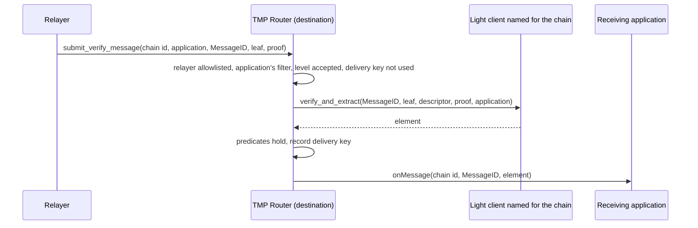

```ruby
submit_verify_message(router, sender, chain_id, application, id, leaf, proof)
    require sender in router.relayers
    light_client := router.light_clients[router.clients[chain_id]]   # the client registry (4.7)
    filter := router.filters[application, chain_id]          # registered by the application, never from the relayer
    require light_client.settlement_level in filter.accepted_levels   # the levels the application opted in to
    require target_field_is_instance(filter.extract_pattern, id.target_field)
    key := delivery_key(application, chain_id, id)
    require key not in router.delivered
    element := light_client.verify_and_extract(id, leaf, filter.descriptor, proof, application)
    require predicates_hold(filter, element)
    router.delivered.add(key)
    application.onMessage(chain_id, id, element)             # a failure reverts all of the above
```

A light client of Midnight implements `verify_and_extract` with `verify_packet` (6.6): the packet proof travels in `proof`, the Router passes `application`, the client requires the submitted `id` to carry the `commitment_path` and `root` that `verify_packet` returns, and the element returned is the packet, read with the event layout of its runtime version. `onMessage` is the destination application's callback on that chain. Companion MIPs write these operations in their chain's conventions, for example `submitVerifyMessage` in Solidity.

One submission delivers to one application, so a failing application blocks only its own deliveries. A callback failure reverts the submission, including the delivery mark, so the message stays undelivered and can be submitted again (MPS Goal 3).

### 8. Invariants

A conforming implementation satisfies all of the following.

- **INV-1 (verified before use).** An application acts on an element only if its `leaf_key` is recorded by the light client that the client registry names for its source chain (4.7).
- **INV-2 (at most once).** For each `delivery_key`, an application acts at most once.
- **INV-3 (application's filter only).** The element acted on is extracted with the application's own descriptor, at a `target_field` that is an instance of its extract pattern, and satisfies its predicates.
- **INV-4 (checkpoint lineage).** Every checkpoint other than the first was proven from an earlier stored checkpoint, or, on a client with governed checkpoints, added by a Security Admin change after `GOVERNANCE_DELAY`.
- **INV-5 (settlement floor).** No leaf is recorded from a block below the light client's declared settlement level.
- **INV-6 (permanence).** Checkpoints and delivery keys are never pruned. Recorded leaves are a cache; losing one costs a new proof, never a second delivery.
- **INV-7 (relayer gate).** Only an allowlisted relayer can record a leaf or add a checkpoint by a consensus update.
- **INV-8 (pause safety).** A pause blocks only consensus updates and message proofs, including packet proofs on a light client of Midnight; it never blocks consuming or delivering a leaf already recorded.
- **INV-9 (packet binding).** A destination accepts a Midnight packet only if an output of the sender's packet token, owned by the packet commitment, was created by a transaction of a finalized Midnight block that fully succeeded.

### 9. Governance and pause

- The Security Admin is the threshold of members of 4.3, never one key; each member can pause once per `admin_epoch`; on other chains it is that chain's multisig or governance contract.
- Every change it makes takes effect no earlier than `GOVERNANCE_DELAY` after it is proposed, and is public in that time: a new or replaced light client, a chain pointed at another light client, a checkpoint added to a client with governed checkpoints, a verifier upgrade, a relayer or member change, a new event layout. Only pausing and unpausing take effect without the delay: any one member can pause, and unpausing needs the threshold.
- Each kind of change has its own mechanism. On Midnight, relayer, member, threshold, checkpoint and unpause changes go through `propose`, `approve` and `apply` (4.4); a new light client is a new contract created from an agreed checkpoint, and a chain is pointed at it by `setClient` on a Router, or through the application's upgrade rules in the Embedded and Shared profiles (4.7); a verifier key is replaced as the verification capabilities MIP specifies. On other chains, registering a light client, upgrading a verifier and adding an event layout are admin calls on the Router or the light client, behind a timelock of at least `GOVERNANCE_DELAY`, as each companion MIP specifies.
- A pause stops consensus updates and message proofs on one light client (INV-8). Leaves already recorded can still be consumed or delivered. Anything that needs a new proof waits until the client is unpaused or replaced, including an application's refund that travels as a message. The Security Admin pauses at once when monitoring detects an exploit, an invalid state transition, conflicting finality on the source chain, or a compromised relayer; relayers likewise stop submitting on any disagreement between their data sources. Detecting and punishing validators who sign conflicting blocks is the source chain's job, not the light client's.
- Replacing a light client, after a consensus upgrade on the source chain or after a pause it cannot safely lift, creates a new light client for the same `chain_id` from an agreed checkpoint and points the chain at it in the client registry (4.7). Delivery keys use the `chain_id`, so INV-2 holds across the change; a leaf recorded only by the old light client is proven again to the new one.

### 10. Versioning

- This specification is versioned by its MIP number and revision history. Substantive changes after acceptance require a new MIP that lists this one in `Replaces`.
- `Packet.version` and the light client's `spec_version` carry `SPEC_VERSION`. Readers reject versions they do not support.
- Domain tags carry their own version (`:v1`), so a new version cannot collide with old keys.

### 11. Scope

**In scope:** message identity and encodings, the light client interface, delivery and replay rules on Midnight and on Routers elsewhere, the packet commitment, the light client of Midnight, relaying permissions, governance and pause.

**Out of scope:**

- Each source chain's verification: its companion MIP (4.6).
- How Midnight contracts verify proofs that include pairings: the verification capabilities MIP. Expected content: supported external verifier keys with a documented public-input layout and size limits, and a way to verify BLS12-381 pairings (an in-circuit gadget or a validator-run operation).
- Asset transfer rules: MPS Recommended MIP 6. Section 12 is an informative outline.
- Relayer fees, and the DUST (the resource Midnight transactions pay fees in) for delivery transactions.
- Relayer architecture.

| Capability needed from Midnight                                           | Needed for                                                       | Status                   |
| ------------------------------------------------------------------------- | ---------------------------------------------------------------- | ------------------------ |
| Verifier keys from circuits not compiled from Compact, and pairing checks | Light clients on Midnight for chains finalized by BLS signatures | Verification capabilities MIP   |
| Cross-contract calls and `kernel.caller()` on mainnet                     | The Shared and Router profiles (5.5, 5.6)                        | Ledger 9, live since November 2026 |
| BEEFY signing on mainnet                                                  | BEEFY light clients of Midnight (6.1)                            | Required by MIP-0023     |
| Provable contract messages                                                | Replacing the packet commitment (6.2)                            | MPS Recommended MIP 4    |

### 12. Example: asset transfer (informative)

The same three phases, with the way back sent as a second message.

- **Send.** On the source chain the user locks tokens in an escrow, which sends `Locked(origin_token, amount, claim_commitment, nonce)` as a message. `claim_commitment` is `H(secret)`, so the Midnight recipient is not revealed on the source chain.
- **Prove.** A relayer proves the message to the source chain's light client on Midnight.
- **Deliver.** The user consumes the message by proving knowledge of `secret`, and the application mints the same amount, shielded if the user wants, of a token type fixed per origin token.
- **Back.** The application burns on Midnight and sends a `Packet`; a relayer proves it to the light client of Midnight on the source chain, and the escrow releases.

```ruby
claim(app, filter, chain_id, id, target_field, leaf, secret)
    element := consume(app, filter, chain_id, id, target_field, leaf)   # INV-1 to INV-3
    locked  := decode(Locked, element)
    require H(secret) == locked.claim_commitment
    mint_shielded(token_type(H(chain_id ‖ locked.origin_token), app.address),
                  locked.amount)
```

As long as every recorded lock is real, supply on Midnight never exceeds what the escrow holds: every mint needs a recorded, unconsumed lock, and every release a recorded, unconsumed burn.

## Rationale

### Why separate light clients from messaging?

So a chain can be added, or its verification replaced, without touching applications (MPS Goal 2). A consensus upgrade on a source chain, a light client of Midnight moving from GRANDPA to BEEFY, or a cheaper proof system each change one light client. The interface of section 4 is deliberately small: a light client attests raw bytes under a root and declares a settlement level.

### Why a companion MIP per chain?

What a chain commits, how it rotates validators and when its blocks are settled differ per chain, and change on that chain's schedule. A companion MIP per chain lets each be added, revised or withdrawn without reopening this one.

### Why native encodings?

Re-encoding would need a trusted party or extra code on the source chain. A message is whatever the source chain already commits, and the descriptor says how to read it. A new encoding is a decoder, not a protocol change.

### Why application-owned filters?

If a relayer chose how to read proven bytes, it could point at a different element of a genuinely included leaf and pass verification. Fixing the filter to the application closes that; on Midnight it holds by construction because the filter is compiled into the application.

### Why pull delivery first on Midnight?

Before ledger 9 a Midnight contract could not learn who called it (MPS-0040), so a push from a Router could not be told apart from a push from anyone. In the pull model the application checks a fact (the leaf is recorded) rather than trusting a caller, so it needs no caller identity at all. A failed consumption reverts and can be retried, which gives recovery without extra state. Ledger 9's `kernel.caller()` lets an application authenticate its Router, so the Router profile adds push delivery without changing the light clients, keys or filters (5.6).

### Why revert failed callbacks?

Marking a failed callback delivered loses the message, which MPS Goal 3 forbids. Because one submission names one application, a reverting application blocks only its own messages. A Router could instead catch a failed callback, mark the message delivered and move on; this MIP requires the revert, so that no message is lost.

### Why permissioned relaying?

Light clients keep every checkpoint forever, so a **long-range fork**, an alternative history signed with the old keys of validators who have since left the set, would pass the cryptographic check. A relayer allowlist is TMP's defence against this, and it also means a verifier bug alone cannot deliver a forged message: an attacker needs a broken verifier *and* an allowlisted relayer. MPS Goal 4 asks that no single relayer can stall or censor a message; at least two independent, replaceable relayers per route meets that. Letting anyone relay would instead require a **trusting period**, a time after which a light client that has not been updated expires, which breaks any-age verification.

### Why secret-based authorization?

A Compact operation has no reliable caller identity for a top-level call (MPS-0029), and `ownPublicKey()` is a witness value a caller can choose. Proving knowledge of a secret whose hash is stored is the pattern Midnight standards use for authority (MIP-0007).

### Why a token mint as the packet commitment?

It is the only contract-controlled fact committed in consensus state today: only the issuing contract can mint its token type, and the output it creates appears in `System::Events`, which is in the state trie. No one holds a key for an address equal to a packet commitment, so the output is never spent, and every output of a packet token type is a mint by its contract. It is a stopgap until contract messages are provable, and the descriptor model lets it be replaced without changing the messaging rules.

### Why stop on delayed or forced set changes?

Every ordinary handover on Midnight is a scheduled change with delay 0, announced and enacted in one block the current set finalizes, so following it adds no trust (6.5). A change with a delay comes only as a forced change, after finality has stalled, and installs a set the current set did not finalize; following it would add trust the light client cannot check. Stopping and replacing the client through a public, delayed governance action keeps every accepted root traceable to a finalized header.

### Alternatives considered

| Alternative | Why not |
|---|---|
| A bridge committee or multisig posting source-chain roots on Midnight | Adds a trusted party for every chain (MPS Goal 1) |
| A runtime pallet verifying source chains in the node | Contracts cannot read runtime state, and no transaction kind carries the result to a contract |
| Optimistic roots with challenges resolved on Midnight | Midnight cannot judge the dispute without the same verification this MIP needs |
| Permissionless relaying with a trusting period | Breaks any-age verification and removes the defence against verifier bugs |

### Goal satisfaction

- **Goal 1. The most trust-minimized verification.** A light client checks the source chain's own consensus, the most trust-minimized way to verify a message, and at `FINALIZED` and `SETTLED` every leaf it records traces to that consensus (INV-1, INV-4, INV-5). The remaining assumptions, including the initial checkpoint, are listed in Security Considerations.
- **Goal 2. Messaging separate from chain verification.** Messaging (sections 3, 5, 7) depends only on the interface of section 4; each chain is a companion MIP, and messages keep their native encoding.
- **Goal 3. At most once, always retryable.** INV-2; a failed consume or callback reverts, records nothing, and can be retried (5.3, 5.6, section 7). Side effects and refunds belong to the application (section 12).
- **Goal 4. No single point of control over delivery.** `MIN_RELAYERS_PER_ROUTE`, consumption open to anyone, and relayers approved and replaced by the Security Admin (4.4, section 9). Met in part: how relayers are paid is left to a separate MIP (Open questions).
- **Goal 5. Messages out of Midnight with the same guarantees.** Section 6, building on light clients of Midnight (MPS-0048): packets are proven from Midnight's consensus, delivered once per `delivery_key`, and relayed under the same allowlist.
- **Goal 6. Usable by any contract.** Any contract can consume within the interface of section 5, and send through section 6.
- **Goal 7. Stated cost and latency.** Each light client declares its settlement level; each companion MIP states its latency. Costs are published with the reference implementation, and state growth is bounded as in Security Considerations.
- **Goal 8. Controlled upgrades.** Section 9: a threshold of members, every change public and delayed, and a pause that never blocks consuming recorded leaves (INV-8).
- **Goal 9. Supply always backed.** Enforced by the asset-transfer rules on top (section 12 outlines them; MPS Recommended MIP 6 specifies them), using INV-1 to INV-3.
- **Goal 10. Receiving reveals no more than the application chooses.** Consuming a verified message needs no identity (5.3), and the source chain can name the recipient only by a commitment: in section 12 the recipient takes the message by proving the secret behind `claim_commitment`.

### Open questions

- Which form the pairing capability takes (an in-circuit gadget behind external verifier keys, or a validator-run operation), and its cost in the ledger's cost model.
- How relayer fees and the DUST for delivery transactions are paid.
- Which commitment to the next BEEFY committee is canonical: on node 1.0.x the MMR leaf's `beefy_next_authority_set` is built over keys only, while the signed payload's next set is over keys and stakes. 6.5 follows MIP-0023.

## Path to Active

### Acceptance Criteria

1. The verification capabilities MIP is Active.
2. At least one source-chain companion MIP is Active, with its light client on Midnight mainnet recording messages at its declared settlement level with no trusted party.
3. A light client of Midnight is live on at least one other chain, accepting packets as in 6.6.
4. Each live route has at least `MIN_RELAYERS_PER_ROUTE` independent relayers.
5. The test vectors below pass against every implementation.
6. Security reviews of every light client, circuit and Router, with all findings closed.

### Implementation Plan

Every step is rehearsed on Midnight preprod and the destination's testnet first, in the same order.

1. **Midnight as a source.** Deploy a light client of Midnight and a Router on the first destination, created from an agreed authority set; start the relayers.
2. **Generate the proving artifacts** for each light client on Midnight, under the verification capabilities MIP's verifier-key format, and publish the keys.
3. **Midnight as a destination,** in the Embedded, Shared or Router profile, on devnet, then preprod, once the verification capabilities MIP is available there.
4. **Mainnet,** once the verification capabilities MIP is Active and audits are closed.
5. **Hand over control.** The Security Admin becomes the agreed members and threshold, and relayer allowlists go to the named operators. Before handover, check on-chain that every role is held by exactly the intended accounts.
6. Later: **BEEFY light clients of Midnight** once MIP-0023 is on mainnet.

## Backwards Compatibility Assessment

This MIP adds contracts and off-chain components. On its own it needs no hard fork and changes no existing contract, transaction format or wallet. The capabilities it depends on arrive through their own MIPs and releases.

| Existing piece | Interaction |
|---|---|
| Cardano route for NIGHT, MPS-0033, MIP-0023 | Unchanged. TMP is a separate route; once MIP-0023 makes BEEFY sign, light clients of Midnight can use it |
| MIP-0002 contract events | Not used for proofs, since events are not consensus state. Usable once they become provable |
| MIP-0008 network identifiers | Used for Midnight's `chain_id` |
| MIP-0011, MIP-0012, MIP-0014 tokens | Applications on TMP mint and hold value with these, unchanged |
| Runtime upgrades of Midnight | Change `System::Events` layouts; destinations reject unknown versions until a new layout passes `GOVERNANCE_DELAY` |

## Security Considerations

Every party TMP relies on, what it is trusted for, and what it could do if compromised. Each companion MIP adds the parties specific to its chain.

| Party | Trusted for | If compromised | Bounded by |
|---|---|---|---|
| Source chain validators, above the finality threshold | the finality of the blocks they sign | can sign a false block, and the light client accepts it | the source chain's own security and slashing; monitoring detects conflicting finality and the Security Admin pauses the client (section 9) |
| Initial checkpoint | the first signer set a light client trusts; every later checkpoint descends from it (INV-4) | a wrong set lets its members sign any block | it is taken from the source chain's public data at an agreed block, and no application or Router uses a new light client until `GOVERNANCE_DELAY` has passed (section 9), so anyone can recompute it first |
| Light client code, proof circuits and any trusted setup | correct verification | a soundness bug lets a forged update or message pass | the relayer allowlist: a forgery still needs an allowlisted relayer to submit it |
| Midnight's verifier for external proofs (verification capabilities MIP) | checking light client proofs on Midnight | a flaw accepts a false proof | the same allowlist; audits of the verification capabilities MIP |
| Relayers | liveness, and following the source chain's canonical fork | can delay or omit messages; with the keys of validators who have since left the set, could submit a long-range fork that the light client accepts, since its signatures are genuine | the allowlist; each relayer checks finality against its own node, independent endpoints and its peers, and halts on any disagreement; any other allowlisted relayer can take over |
| Relayer allowlist holder (the Security Admin) | admission | can block relayers or admit new ones, but cannot forge alone | a forgery also needs a verification flaw; changes wait `GOVERNANCE_DELAY` |
| Security Admin, at its threshold | light client creation and replacement, verifier upgrades, event layouts, relayers and members | can install a light client, checkpoint or layout that accepts a forged message | the threshold of members; `GOVERNANCE_DELAY`: every such change is public before it takes effect, and monitoring alerts on it |
| One Security Admin member | pausing | can pause a light client, delaying new proofs | cannot change anything else alone; pauses once per admin epoch; unpausing needs the threshold |

So a forged message needs one of four things: the source chain's finality threshold of stake; the old keys of a past finality threshold *and* an allowlisted relayer (a long-range fork); a verification flaw *and* an allowlisted relayer; or a Security Admin change, including a wrong initial checkpoint, a wrong governed checkpoint or a chain pointed at a wrong light client, which needs the threshold and is public and delayed. Checking the source chain's consensus adds no party that can forge on its own.

Further points:

- **Replay.** `delivery_key` per application (INV-2); relayer proofs are bound to their operation (5.2).
- **Off-target elements.** The filter is fixed by the application (INV-3).
- **Pause.** Never blocks consuming or delivering a recorded leaf (INV-8); new proofs, including refunds sent as messages, wait for an unpause.
- **State growth.** Checkpoints and delivery keys are kept forever (INV-6): pruning a checkpoint would break any-age verification, and pruning a delivery key would reopen replay. Recorded leaves are kept too, though they are a cache that could be pruned (4.3). Each delivered message adds two 32-byte keys, a leaf key in the light client and a delivery key in the application or its Router, and each consensus update one 32-byte checkpoint. Only allowlisted relayers add checkpoints and leaves, and a delivery key is added only for a recorded leaf, so growth is bounded by relayer submissions, each paid for by the transaction that writes it. Each Midnight packet also leaves one unspendable packet-token output and its `outbox` entry (6.2), paid for by the sending application.
- **Destination binding.** A Midnight packet is delivered only on the chain and to the application it names (6.6).
- **`ownPublicKey()`.** Forbidden for authorization (5.2).
- **Router on Midnight.** Delivers only leaves its registered light client recorded; an application accepts `on_message` only from its own Router, through `kernel.caller()` (5.6).
- **Fail closed.** Unknown event layouts and delayed or forced GRANDPA set changes are rejected rather than accepted unverified; conflicting finality on a source chain leads to a pause (section 9).

## Implementation

No change to the Midnight node, ledger or Compact is made by this MIP; those come from the MIPs listed in section 11.

| Component | Where |
|---|---|
| Light client contract per source chain (5.1) | Midnight, Compact |
| `consume` and `delivered` (5.3) | Midnight, Compact, in each receiving application |
| Router, `deliver` and `on_message` (5.6) | Midnight, Compact, one Router per deployment and `on_message` in each receiving application, from ledger 9 |
| `send_packet`, `nextNonce` and `outbox` (6.2) | Midnight, Compact, in each sending application |
| Light clients of Midnight and Routers (sections 6, 7) | Each destination chain, as its companion MIP specifies |
| Relayers, provers, monitoring | Off-chain |

A reference implementation of the Compact interfaces will be published with this MIP.

## Testing

### Light client contract (Compact)

- `updateConsensusState` and `verifyMessage` reject: a paused client, an unknown relayer secret, an unknown anchor index, an anchor whose stored value differs, a new index not above the newest stored index.
- A pause blocks `verifyMessage` but not `consume`.
- Governance: one member can pause, and a second pause by the same member in one `admin_epoch` is rejected; `apply` rejects a change below the threshold, before its delay, or proposed under an earlier `admin_epoch`; the same change can be proposed again after an `admin_epoch` change; a change that would leave the threshold at 0 or above the number of members reverts; an unpause applies without the delay once at the threshold.
- Governed checkpoints: `propose` rejects `addCheckpoint` on a client without them; `updateConsensusState` fails on a client with them; after `addCheckpoint` applies, `verifyMessage` rejects every older anchor.

### Applications (Compact)

- `consume` rejects: an unrecorded leaf, leaf bytes that do not hash to the recorded digest, a `target_field` outside the pattern or not hashing to `id.targetField`, a failing predicate, a repeated delivery key, a leaf recorded only by a light client other than the one the application's registry names for the chain, a leaf above `MAX_LEAF`.
- `leaf_key`, `delivery_key` and the packet commitment match the test vectors byte for byte.

### Router on Midnight (Compact, ledger 9)

- `deliver` rejects: a leaf above `MAX_LEAF`, a chain with no registered light client, a leaf not recorded under `padded_digest` by the light client the registry names for its chain, a repeated delivery key, a message delivered before the chain's light client was replaced.
- `on_message` rejects: a call from any contract other than its Router, a direct user call, a chain or settlement level the application did not accept, a `target_field` outside the pattern or not hashing to `id.targetField`, a failing predicate, a message in the application's own `delivered` set from before it moved to the Router.
- A failing `on_message` reverts `deliver`, and the message can be delivered later.
- A paused light client still lets `deliver` and `consume` take leaves it recorded.
- `setClient` waits `GOVERNANCE_DELAY`; after it, a leaf recorded only by the old light client is rejected until proven to the new one, and a message delivered before is not delivered again.

### Light client of Midnight

- Accepts real justifications at two consecutive authority set handovers.
- Rejects: weight at or below two thirds, an unknown voter, a duplicate voter, a wrong set id or round, a precommit target that does not descend from the commit target, a header that does not hash to the commit target, a delayed or forced set change.
- BEEFY client: accepts a handover chain of signed commitments and leaves across at least two sessions; rejects a signer committee other than current or next, a multiproof under another keyset, signed seats below `required(seat_count, 2, 3)`, a signature over another commitment, a leaf whose `parent_number` is not `block_number - 1`, an MMR proof at the wrong index, a skipped committee.
- GRANDPA packet path: accepts a packet in a block older than the newest stored block through its ancestry; rejects an ancestry with a broken `parent_hash` link or one that does not end at a stored block hash.
- BEEFY packet path: rejects a leaf whose `parent_number` is not the packet's block, a header that does not hash to `parent_hash`, a root number not after the block; accepts proofs on a network whose `mmr_first` is not 1.
- A Router on another chain rejects a submitted `id` whose `commitment_path` or `root` differs from what `verify_packet` returns, and the same packet proven twice, under two blocks or two outputs, is delivered once.
- `verify_packet` rejects: an unknown runtime version, a storage proof for another key, an output of another contract's token, an owner that is not the packet commitment, a packet whose transaction failed or only partly succeeded, an applied record of another extrinsic, a packet for another chain or another application, a relayer not on the allowlist.

### Integration

- End to end on Midnight devnet and preprod for each direction of each companion MIP, including a retry after a failed consume and after a reverted Router callback.

### Test vectors

To be published with this MIP:

- `leaf_key`, `delivery_key` and packet commitments for sample inputs.
- Encoding descriptor vectors: leaf, descriptor, `target_field`, expected element or expected rejection, for every supported encoding including `scale`.
- Midnight GRANDPA justifications at two consecutive authority set handovers, with ancestor headers and `System::Events` storage proofs, from mainnet.
- BEEFY signed commitments, MMR leaves and proofs, and key multiproofs across a handover, from a BEEFY-signing Midnight network, until mainnet signs BEEFY.

## References

1. MPS-XXXX: Trustless Cross-Chain Messaging
2. MIP-XXXX: TMP Light Clients for Robinhood Chain (companion)
3. MIP-XXXX: TMP Routes for Solana (companion)
4. MIP-0002: Public Contract Log Emission for Compact Smart Contracts
5. MIP-0007: Midnight Name Service, Canonical Registry and Resolver Standard
6. MIP-0008: CAIP-2 Network Identifiers for Midnight
7. MIP-0023: Committee Bridge Consensus Integration
8. MIP-0011: Native Shielded Token Standard; MIP-0012: Contract Custody of Midnight-Native Assets; MIP-0014: Native Unshielded Token Standard
9. MPS-0029: Caller Identity Access in Compact Circuits
10. MPS-0033: mNIGHT to cNIGHT
11. MPS-0040: Cross-Contract Call Provenance in Compact Circuits
12. MPS-0048: Enabling Light Clients on Midnight
13. RFC 2119: Key words for use in RFCs to Indicate Requirement Levels: https://www.rfc-editor.org/rfc/rfc2119
14. Parity SCALE codec: https://docs.polkadot.com/polkadot-protocol/parachain-basics/data-encoding/
15. Substrate GRANDPA finality (`sp-consensus-grandpa`, `finality-grandpa`): https://github.com/paritytech/polkadot-sdk

## Acknowledgements

TBD.

## Copyright Waiver

All contributions (code and text) submitted in this MIP must be licensed under the Apache License, Version 2.0. Submission requires agreement to the Midnight Foundation Contributor License Agreement, which includes the assignment of copyright for your contributions to the Foundation.
